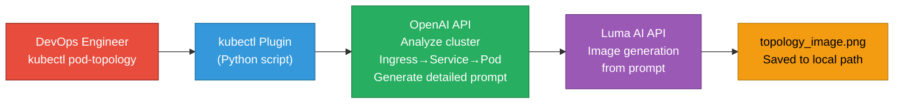
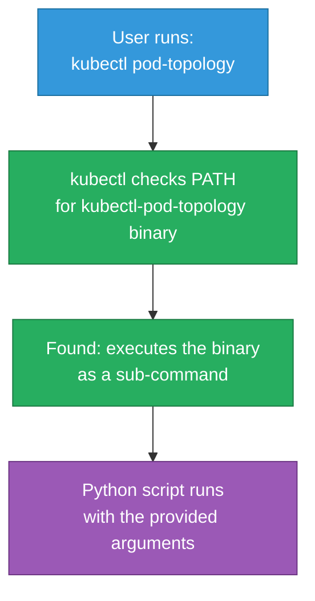
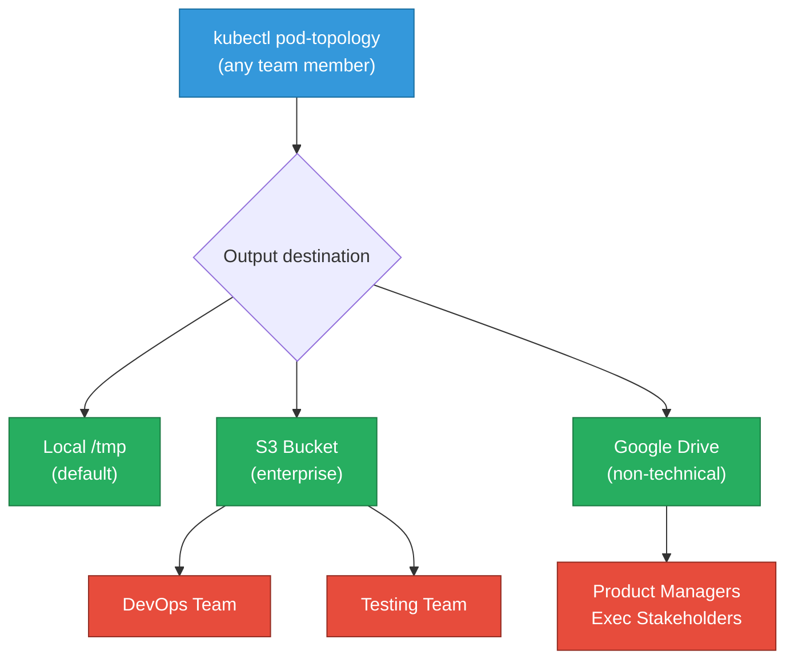

# Bonus 1: kubectl Pod Topology AI Plugin

<details open>
<summary><b>Bonus 1: kubectl Pod Topology AI Plugin (CS46H)</b></summary>

## Table of Contents

- [Overview](#overview)
- [Why Visualize Kubernetes Traffic Flow?](#why-visualize-kubernetes-traffic-flow)
- [Architecture: Two-API Design](#architecture-two-api-design)
- [kubectl Plugin Mechanics](#kubectl-plugin-mechanics)
- [Python Script Walkthrough](#python-script-walkthrough)
- [Installation and Configuration](#installation-and-configuration)
- [Live Demo](#live-demo)
- [Extensions and Enterprise Use Cases](#extensions-and-enterprise-use-cases)
- [Summary](#summary)

---

## Overview

This project builds a **kubectl plugin** that generates a visual topology image of Kubernetes traffic flow for any pod — showing the path from internet → ingress → service → pod, including TLS status and pod health (running/CrashLoopBackOff). The image is generated by combining OpenAI (relationship analysis + prompt generation) with Luma AI (image generation), called from a Python script installed as a `kubectl` sub-command.

---

## Why Visualize Kubernetes Traffic Flow?

```diff
+ Problem: kubectl CLI gives text output — no way to visually trace traffic flow to a pod
+ Problem: Developers and testers struggle to understand ingress → service → pod routing
+ Problem: Pod status flags (CrashLoopBackOff, Running) are buried in text output
! Standard kubectl does not support image/diagram generation natively
+ Solution: kubectl plugin + OpenAI (analysis) + Luma AI (image) = one-command topology image
```

**Use Cases:**
| Audience | How They Use It |
|----------|----------------|
| Developers | Understand routing for their application's pods |
| Testers | Visualize which pod receives traffic during testing |
| Incident Response | Instantly see routing state + pod health during an outage |
| Onboarding | New engineers understand cluster topology without kubectl expertise |

> [!IMPORTANT]
> The key insight: this is AI used as a Kubernetes observability enhancement — not for code generation. kubectl plugins written in any language (Python, Go, Bash) are recognized by kubectl automatically when placed in PATH with the `kubectl-` prefix.

---

## Architecture: Two-API Design

Two AI models are used because each excels at a different task:



**Why Two Models?**

| Capability | OpenAI | Luma AI |
|-----------|--------|---------|
| Cluster analysis | ✅ Excellent | ❌ Not designed for this |
| Text → structured relationship | ✅ Excellent | ❌ Not applicable |
| Image generation from text prompt | ⚠️ Limited, expensive | ✅ Purpose-built, cost-effective |
| Use in this project | Step 1: analyze + prompt | Step 2: generate image |

> [!NOTE]
> OpenAI can generate images (DALL-E), but it is expensive for image generation and less reliable for technical diagrams compared to Luma AI. Luma AI (platform.lumalabs.ai) is purpose-built for high-quality image generation from text prompts.

---

## kubectl Plugin Mechanics

**How kubectl discovers plugins:**

```bash
# kubectl recognizes any executable in PATH with the "kubectl-" prefix as a plugin
# Example: a file named "kubectl-pod-topology" → runs as "kubectl pod-topology"

# Installation steps (install.sh does this automatically):
# 1. Bundle the Python script as an executable package
# 2. Place the executable in a directory that is in $PATH
# 3. kubectl now treats it as a built-in sub-command
```



**Input Parameters:**

| Parameter | Description | Example |
|-----------|-------------|---------|
| `pod-name` | Name of the target pod | `nginx-topology-abc123` |
| `namespace` | Kubernetes namespace | `default` |
| `output-path` | Local directory to save the image | `/tmp/topology/` or `~/Downloads/` |

---

## Python Script Walkthrough

The plugin is a single Python file (`kubectl-pod-topology`) with four key functions:

```python
# main() — entry point
# 1. Accepts 3 CLI parameters: pod name, namespace, output path
# 2. Validates the OpenAI API key (from .env.local)
# 3. Calls gather_cluster_resources() → analyze_traffic_flow()
# 4. Calls generate_topology_image() with the resulting prompt
# 5. Saves image to the specified output path
```

**Function 1: Gather cluster resources**
```python
# Queries the Kubernetes cluster for:
# - Pod details (name, namespace, labels, status)
# - Services associated with the pod (selector matching)
# - Ingress resources routing to the service
# Assembles: Ingress → Service → Pod relationship map
```

**Function 2: Analyze traffic flow (OpenAI call)**
```python
# System prompt to OpenAI:
# "Analyze this Kubernetes resource topology:
#  - Ingress: [name, rules, TLS config]
#  - Service: [name, type, port]
#  - Pod: [name, status, namespace]
#  Create a detailed image generation prompt that visually describes
#  the traffic flow from internet to pod, including status indicators."

# OpenAI returns: a rich text prompt describing the desired image
```

**Function 3: Generate topology image (Luma AI call)**
```python
# Sends the OpenAI-generated prompt to Luma AI image generation API
# Luma AI returns: image URL or binary
# Script downloads and saves to the specified output path
```

**Example `.env.local` configuration:**
```bash
OPENAI_API_KEY=sk-your-openai-key-here
LUMA_API_KEY=your-luma-api-key-here
```

> [!IMPORTANT]
> Never commit `.env.local` to source control. The `.gitignore` should exclude it. Rotate both API keys immediately if they are accidentally exposed.

---

## Installation and Configuration

**Prerequisites:**
- Python 3.x installed
- `kubectl` configured and connected to a cluster
- OpenAI API key (platform.openai.com)
- Luma AI API key (platform.lumalabs.ai → API section)

**Step-by-Step Setup:**

```bash
# 1. Clone the repository
git clone https://github.com/abhishekveeramalla/kubectl-pod-topology
cd kubectl-pod-topology

# 2. Configure API keys
cp .env.local.example .env.local
# Edit .env.local — add your OPENAI_API_KEY and LUMA_API_KEY

# 3. Install the plugin (adds to PATH automatically)
chmod +x install.sh
./install.sh

# 4. Verify kubectl recognizes the plugin
kubectl plugin list
# Should show: kubectl-pod-topology

# 5. Deploy a test workload (example from the demo)
kubectl apply -f nginx-topology.yaml  # creates Deployment + Service + Ingress
```

**Getting a Luma AI API Key:**
1. Go to `platform.lumalabs.ai`
2. Navigate to the **API** section
3. Create a new API key
4. Optional: Try the playground to verify image generation before using in the plugin

---

## Live Demo

**Demo setup:**
```yaml
# nginx-topology.yaml — deploys 3 resources:
# 1. Deployment (nginx pod)
# 2. Service (ClusterIP)
# 3. Ingress (HTTP, no TLS)
```

**Demo commands:**
```bash
# Verify cluster resources are running
kubectl get namespace
kubectl get pods               # → nginx-topology-<hash> Running
kubectl get svc                # → nginx-topology-service
kubectl get ing                # → nginx-topology-ingress

# Run the AI topology plugin
kubectl pod-topology nginx-topology-<pod-hash> default /tmp/topology/

# Output in terminal:
# "Analyzing traffic flow..."
# "name of the pod: nginx-topology-<hash>"
# "name of the service: nginx-topology-service"
# "Waiting for Luma to render the image..."
# [~30 seconds later]
# "Image saved to /tmp/topology/topology_image.png"
```

**Generated Image — What it Shows:**

```diff
+ Internet → Ingress (nginx-topology-ingress)
+   └── Status: HTTP (no TLS — shown explicitly)
+ Ingress → Service (nginx-topology-service)
+   └── Port mapping: 80 → Pod:80
+ Service → Pod (nginx-topology-<hash>)
+   └── Status: Running (green icon ✅)
! If pod were in CrashLoopBackOff: red icon ❌ on pod
```

**Status Icon Legend:**

| Pod State | Icon Color | Description |
|-----------|-----------|-------------|
| Running | 🟢 Green | Pod is healthy |
| CrashLoopBackOff | 🔴 Red | Pod is repeatedly crashing |
| Pending | 🟡 Yellow | Pod is waiting for scheduling |
| Unknown | ⚪ Gray | kubelet cannot report status |

---

## Extensions and Enterprise Use Cases

**Near-term extensions (mentioned in episode):**
- Save image to **S3 bucket** instead of local path — shareable across the organization
- Save image to **Google Drive** — accessible to non-technical stakeholders
- Pass **Gateway API** resources instead of classic Ingress

**Enterprise deployment patterns:**



**Other AI kubectl plugin ideas** (same pattern, different AI models):
- `kubectl cost-estimate <deployment>` — AI predicts monthly cloud cost from resource requests
- `kubectl explain-crash <pod>` — AI reads pod logs + events, explains crash in plain English
- `kubectl review-yaml <file>` — AI reviews a YAML manifest for security and best-practice issues

---

## Summary

```diff
+ Key Achievement: AI-powered kubectl plugin generates visual Kubernetes topology images
+ Two-model architecture: OpenAI (analysis + prompt) + Luma AI (image generation)
+ kubectl plugin pattern: any executable in PATH with "kubectl-" prefix = recognized sub-command
+ Input: pod name + namespace + output path
+ Output: PNG image showing internet → ingress → service → pod flow with status icons
! Requires both API keys: OPENAI_API_KEY and LUMA_API_KEY in .env.local
- Current limitation: output path must be local; S3/Drive extension needed for team sharing
```

### Quick Reference

| Command | Purpose |
|---------|---------|
| `./install.sh` | Bundle + add kubectl plugin to PATH |
| `kubectl plugin list` | Verify plugin is recognized by kubectl |
| `kubectl pod-topology <pod> <ns> <path>` | Generate topology image |
| `kubectl get pods` | Get pod names for plugin input |
| `kubectl apply -f nginx-topology.yaml` | Deploy test workload |

### Expert Insight

**Real-world Application:**
Integrate the plugin into your SRE runbook: every incident auto-runs `kubectl pod-topology` and uploads the result to a shared S3 bucket. The on-call engineer sees the topology image instantly without needing to mentally parse `kubectl get ing`, `kubectl get svc`, and `kubectl describe pod` separately.

**Expert Path:**
1. Extend the plugin to support Gateway API resources (HTTPRoute, Gateway) in addition to classic Ingress
2. Add a `--watch` flag that regenerates the image every 30 seconds during an incident
3. Integrate with PagerDuty or Slack: attach the topology image automatically to incident alerts
4. Use a multi-modal LLM (GPT-4V) to analyze the generated image and flag anomalies in the topology description

**Common Pitfalls:**
- **`kubectl-pod-topology` not found**: The binary must be in a directory listed in `$PATH`, not just in the project directory. `install.sh` handles this, but verify with `echo $PATH` if the plugin is not recognized.
- **OpenAI API key validation fails**: The script checks the key before making API calls. Ensure `OPENAI_API_KEY` is set in `.env.local`, not as a shell variable — the Python `dotenv` loader reads the file, not the shell environment.
- **Luma AI timeout**: Image generation takes 15–30 seconds. Do not kill the terminal process early. If it times out, retry — Luma AI may be under load.
- **Pod not found**: The plugin queries the live cluster. Ensure `kubectl get pods -n <namespace>` shows the pod in `Running` state before invoking the plugin.
- **`kubectl apply -f nginx-topology.yaml`**: Ensure the YAML defines all three resources (Deployment, Service, Ingress) — the plugin needs all three to build the full relationship map.

**Diagnostic Relevance:**
- `kubectl get pods -n <namespace>` → confirms pod exists and its current state before running the plugin
- `kubectl get svc -n <namespace>` → confirms service selector matches pod labels (prerequisite for topology)
- `kubectl get ing -n <namespace>` → confirms ingress exists and has rules pointing to the service
- `kubectl describe pod <pod-name>` → provides event log useful if the plugin reports incomplete topology data
- `kubectl plugin list` → verifies the plugin binary is in PATH and executable before running

</details>
