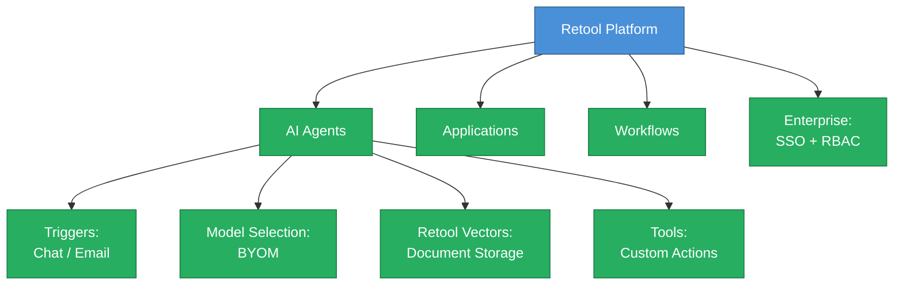
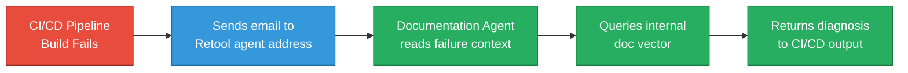

# Bonus 2: Enterprise AI Agent for Internal Documentation with Retool

<details open>
<summary><b>Bonus 2: Enterprise AI Agent for Internal Documentation with Retool (CS46H)</b></summary>

## Table of Contents

- [Overview](#overview)
- [Why Organizations Cannot Use ChatGPT for Internal Docs](#why-organizations-cannot-use-chatgpt-for-internal-docs)
- [What is Retool?](#what-is-retool)
- [Building the Documentation Agent](#building-the-documentation-agent)
- [Retool Vectors: Storing Documents for AI](#retool-vectors-storing-documents-for-ai)
- [Tools: Extending Agent Capabilities](#tools-extending-agent-capabilities)
- [Live Demo: Superbility Observability Platform](#live-demo-superbility-observability-platform)
- [Enterprise Features](#enterprise-features)
- [Comparison: Day 8 (CrewAI) vs. Bonus 2 (Retool)](#comparison-day-8-crewai-vs-bonus-2-retool)
- [Summary](#summary)

---

## Overview

This session demonstrates building an enterprise-grade internal documentation AI agent using Retool in minutes — without writing a single line of application code. Unlike Day 8 (which used CrewAI + Ollama for a developer-built agent), Retool provides a full enterprise platform with SSO, RBAC, BYOM, email triggers, and vector document storage — designed for organizations with compliance and security requirements.

---

## Why Organizations Cannot Use ChatGPT for Internal Docs

```diff
- Problem 1: ChatGPT is blocked in most enterprise environments — security policy
- Problem 2: Even when allowed, employees paste IP addresses, API keys, sensitive configs
- Problem 3: Public AI assistants can use submitted data for training — compliance risk
! Problem 4: ChatGPT has no knowledge of your internal tools — it cannot help with them
+ Solution: Build a private, enterprise-grade AI agent using your own documentation
```

**The core need:**

Every organization has internal tools with proprietary documentation that:
- Employees struggle to navigate (hundreds of pages)
- Cannot be uploaded to public AI assistants (security/compliance)
- Need AI-powered Q&A, not just keyword search

---

## What is Retool?

**Retool** is an enterprise-grade AI agent platform for building agents, applications, and workflows that operate on your organization's own data — securely, with full access control.



**Retool vs. Other AI Builders:**

| Feature | Most AI Builders | Retool |
|---------|-----------------|--------|
| Target audience | Proof of concept / demos | Enterprise production |
| Data ownership | Cloud-hosted | Bring Your Own Data |
| Access control | Basic | RBAC per user/app/data |
| SSO | Limited | Okta, Auth0, OneLogin |
| Model flexibility | Locked to one provider | BYOM (any model) |
| Triggers | Chat only | Chat + Email (+ more) |
| Document storage | Manual integration | Retool Vectors (built-in) |

---

## Building the Documentation Agent

**Step-by-step agent creation:**


**Step 1: Create the agent**
1. Log in to Retool → click **Agents** tab → **+ New Agent** → **Start from scratch**
2. Name: `documentation-agent-one`
3. Click **Create**

**Step 2: Configure the trigger**

| Trigger Type | Use Case |
|-------------|---------|
| **Chat** | Interactive Q&A — employees ask questions via chat interface |
| **Email** | CI/CD automation — pipeline emails the agent on failure for diagnosis |

> [!NOTE]
> The email trigger is particularly powerful for DevOps: configure your CI/CD pipeline to send an email to the agent's address when a build fails. The agent reads the failure context and responds with a diagnosis — zero human intervention required.

**Step 3: Write instructions using the Configuration Assistant**

Instead of hand-writing agent instructions, Retool's **Configuration Assistant** generates them:

```
User input to Config Assistant:
"I want to create a chatbot that takes input from the users and returns the output."

Generated instructions:
"You are a helpful chatbot assistant. Take the input from the user — it can be a
question or a message — and return a clear, accurate, and friendly response."
```

**Step 4: Select the model**

Retool is model-agnostic — choose based on organizational standards:
- **OpenAI**: GPT-4o, GPT-4o mini (cost-efficient)
- **Anthropic**: Claude 3.5 Sonnet, Claude 3 Haiku
- **Open source**: DeepSeek, Llama (self-hosted or API)

---

## Retool Vectors: Storing Documents for AI

**Retool Vectors** is a built-in vector database for storing and retrieving unstructured documents.

```diff
+ What is a vector? A mathematical representation of text that makes it searchable by meaning
+ Why vectors? LLMs understand semantic similarity — vectors enable "find text that means X"
+ Retool Vectors = managed vector database — no separate Pinecone/Chroma setup needed
! You can upload multiple PDFs — the agent searches across all of them
```

**Setup process:**

```bash
# In Retool: Resources → Retool Vectors → New Vector
# Name the vector (e.g., "demo")
# Upload document(s): Add Document → Upload file
```

**Supported use case:**
- Single PDF: one tool documentation
- Multiple PDFs: entire knowledge base (e.g., 20 internal tool docs)

The vector embedding happens automatically — no configuration needed.

---

## Tools: Extending Agent Capabilities

**Tools** are actions the agent can take beyond just answering questions. They are attached to the agent and invoked automatically when needed.

**Built-in tool types available in Retool:**

| Tool Type | Example |
|-----------|---------|
| **Retool Vector** | Retrieve information from uploaded documents |
| **Calendar** | Create a calendar event after execution |
| **Google Docs** | Write execution results to a document |
| **Code** | Run custom Python/JavaScript logic |

**Configuring the Retool Vector tool:**

```javascript
// In the tool configuration (Custom Tool mode):
// Function: retrieve from vector
// Vector name: "demo"
// Document name: "superbility_documentation.pdf"  // set as default
```

**Why set a default document name?**

> [!IMPORTANT]
> If you have multiple vectors and multiple documents, the agent will search ALL of them unless told which one to use. Setting the default document name in the tool configuration ensures the agent queries the correct document efficiently. Without it, the agent spends tokens searching irrelevant vectors.

**Final instruction to the Configuration Assistant:**
```
"Use 'demo' as the default name for the vector. 
Use 'superbility_documentation.pdf' as the default document name."
```

This causes the agent to automatically use the retrieve tool with these values whenever a question is asked.

---

## Live Demo: Superbility Observability Platform

**Demo document:** `superbility_documentation.pdf` — a fictional internal observability platform document containing:
- Platform overview
- Architecture
- Installation steps
- Comparison with popular observability tools (Prometheus, etc.)

**Question 1: "What is Superbility?"**

```diff
! External AI (ChatGPT): "I'm not familiar with Superbility — it may be an internal tool."
+ Retool agent behavior:
+   1. Cannot find Superbility in training data
+   2. Automatically invokes the "retrieve tool"
+   3. Fetches vector name: "demo", document: "superbility_documentation.pdf"
+   4. Retrieves relevant sections from the PDF
+   5. Generates answer from document content

+ Agent response: "Superbility is a unified observability platform designed to provide
+   real-time visibility into application performance."
```

**Question 2: "How is Superbility better than Prometheus?"**

```diff
+ Agent behavior:
+   1. Uses retrieve tool again
+   2. Finds comparison section in the document
+   3. Reasons using GenAI capabilities + document context

+ Agent response:
+   "Prometheus is a purpose-built metrics collection tool.
+    Superbility supports metrics, traces, and logs natively
+    and correlates them into a unified UI — providing broader
+    observability coverage."
```

> [!IMPORTANT]
> The second question demonstrates the key power of a GenAI agent over simple search: it doesn't just retrieve the comparison paragraph — it **reasons** about the comparison and presents it as a structured, readable answer. ELK/Elasticsearch would return the raw document section; the AI agent synthesizes the answer.

---

## Enterprise Features

**1. Email Trigger for CI/CD Integration**



**2. RBAC (Role-Based Access Control)**

> [!IMPORTANT]
> The transcript mentions "arbback" which is the RBAC acronym (Role-Based Access Control). Retool allows defining access rules: which users can access which applications, which agents, and which data vectors. This is essential for enterprise deployments where not all employees should have access to all internal documentation.

**3. SSO Integration**

| Provider | Supported |
|----------|----------|
| **Okta** | ✅ |
| **Auth0** | ✅ |
| **OneLogin** | ✅ |

No manual user onboarding required — connect SSO and all employees authenticate with their corporate identity.

**4. BYOM (Bring Your Own Model)**

Choose any model based on:
- **Cost**: GPT-4o mini for high-volume, routine Q&A
- **Capability**: Claude 3.5 for complex technical questions
- **Compliance**: DeepSeek or Llama for air-gapped environments

---

## Comparison: Day 8 (CrewAI) vs. Bonus 2 (Retool)

| Dimension | Day 8: CrewAI + Ollama | Bonus 2: Retool |
|-----------|----------------------|-----------------|
| **Setup complexity** | Moderate (Python, YAML, CLI) | Low (GUI, no code) |
| **Target user** | Developer/DevOps | Any team member |
| **Cost** | Zero (local LLM) | Subscription (Retool plan) |
| **Data privacy** | 100% local — nothing leaves machine | Retool-managed cloud (enterprise plan) |
| **SSO/RBAC** | Manual (DIY) | Built-in enterprise feature |
| **Scalability** | Limited to one machine's RAM | Cloud-hosted, multi-user |
| **Triggers** | CLI only | Chat + Email + API |
| **Best for** | Individual developer, air-gapped | Enterprise team deployment |
| **Model flexibility** | Any Ollama model | Any major cloud LLM |

```diff
+ Use CrewAI + Ollama: strict air-gap required, zero budget, developer-led POC
+ Use Retool: enterprise rollout, non-technical users, SSO required, email trigger needed
! Both solve the same core problem: private AI Q&A on internal documentation
```

---

## Summary

```diff
+ Core achievement: Enterprise-grade internal documentation AI agent, no coding required
+ Platform: Retool (enterprise AI agent/workflow/application builder)
+ Document storage: Retool Vectors (managed vector database, built-in to platform)
+ Model: BYOM — GPT-4o mini used in demo (any OpenAI/Anthropic/open-source model)
+ Trigger options: Chat (interactive) + Email (CI/CD automation)
+ Enterprise features: SSO (Okta/Auth0/OneLogin), RBAC, multi-document support
! Key distinction from Day 8: Retool = enterprise platform; CrewAI = developer framework
- Limitation: Retool is a paid platform; free tier for evaluation only
```

### Quick Reference

| Action | How |
|--------|-----|
| Create agent | Retool → Agents → + New Agent → Start from scratch |
| Write instructions | Configuration Assistant → describe requirement in plain English |
| Upload document | Resources → Retool Vectors → New Vector → Add Document |
| Add retrieve tool | Agent → Tools → + Add Tool → Retool Vector → configure defaults |
| Test agent | Agent → Chat section → type question |
| Enable email trigger | Agent → Triggers → Email → copy the agent email address |
| Add SSO | Retool Settings → SSO → connect Okta/Auth0/OneLogin |

### Expert Insight

**Real-world Application:**
Deploy a Retool documentation agent for your most-used internal tool. Connect the agent's email address as the final notification step in your CI/CD pipeline failure handler. Now every failed build automatically queries the internal runbook and returns a diagnosis — cutting MTTR (Mean Time to Resolve) for known failure patterns by 60–80%.

**Expert Path:**
1. Start with one critical internal tool (not the most complex — pick one with clear, structured documentation)
2. Upload the PDF, test 10 representative questions, measure accuracy
3. Use the Configuration Assistant to refine agent instructions based on failures
4. Enable the email trigger and wire it to one CI/CD pipeline notification
5. Roll out to the team using SSO — collect feedback to improve the agent over 2 weeks

**Common Pitfalls:**
- **Agent cannot find information**: Ensure the tool defaults (vector name + document name) are set correctly in the tool configuration. Without defaults, the agent searches all vectors.
- **Generic instructions**: Use the Configuration Assistant to make instructions specific — "You are a Superbility observability platform expert. Always query the documentation before answering." Generic instructions produce generic answers.
- **Wrong model for the task**: GPT-4o mini is cost-efficient but may struggle with complex technical reasoning. For enterprise deployments with complex architecture questions, use GPT-4o or Claude 3.5 Sonnet.
- **Email trigger configuration**: The CI/CD system must be configured to send the email in the correct format. Test with a manual email first before wiring to automation.
- **Multiple vectors without routing**: If you have 20 document vectors and don't specify a default, the agent may query irrelevant vectors. Either set per-agent defaults or use a routing agent to select the correct vector before querying.

**Diagnostic Notes:**
- If the agent answers "I don't know" — check that the retrieve tool is configured and the vector name/document name are correct
- If SSO login fails — verify the identity provider configuration matches Retool's SSO setup guide exactly
- If the email trigger doesn't fire — check that the CI/CD system can reach Retool's email endpoint (network/firewall)

**Transcript Corrections:**
- "JPT / chat GBT" → "ChatGPT"
- "arbback" → "RBAC (Role-Based Access Control)"
- "GPD5 mini / GPT5 mini" → "GPT-4o mini" (no model named GPT-5 mini existed at time of recording)
- "superbility" → "Superbility" (fictional internal tool name used in demo — intentional)
- "terapform" → "Terraform"
- "octa auto" → "Okta, Auth0" (two separate SSO providers)
- "one login" → "OneLogin" (single brand name)

</details>
