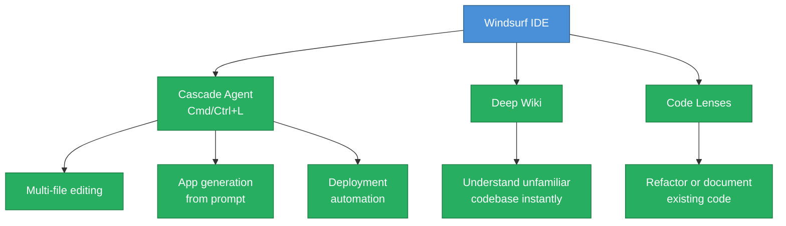
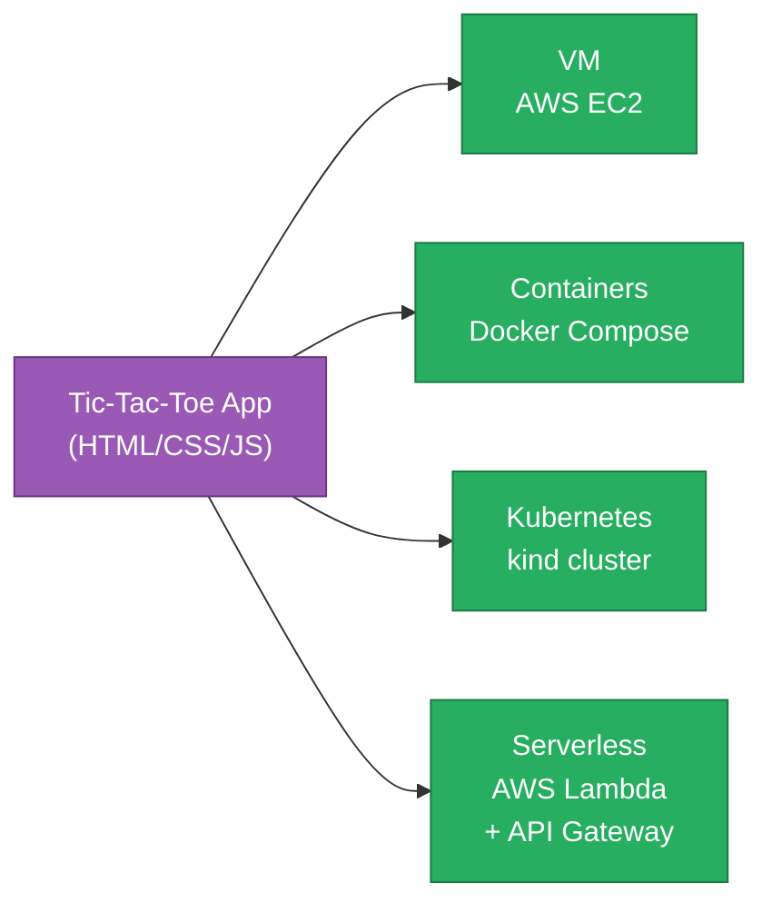

# Bonus 3: AI Deploys to All Four Environments — Ultimate DevOps Test with Windsurf

<details open>
<summary><b>Bonus 3: AI Deploys to All Four Environments — Ultimate DevOps Test with Windsurf (CS46H)</b></summary>

## Table of Contents

- [Overview](#overview)
- [Windsurf and the Cascade Agent](#windsurf-and-the-cascade-agent)
- [The Challenge: Four Deployment Environments](#the-challenge-four-deployment-environments)
- [Step 1: Generate the Application](#step-1-generate-the-application)
- [Step 2: Deploy to AWS EC2 (Virtual Machine)](#step-2-deploy-to-aws-ec2-virtual-machine)
- [Step 3: Deploy to Docker (Containers)](#step-3-deploy-to-docker-containers)
- [Step 4: Deploy to Kubernetes (kind)](#step-4-deploy-to-kubernetes-kind)
- [Step 5: Deploy to AWS Lambda (Serverless)](#step-5-deploy-to-aws-lambda-serverless)
- [Results Summary](#results-summary)
- [Summary](#summary)

---

## Overview

This session tests whether an AI coding agent can take a web application from zero and deploy it to four different production-grade environments — VM, containers, Kubernetes, and serverless — using only natural language prompts and zero manual infrastructure work. The AI agent used is **Windsurf's Cascade** coding agent. Result: all four deployments succeeded, including autonomous error recovery during Kubernetes deployment.

---

## Windsurf and the Cascade Agent

**Windsurf** is an AI-powered IDE that can be used as a standalone application or as a plugin in any IDE.



**Key features:**

| Feature | Purpose |
|---------|---------|
| **Cascade** | AI coding agent — generates apps, edits multiple files, deploys to infrastructure |
| **Deep Wiki** | Explains unfamiliar code in a large codebase with multiple scenarios |
| **Code Lenses** | Refactors or adds documentation to existing code inline |

**Starting Cascade:**
- Keyboard shortcut: `Cmd+L` (macOS) / `Ctrl+L` (Windows/Linux)
- Can switch between multiple AI models within Cascade
- Supports **auto access** (no approval per command) or **manual approval** mode

> [!IMPORTANT]
> Auto access mode allows Cascade to run commands directly on your machine without prompting for each one. Only enable this in a controlled environment — Cascade will execute shell commands, create AWS resources, and run deployments automatically.

---

## The Challenge: Four Deployment Environments



**Estimated manual time:** 7–8 hours (with Google + documentation)
**With Windsurf Cascade:** ~20–30 minutes

**Each environment requires different artifacts:**

| Environment | Required Files Generated by AI |
|-------------|-------------------------------|
| EC2 (VM) | `user_data.sh` (nginx install, file copy, service enable) |
| Docker | `Dockerfile`, `docker-compose.yml`, nginx config, health checks |
| Kubernetes | `namespace.yaml`, `configmap.yaml`, `deployment.yaml`, `service.yaml`, `ingress.yaml` |
| Lambda | `lambda/index.js`, `package.json`, `deploy.sh`, IAM role creation |

---

## Step 1: Generate the Application

**Prompt to Cascade:**
```
Generate a sample tic-tac-toe application. 
Project name: abi-tic-tac-toe. 
Programming language: JavaScript.
```

**Cascade's plan:**
1. Create project directory structure
2. Create `index.html`
3. Create `style.css` for styling
4. Create `script.js` with game logic
5. Generate `README.md` for documentation
6. Test in browser

**Generated files:**
```
abi-tic-tac-toe/
├── index.html       ← game UI
├── style.css        ← styling
├── script.js        ← game logic (player 1 / player 2 turns)
└── README.md        ← documentation
```

**Verification:** Cascade opens the browser automatically — game is playable (player 1 vs. player 2 turn-based).

---

## Step 2: Deploy to AWS EC2 (Virtual Machine)

**Prompt to Cascade:**
```
Create an Ubuntu EC2 instance on AWS using AWS CLI from ~/homebrew/bin.
Use a user data script to deploy the application on the instance.
Open the security group on the required port.
Return the public IP and port to access the application.
```

**Cascade's execution plan:**
1. Verify AWS CLI is available
2. Create security group (open port 80)
3. Generate `user_data.sh` script
4. Launch EC2 instance with the user data
5. Extract instance ID and DNS name
6. Wait 60 seconds → verify with `curl`
7. Return public IP and access URL

**Generated `user_data.sh`:**
```bash
#!/bin/bash
apt-get update
apt-get install -y nginx
systemctl enable nginx

# Create project directory
mkdir -p /var/www/abi-tic-tac-toe

# Copy application files
cp /tmp/index.html /var/www/abi-tic-tac-toe/
cp /tmp/style.css  /var/www/abi-tic-tac-toe/
cp /tmp/script.js  /var/www/abi-tic-tac-toe/

# Configure nginx to serve from project directory
# nginx runs as service at startup
```

```diff
+ Result: Application accessible at http://13.126.230.73 (demo IP)
+ Verification: curl from Cascade + manual browser check
+ Status: ✅ SUCCESS — VM deployment complete
```

> [!NOTE]
> Cascade waited 60 seconds after instance launch before verifying — this is intentional because the user data script needs time to execute on the newly-launched instance before nginx is ready.

**Diagnostic relevance:**
- `aws ec2 describe-instances --instance-ids <id>` — check instance state (pending/running)
- `curl http://<public-ip>` — verify nginx is serving the application
- `aws ec2 describe-security-groups` — verify port 80 is open in the security group

---

## Step 3: Deploy to Docker (Containers)

**Prompt to Cascade:**
```
Generate a docker compose file to deploy this application 
as containers on the localhost.
```

**Cascade's execution plan:**
1. Create `Dockerfile` (nginx base image)
2. Create `docker-compose.yml` (with monitoring)
3. Create nginx container configuration
4. Test docker compose deployment
5. Create documentation

**Generated `Dockerfile`:**
```dockerfile
FROM nginx:alpine
LABEL maintainer="abi-tic-tac-toe"
LABEL description="Tic-Tac-Toe Game Container"

# Remove default nginx website
RUN rm -rf /usr/share/nginx/html/*

# Copy application files
COPY index.html /usr/share/nginx/html/
COPY style.css  /usr/share/nginx/html/
COPY script.js  /usr/share/nginx/html/

# Update nginx configuration
COPY nginx.conf /etc/nginx/nginx.conf

CMD ["nginx", "-g", "daemon off;"]
```

**Generated `docker-compose.yml` — 4 containers:**

```yaml
version: '3.8'
networks:
  app-network:
    driver: bridge     # bridge network for container communication

volumes:
  redis-data:          # Redis data volume
  prometheus-data:     # Prometheus metrics volume

services:
  tic-tac-toe:         # Application container
    build: .
    ports: ["8080:80"]
    healthcheck: ...

  nginx:               # Load balancer container
    image: nginx:alpine
    # Health check via nginx load balancer

  redis:               # Caching/state container
    image: redis:alpine
    volumes: [redis-data:/data]

  monitoring:          # Observability container
    image: prom/prometheus
    volumes: [prometheus-data:/prometheus]
```

> [!NOTE]
> Cascade added Redis and Prometheus containers without being asked — it proactively added monitoring and caching because these are production best practices for container deployments. This demonstrates agentic behavior beyond the literal prompt.

```diff
+ Result: Application on localhost:8080
+ 4 containers: tic-tac-toe (app) + nginx (LB) + Redis (cache) + Prometheus (monitoring)
+ Health check: verified via nginx load balancer container
+ Status: ✅ SUCCESS — Container deployment complete
```

---

## Step 4: Deploy to Kubernetes (kind)

**Pre-step: Create kind cluster**
```bash
kind create cluster --name cascade
kubectl get nodes    # verify kubectl is configured to this cluster
```

**Prompt to Cascade:**
```
Generate Kubernetes manifests for this application and deploy 
to the Kubernetes cluster configured with kubectl.
kubectl is located at ~/homebrew/bin/kubectl.
```

**Cascade's execution plan:**
1. Verify kubectl installation (correct binary)
2. Create namespace
3. Create ConfigMap (nginx configuration)
4. Create Deployment manifest
5. Create Service manifest
6. Create Ingress (optional — kind local cluster)
7. Deploy manifests and return access URL

**Generated manifests:**
```
tic-tac-toe/
├── namespace.yaml        ← namespace: tic-tac-toe
├── configmap.yaml        ← nginx config (port 80, server_name localhost)
├── deployment.yaml       ← application pods
├── service.yaml          ← ClusterIP service
└── ingress.yaml          ← Ingress (overridden by port-forward for kind)
```

```yaml
# namespace.yaml
apiVersion: v1
kind: Namespace
metadata:
  name: tic-tac-toe
```

### Autonomous Error Recovery — CrashLoopBackOff

```diff
! Issue: Pods entered CrashLoopBackOff after initial deployment
! Error in logs: "permission denied" (nginx user permissions issue)
! Human intervention required: ZERO
+ Cascade behavior:
+   1. Detected CrashLoopBackOff in pod status
+   2. Read pod logs → identified "permission denied"
+   3. Understood root cause: nginx user config in deployment manifest
+   4. Updated deployment.yaml with corrected security context
+   5. Redeployed — pods moved to Running state
```

> [!IMPORTANT]
> This is the most significant demonstration in the session: Cascade encountered a real production error (nginx permission denied = CrashLoopBackOff) during deployment, autonomously diagnosed the root cause from logs, updated the manifest, and redeployed — all without any human input. This is the definition of an AI agent (autonomous task execution) vs. an AI assistant (would have required the human to paste the error and ask for help).

**kind + port-forward decision:**
```bash
# Cascade recognized kind does not support external LoadBalancer
# Instead of trying to use Ingress (which would fail), Cascade automatically chose:
kubectl port-forward -n tic-tac-toe svc/tic-tac-toe-service 8081:80
# Application accessible at localhost:8081
```

```diff
+ Result: Application on localhost:8081
+ Autonomous fix: CrashLoopBackOff resolved without human intervention
+ Intelligent decision: port-forward instead of Ingress for kind cluster
+ Status: ✅ SUCCESS — Kubernetes deployment complete
```

**Diagnostic relevance:**
- `kubectl get pods -n tic-tac-toe` — monitor pod states during deployment
- `kubectl logs <pod-name> -n tic-tac-toe` — read error output to diagnose CrashLoopBackOff
- `kubectl describe pod <pod-name> -n tic-tac-toe` — full events log for startup issues
- `kubectl get all -n tic-tac-toe` — view all resources created in the namespace

---

## Step 5: Deploy to AWS Lambda (Serverless)

**Prompt to Cascade:**
```
Deploy this application onto AWS Lambda functions using AWS CLI from ~/homebrew/bin.
```

**Cascade's execution plan:**
1. Check AWS CLI availability
2. Create Lambda function handler (`lambda/index.js`)
3. Create `package.json`
4. Create IAM role for Lambda execution
5. Create `deploy.sh` with AWS CLI commands
6. Deploy the Lambda function
7. Create API Gateway for web access
8. Test with health check curl + verify application

**Generated `lambda/` directory:**
```
lambda/
├── index.js        ← Lambda handler (serves HTML/CSS/JS via API Gateway response)
├── package.json    ← Node.js package config
└── deploy.sh       ← AWS CLI commands for IAM + Lambda + API Gateway
```

**`deploy.sh` steps (generated by Cascade):**
```bash
#!/bin/bash
# 1. Create IAM role for Lambda
aws iam create-role --role-name abi-tic-tac-toe-lambda-role \
  --assume-role-policy-document file://trust-policy.json

# 2. Attach Lambda basic execution policy
aws iam attach-role-policy --role-name abi-tic-tac-toe-lambda-role \
  --policy-arn arn:aws:iam::aws:policy/service-role/AWSLambdaBasicExecutionRole

# 3. Package and deploy Lambda function
zip -r function.zip .
aws lambda create-function --function-name abi-tic-tac-toe \
  --runtime nodejs18.x --handler index.handler \
  --zip-file fileb://function.zip \
  --role arn:aws:iam::<account>:role/abi-tic-tac-toe-lambda-role

# 4. Create API Gateway and connect to Lambda
aws apigatewayv2 create-api ...
```

```diff
+ Result: Lambda function created in AWS console (verified within 2 minutes)
+ API Gateway: created and connected to Lambda
+ Health check: verified with curl by Cascade
+ Application: accessible via API Gateway URL — "Powered by AWS"
+ Status: ✅ SUCCESS — Serverless deployment complete
```

---

## Results Summary

| Environment | Platform | Access URL | Status | Cascade Time |
|-------------|----------|-----------|--------|-------------|
| **VM** | AWS EC2 + nginx | `http://13.126.230.73:80` | ✅ Success | ~5 min |
| **Containers** | Docker Compose (4 containers) | `localhost:8080` | ✅ Success | ~5 min |
| **Kubernetes** | kind + port-forward | `localhost:8081` | ✅ Success (self-healed) | ~8 min |
| **Serverless** | AWS Lambda + API Gateway | API Gateway URL | ✅ Success | ~7 min |

**Final project directory (all artifacts in one folder):**
```
abi-tic-tac-toe/
├── index.html              ← application
├── style.css
├── script.js
├── README.md
├── user_data.sh            ← EC2 deployment
├── Dockerfile              ← container image
├── docker-compose.yml      ← container orchestration (4 containers)
├── nginx.conf              ← nginx config for containers
├── k8s/                    ← Kubernetes manifests
│   ├── namespace.yaml
│   ├── configmap.yaml
│   ├── deployment.yaml
│   ├── service.yaml
│   └── ingress.yaml
└── lambda/                 ← serverless deployment
    ├── index.js
    ├── package.json
    └── deploy.sh
```

---

## Summary

```diff
+ Key Achievement: Single AI agent deployed one app to 4 environments in ~20-30 minutes
+ Estimated manual time: 7-8 hours — productivity gain: 15-20x
+ Windsurf Cascade: generates code + runs commands + deploys + verifies + self-heals
! Autonomous error recovery: CrashLoopBackOff fixed without any human intervention
+ Intelligence: Recognized kind environment → chose port-forward over broken Ingress
+ Bonus: Added Redis + Prometheus to Docker Compose without being asked
- Limitation: Requires API keys, AWS credentials, and tool installations (kind, Docker)
```

### Quick Reference

| Task | Cascade Prompt Pattern |
|------|----------------------|
| Generate app | `"Generate a [app-type] application in [language], name: [name]"` |
| Deploy to EC2 | `"Create Ubuntu EC2 on AWS using AWS CLI, use user data to deploy, return public IP"` |
| Deploy to Docker | `"Generate docker compose file to deploy as containers on localhost"` |
| Deploy to K8s | `"Generate Kubernetes manifests and deploy to cluster configured with kubectl"` |
| Deploy to Lambda | `"Deploy to AWS Lambda using AWS CLI"` |

### Expert Insight

**Real-world Application:**
Use Windsurf Cascade to bootstrap multi-environment deployment pipelines during greenfield projects. Instead of spending the first sprint writing infrastructure code, have Cascade generate all four environment artifacts and use them as the starting point for your Terraform/Helm/CDK work. The AI-generated versions are correct starting points, not production-ready finals — treat them as scaffolding.

**Expert Path:**
1. Use Cascade for initial scaffolding — then review and refine what it generates
2. The CrashLoopBackOff self-healing is impressive, but in production, always understand WHY it fixed the issue — read the change before accepting it
3. Combine Cascade (agent) with a GitOps workflow: Cascade generates the manifests → commits to Git → ArgoCD deploys to the real cluster
4. Use parallel Cascade windows for simultaneous multi-environment deployment (as the instructor hints at)

**Common Pitfalls:**
- **Auto access mode risks**: With auto access, Cascade runs shell commands without approval. For EC2 deployment, this includes creating real AWS resources that incur costs. Review prompts carefully before granting auto access for cloud operations.
- **Duplicate CLI installations**: The instructor's `~/homebrew/bin/kubectl` hint shows a real-world scenario — always specify the exact path when a machine has multiple versions of a tool.
- **Lambda cold start with static HTML**: Lambda is designed for functions, not static site hosting. The generated approach works for demo but API Gateway + Lambda for a static HTML game is overkill — S3 + CloudFront is the correct serverless pattern for static sites.
- **kind vs. production Kubernetes**: The port-forward decision is correct for kind but would not work in production. The CrashLoopBackOff fix in a kind environment may not reproduce the same fix needed for EKS/GKE/AKS.
- **IAM role creation permissions**: The Lambda deployment requires `iam:CreateRole` and `iam:AttachRolePolicy`. Ensure the AWS CLI credentials have these permissions or the deploy.sh will fail with AccessDeniedException.

**Diagnostic Relevance:**
- `kubectl get pods -n <namespace>` → first check after any deployment — identifies CrashLoopBackOff immediately
- `kubectl logs <pod> -n <namespace>` → reveals the actual error (as shown: "permission denied" for nginx)
- `kubectl describe pod <pod> -n <namespace>` → full event log including image pull errors, scheduling failures
- `aws ec2 describe-instance-status --instance-ids <id>` → confirms EC2 instance state (initializing/ok)
- `aws lambda get-function --function-name <name>` → verify Lambda deployment and configuration
- `docker compose ps` → verify all containers are running and healthy (not just created)
- `docker compose logs <service>` → per-container logs for debugging docker compose issues

**Transcript Corrections:**
- "cube CTL / cubectl" → "kubectl"
- "engineix / engineext" → "nginx"
- "Windinsurf / Windsor / Vinsurf / Windsoroft" → "Windsurf"
- "docker compos" → "docker compose"
- "radius" → "Redis"
- "AWS CLA" → "AWS CLI"
- "IM role" → "IAM role"
- "yamel" → "YAML"
- "ab tic tac to" → "abi-tic-tac-toe"

</details>
