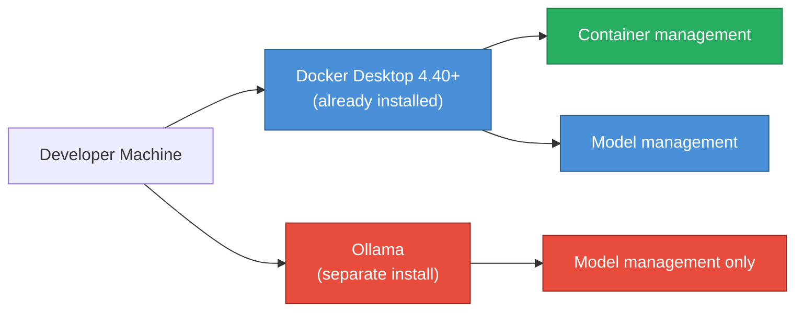
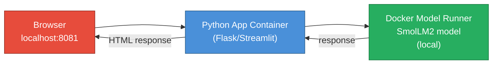

# Bonus 4: Docker Model Runner — Local LLMs Without Ollama

<details open>
<summary><b>Bonus 4: Docker Model Runner — Local LLMs Without Ollama (CS46H)</b></summary>

## Table of Contents

- [Overview](#overview)
- [Docker Model Runner vs. Ollama](#docker-model-runner-vs-ollama)
- [Prerequisites and Setup](#prerequisites-and-setup)
- [CLI Commands](#cli-commands)
- [Docker AI Hub — Model Registry](#docker-ai-hub--model-registry)
- [Running Models](#running-models)
- [Building a Python AI Assistant](#building-a-python-ai-assistant)
- [Summary](#summary)

---

## Overview

**Docker Model Runner** is a feature introduced in Docker Desktop 4.40 that allows you to pull, run, and integrate local LLMs — using the same familiar Docker CLI patterns. It is Docker's answer to Ollama: if you already have Docker installed, you no longer need a separate tool to run local AI models.

```diff
+ New feature in Docker Desktop 4.40+
+ CLI pattern mirrors Docker container commands (pull/run/rm/list)
+ Models are hosted on Docker AI Hub (hub.docker.com/u/ai)
+ Direct integration with Python, Node.js, Go applications
+ MCP server support (future capability — not covered in this session)
! Requires Docker Desktop 4.40 or later — earlier versions will show "model: not a recognized command"
```

---

## Docker Model Runner vs. Ollama

Both tools solve the same problem: run LLMs locally without sending data to the cloud. The key difference is tooling consolidation.



| Dimension | Ollama | Docker Model Runner |
|-----------|--------|-------------------|
| **Installation** | Separate tool required | Built into Docker Desktop 4.40+ |
| **CLI pattern** | `ollama pull/run/rm/list` | `docker model pull/run/rm/list` |
| **Model registry** | Ollama Library | Docker AI Hub (hub.docker.com/u/ai) |
| **Container + model** | Two tools | One tool |
| **MCP integration** | Supported | Supported (future videos) |
| **Best for** | Ollama-native workflows | Teams already using Docker |

> [!IMPORTANT]
> Docker Model Runner does NOT replace Ollama — both are valid. The advantage is for DevOps engineers and developers who already live in Docker. Adding model capabilities to an existing Docker workflow requires zero new software installations.

---

## Prerequisites and Setup

**Requirements:**
1. **Docker Desktop 4.40 or later** — mandatory; earlier versions do not have `docker model`
2. A Docker account (for Docker AI Hub access)

**Verify your version:**
1. Open Docker Desktop dashboard
2. Check the version in the bottom right corner
3. If not 4.40+: update Docker Desktop

**Common issue — `docker model` not found after update:**
```bash
# Solutions:
# 1. Restart Docker Desktop after updating
# 2. Log out and back in to your Docker account
# 3. Verify the CLI:
docker model --help
# Expected output: shows pull/run/rm/list subcommands
```

---

## CLI Commands

Docker Model Runner mirrors the Docker container CLI — learning curve is near-zero for Docker users.

| Docker Container | Docker Model Runner | Action |
|-----------------|---------------------|--------|
| `docker pull <image>` | `docker model pull <model>` | Download a model |
| `docker run <image>` | `docker model run <model>` | Run a model |
| `docker rm <container>` | `docker model rm <model>` | Remove a model |
| `docker images` | `docker model list` | List downloaded models |

```bash
# Pull a model from Docker AI Hub
docker model pull ai/smollm2

# Verify download
docker model list
# Output: NAME           SIZE      MODIFIED
#         ai/smollm2     256 MB    2 minutes ago

# Single-prompt mode (model exits after responding)
docker model run ai/smollm2 "What is Kubernetes?"

# Interactive chat mode (no prompt = conversational session)
docker model run ai/smollm2
# > What is Kubernetes?
# [model responds]
# > Tell me more about pods
# [continues the conversation like ChatGPT]
# Ctrl+C to exit

# Remove a model (free up disk space)
docker model rm ai/smollm2
```

> [!NOTE]
> In single-prompt mode, the model exits after responding. In interactive mode (no prompt argument), the model stays running for a multi-turn conversation. The interactive mode mirrors the Ollama interactive shell experience.

---

## Docker AI Hub — Model Registry

**Docker AI Hub** is the model registry for Docker Model Runner — the equivalent of Docker Hub for container images.

**URL:** `hub.docker.com/u/ai`

**Available models (at time of recording):**

| Model | Parameters | Size | Best For |
|-------|-----------|------|---------|
| **ai/smollm2** | 135M | 256 MB | Ultra-fast, lightweight tasks |
| **ai/llama3** | ~4.7B | ~3 GB | General purpose, quality responses |
| **ai/phi** | ~3.8B | ~2 GB | Reasoning, code generation |

**SmolLM2 vs. Llama comparison:**

```diff
+ SmolLM2: 135 million parameters — 256 MB download — fastest inference
+ Llama 3 (smallest): 1 billion parameters — ~1.5 GB — better quality
! Trade-off: size/speed vs. answer quality
- SmolLM2 not suitable for complex technical questions (small parameter count)
+ SmolLM2 excellent for: quick Q&A, classification, simple generation tasks
```

**Pulling a model:**
```bash
# Option 1: use the latest tag
docker model pull ai/smollm2

# Option 2: use a specific version tag (visible on Docker AI Hub)
docker model pull ai/smollm2:1.7b-instruct-fp16

# Subsequent pulls use local cache — no re-download
docker model pull ai/smollm2
# Output: Using cached model
```

---

## Running Models

### Single-Prompt Mode
```bash
# Use for one-off queries — model terminates after response
docker model run ai/smollm2 "What is Kubernetes?"

# After the response, the model is no longer running
# Useful in scripts or automation pipelines
```

### Interactive Mode
```bash
# No prompt argument = enters interactive chat session
docker model run ai/smollm2

# Inside the interactive session:
# > What is Kubernetes?
# [multi-paragraph response]
# > What are pods?
# [continues conversation with context from previous messages]
# > exit or Ctrl+C to quit
```

> [!IMPORTANT]
> The interactive mode maintains conversation context within the session — each prompt is aware of previous ones. This is the same behavior as ChatGPT's conversational memory within a single session.

---

## Building a Python AI Assistant

Docker provides an official open-source example repository with Python, Node.js, and Go implementations of an AI assistant using Docker Model Runner.

### Official Repository Setup

```bash
# Clone the official Docker AI assistant example
git clone https://github.com/docker/model-runner-examples
cd model-runner-examples

# The repo contains:
# ├── python/     ← Python assistant (Flask/Streamlit)
# ├── nodejs/     ← Node.js assistant
# └── go/         ← Go assistant
```

**Configuration via `.env` file:**
```bash
# The repository reads the model from an .env file
MODEL=ai/smollm2    # override default model with your downloaded model

# If you don't have the default model locally,
# the application will automatically pull it from Docker AI Hub
```

### Running the Python Assistant

```bash
# Run the launch script (builds and starts all containers)
./run.sh

# Output:
# Starting Python container on port 8081...
# Starting Node.js container on port 8082...
# Starting Go container on port 8083...
# [Note: some ports may conflict — use the Python one]
```

**Access the web UI:**
```
http://localhost:8081
```



**Demo query: "What is Kubernetes?"**

```diff
+ Model: SmolLM2 (135M parameters)
+ Hardware: high-end machine with GPUs
+ Response time: very fast (lightweight model + GPU acceleration)
+ Data flow: browser → Python container → Docker Model Runner → SmolLM2 (local) → response
! Zero data leaves the machine — completely private
```

### Why This Approach is Significant

```diff
+ Before Docker Model Runner: need Ollama installed separately
+ Before Docker Model Runner: complex Python code to call ollama.chat() API
+ With Docker Model Runner: model is a service in Docker Desktop
+ With Docker Model Runner: call via standard OpenAI-compatible HTTP endpoint
! Models become just another service in your docker-compose.yml (future capability)
```

---

## Summary

```diff
+ Core feature: Local LLMs via Docker Model Runner — no separate Ollama install needed
+ CLI: docker model pull/run/rm/list — mirrors container commands exactly
+ Registry: Docker AI Hub (hub.docker.com/u/ai) — hub.docker.com equivalent for models
+ Best model for speed: SmolLM2 (135M params, 256 MB) — trade-off: lower quality than Llama
+ Integration: Official Python/Node.js/Go example repo from Docker
+ Future: MCP server integration for AI agent capabilities
- Requirement: Docker Desktop 4.40+ (not available in older versions or Docker Engine only)
- Limitation: Fewer models available on Docker AI Hub vs. Ollama library at time of recording
```

### Quick Reference

| Command | Action |
|---------|--------|
| `docker model --help` | Verify model runner is available |
| `docker model pull ai/smollm2` | Download SmolLM2 model |
| `docker model list` | List downloaded models |
| `docker model run ai/smollm2 "prompt"` | Single-prompt mode |
| `docker model run ai/smollm2` | Interactive chat mode |
| `docker model rm ai/smollm2` | Remove model (free space) |

### Expert Insight

**Real-world Application:**
For DevOps teams that already standardize on Docker Desktop, Docker Model Runner eliminates the "install Ollama on every engineer's machine" onboarding step. Add the model runner configuration to your team's Docker Desktop standard setup script — engineers get local AI model support automatically. This is particularly valuable in environments with strict software installation policies where adding a new tool (Ollama) requires IT approval but extending Docker Desktop does not.

**Expert Path:**
1. Explore Docker AI Hub for available models — check for specialized models (code-focused, reasoning-focused)
2. Compare SmolLM2 vs. Llama 3 response quality on your specific use case before choosing
3. Once Docker adds model runner to docker-compose.yml support, use it to add local LLM as a service alongside your application containers
4. Watch for MCP server integration to unlock AI agent capabilities within the Docker ecosystem
5. Use the OpenAI-compatible endpoint from Docker Model Runner to swap Ollama for Docker Model Runner in existing CrewAI or LangChain projects without code changes

**Common Pitfalls:**
- **`docker model`: command not found** — Docker Desktop is below 4.40, or needs a restart/re-login after update
- **First pull takes time** — SmolLM2 is 256 MB; Llama 3 is several GB. Subsequent runs use the local cache instantly
- **Port conflicts in run.sh** — the official example starts Python, Node.js, and Go containers on consecutive ports; if ports 8081–8083 are in use, some containers will fail to start. Kill the conflicting processes or change the port in the compose file
- **Wrong model name in .env** — If the `.env` file references a model you don't have locally, the application will attempt to pull it from Docker AI Hub automatically (adds startup time)
- **Interactive mode exit** — `exit` or `Ctrl+C` terminates the interactive session; unsaved conversation history is lost

**Diagnostic Relevance:**
- `docker model list` → confirms which models are downloaded before running the application
- `docker ps` → verify the Python/Node.js application containers are running after `./run.sh`
- `docker logs <container-name>` → view application startup errors or model connection issues
- `docker model run ai/smollm2 "test"` → quick sanity check that the model runner is working before starting the full application

**Transcript Corrections:**
- "Olama" → "Ollama" (repeated throughout)
- "fee model" → "Phi model" (Microsoft Phi — `ai/phi` on Docker AI Hub)
- "small lm2" → "SmolLM2" (the model name: Small Language Model 2)
- "docker model h" → `docker model --help`
- "Docker Model Brother" → "Docker Model Runner" (at end of transcript — audio garbling)
- "28 GPUs" → likely "2 to 8 GPUs" or a high-end workstation GPU count; flagged as unclear audio

</details>
