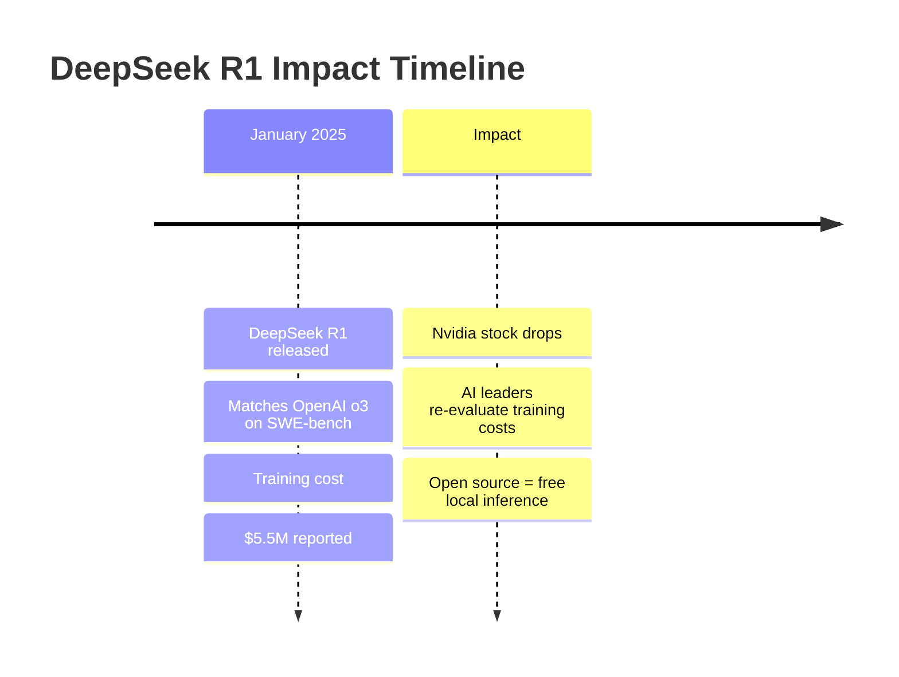
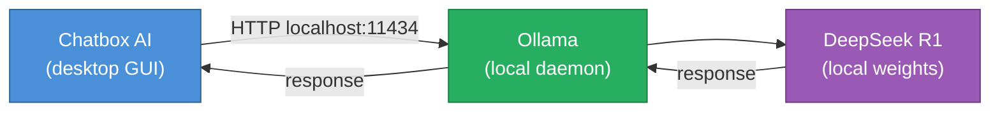

# Bonus 5: Run DeepSeek AI Locally in 2 Steps

<details open>
<summary><b>Bonus 5: Run DeepSeek AI Locally in 2 Steps (CS46H)</b></summary>

## Table of Contents

- [Overview](#overview)
- [What is DeepSeek AI?](#what-is-deepseek-ai)
- [Why DeepSeek Matters: Cost and Open Source](#why-deepseek-matters-cost-and-open-source)
- [Running DeepSeek Locally: 2 Steps](#running-deepseek-locally-2-steps)
- [Choosing the Right Model Size](#choosing-the-right-model-size)
- [Adding a Chat UI: Chatbox AI](#adding-a-chat-ui-chatbox-ai)
- [Summary](#summary)

---

## Overview

DeepSeek AI R1 is a Chinese-built open-source LLM that matches OpenAI o3 performance on SWE-bench benchmarks — trained at a reported cost of only $5.5 million vs. the billions spent by US AI companies. It can be run entirely locally using Ollama in two commands. This session covers the context behind DeepSeek's significance, the API cost comparison, and how to run it locally with a ChatGPT-like web UI.

---

## What is DeepSeek AI?

**DeepSeek** is an LLM released by a Chinese AI company that caused significant disruption in the AI industry upon release.



**Key facts:**
- **Model name:** DeepSeek R1 (R1 = first release)
- **Benchmark:** SWE-bench (Software Engineering Benchmarking) — matches OpenAI o3
- **Training cost:** ~$5.5 million (vs. billions for comparable US models)
- **License:** Open source — can be downloaded, run locally, and used in commercial products
- **Origin:** Recorded on January 29, 2025 — Chinese New Year coincidence

---

## Why DeepSeek Matters: Cost and Open Source

### 1. Open Source = Free Local Inference

```diff
+ DeepSeek R1 is open source — download the weights, run on your own hardware
+ Zero API costs when self-hosted
+ Zero data exposure — all inference stays on-premise
+ Legal for commercial use (check specific license terms)
- OpenAI models: closed weights — API access only, billing required
```

### 2. API Cost Comparison

| Model | Cost per 1M tokens | Notes |
|-------|-------------------|-------|
| **OpenAI o3** | $7.50 | Via API (not ChatGPT subscription) |
| **DeepSeek** | $0.15 | 50x cheaper than OpenAI o3 |

**Real-world example:** A simple prompt + response (e.g., "print numbers 1-10") = ~511 tokens.

```diff
! For 1 million tokens (1,953 such queries):
+ OpenAI o3 API cost: $7.50
+ DeepSeek API cost: $0.15
! Cost reduction: 98%

+ Impact for startups: chatbots currently paying $X/month to OpenAI can cut costs by 98%
! Caveat: DeepSeek is newer and less battle-tested than OpenAI's production APIs
```

### 3. Industry Impact

The combination of **open source + low training cost** raised industry questions:
- If DeepSeek trained a frontier model for $5.5M, why does OpenAI need billions?
- Nvidia stock dropped — if training costs collapse, GPU demand for AI may plateau
- CUDA dominance (Nvidia's ML framework) came under scrutiny

> [!NOTE]
> The instructor notes: AI experts view this as positive for humanity. As model training costs decrease, more organizations worldwide can afford to build AI applications — accelerating problem-solving across all fields.

---

## Running DeepSeek Locally: 2 Steps

**Step 1: Download and install Ollama**

```bash
# Go to ollama.ai — download for macOS, Linux, or Windows
# macOS: download .dmg → double-click → install
# After install: Ollama icon appears in the menu bar

# Verify installation:
ollama --help
```

**Step 2: Pull and run DeepSeek**

```bash
# Search for "deepseek" on ollama.com/library — it's trending
# Choose your model size (see table below)

# Run DeepSeek R1 1.5B (recommended for local use):
ollama run deepseek-r1:1.5b

# The first run downloads the model (1.1 GB for 1.5B)
# Subsequent runs use local cache

# Test immediately:
# > Write a Python code to print 1 to 10
# [model responds with Python code]
```

> [!IMPORTANT]
> GPU matters: On GPU-accelerated machines (CUDA/Metal), inference is very fast. On CPU-only machines, expect significant response delays, especially for larger model sizes. For CPU-only machines, always use the 1.5B model.

**Ollama CLI quick reference:**
```bash
ollama run deepseek-r1:1.5b        # Run 1.5B model (interactive)
ollama list                         # List all downloaded models
ollama rm deepseek-r1:1.5b         # Remove model
```

---

## Choosing the Right Model Size

DeepSeek R1 is available in multiple sizes via Ollama:

| Size | Parameters | Download Size | RAM Needed | Best For |
|------|-----------|--------------|-----------|---------|
| `deepseek-r1:1.5b` | 1.5 Billion | ~1.1 GB | 8 GB | Local laptop, fast responses |
| `deepseek-r1:7b` | 7 Billion | ~4 GB | 16 GB | Better quality, moderate hardware |
| `deepseek-r1:8b` | 8 Billion | ~5 GB | 16 GB | Similar to 7B |
| `deepseek-r1:14b` | 14 Billion | ~9 GB | 32 GB | High quality, strong hardware |
| `deepseek-r1:671b` | 671 Billion | ~400 GB | Multiple A100s | Enterprise, frontier quality |

```diff
+ Start with 1.5b: 1.1 GB, runs on any modern laptop (even CPU-only)
+ 7b or 14b: better quality — use if you have 16–32 GB RAM
! 671b: only for high-end GPU servers — NOT for laptops
- Higher parameters ≠ always better for your use case — measure before scaling up
```

**Rule of thumb:** "Higher parameter count = trained on more data = generally better quality — but only if your hardware can run it at acceptable speed."

---

## Adding a Chat UI: Chatbox AI

Running models via CLI is functional, but a ChatGPT-like interface improves usability. Two options:

### Option 1: Open WebUI (used in previous sessions)

Used in Day 7/8 sessions to give Ollama a ChatGPT-like interface. Works with all Ollama models including DeepSeek.

### Option 2: Chatbox AI (new in this session)

**Chatbox AI** is a desktop application that provides a ChatGPT-style interface over any Ollama model.

**Setup:**
1. Download Chatbox AI from the official website (macOS: Apple Silicon or Intel; also Windows/Linux)
2. Install the `.dmg` and open the app
3. Go to **Settings → Model Provider**
4. Select **Ollama** as the provider
5. URL: `http://localhost:11434` (default — do not change)
6. Model: select from your locally downloaded models (e.g., `deepseek-r1:1.5b`)
7. Click **Save**



**Available models in Chatbox:**
- The model picker shows all models you have pulled via `ollama pull` or `ollama run`
- In the demo: Llama 3.2, Llama 3.1, Phi, DeepSeek R1 all visible

**Demo query:** "Why is Pluto a dwarf planet?"
- Response from local DeepSeek R1 via Chatbox AI
- Quality equivalent to ChatGPT interface — but fully local, fully private

> [!NOTE]
> Chatbox AI vs. Open WebUI: both connect to Ollama locally. Chatbox AI is a native desktop app (lighter, faster start). Open WebUI is a web app (runs in browser, richer features). Either works with DeepSeek.

---

## Summary

```diff
+ DeepSeek R1: open-source, SWE-bench matches OpenAI o3, 98% cheaper API cost
+ Local setup: 2 steps — install Ollama → ollama run deepseek-r1:1.5b
+ Recommended local size: 1.5B (1.1 GB) — fast on any modern laptop
+ Chat UI options: Open WebUI (browser) or Chatbox AI (desktop app)
! Industry impact: low training cost questions Nvidia GPU demand and OpenAI pricing model
- Caveat: DeepSeek is newer and less battle-tested than OpenAI APIs in production
- Data privacy concern: DeepSeek cloud API routes data through China; LOCAL runs are private
```

### Quick Reference

| Action | Command |
|--------|---------|
| Install Ollama | Download from ollama.ai |
| Run DeepSeek (1.5B) | `ollama run deepseek-r1:1.5b` |
| List local models | `ollama list` |
| Remove model | `ollama rm deepseek-r1:1.5b` |
| Connect Chatbox AI | Settings → Ollama → `localhost:11434` → select model |

### Expert Insight

**Real-world Application:**
For startups with AI chatbots currently burning OpenAI API budget, DeepSeek R1 via local Ollama or DeepSeek's API is a direct replacement at 98% lower cost. The SWE-bench parity means code generation quality is comparable. Run a 30-day parallel test: pipe 10% of traffic to DeepSeek responses, measure user satisfaction, then migrate if metrics hold.

**Expert Path:**
1. Run the 1.5B model first — understand its limitations before evaluating larger sizes
2. For serious evaluation: test your specific use case (code generation? RAG? summarization?) with the actual workload, not generic benchmarks
3. For production: consider self-hosting DeepSeek 7B on a GPU server vs. using the DeepSeek API — calculate break-even point based on your token volume
4. For CI/CD integration: use `ollama serve` as a daemon and call its OpenAI-compatible API from any Python/Node.js application — the same code works for Ollama (any model) and OpenAI API

**Common Pitfalls:**
- **Slow responses on CPU**: DeepSeek 1.5B on a CPU-only machine is usable but slow; 7B+ on CPU is impractical. Check GPU availability with `ollama ps` during a run.
- **Data privacy with DeepSeek cloud API**: When running DeepSeek locally via Ollama, your data NEVER leaves your machine. When using `api.deepseek.com`, data IS sent to DeepSeek's servers in China — treat this like any other cloud API from a data governance perspective.
- **Model size vs. available RAM**: Ollama loads the entire model into RAM. Running `deepseek-r1:7b` on a machine with 8 GB RAM will cause swapping — response times become unacceptable. Always match model size to available RAM.
- **Chatbox AI model list empty**: The model picker only shows models you have already downloaded via `ollama pull` or `ollama run`. Pull the model first before connecting Chatbox AI.

**Transcript Corrections:**
- "AMA" → "Ollama" (audio garbling — repeated throughout)
- "sa Adela" → "Sam Altman" (CEO of OpenAI)
- "S SW benchmarking" → "SWE-bench benchmarking" (Software Engineering benchmark)
- "hsaw" → unclear company name (DeepSeek's parent company)
- "Pi model" → "Phi model" (Microsoft Phi)
- "theta" → "data" (in "model is trained on more amount of data")
- "deeps one" → "DeepSeek R1" (the model name)
- "open aai" → "OpenAI"
- "open AI o3" → "OpenAI o3"
- "$550 million" → "$5.5 million" (transcript says "$550 million" in one place — context confirms $5.5M is correct)

</details>
