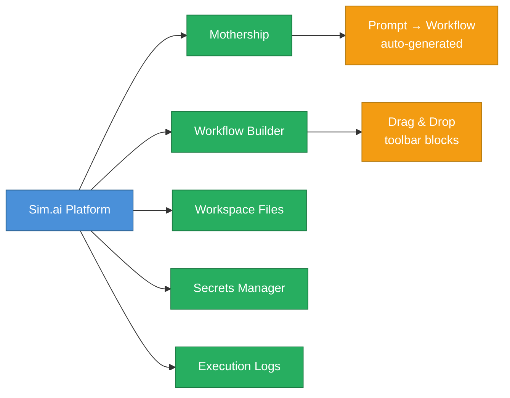
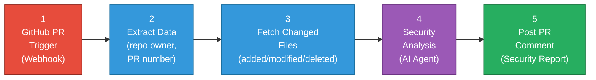
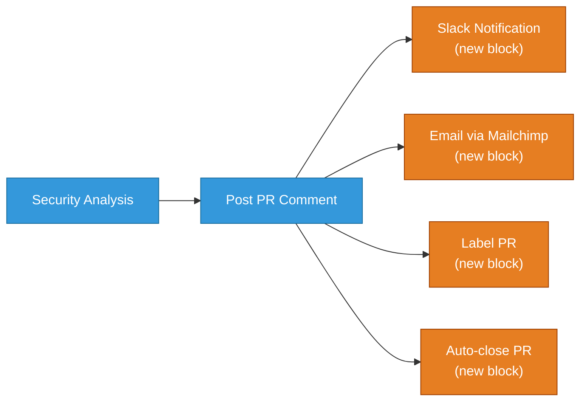

# Capstone: AI DevSecOps Workflow on Pull Requests

<details open>
<summary><b>Capstone: AI DevSecOps Workflow on Pull Requests (CS46H)</b></summary>

## Table of Contents

- [Overview](#overview)
- [Why AI-Powered DevSecOps?](#why-ai-powered-devsecops)
- [Platform: Sim.ai](#platform-simai)
- [Workflow Architecture](#workflow-architecture)
- [Building with Mothership (Prompt-to-Workflow)](#building-with-mothership-prompt-to-workflow)
- [GitHub Webhook Configuration](#github-webhook-configuration)
- [Live Demo: Detecting a Hardcoded Password](#live-demo-detecting-a-hardcoded-password)
- [Extending the Workflow](#extending-the-workflow)
- [Summary](#summary)

---

## Overview

This capstone demonstrates how to build an end-to-end AI-powered DevSecOps workflow using zero coding. When a developer opens a GitHub pull request, the workflow automatically performs a security analysis of every changed file and posts a detailed security report back as a PR comment — with a final recommendation to approve or block the merge.

The key insight: AI writes code that is functionally correct but often insecure. This workflow puts an AI security reviewer on every PR automatically, replacing tool lock-in with a fully customizable AI agent.

---

## Why AI-Powered DevSecOps?

```diff
+ Problem: Developers use AI to write code → code is functionally correct but security-prone
+ Problem: Traditional security tools are limited to their vendor's research rules
! Problem: Tool lock-in and vendor lock-in restrict what security checks are possible
- Old approach: static SAST tools → fixed rules → miss AI-generated vulnerability patterns
+ New approach: AI security agent → natural language rules → fully customizable checks
```

**The Business Case:**

| Traditional Security Tools | AI DevSecOps Workflow |
|---|---|
| Fixed vendor rule sets | Fully customizable — add/remove checks via prompt |
| Vendor lock-in | Bring Your Own Model (BYOM) |
| License costs | Sim.ai free tier (1,000 credits on signup) |
| Rules updated quarterly | AI knowledge updated continuously |
| Cannot reason about context | AI understands code intent, not just patterns |

> [!IMPORTANT]
> Every organization adopting AI-assisted coding MUST add an AI security layer to the PR review process. Developers using GitHub Copilot, ChatGPT, or Cursor to generate code introduce security vulnerabilities that only an AI reviewer can reliably catch at scale.

---

## Platform: Sim.ai

**Sim.ai** is a no-code AI workflow platform for building, deploying, and orchestrating multi-agent AI workflows.



**Key Features:**
- **Mothership** — AI that reads a prompt and builds the entire workflow automatically
- **Workflow Builder** — Visual drag-and-drop tool for manual workflow construction
- **Workspace Files** — Store prompts, configs, and reference documents within the platform
- **Secrets Manager** — Secure storage for API keys, GitHub tokens, database credentials
- **Execution Logs** — Full audit trail of every workflow run with success/failure status

**Getting Started:**
1. Create a free account at sim.ai (1,000 free credits included)
2. Navigate to **Workspace → Files** to store your workflow prompts
3. Use **Mothership** to build workflows from natural language prompts
4. Use **Settings → Secrets** to store sensitive tokens securely

> [!NOTE]
> Sim.ai supports bring-your-own-model (BYOM): you can connect OpenAI, Anthropic, Google, or any API-compatible LLM to the security analysis agent. You are not locked into a single AI provider.

---

## Workflow Architecture

The DevSecOps AI workflow consists of exactly 5 blocks executed sequentially on every GitHub PR creation event.



**Block-by-Block Breakdown:**

| Block | Type | Purpose | Key Data |
|-------|------|---------|---------|
| **GitHub PR** | Trigger | Receives webhook event on PR creation | PR payload → triggers workflow |
| **Extract Data** | Data | Parses PR metadata | repo owner, PR number, branch |
| **Fetch Changed Files** | Data | Gets all files added/modified/deleted | File paths + diffs |
| **Security Analysis** | AI Agent | Runs AI security review on each file | Vulnerability findings |
| **Post PR Comment** | Output | Writes formatted report to GitHub PR | Approve / Block recommendation |

**Security Checks Performed by the AI Agent:**

```diff
+ Check 1: Hard-coded secrets (passwords, API keys, tokens in source code)
+ Check 2: SQL/Command injection vulnerabilities
+ Check 3: Unsafe deserialization patterns
+ Check 4: Any additional checks defined in your prompt
! All checks are natural language — remove a line from the prompt to disable a check
- Traditional tools: fixed rules you cannot modify without vendor support
```

---

## Building with Mothership (Prompt-to-Workflow)

The entire workflow is built from a single prompt stored in the Sim.ai workspace. No coding required.

### Step-by-Step Build Process

**Step 1: Write the workflow requirement prompt**

Store a detailed prompt in **Workspace → Files** as `DevSecOps.md`. The prompt structure:

```markdown
# DevSecOps AI Workflow Requirements

## Objective
Build an automated AI workflow that performs security analysis on every GitHub 
pull request and posts a summarized report back as a pull request comment.

## Workflow Steps
1. Trigger: GitHub PR creation webhook
2. Extract PR data: repository owner, PR number, changed files
3. Security Agent analysis — check for:
   - Hard-coded secrets (passwords, API keys, tokens)
   - SQL injection vulnerabilities
   - Command injection vulnerabilities  
   - Unsafe deserialization
4. Aggregate findings with severity levels (Critical/High/Medium/Low)
5. Post formatted security report as PR comment with approve/block recommendation

## Output Format Example
**AI Security Scan Report**
- File: backend/src/db.js
  - Finding: Hardcoded password detected
  - Severity: CRITICAL
  - Recommendation: Use environment variables

**Overall Recommendation:** BLOCK MERGE / APPROVE MERGE
```

**Step 2: Invoke Mothership with a file reference**

In the Mothership chat interface:
```
Build an AI workflow according to the requirement that is in the file 
DevSecOps.md from the workspace.
```

> [!IMPORTANT]
> Mothership reads the file from the workspace, understands the requirement, and builds all 5 blocks automatically in 30–60 seconds. You do not paste the full prompt into the chat — you reference the file by name.

**Step 3: Mothership builds the workflow**

```diff
+ Mothership reads DevSecOps.md
+ Understands: "DevSecOps workflow triggers on GitHub pull request"
+ Creates: GitHub PR block → Extract data → Fetch files → Security agent → Post comment
! Review the generated workflow — each block is fully editable after generation
```

**Step 4: Deploy**

Click the **Deploy** button. The workflow becomes live and a **Webhook URL** is generated. This webhook URL is what you configure in GitHub repository settings.

---

## GitHub Webhook Configuration

After deploying the Sim.ai workflow, configure GitHub to call it on every PR.

**Setup Steps (per repository):**

```bash
# One webhook URL → can be added to unlimited repositories
# Any PR in any configured repo triggers the same workflow
```

1. Go to **GitHub Repository → Settings → Webhooks → Add webhook**
2. **Payload URL**: Paste the Sim.ai webhook URL
3. **Content type**: `application/json`
4. **Secret**: Leave blank (unless you add secret validation to the workflow)
5. **Events**: Select "Let me select individual events" → check **Pull requests**
6. **Active**: ✅ checked
7. Click **Add webhook**

> [!NOTE]
> One Sim.ai webhook URL can be added to any number of GitHub repositories. Every PR created across all those repos will trigger the same security analysis workflow.

**Secure Token Storage:**

Before the workflow can comment on PRs, it needs your GitHub Personal Access Token (PAT):
1. Go to **Sim.ai Settings → Secrets**
2. Add `GITHUB_TOKEN` = your PAT (with `repo` and `pull_request:write` scopes)
3. The workflow references the secret by name — the token is never exposed in logs

---

## Live Demo: Detecting a Hardcoded Password

**Test scenario:** A developer creates a PR with a hardcoded database password in `backend/src/db.js`:

```javascript
// Insecure code added to the test branch
const query = db.execute(
  "SELECT * FROM users WHERE id = ?",
  { password: "MyS3cr3tP@ssw0rd" }  // ← hardcoded credential
);
```

**Workflow Execution (timeline):**
```diff
! T+0s:  Developer opens PR from test branch to main
! T+1s:  GitHub sends webhook payload to Sim.ai
! T+5s:  Block 2 extracts repo owner + PR number
! T+10s: Block 3 fetches changed files (backend/src/db.js diff)
! T+30s: Block 4 — AI agent analyzes the diff
! T+60s: Block 5 posts security report as PR comment
```

**AI-Generated Security Report (posted as PR comment):**

```markdown
## 🔒 AI Security Scan Report

### backend/src/db.js
| Finding | Severity | Recommendation |
|---------|----------|----------------|
| Hardcoded password detected in database query | **CRITICAL** | Remove the password and use environment variables (process.env.DB_PASSWORD) |

### Overall Recommendation: ❌ BLOCK MERGE

Critical security vulnerability detected. Do not merge until the hardcoded 
credential is replaced with a secure environment variable reference.
```

> [!IMPORTANT]
> The AI correctly identified the hardcoded password, classified it as CRITICAL severity, provided a specific remediation recommendation, and blocked the merge — all automatically, in under 60 seconds, with zero human review required.

---

## Extending the Workflow

Because the security checks are defined in a natural language prompt (not vendor rules), the workflow is trivially extensible.

**Adding checks:** Append lines to the prompt:
```diff
+ Add: Check for insecure random number generation (Math.random() for security contexts)
+ Add: Check for missing HTTPS enforcement in API calls
+ Add: Check for prototype pollution vulnerabilities in JavaScript
```

**Removing checks:** Delete lines from the prompt:
```diff
- Remove: Unsafe deserialization (not relevant for this codebase)
```

**Adding notification channels:**



**Adding blocks via Mothership:**
```
Extend the workflow: after posting the PR comment, if severity is CRITICAL, 
also send a Slack notification to #security-alerts channel.
```

---

## Summary

```diff
+ Key Achievement: End-to-end DevSecOps AI workflow built with a single prompt
+ Zero code written: 5-block workflow generated entirely by Mothership AI
+ Real detection: Hardcoded password found, classified CRITICAL, merge blocked
+ Scalable: One webhook URL covers unlimited GitHub repositories
+ Customizable: Add/remove security checks by editing natural language prompt
- Limitation: Free tier has 1,000 credits; heavy usage requires Pro/Max plan
! Important: Always store GitHub tokens in Sim.ai Secrets — never hardcode them in the workflow
```

### Quick Reference

| Action | How |
|--------|-----|
| Build workflow from prompt | Mothership → reference file from workspace |
| Store sensitive tokens | Sim.ai Settings → Secrets |
| Get webhook URL | Click GitHub PR block → copy webhook URL |
| Add to GitHub repo | Settings → Webhooks → Payload URL → select Pull requests event |
| Extend the workflow | Drag block from toolbar or ask Mothership to add it |
| View execution logs | Sim.ai → Logs tab |
| Apply discount | Use link in description + coupon code `abi20` for 20% off Pro |

### Expert Insight

**Real-world Application:**
Deploy this workflow as the first line of defense in your CI/CD pipeline. Configure it on all repositories in your GitHub organization simultaneously — one webhook deployment, universal coverage. Combine with branch protection rules requiring the AI security review to pass before merge is allowed.

**Expert Path:**
1. Master the prompt engineering for security rules (what to detect, what severity, what output format)
2. Connect a stronger model (GPT-4o, Claude 3.5) for more accurate vulnerability detection
3. Add OWASP Top 10 as the baseline security check list in the prompt
4. Build a feedback loop: when a false positive is flagged, update the prompt to exclude that pattern
5. Extend to infrastructure-as-code files (Terraform, Helm charts) — same workflow, different prompt

**Common Pitfalls:**
- **Webhook not triggering**: Verify Content-Type is `application/json` and event is set to "Pull requests" (not just "Pushes")
- **GitHub token scope**: Token needs `repo` scope and `pull_requests:write` permission — read-only tokens cannot post comments
- **False positives**: If the AI flags safe patterns, refine the prompt with "Do not flag X when Y context"
- **Credit exhaustion**: Each workflow run consumes credits proportional to the model used + number of changed files; monitor usage in the Sim.ai dashboard
- **Mothership vs. manual build**: If Mothership generates an incorrect block, switch to manual drag-and-drop mode to fix individual blocks without regenerating the whole workflow

</details>
