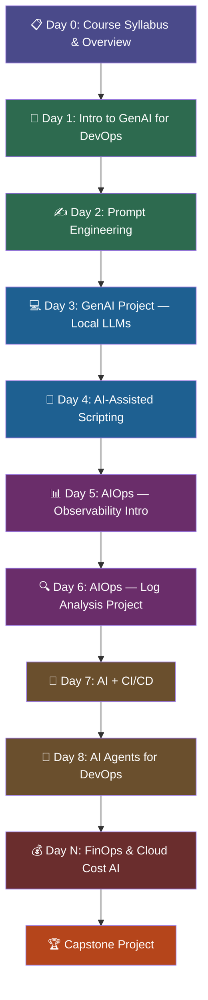
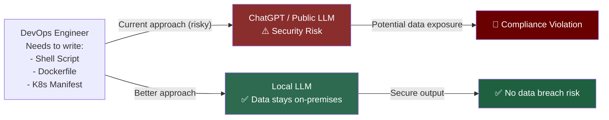
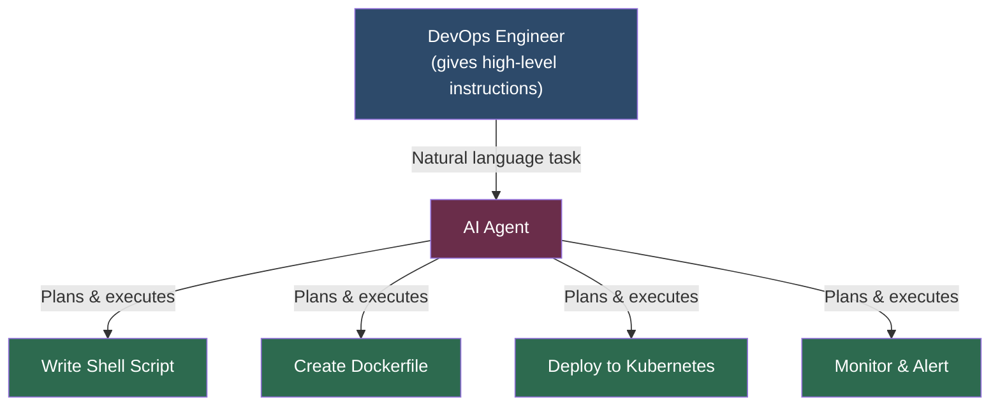
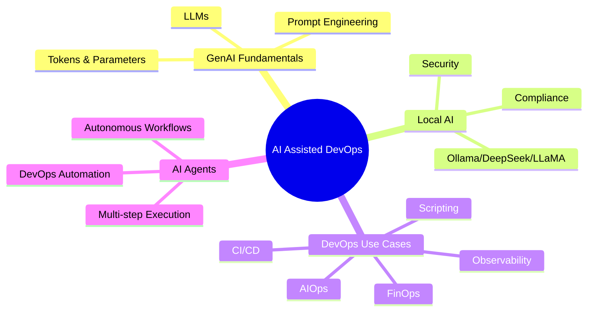
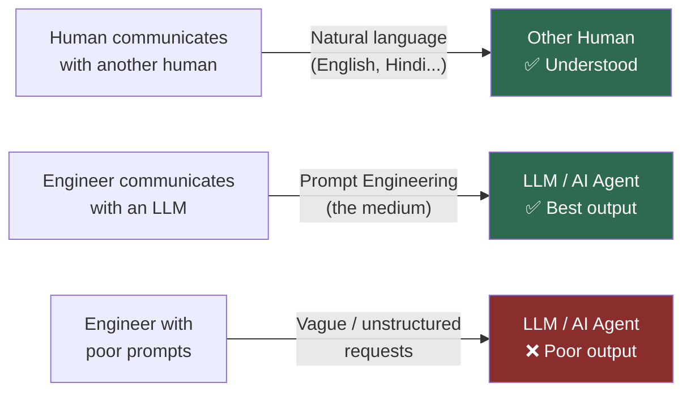
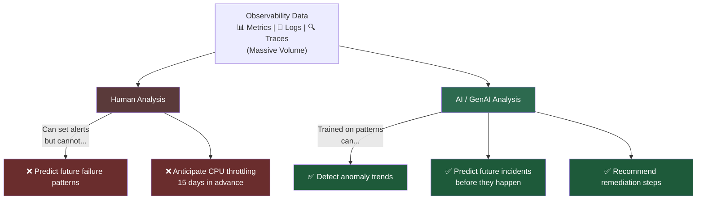
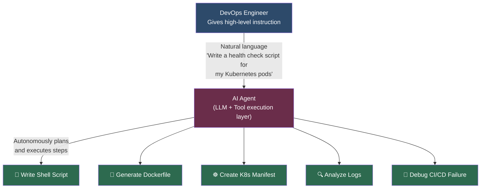

# Day 0: AI Assisted DevOps — Course Syllabus & Overview

<details open>
<summary><b>Day 0: AI Assisted DevOps — Course Syllabus & Overview (Claude Sonnet 4.6 Thinking)</b></summary>

## Table of Contents

- [Overview: What is AI Assisted DevOps?](#overview-what-is-ai-assisted-devops)
- [Course Context & Channel Background](#course-context--channel-background)
- [Prerequisites](#prerequisites)
- [Course Syllabus — Day-by-Day Breakdown](#course-syllabus--day-by-day-breakdown)
  - [Day 1: Introduction to Generative AI for DevOps](#day-1-introduction-to-generative-ai-for-devops)
  - [Day 2: Prompt Engineering](#day-2-prompt-engineering)
  - [Day 3: Running LLMs Locally (GenAI Project)](#day-3-running-llms-locally-genai-project)
  - [Day 4: AI-Assisted Shell Scripting](#day-4-ai-assisted-shell-scripting)
  - [Day 5 & 6: AIOps — Observability & Incident Response](#day-5--6-aiops--observability--incident-response)
  - [Day 7: AI + CI/CD Pipelines](#day-7-ai--cicd-pipelines)
  - [Day 8: AI Agents for DevOps](#day-8-ai-agents-for-devops)
  - [Day N: Cloud Cost Optimization & FinOps with AI](#day-n-cloud-cost-optimization--finops-with-ai)
  - [Capstone Project](#capstone-project)
- [Key Themes Across the Course](#key-themes-across-the-course)
- [Summary](#summary)

---

## Overview: What is AI Assisted DevOps?

In 2025, the entire tech industry is focused on Generative AI — but the critical question for practitioners is: **how can DevOps engineers specifically leverage Generative AI to enhance their day-to-day productivity?**

This course answers that question with a structured, hands-on, 10-day curriculum. Rather than just exploring AI tools in isolation, this series focuses on the intersection of **Generative AI capabilities** and **real DevOps workflows** — from scripting to observability, CI/CD, AI agents, and cloud cost management.

> [!IMPORTANT]
> The course is designed for **both** experienced DevOps professionals looking to stay current **and** aspiring DevOps engineers who want to build skills aligned with market demands.

---

## Course Context & Channel Background

The YouTube channel (Abhishekh Veeramalla) is well-known for producing **Zero to Hero** series that cover the full DevOps technology stack:

| Available Zero-to-Hero Courses |
|-------------------------------|
| DevOps 0 to Hero              |
| AWS 0 to Hero                 |
| Azure 0 to Hero (including Azure DevOps) |
| Python                        |
| Terraform                     |
| Observability                 |
| Kubernetes                    |
| Docker                        |

All courses include both **theory** and **practical projects** and are available **free** on the channel.

> [!NOTE]
> No registration or sign-up is required. Subscribe to the channel and optionally follow the Telegram channel to get updates on new video releases (planned cadence: at least 3 episodes per week).

---

## Prerequisites

```diff
+ No strict prerequisites — the course is designed to be accessible.
! Recommended: Familiarity with DevOps fundamentals (Docker, Kubernetes, CI/CD, Python, scripting).
- Do NOT expect deep ML/AI theory — the focus is practical application for DevOps engineers.
```

The DevOps landscape that serves as prior knowledge context includes:
- **Docker** — containerization
- **Kubernetes** — container orchestration
- **CI/CD** — continuous integration and delivery pipelines
- **Python** — scripting and automation
- **Observability** — metrics, logs, and traces

---

## Course Syllabus — Day-by-Day Breakdown



---

### Day 1: Introduction to Generative AI for DevOps

**Topic:** Fundamentals of Generative AI for DevOps Engineers

**What you will learn:**
- What is **Generative AI** and why does it matter for DevOps engineers?
- Understanding **Large Language Models (LLMs)** — what they are and how they work at a conceptual level
- The **DevOps + AI Landscape** — which AI tools are relevant to DevOps practitioners
- How to **interact with LLMs** effectively in a DevOps context
- **Hands-on session** at the end of the video

> [!NOTE]
> Day 1 is intentionally "light" as it is the first day of the series — focused on building foundational understanding before diving into heavy hands-on work.

---

### Day 2: Prompt Engineering

**Topic:** Prompt Engineering Explained — The Core Skill for AI-Assisted DevOps

**Why it matters:**

> 💡 Just as humans communicate with each other using languages like English or Hindi, the medium for communicating with Large Language Models is **prompt engineering**. The more efficiently you communicate with an LLM, the better the output you get.

**What you will learn:**
- **Tokens** — what they are and why they matter
- **Parameters** — temperature, max tokens, and other LLM settings
- **Prompt Engineering Techniques:**

| Technique | Description |
|-----------|-------------|
| Zero-shot prompting | Asking the LLM without providing any examples |
| Few-shot prompting | Providing a few examples to guide the model's response |
| N-shot prompting | Providing N examples for better context |
| Chain-of-thought | Breaking complex reasoning into sequential steps |

- **Hands-on practical demonstration** applying prompt engineering techniques

> [!IMPORTANT]
> Day 2 is described as **"super important for the entire series"** because prompt engineering is the foundational skill used throughout the rest of the course. As LLMs and AI agents keep evolving, the ability to communicate effectively with them (i.e., prompt engineering) remains the most critical skill for any software or DevOps engineer.

```diff
+ The more efficiently you prompt an LLM → the better the output quality
! Prompt engineering applies to LLMs, AI agents, and all AI-assisted workflows
- Poor prompting = poor, unreliable, or irrelevant responses
```

---

### Day 3: Running LLMs Locally (GenAI Project)

**Topic:** Running Large Language Models Locally on Your Machine

**The Problem This Solves:**

Many DevOps engineers and organizations face this challenge: Using public LLMs like ChatGPT risks exposing proprietary code, infrastructure details, or sensitive configuration data to third-party services — a major **compliance and security concern**.



**What you will learn:**
- How to run LLMs **locally on your machine** (e.g., DeepSeek, LLaMA)
- How to make **API calls to local LLMs** programmatically
- How DevOps engineers can **communicate with locally-running models** to get the best output
- How to enhance **day-to-day productivity** using local LLMs without sending sensitive data to public APIs

> [!IMPORTANT]
> Running models locally eliminates compliance and security risks that arise when using public LLMs with organization-specific data. Organizations with strict compliance requirements should use local LLMs.

---

### Day 4: AI-Assisted Shell Scripting

**Topic:** AI-Assisted Scripting — Shell & Python

**Focus:** One of the core day-to-day activities in DevOps is writing scripts. This day explores how Generative AI can dramatically improve scripting productivity.

**Scripting types covered:**
- Shell scripting
- Python scripting

**What you will learn:**
- Best AI tools for scripting assistance
- How to use those tools effectively in your workflow
- Hands-on demonstration
- A **challenge** at the end of the video to reinforce learning

---

### Day 5 & 6: AIOps — Observability & Incident Response

**Topic:** AIOps — AI for Observability and Incident Response (Two-Day Coverage)

**Why this is important — The Human Limitation Problem:**

```diff
! As a DevOps engineer working with observability, you deal with:
!   - Metrics (CPU, memory, disk, network)
!   - Logs (application logs, system logs, audit logs)
!   - Traces (distributed tracing across microservices)
! This means you are managing HUGE volumes of data.
- As a human, no matter how many alarms or alerts you set up, you CANNOT:
-   - Predict future failure patterns
-   - Anticipate issues before they happen
+ But Generative AI CAN:
+   - Detect patterns in large datasets
+   - Anticipate future events
+   - Predict issues before they cause outages
```

**Real-world example:**
> Today your VM's CPU is at 50% usage — but can you predict that after 15 days your application might crash because of CPU throttling? As a human, this is impossible. But generative AI can analyze the trend and warn you in advance.

**What you will learn across Days 5 & 6:**

| Day | Focus |
|-----|-------|
| **Day 5** | Introduction to AIOps — concepts, tools, and free playgrounds |
| **Day 6** | Hands-on AIOps project using Python — log analysis with AI |

> [!NOTE]
> Rather than using open-source tools like Prometheus + Grafana (which won't generate realistic data), the course will use an **enterprise-grade AIOps tool** to show how AIOps is implemented in real-time with actual data. Tools mentioned: ManageEngine, Dynatrace.

---

### Day 7: AI + CI/CD Pipelines

**Topic:** Generative AI + CI/CD — Improving Your Pipeline with AI

**What you will learn:**
- How to **write CI/CD pipelines** with AI assistance
- How to perform **log analysis within CI/CD pipelines** using AI
- How to use AI to **improve existing CI/CD processes**
- Hands-on demonstration

**Key DevOps Workflow with AI:**

```diff
! Client Code Change → CI/CD Pipeline → AI-Assisted Steps:
!   → Automated pipeline generation
!   → AI-powered log analysis
!   → Intelligent failure detection
!   → Automated remediation suggestions
+ Result: Faster, smarter, more reliable CI/CD
```

---

### Day 8: AI Agents for DevOps

**Topic:** AI Agents — Building Autonomous DevOps Assistants

**What are AI Agents?**
AI agents are systems powered by LLMs that can **perform tasks autonomously on your behalf**. They go beyond simple question-answering — they can execute multi-step workflows, make decisions, and interact with external systems.



**What you will learn:**
- How to **create a simple AI agent** from scratch
- How a DevOps engineer can **build and use an AI agent** to perform tasks on their behalf
- Cool hands-on demonstration

---

### Day N: Cloud Cost Optimization & FinOps with AI

**Topic:** AI-Powered Cloud Cost Optimization (FinOps)

**Why AI is essential for FinOps:**
Cloud cost management deals with massive amounts of billing and usage data. Just as with observability, **humans struggle to identify patterns and optimization opportunities** in large datasets — but AI excels here.

**What you will learn:**
- The intersection of **compliance, security, and FinOps** in cloud environments
- How Generative AI can help **predict and optimize cloud costs**
- How AI helps organizations **reduce cloud expenditure**
- Hands-on demonstration

---

### Capstone Project

**Topic:** End-to-End GenAI + DevOps Project

The final day will bring together **all concepts learned** from Day 1 through Day N into a comprehensive, end-to-end project. The exact project was still being planned at the time of this recording, but it will:
- Use **AI agents**
- Combine **multiple skills** from the course
- Be **showcase-worthy** — something you can demonstrate on LinkedIn or GitHub

> [!TIP]
> The capstone project is designed to be portfolio-ready, helping you demonstrate AI-assisted DevOps skills to prospective employers.

---

## Key Themes Across the Course



| Theme | Description |
|-------|-------------|
| 🔐 **Security-First** | Running local LLMs to avoid data exposure to public APIs |
| 📊 **Data Scale** | AI handles the massive data volumes in observability and FinOps |
| ⚡ **Productivity** | Every day focuses on measurable productivity improvements |
| 🛠️ **Hands-On** | Each day includes practical demos and challenges |
| 🔄 **Iterative Learning** | Concepts build on each other — prompt engineering feeds into agent building |

---

## Summary

### Key Takeaways

```diff
+ Day 0 establishes the "why" — DevOps engineers must leverage GenAI to stay relevant in 2025+
+ Prompt engineering (Day 2) is the most critical foundational skill for the entire series
+ Local LLMs (Day 3) solve the security/compliance problem with public AI tools
+ AIOps (Days 5 & 6) is the highest-ROI application area — AI excels at pattern detection in large datasets
+ AI Agents (Day 8) represent the future of autonomous DevOps workflows
! The course syllabus may evolve positively — additional interesting topics may be added
- No strict prerequisites, but DevOps fundamentals will help you get more out of the hands-on sessions
```

### Quick Reference — Course Structure

| Day | Topic | Key Skill |
|-----|-------|-----------|
| **Day 0** | Course Syllabus & Overview | Course orientation |
| **Day 1** | Intro to GenAI for DevOps | LLMs, AI tools landscape |
| **Day 2** | Prompt Engineering | Zero-shot, few-shot, chain-of-thought |
| **Day 3** | Local LLMs & GenAI Project | Running DeepSeek/LLaMA locally, API calls |
| **Day 4** | AI-Assisted Scripting | Shell scripting, Python scripting with AI |
| **Day 5** | AIOps Introduction | Observability + AI concepts |
| **Day 6** | AIOps Log Analysis Project | Python-based log analysis |
| **Day 7** | AI + CI/CD | Pipeline generation, log analysis in CI |
| **Day 8** | AI Agents | Building autonomous DevOps agents |
| **Day N** | FinOps & Cloud Cost AI | Cost prediction and optimization |
| **Capstone** | End-to-End Project | All skills combined |

### Expert Insight

**🌍 Real-world Application:**
In production environments, the combination of local LLMs + AIOps is particularly powerful. Organizations can keep sensitive infrastructure data on-premises (using local models) while gaining AI-powered insights for observability, cost optimization, and incident response — eliminating the tension between AI productivity gains and security compliance.

**🚀 Expert Path:**
1. Master prompt engineering first — it is the skill that multiplies the value of every other AI tool
2. Practice with local LLMs early so you understand the security model
3. Focus on AIOps Days 5 & 6 — these have the highest real-world impact in production environments
4. Build the capstone project end-to-end and document it for your portfolio

**⚠️ Common Pitfalls:**
- Sending sensitive infrastructure details, credentials, or architecture diagrams to public LLMs (ChatGPT, etc.) — use local models for sensitive work
- Skipping prompt engineering basics and going directly to advanced tools — the fundamentals determine output quality
- Treating AI tools as magic boxes — understand what they can and cannot do to use them effectively
- Missing Day 2 (Prompt Engineering) — all subsequent days depend on this skill

> [!IMPORTANT]
> **Transcript Corrections Applied:**
> The following transcription errors were corrected in this study guide:
> - "insns / inare / inger / inet / inire" → "engineers" (repeated garbled audio for "DevOps engineers")
> - "metrix" → "metrics"
> - "phobs" → "FinOps"
> - "compains" → "compliance"
> - "nsh prompt engineering" → "N-shot prompt engineering"
> - "coure syllabus" → "course syllabus"

</details>

<details open>
<summary><b>Day 0: AI Assisted DevOps — Course Syllabus & Overview (CS46H)</b></summary>

## Table of Contents

- [DAY-0: AI Assisted DevOps Zero to Hero | Course Syllabus](#day-0-ai-assisted-devops-zero-to-hero--course-syllabus)
  - [What Is This Course About?](#what-is-this-course-about)
  - [Channel Background](#channel-background)
  - [Prerequisites](#prerequisites)
  - [10-Day Course Syllabus](#10-day-course-syllabus)
    - [Day 1 — Introduction to Generative AI for DevOps](#day-1--introduction-to-generative-ai-for-devops)
    - [Day 2 — Prompt Engineering](#day-2--prompt-engineering)
    - [Day 3 — Running LLMs Locally (GenAI Project)](#day-3--running-llms-locally-genai-project)
    - [Day 4 — AI-Assisted Scripting](#day-4--ai-assisted-scripting)
    - [Day 5 — AIOps & Observability (Part 1)](#day-5--aiops--observability-part-1)
    - [Day 6 — AIOps with Enterprise Tools (Part 2)](#day-6--aiops-with-enterprise-tools-part-2)
    - [Day 7 — AI + CI/CD Pipelines](#day-7--ai--cicd-pipelines)
    - [Day 8 — AI Agents for DevOps](#day-8--ai-agents-for-devops)
    - [Day N — Cloud Cost Optimization & FinOps with AI](#day-n--cloud-cost-optimization--finops-with-ai)
    - [Capstone Project](#capstone-project)
  - [Release Schedule & Resources](#release-schedule--resources)
- [Summary](#summary)

---

## DAY-0: AI Assisted DevOps Zero to Hero | Course Syllabus

### What Is This Course About?

In 2025, Generative AI has become the defining force in technology. For DevOps engineers, the critical question is not *what* AI is — it is **how to harness it to accelerate day-to-day operations**. This course bridges that gap: a structured, hands-on 10-day series where every session delivers both conceptual understanding and practical, reproducible demos.

The course targets DevOps engineers at any level who want to stay ahead by integrating Generative AI into workflows like scripting, observability, CI/CD, and cloud cost management.

> [!IMPORTANT]
> This course focuses on **practical application**, not deep AI/ML theory. If you can write a shell script and understand what Docker does, you have enough background to get maximum value.

---

### Channel Background

The instructor is **Abhishek Veeramalla**, known for free Zero-to-Hero series covering the full DevOps stack:

```diff
+ DevOps 0 to Hero
+ AWS 0 to Hero
+ Azure 0 to Hero (includes Azure DevOps)
+ Python | Terraform | Observability | Kubernetes | Docker
! All courses include Theory + Practical Projects — completely free
```

| Course Characteristic | Details |
|----------------------|---------|
| Format | Theory + Practical Projects |
| Access | Free on YouTube |
| Registration | None required — just subscribe |
| Updates | ~3 episodes/week; Telegram channel for notifications |

---

### Prerequisites

```diff
+ No strict prerequisites — course is accessible to beginners
! Recommended background: fundamentals of DevOps (Docker, Kubernetes, CI/CD, Python, scripting)
- Not required: Deep ML/AI theory — focus is always on practical DevOps application
```

> [!NOTE]
> Even if you are an aspiring DevOps engineer (not yet working professionally), this course helps you stay current with market trends and adds AI-assisted skills to your toolkit.

---

### 10-Day Course Syllabus


---

#### Day 1 — Introduction to Generative AI for DevOps

**Overview:** The foundational day sets up the "why" and "what" of Generative AI from a DevOps perspective — introducing LLMs, the AI tools landscape, and ending with a simple hands-on session.

**Key Topics:**
- What is Generative AI and why it matters in 2025
- Understanding **Large Language Models (LLMs)** — what they are and how to interact with them
- The DevOps AI Landscape — which Generative AI tools are specifically useful for DevOps engineers
- Hands-on session at the end of the video

> [!NOTE]
> Day 1 is intentionally introductory — "light" content to build the foundation before the hands-on days begin.

---

#### Day 2 — Prompt Engineering

**Overview:** The most critical day of the entire course. Prompt engineering is the primary interface between a DevOps engineer and any LLM — getting this right amplifies every subsequent AI interaction.

**Why Prompt Engineering Is the #1 Skill:**



**What you will learn:**

| Topic | Description |
|-------|-------------|
| Tokens | The basic unit of LLM input/output; directly affects API cost |
| Parameters | Temperature, max tokens — controls LLM behavior and creativity |
| Zero-shot prompting | Direct task request with no examples provided |
| Few-shot prompting | Providing 2–3 examples to guide output style |
| N-shot prompting | Providing N examples for precise output conditioning |
| Chain-of-Thought (CoT) | Breaking reasoning into sequential steps for complex tasks |

- Practical hands-on demonstration applying all techniques

> [!IMPORTANT]
> Day 2 is called out as **"super important for the entire series."** As LLMs and AI agents keep evolving, the interface between engineer and AI stays the same: **how well you prompt determines how useful the output is.**

---

#### Day 3 — Running LLMs Locally (GenAI Project)

**Overview:** DevOps engineers write shell scripts, Dockerfiles, and Kubernetes manifests daily. Using public LLMs like ChatGPT to help with these tasks introduces a serious risk — sensitive organizational data may be sent to third-party servers. This day solves that problem.

**The Security/Compliance Problem:**

```diff
! DevOps engineer needs to write a Dockerfile or K8s manifest
- Using ChatGPT or public LLMs:
-   → Sends infrastructure details / proprietary config to third-party servers
-   → Violates compliance policies in most organizations
+ Using Local LLMs (e.g., DeepSeek, LLaMA via Ollama):
+   → Data never leaves your machine
+   → Eliminates compliance and security risks
+   → Zero data breach exposure
```

**What you will learn:**
- How to run LLMs **locally on your machine** (DeepSeek, LLaMA, etc.)
- How to make **API calls** to locally running LLMs programmatically
- How DevOps engineers can communicate with local models to maximize day-to-day productivity
- Why local LLMs are the right choice for organizations with strict compliance requirements

> 💡 **Key Insight:** Running a local LLM is not technically difficult — the real value is knowing *how to use it effectively* in your DevOps workflow and *when* to prefer it over cloud APIs.

---

#### Day 4 — AI-Assisted Scripting

**Overview:** Scripting is one of the most frequent, time-consuming tasks in a DevOps role. This day explores how Generative AI can dramatically accelerate writing shell scripts and Python scripts.

**What you will learn:**
- Best AI tools available for scripting assistance
- How to integrate AI scripting tools into your actual workflow
- Hands-on demonstration
- A **challenge** at the end of the video to test your skills

**Scripting types covered:**
- Shell scripting (Bash)
- Python scripting

---

#### Day 5 — AIOps & Observability (Part 1)

**Overview:** Observability generates enormous volumes of data — metrics, logs, and traces. Humans cannot realistically identify patterns or predict failures in this data at scale. Generative AI fundamentally changes this.

**The Human Limitation in Observability:**



**Real-world example from the instructor:**
> Today your VM's CPU is at 50% usage. Can you predict that in 15 days your application will crash due to CPU throttling? As a human, this is impossible. Generative AI can analyze usage trends and anticipate this before it causes an outage.

**What you will learn:**
- The role of Generative AI in observability and incident response
- AIOps concepts, free playgrounds, and available tools
- How AI processes metrics, logs, and traces to generate actionable insights

---

#### Day 6 — AIOps with Enterprise Tools (Part 2)

**Overview:** Continuation of AIOps with enterprise-grade tooling and real-time data demonstration. Open-source tools like Prometheus + Grafana don't generate realistic production-scale data for AIOps demos; enterprise tools provide authentic context.

**What you will learn:**
- Hands-on with an enterprise AIOps tool (e.g., ManageEngine, Dynatrace)
- How AIOps is implemented in real production environments
- Live demonstration with real-time data

> [!NOTE]
> Days 5 and 6 are both AIOps-focused and build on each other. Abhishek describes this as his **"favorite part"** of the course because the ROI of Generative AI is highest when applied to observability data at scale.

---

#### Day 7 — AI + CI/CD Pipelines

**Overview:** CI/CD is the backbone of modern DevOps delivery. This day explores how Generative AI can help write, analyze, and improve CI/CD pipelines — turning slow debugging cycles into rapid automated feedback.

**What you will learn:**
- How to **write CI/CD pipelines** using AI assistance
- How to perform **AI-powered log analysis** within CI/CD workflows
- How to **improve existing pipelines** using Generative AI
- Hands-on demonstration

**The AI-Enhanced CI/CD Flow:**

```diff
! Developer commits code → CI/CD pipeline triggers →
! AI-Assisted Steps:
+   → AI generates pipeline YAML (GitHub Actions, Jenkins, GitLab CI)
+   → AI analyzes build/test logs for failure root cause
+   → AI suggests fixes for broken pipeline stages
+   → AI reviews security and compliance in pipeline config
+ Result: Faster feedback loops, smarter failure diagnosis
```

---

#### Day 8 — AI Agents for DevOps

**Overview:** AI Agents represent a major leap beyond simple chatbots — they can autonomously plan and execute multi-step tasks, making them enormously valuable for DevOps automation.

**What AI Agents can do for DevOps:**



**What you will learn:**
- How to **create a simple AI Agent** from scratch
- How a DevOps engineer builds and uses an AI Agent to perform tasks autonomously
- Hands-on demonstration of real DevOps task execution by an AI Agent

---

#### Day N — Cloud Cost Optimization & FinOps with AI

**Overview:** Cloud cost management, like observability, involves massive volumes of billing and usage data. AI excels precisely where human data-processing capacity is exceeded.

**Why AI Shines in FinOps:**

```diff
! Cloud cost data = massive datasets (billing APIs, usage metrics, resource utilization)
- As humans, we fail to identify patterns and optimization opportunities at this scale
+ Generative AI can:
+   → Analyze historical cost trends across hundreds of services
+   → Predict future spend trajectories before budget overruns occur
+   → Recommend rightsizing and reservation strategies
+   → Identify idle or wasteful resources automatically
```

**What you will learn:**
- The intersection of **compliance, security, and FinOps** in cloud environments
- How Generative AI predicts and recommends cost optimization strategies
- How AI helps organizations reduce cloud expenditure
- Hands-on demonstration

---

#### Capstone Project

**Overview:** The final session combines all skills learned from Day 1 through Day N into an end-to-end project that is portfolio-ready and showcaseable on social platforms.

**Capstone goals:**
- Use **AI Agents** as the primary orchestration mechanism
- **Integrate all skills** — prompt engineering, local LLMs, scripting, AIOps, CI/CD, FinOps
- Build something **showcase-worthy** for LinkedIn, GitHub, or technical interviews

> [!IMPORTANT]
> The exact capstone project was still being finalized at recording time. The syllabus may evolve positively — additional interesting topics not listed here may be added as the course develops.

---

### Release Schedule & Resources

| Item | Details |
|------|---------|
| **Day 1 Start Date** | 10th March at 9:00 PM IST |
| **Release Cadence** | At least 3 episodes per week |
| **Platform** | YouTube (free, no registration required) |
| **Notifications** | Subscribe to channel + join Telegram channel |
| **Telegram Content** | Video updates and course-related documents |

---

## Summary

### Key Takeaways

```diff
+ Course goal: teach DevOps engineers to leverage GenAI for measurable day-to-day productivity gains
+ Prompt Engineering (Day 2) is the most foundational skill — everything else in the course builds on it
+ Local LLMs (Day 3) are the security-compliant alternative to public LLMs for organizational use
+ AIOps (Days 5-6) delivers the highest real-world ROI — AI outperforms humans on large observability datasets
+ AI Agents (Day 8) represent the future of DevOps automation — autonomous, multi-step task execution
! Syllabus may expand positively — additional valuable topics may be added as the course progresses
- No strict prerequisites but DevOps fundamentals (Docker, K8s, CI/CD, scripting) maximize your learning
```

### Quick Reference — Full Course Map

| Day | Topic | What You Build / Learn |
|-----|-------|------------------------|
| **Day 0** | Course Syllabus | Course orientation and 10-day roadmap |
| **Day 1** | Intro to GenAI for DevOps | LLMs, AI tools landscape, first hands-on demo |
| **Day 2** | Prompt Engineering | Zero-shot, few-shot, N-shot, Chain-of-Thought |
| **Day 3** | Running LLMs Locally | DeepSeek/LLaMA on local machine, API calls |
| **Day 4** | AI-Assisted Scripting | Shell scripts + Python scripts with AI tools |
| **Day 5** | AIOps — Observability Intro | AI for metrics, logs, traces; free playgrounds |
| **Day 6** | AIOps — Log Analysis Project | Python-based AIOps with enterprise tool (real-time) |
| **Day 7** | AI + CI/CD | AI-assisted pipeline generation and log analysis |
| **Day 8** | AI Agents | Build autonomous DevOps AI agent with demo |
| **Day N** | FinOps & Cloud Cost AI | AI-powered cost prediction and optimization |
| **Capstone** | End-to-End Project | All skills combined into portfolio project |

### Expert Insight

**🌍 Real-world Application:**
The combination of **Local LLMs + AIOps** is the highest-value production pattern from this course. Organizations can run DeepSeek or LLaMA locally to assist with infrastructure code (keeping sensitive data on-premises), while using AIOps on observability data to predict incidents before they occur. These two capabilities together reduce MTTR (Mean Time to Resolve) and prevent compliance violations simultaneously.

**🚀 Expert Path:**
1. Start with **Day 2 (Prompt Engineering)** even before Day 1 if you're experienced — it pays dividends immediately in every AI interaction
2. Set up a **local LLM** (Ollama + LLaMA/DeepSeek) on your own machine during or after Day 3 and use it daily for scripting tasks
3. For the AIOps days, focus on the **enterprise tool demo** — this is closest to what you'll encounter in real production environments
4. Build the capstone project and **publish it on GitHub** — AI-assisted DevOps projects are highly visible to recruiters in 2025+

**⚠️ Common Pitfalls:**
- Using ChatGPT or public LLMs with actual infra configs, Kubernetes secrets, or pipeline credentials — always use local LLMs for sensitive organizational work
- Skipping Day 2 and jumping straight to hands-on days — poor prompt engineering makes every AI tool underperform
- Expecting AI to replace DevOps expertise — AI **augments** engineers; you still need to verify, test, and take ownership of the output
- Not completing the capstone — it is the only day that integrates all skills and creates a tangible, demonstrable portfolio artifact

**📝 Additional Diagnostic / Troubleshooting Notes:**
The following commands and concepts have diagnostic relevance:
- **LLM API health check** — `curl http://localhost:11434/api/tags` verifies Ollama daemon is running and lists available local models; if this fails, run `ollama serve` in a terminal first
- **Local LLM RAM usage** — `free -h` or `Get-Process ollama | Select-Object WorkingSet` shows memory consumption; LLaMA 1B needs ~2 GB RAM, 7B models need ~8 GB, 70B+ models need 40 GB+ of RAM/VRAM
- **CI/CD log analysis** — always redirect both stdout and stderr (`command 2>&1 | tee build.log`) so AI log analysis tools receive the complete failure context; stderr-only failures are frequently missed in pipelines
- **Python venv activation** — `source venv/bin/activate` (Linux/Mac) or `.\venv\Scripts\Activate.ps1` (Windows); if `pip install` installs globally instead of in venv, the environment is not activated
- **Generative AI API rate limits** — `429 Too Many Requests` responses from hosted LLM APIs indicate rate limit exhaustion; implement exponential backoff with `time.sleep(2 ** attempt)` in retry loops

> [!IMPORTANT]
> **Transcript Corrections Applied (CS46H pass):**
> - "abishek" → "Abhishek" (instructor's name)
> - "devop insns / inare / inet / enger / inire" → "DevOps engineers" (repeated garbled audio throughout)
> - "metrix" → "metrics"
> - "phobs" → "FinOps" (Financial Operations)
> - "compains" → "compliance"
> - "nsh prompt engineering" → "N-shot prompt engineering"
> - "obser ability" → "observability"
> - "coure syllabus" → "course syllabus"
> - "Diner Trace" → "Dynatrace" (enterprise APM/monitoring tool)
> - "cicd" → "CI/CD"

</details>
