# Day 1: Fundamentals of AI for DevOps Engineers

<details open>
<summary><b>Day 1: Fundamentals of AI for DevOps Engineers (G3CS46T)</b></summary>

## Table of Contents
1. [Episode Overview](#1-episode-overview)
2. [Traditional AI vs. Generative AI](#2-traditional-ai-vs-generative-ai)
3. [Large Language Models (LLMs)](#3-large-language-models-llms)
4. [How LLMs Are Trained](#4-how-llms-are-trained)
5. [Prompt Engineering — Introduction](#5-prompt-engineering--introduction)
6. [The AI Landscape for DevOps Engineers](#6-the-ai-landscape-for-devops-engineers)
7. [Demo: VM Health-Check Shell Script with GitHub Copilot Workspace](#7-demo-vm-health-check-shell-script-with-github-copilot-workspace)
8. [Summary](#8-summary)

---

## 1. Episode Overview

**Day 1** is the first hands-on episode of the 10-day *AI Assisted DevOps — Zero to Hero* series. The episode establishes the conceptual groundwork all subsequent labs depend on, then closes with a live demonstration to make the power of Generative AI concrete from day one.

**Topics covered:**
- What is Generative AI? What is Traditional AI? What are their use cases?
- What are Large Language Models (LLMs) and how do they work?
- The AI Landscape for DevOps Engineers (4 categories)
- Prompt Engineering fundamentals
- Demo: Using GitHub Copilot Workspace (an AI Agent) to create a repository + shell script

> [!NOTE]
> Notes for every episode are published in the corresponding GitHub folder. Fork and star the repository to receive continuous updates.

---

## 2. Traditional AI vs. Generative AI

### Overview
AI is not new — it has existed since the 1900s. What changed in recent years is the emergence of **Generative AI**, which forced practitioners to give the older paradigm a name: **Traditional AI**. Understanding both is essential for knowing *when to use which* in a DevOps context.

---

### 2.1 Traditional AI

> **Primary use case → Predict based on historical data**

Traditional AI models are trained on **labeled historical data**. Given new input, the model *predicts* the most likely outcome by drawing on patterns learned during training.

#### How it works (weather prediction example)

```
Historical Data (1970 – today)
  Date: 28 March, Time: 10 AM, City: New York → Temp: 12°C
  Date: 28 March, Time: 10 AM, City: New York → Temp: 11°C
  ...

User Query: "What will the temperature be in New York on 28 March at 10 AM?"
Model output: ~12°C  (prediction — not retrieved from the internet)
```

The model **does not query** the internet at inference time. It predicts from patterns encoded during training.

#### Traditional AI use cases in DevOps

| Use Case | Description |
|---|---|
| **Log Analysis** | Identifies patterns in log data and predicts future error conditions |
| **Event Management** | Detects anomalies and reports incidents before they occur |
| **Predictive Autoscaling** | AWS Predictive Auto Scaling trains on CloudWatch metrics and scales *before* demand spikes |
| **Capacity Planning** | Forecasts resource needs based on historical growth trends |
| **Anomaly Detection** | Flags metrics deviating from learned baselines |

> [!IMPORTANT]
> **AWS Predictive Auto Scaling** is a real-world example of Traditional AI in DevOps. It continuously trains its model on your EC2 metrics and predicts upcoming capacity events — proactively adding capacity before the spike occurs.

#### Mermaid: Traditional AI Flow

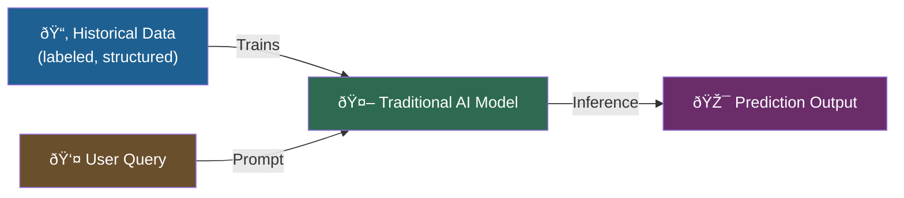

---

### 2.2 Generative AI

> **Primary use case → Generate NEW content that did not previously exist**

Generative AI does not retrieve content — it **creates** new content from the representations (patterns, weights) it learned during training on vast datasets.

It can generate:
- � **Text** (code, documentation, shell scripts, Kubernetes manifests)
- 🖼� **Images** (novel scenes from text descriptions)
- 🎬 **Videos**

#### How it differs from Traditional AI

| Attribute | Traditional AI | Generative AI |
|---|---|---|
| **Primary goal** | Predict | Generate / Create |
| **Output type** | Classification, regression, anomaly score | New text, image, video, code |
| **Training data size** | Moderate (domain-specific) | Massive (trillions of tokens from the internet) |
| **Example** | Predictive Autoscaling | ChatGPT writing a Kubernetes manifest |
| **DevOps strength** | Log analysis, event prediction | Code generation, config authoring, documentation |

#### The Image Generation Example (Generative AI in action)

```
User prompt:
  "Generate an image of a woman sitting on a cliff,
   wearing a sari, holding an ice cream."

→ The model DOES NOT copy this image from the internet.
→ It synthesizes a completely NEW image from the patterns
  it learned during training on millions of images.
→ This is why it is called "generative."
```

The same principle applies to text generation — such as LLMs generating a Kubernetes manifest **you have never published anywhere**.

#### Mermaid: Generative AI Flow

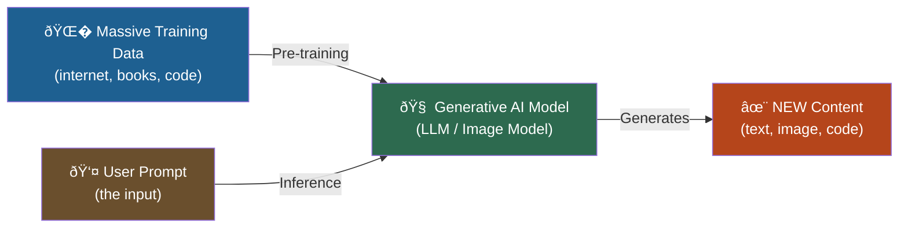

> [!NOTE]
> AIOps (Days 5 & 6 of this course) is powered by a **combination** of Traditional AI and Generative AI — predictions (trad.) + natural-language explanations (gen. AI).

---

## 3. Large Language Models (LLMs)

### Overview
Large Language Models (LLMs) are a **sub-category of Generative AI** focused specifically on **text generation**. They are the engine behind tools like ChatGPT, Claude, Llama, and DeepSeek.

### 3.1 What Makes an LLM "Large"?

The "large" refers to the **number of parameters** the model was trained on.

| Model | Parameters |
|---|---|
| **Llama 3 (407B)** | ~407 billion parameters |
| **GPT-4** | Estimated >1 trillion parameters |
| **DeepSeek** | Competitive with GPT-4 class |

> A **parameter** is a numerical weight inside the neural network. More parameters = more "memory" = more capacity to represent patterns from the training data.

### 3.2 LLMs Work Like a Human Brain

```
Analogy:
  Human: reads Kubernetes docs → stores knowledge in brain
  → When asked "What is Kubernetes?" answers FROM memory
  → Does NOT re-read the docs each time

LLM: trained on Kubernetes docs, GitHub repos, Stack Overflow, Reddit
  → Stores patterns in billions of parameters (its "memory")
  → When asked "Generate a Kubernetes manifest" answers FROM memory
  → Does NOT query the training data at inference time
```

> [!IMPORTANT]
> LLMs are **fast** because they answer from memory — not by searching the internet at query time. The slowness you sometimes observe is model size + compute limits, not data retrieval.

### 3.3 The Kubernetes Manifest Use Case

```
DevOps Engineer need:
  → Generate a Kubernetes Deployment manifest for my app

Challenge:
  → Your specific manifest does NOT exist on Stack Overflow, Reddit, or GitHub

How LLMs solve it:
  → Kubernetes docs were part of training data
  → LLM learned Kubernetes YAML structure from thousands of examples
  → It synthesizes a NEW manifest tailored to your requirements
  → It does NOT copy-paste from a source — it generates
```

```yaml
# Example: Kubernetes Deployment Manifest generated by LLM
apiVersion: apps/v1
kind: Deployment
metadata:
  name: my-app
  annotations:
    owner: "devops-team"
spec:
  replicas: 3
  selector:
    matchLabels:
      app: my-app
  template:
    metadata:
      labels:
        app: my-app
    spec:
      containers:
        - name: my-app
          image: my-registry/my-app:latest
          ports:
            - containerPort: 8080
```

---

## 4. How LLMs Are Trained

### Overview
Training a 407-billion parameter model requires resources far beyond a personal laptop. This is where **supercomputers** and **GPU/TPU clusters** enter the picture.

### 4.1 Hardware Requirements

```
Personal laptop / workstation:
  → Limited CPUs, GPUs, RAM
  → Can run small/quantized models (e.g., Llama 7B with Ollama)

Supercomputers used to train LLMs:
  → Thousands of GPUs + TPUs per node
  → Hundreds of supercomputer nodes (millions of GPUs total)
  → Massive parallel computing capability
```

| Resource | Personal Machine | Supercomputer Cluster |
|---|---|---|
| **GPUs** | 1–8 | Thousands per node × hundreds of nodes |
| **Parallel Computation** | Limited | Massive parallel batches |
| **Training Time** | Infeasible for LLMs | Weeks to months |
| **Inference** | Fast (from memory) | Not needed — model is exported |

### 4.2 Training Data Sources

LLMs are trained on vast internet data. Early OpenAI models confirmed ~80% of training data came from **Common Crawl** (a publicly available web archive). Other sources include:
- Books and academic papers
- GitHub repositories (code!)
- Stack Overflow, Reddit, Wikipedia
- Kubernetes docs, Docker docs, cloud provider docs

> [!NOTE]
> As LLMs have become more commercially sensitive, model creators reveal **less** about their specific training sources. For a DevOps practitioner, the key insight is: **your infrastructure knowledge is already in the model.**

### 4.3 Why LLMs Are So Fast at Inference

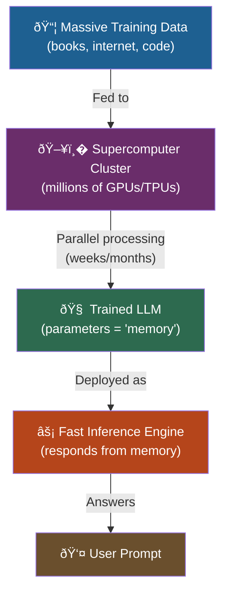

---

## 5. Prompt Engineering — Introduction

### Overview
A **prompt** is the input you provide to an LLM. **Prompt Engineering** is the practice of crafting prompts to get the most accurate, useful, and relevant output from a model.

> "Language is the medium between humans. Prompt is the medium between humans and LLMs."
> — Abhishek Veeramalla

### 5.1 What is a Prompt?

```
You can write your prompt in ANY language:
  → English, Telugu, Hindi, Spanish — LLMs understand most human languages
  → The input you type = the prompt
  → The science of crafting optimal prompts = Prompt Engineering
```

### 5.2 Why Prompt Quality Matters — Kubernetes Manifest Example

```
� Vague prompt:
  "Generate a Kubernetes deployment manifest"
  → LLM produces a generic template with placeholder values
  → May not match your app's actual requirements

✅ Detailed prompt:
  "Generate a Kubernetes Deployment manifest with:
   - Deployment name: payment-service
   - Port: 8443
   - Replicas: 3
   - Annotation: team=backend, env=production
   - Container: payment-service:v1.2.0 from my-registry"
  → LLM produces a manifest that is much closer to production-ready
```

**More relevant context → Better output.**

### 5.3 Prompt Engineering Techniques (Preview — covered fully in Day 2)

| Technique | Description |
|---|---|
| **Zero-shot Prompting** | Ask a question with no examples |
| **Few-shot Prompting** | Provide 2–3 examples before your actual question |
| **N-shot Prompting** | Provide N examples to guide the model |
| **Chain-of-Thought (CoT)** | Ask the model to reason step by step |
| **Role Prompting** | "Act as a Senior DevOps Engineer and…" |
| **Capital Letter Emphasis** | Capitalizing key words helps the LLM identify your focal point |

> [!IMPORTANT]
> Prompt Engineering becomes increasingly important as AI agents and automation pipelines replace manual CLI steps. Your prompts are instructions to an autonomous system — precision matters.

---

## 6. The AI Landscape for DevOps Engineers

### Overview
Just as DevOps engineers must master a **DevOps landscape** (Git, CI/CD, IaC, containers, orchestration), there is now an **AI landscape** specific to DevOps practitioners. Abhishek classifies this into **4 categories**.

> [!NOTE]
> **Focus on CONCEPTS, not specific tools.** Tools change rapidly. The concept of "AI agent" or "AI assistant" will persist. Master the concept and you can adapt to any tool that emerges.

### 6.1 The 4 Categories

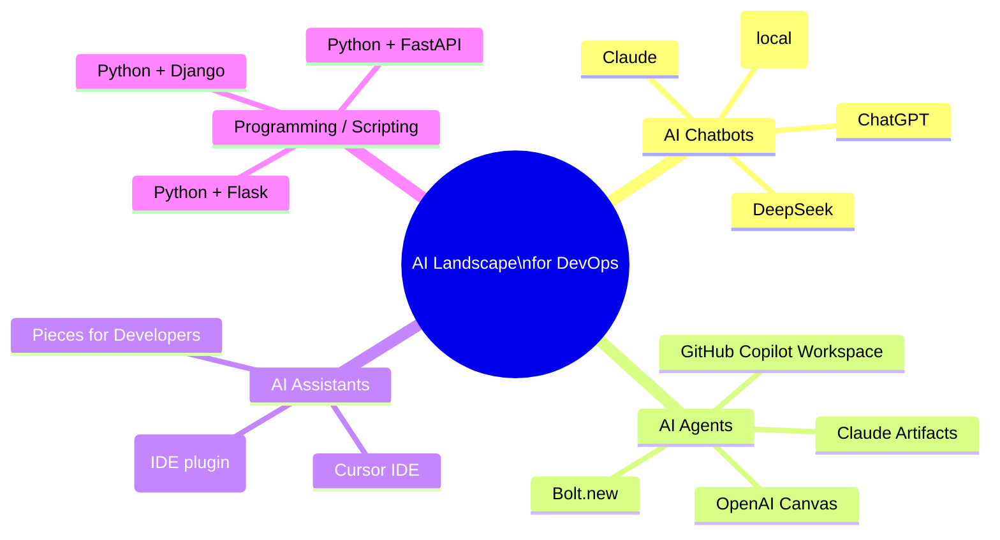

---

### 6.2 Category 1: AI Chatbots

**What they are:** Conversational AI models accessible via a web browser or API. You provide a prompt and receive a text response. Great for ad-hoc DevOps questions, code generation snippets, and documentation help.

| Tool | Notes |
|---|---|
| **ChatGPT** (OpenAI) | Most widely known; GPT-4 class model |
| **Claude** (Anthropic) | Very competitive; often superior for long-context tasks |
| **Llama 3** (Meta) | Open-source; can be run **locally** via Ollama — key for enterprise security |
| **DeepSeek** | Emerging challenger; showed very promising results; open-source friendly |

> [!TIP]
> For most DevOps tasks (generating configs, explaining errors, writing scripts), any of these chatbots work fine. The important habit is to **start using one daily**.

---

### 6.3 Category 2: AI Agents

**What they are:** AI agents go **beyond chatbots** — they take your instruction AND **autonomously perform actions** on your behalf (creating files, repositories, running commands, calling APIs).

```
AI Chatbot:
  User → Prompt → AI → Text response (you copy-paste it yourself)

AI Agent:
  User → Instruction → AI → Plans + Executes → Creates repo, writes code, commits
```

**Difference illustrated:**
```diff
+ AI Agent: "Create a GitHub repo and add a shell script that monitors VM health"
  → Creates the repository
  → Writes the shell script
  → Pushes it to GitHub
  → All autonomously

- AI Chatbot (e.g., ChatGPT): Can WRITE the shell script for you
  → Cannot create the GitHub repository
  → Cannot push files — you must do that yourself
```

| Tool | Notes |
|---|---|
| **GitHub Copilot Workspace** | Free (as of recording); used in today's demo; full AI agent |
| **Bolt.new** | Very promising; free tier ~1M tokens/month; strong for full-stack generation |
| **Claude Projects / Artifacts** | Contextual agent within Claude |
| **OpenAI Canvas** | OpenAI's agentic workspace |
| **Google AI Studio** | Google's agent-like environment |
| **Cursor IDE** | AI-native IDE; promising but free tier is very limited |

**Recommendation:** Start with **GitHub Copilot Workspace** (fully free) or **Pieces for Developers** (also free).

---

### 6.4 Category 3: AI Assistants (IDE Plugins)

**What they are:** AI assistants embedded **inside your code editor or terminal**. They provide real-time suggestions, autocomplete, and contextual help as you write code or shell scripts.

| Tool | Notes |
|---|---|
| **GitHub Copilot** | Free for individuals (VS Code, JetBrains, Vim); widely adopted |
| **Pieces for Developers** | Free; excellent context memory across sessions |
| **Cursor IDE** | Built around AI assistance; free tier limited |

> Difference from AI agents: AI assistants **suggest and help** — they don't autonomously take actions like creating repositories.

---

### 6.5 Category 4: Programming / Scripting (Python)

**What it is:** Interacting with LLMs **programmatically** via API calls — building custom integrations, automation pipelines, and AI-powered DevOps tools.

**Why Python:**
- Python is the de facto language for AI/ML tooling
- Clean, readable syntax ideal for rapid DevOps scripting
- Mature ecosystem for LLM frameworks

| Framework | Best For |
|---|---|
| **FastAPI** | Building REST APIs that wrap LLM calls (highly recommended for AI use cases) |
| **Flask** | Lightweight REST API wrapper around LLMs |
| **Django** | Full-featured web framework with LLM integration |

> [!TIP]
> **FastAPI is specifically recommended** by the instructor for Generative AI related activities due to its async support, automatic OpenAPI docs, and performance characteristics.

---

### 6.6 AI Landscape Summary Table

| Category | Role | Example Tools | Free Options |
|---|---|---|---|
| AI Chatbots | Ad-hoc Q&A, code snippets | ChatGPT, Claude, Llama, DeepSeek | Claude (free tier), Llama (local/free) |
| AI Agents | Autonomous task execution | GitHub Copilot Workspace, Bolt.new | Copilot Workspace (free), Bolt (1M tokens/mo) |
| AI Assistants | IDE code suggestions | GitHub Copilot, Pieces, Cursor | Copilot (free), Pieces (free) |
| Programming | API integration, automation | Python + FastAPI/Flask | All open source |

---

## 7. Demo: VM Health-Check Shell Script with GitHub Copilot Workspace

### Overview
This demonstration shows how an **AI Agent** (GitHub Copilot Workspace) can complete a multi-step DevOps task — creating a GitHub repository *and* writing a functional shell script — in minutes. The same task would take an average engineer 2–3 hours; a skilled engineer ~30 minutes.

### 7.1 Task Specification

```
Task (as defined in the course GitHub repository):

  Create a GitHub repository containing a shell script named health.sh.

  The script must:
  1. Monitor the state of the virtual machine (AWS EC2 instance)
  2. Check the following metrics:
     - CPU utilization
     - Memory utilization
     - Disk space utilization

  Health logic:
    HEALTHY    → All three metrics are BELOW 60%
    NOT HEALTHY → ANY metric is AT OR ABOVE 60%

  Command-line argument support:
    ./health.sh           → Prints "Healthy" or "Not Healthy" only
    ./health.sh explain   → Also explains WHY the machine is in that state
                           (which metric(s) caused the status)
```

### 7.2 AI Agent vs. AI Chatbot — Key Distinction

```
ChatGPT / Claude (AI Chatbot):
  ✅ CAN generate the shell script code
  � CANNOT create a GitHub repository
  � CANNOT commit and push the file to GitHub

GitHub Copilot Workspace (AI Agent):
  ✅ CAN generate the shell script
  ✅ CAN create the GitHub repository
  ✅ CAN commit and push the file
  ✅ Plans → Executes → Delivers — autonomously
```

### 7.3 The Shell Script (Reference Implementation)

```bash
#!/bin/bash
# health.sh — VM Health Check Script
# Usage: ./health.sh [explain]
#
# Returns: "Healthy" if CPU, Memory, and Disk are all below 60%
#          "Not Healthy" if any metric is >= 60%
# With "explain" argument: also prints the reason

THRESHOLD=60

# --- Collect Metrics ---
CPU_USAGE=$(top -bn1 | grep "Cpu(s)" | awk '{print $2 + $4}' | cut -d. -f1)
MEMORY_USAGE=$(free | awk '/Mem:/ {printf "%.0f", $3/$2 * 100}')
DISK_USAGE=$(df / | awk 'NR==2 {print $5}' | tr -d '%')

# --- Evaluate Health ---
STATUS="Healthy"
REASONS=""

if [ "$CPU_USAGE" -ge "$THRESHOLD" ]; then
    STATUS="Not Healthy"
    REASONS="$REASONS\n  âš  CPU utilization is ${CPU_USAGE}% (threshold: ${THRESHOLD}%)"
fi

if [ "$MEMORY_USAGE" -ge "$THRESHOLD" ]; then
    STATUS="Not Healthy"
    REASONS="$REASONS\n  âš  Memory utilization is ${MEMORY_USAGE}% (threshold: ${THRESHOLD}%)"
fi

if [ "$DISK_USAGE" -ge "$THRESHOLD" ]; then
    STATUS="Not Healthy"
    REASONS="$REASONS\n  âš  Disk utilization is ${DISK_USAGE}% (threshold: ${THRESHOLD}%)"
fi

# --- Output ---
echo "VM Health Status: $STATUS"

if [ "$1" == "explain" ]; then
    if [ "$STATUS" == "Healthy" ]; then
        echo -e "\n✅ All metrics are within acceptable limits:"
        echo "  CPU:    ${CPU_USAGE}%"
        echo "  Memory: ${MEMORY_USAGE}%"
        echo "  Disk:   ${DISK_USAGE}%"
    else
        echo -e "\n� The following metric(s) exceeded the ${THRESHOLD}% threshold:"
        echo -e "$REASONS"
    fi
fi
```

### 7.4 Running the Script

```bash
# Make executable
chmod +x health.sh

# Basic run — shows status only
./health.sh
# Output example:
# VM Health Status: Healthy

# Explain run — shows metrics and reason
./health.sh explain
# Output example:
# VM Health Status: Not Healthy
#
# � The following metric(s) exceeded the 60% threshold:
#   âš  CPU utilization is 73% (threshold: 60%)
#   âš  Disk utilization is 81% (threshold: 60%)
```

### 7.5 Productivity Comparison

| Engineer Level | Time to Write Script Manually |
|---|---|
| Average DevOps Engineer | 2–3 hours |
| Senior DevOps Engineer | ~30 minutes |
| **GitHub Copilot Workspace (AI Agent)** | **~2–5 minutes** |

> [!IMPORTANT]
> This is NOT about AI replacing DevOps engineers. It is about **AI multiplying DevOps engineer productivity**. The engineer still needs to understand what the script does, validate it, and troubleshoot failures.

---

## 8. Summary

### Key Takeaways

```diff
+ Traditional AI: Trained on historical data → Predicts future outcomes
+ Generative AI: Trained on massive datasets → Creates NEW content (text, images, code)
+ LLMs: Sub-category of Generative AI focused on text; powered by billions of parameters
+ LLMs answer from memory (parameters) — not by querying the internet at runtime
+ Prompt Engineering: The art of crafting inputs that guide LLMs to useful outputs
+ AI Landscape for DevOps: 4 categories — Chatbots, Agents, Assistants, Programming
+ AI Agents go beyond chatbots — they plan AND execute tasks autonomously
- Do NOT confuse AI Assistants (suggest code) with AI Agents (autonomously execute tasks)
! Prompt quality directly determines output quality — garbage in, garbage out
! AWS Predictive Autoscaling is Traditional AI already in production DevOps
```

---

### Quick Reference

```bash
# Run health check script
./health.sh             # Status only: Healthy / Not Healthy
./health.sh explain     # Status + explanation of metrics

# Get CPU usage (one-liner)
top -bn1 | grep "Cpu(s)" | awk '{print $2 + $4}'

# Get Memory usage percentage
free | awk '/Mem:/ {printf "%.0f", $3/$2 * 100}'

# Get Disk usage percentage (root partition)
df / | awk 'NR==2 {print $5}' | tr -d '%'
```

#### Detailed Command Diagnostics & Troubleshooting Relevance

| Command | Primary Use | Output Fields with High Diagnostic Relevance | Troubleshooting Significance |
|---|---|---|---|
| `top -bn1` | Real-time process & CPU snapshot | `%Cpu(s): us, sy, ni, id, wa, hi, si, st` | **`us` (User CPU)**: High values mean user-space application code is consuming cycles (e.g., infinite loops, heavy regex, compute bottlenecks).<br>**`sy` (System CPU)**: High values point to kernel overhead, frequent context switches, or excessive system calls.<br>**`wa` (I/O Wait)**: High values mean the CPU is idling waiting for disk or network I/O; points to storage latency or database write bottlenecks rather than CPU exhaustion.<br>**`st` (Steal Time)**: High values mean the hypervisor is starving the VM to serve other tenants ("noisy neighbor" problem in AWS EC2 / cloud VMs). |
| `free -m` / `free -h` | System memory allocation overview | `total`, `used`, `free`, `shared`, `buff/cache`, `available`, `Swap: used, free` | **`free` vs. `available`**: A low `free` value is normal in Linux because the kernel caches file pages in `buff/cache`. True memory starvation is diagnosed using `available` (memory that can be freed without swapping).<br>**`Swap` utilization**: When `Swap used` increases and swap paging activity (`si`/`so` in `vmstat`) spikes, the system is thrashing, which will shortly trigger the kernel Out-of-Memory (OOM) Killer (`dmesg -T \| grep -i oom`). |
| `df -h` / `df -i` | Filesystem disk space & inode usage | `Filesystem`, `Size`, `Used`, `Avail`, `Use%`, `Mounted on`, Inodes (`-i`) | **Capacity (`-h`)**: When root `/` reaches 100%, services crash due to inability to write pid files, logs, or temp sockets.<br>**Inode Exhaustion (`-i`)**: Critical diagnostic hidden issue where disk space shows plenty of gigabytes free, but apps fail with `No space left on device` because all inodes are consumed by millions of tiny files (session caches, mail queues, temp files). |
| `chmod +x health.sh` | Sets executable file mode bits | Return code (`$?`), file mode (`ls -l`) | **Permission Denied (`126`)**: In CI/CD runners or container entrypoints, failing to commit the execute bit or run `chmod +x` results in exit status 126 (`Permission denied`), breaking deployment pipelines. |
| `./health.sh` | Automated VM health assessment | Exit code (`0` vs `1`), standard out | **Pipeline Gate**: Returning exit code `0` (healthy) or `1` (unhealthy) allows direct integration into automated health check probes (Kubernetes exec probes, AWS ASG lifecycle hooks, Nagios/Zabbix agents, Prometheus textfile collector). |

---

### Expert Insight

#### � Real-World Application

- **AWS Predictive Autoscaling** uses Traditional AI to prevent capacity shortages before they happen — scale-out events occur *before* traffic spikes, not in reaction to them.
- **GitHub Copilot Workspace** used in the demo represents the trajectory of DevOps automation: instead of writing scripts line-by-line, engineers will describe intent and AI generates, tests, and deploys the implementation.
- LLMs trained on public infrastructure code (Kubernetes docs, Terraform modules, GitHub repos) are **already deeply fluent** in the tools DevOps engineers use daily.

#### 🎓 Expert Path

1. **Start using a chatbot daily** — even for simple queries. Build the habit of prompting.
2. **Explore GitHub Copilot Workspace** — try giving it increasingly complex DevOps tasks.
3. **Study Prompt Engineering deeply** (Day 2 of this course) — this skill compounds with every AI tool.
4. **Learn Python + FastAPI** — as AI APIs become core infrastructure, programmatic LLM interaction is a mandatory skill.
5. **Understand model sizes** — know the difference between a 7B and a 70B parameter model and when each is appropriate for local vs. cloud deployment.

#### âš  Common Pitfalls

| Pitfall | Impact | Fix |
|---|---|---|
| **Vague prompts** | Generic, unusable output | Provide context: names, ports, requirements, constraints |
| **Trusting output blindly** | Broken scripts in production | Always review, test, and validate AI-generated code |
| **Tool obsession** | Switching tools constantly, no depth | Focus on the CONCEPT; master one tool per category |
| **Ignoring Traditional AI** | Missing existing DevOps AI tools | AWS Predictive Autoscaling, Datadog anomaly detection are already in use |
| **Skipping Prompt Engineering** | Poor AI productivity | Day 2 of this course; invest time here |

> [!NOTE]
> **Transcript Corrections Applied:**
> - `deop enges` / `devop sner` / `devop inance` / `enger` → **"DevOps engineers"** (repeated audio garbling in VTT)
> - `gpta Transformers` → **"GPT-based Transformers"** (context-inferred)
> - `genkins` → **"Jenkins"**
> - `anible` → **"Ansible"**
> - `Puli` → **"Pulumi"**
> - `adbot` / `chbs` / `AA agents` → **"AI chatbots" / "AI agents"** (audio garbling)
> - `gilot workspace` → **"GitHub Copilot Workspace"**
> - `bold. new` → **"Bolt.new"**
> - `bid bucket` → **"Bitbucket"**
> - `Jango` → **"Django"**
> - `pieces` → **"Pieces for Developers"**
> - `zero short` / `few short` / `n short` → **"zero-shot" / "few-shot" / "N-shot"** (prompt engineering terminology)

</details>

<details open>
<summary><b>Day 1: Fundamentals of AI for DevOps Engineers (CS46H)</b></summary>

## Table of Contents

- [DAY-1: Fundamentals of AI Assisted DevOps | Demo and Notes Included](#day-1-fundamentals-of-ai-assisted-devops--demo-and-notes-included)
  - [Episode Overview](#episode-overview)
  - [Traditional AI vs. Generative AI](#traditional-ai-vs-generative-ai)
    - [Traditional AI — Predict from Historical Data](#traditional-ai--predict-from-historical-data)
    - [Generative AI — Create New Content](#generative-ai--create-new-content)
    - [Side-by-Side Comparison](#side-by-side-comparison)
  - [Large Language Models (LLMs)](#large-language-models-llms)
    - [What Are LLMs?](#what-are-llms)
    - [How LLMs Are Trained](#how-llms-are-trained)
    - [How LLMs Answer Questions](#how-llms-answer-questions)
    - [LLM Training Sources](#llm-training-sources)
  - [Prompt Engineering — Introduction](#prompt-engineering--introduction)
  - [The AI Landscape for DevOps Engineers (4 Categories)](#the-ai-landscape-for-devops-engineers-4-categories)
  - [Demo: VM Health-Check Shell Script with GitHub Copilot Workspace](#demo-vm-health-check-shell-script-with-github-copilot-workspace)
    - [Task Specification](#task-specification)
    - [The Zero-Shot Prompt](#the-zero-shot-prompt)
    - [GitHub Copilot Workspace Workflow](#github-copilot-workspace-workflow)
    - [Script Execution](#script-execution)
    - [Key Insight: Why You Still Need DevOps Fundamentals](#key-insight-why-you-still-need-devops-fundamentals)
- [Summary](#summary)

---

## DAY-1: Fundamentals of AI Assisted DevOps | Demo and Notes Included

### Episode Overview

Day 1 is the first full content episode of the **AI Assisted DevOps Zero to Hero** series. It builds the conceptual foundation — distinguishing Traditional AI from Generative AI, introducing LLMs, explaining what prompt engineering is, and presenting the AI landscape relevant to DevOps engineers. The episode closes with a compelling live demo that makes the productivity gains from AI Agents immediately tangible.

**Topics covered:**
- Traditional AI vs. Generative AI — definitions, primary use cases, and DevOps applications
- Large Language Models (LLMs) — what they are, how they are trained, how they answer questions
- Prompt Engineering — what it is and why it matters
- The AI Landscape for DevOps Engineers (4 categories)
- Demo: creating a VM health-check shell script + GitHub repository using GitHub Copilot Workspace (an AI Agent)

> [!NOTE]
> Episode notes for every day are published in the corresponding GitHub folder. Fork and star the repository to receive continuous updates.

---

### Traditional AI vs. Generative AI

#### Traditional AI — Predict from Historical Data

> **Core principle:** Train on historical data ? predict future outcomes

**How traditional AI works:**

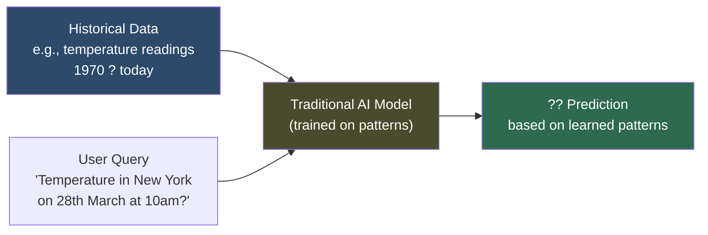

**Real-world weather prediction example:**
The model is fed historical temperature data from 1970 through today. When asked about a future temperature, it analyzes the patterns learned during training and produces a prediction — it does NOT search the internet in real time.

**DevOps Applications of Traditional AI:**

| Use Case | Description |
|----------|-------------|
| **AIOps / Log Analysis** | Analyzes logs at scale, identifies event patterns, predicts and reports future incidents to the engineering team |
| **Incident Management** | Identifies correlations between metrics (CPU, memory, disk) and past incidents; alerts before similar events recur |
| **AWS Predictive Autoscaling** | Continuously monitors cluster metrics, trains its model on usage patterns, and predicts future load to pre-scale before demand spikes |

> ?? **Key Insight:** As a human DevOps engineer, you can observe *current* metrics, but you cannot reliably predict that a VM running at 50% CPU today will crash in 15 days due to gradual memory leak. Traditional AI does exactly that — pattern recognition at scale.

---

#### Generative AI — Create New Content

> **Core principle:** Generate brand-new content (text, images, video) — not copying from a source

**How generative AI works:**

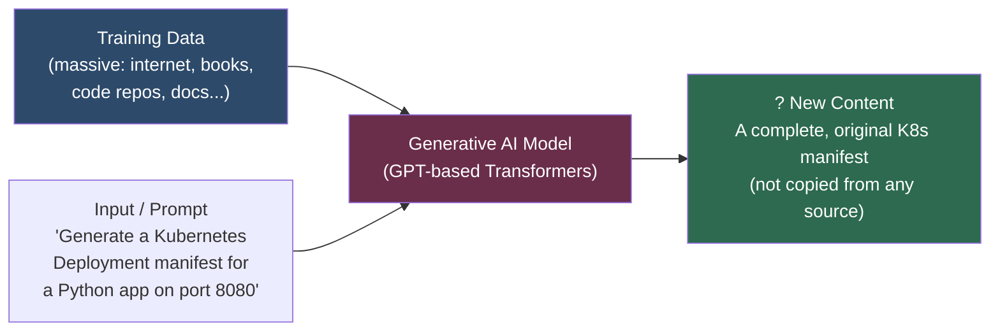

**Image generation example (from transcript):**
> Ask a generative AI to generate an image of "a woman sitting on a cliff wearing a sari and having an ice cream." You likely won't find that exact image on the internet — but the model, trained on millions of images, synthesizes a completely new image matching that description using GPT-based Transformers.

**DevOps Applications of Generative AI:**

- Generating Kubernetes manifests tailored to your specific app's requirements
- Writing shell scripts, Dockerfiles, CI/CD pipelines
- Explaining error logs in plain language
- Drafting architecture documentation
- Code review and security scanning

```diff
! Key distinction:
+ Traditional AI: "Given history, what will happen?"  ? Prediction
+ Generative AI:  "Given a prompt, create something new" ? Generation
```

---

#### Side-by-Side Comparison

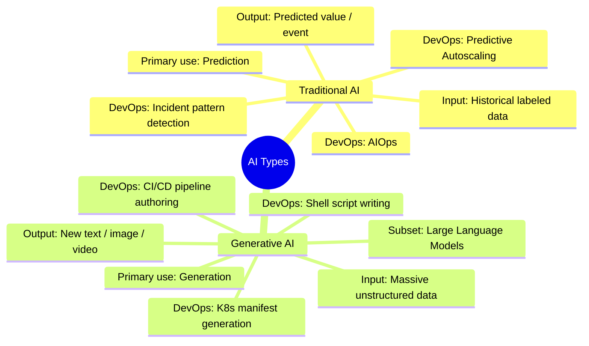

| Attribute | Traditional AI | Generative AI |
|-----------|----------------|---------------|
| **Primary goal** | Predict from data | Generate new content |
| **Training data** | Labeled historical datasets | Massive unstructured internet data |
| **Output type** | Prediction / classification | Text, image, video, code |
| **DevOps example** | AWS Predictive Autoscaling | GitHub Copilot code generation |
| **When it existed** | Since the 1900s | Popularized post-2020 |

---

### Large Language Models (LLMs)

#### What Are LLMs?

**Large Language Models are the text-generation subset of Generative AI.**

The same architectural principle that powers image-generating models (like DALL-E) applies to text — but when the output domain is *text*, the model is called an LLM.

```diff
+ Generative AI ? broad category (text, images, video, audio)
+ Large Language Models ? the text-focused subset of Generative AI
! Same underlying principles; different output modality
```

**Examples of LLMs:**
- **GPT-4** (OpenAI) — powers ChatGPT
- **Claude** (Anthropic)
- **LLaMA 3.1 405B** (Meta) — open-source, can run locally
- **DeepSeek** — newer, promising model
- **Gemini** (Google)

---

#### How LLMs Are Trained

The scale of LLM training is one of the most important concepts to grasp — it explains both their remarkable capability and the cost to build them.

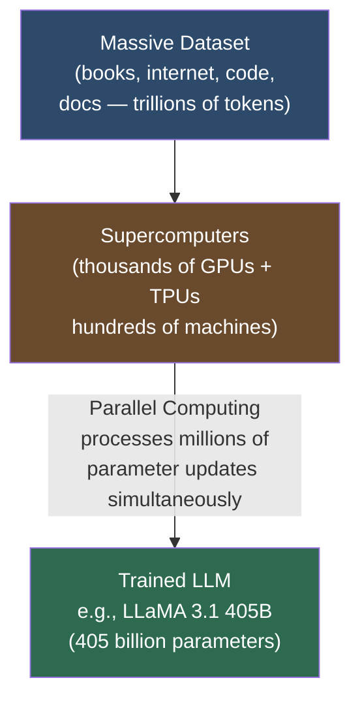

**Why supercomputers?**

| Resource | Your Laptop | Supercomputer |
|----------|------------|---------------|
| CPUs/GPUs | 4–16 cores | Thousands of GPUs + TPUs |
| Parallel processes | Limited | Millions simultaneously |
| Training time for 405B model | Impractical | Weeks across hundreds of machines |
| Memory | 8–64 GB | Petabytes across clusters |

> [!IMPORTANT]
> A model like **LLaMA 3.1 405B** has 405 billion parameters — each parameter is a numerical weight representing a piece of learned knowledge. Training this required thousands of GPUs across hundreds of supercomputers running in parallel for weeks. When you run a smaller model like LLaMA 3.2 1B locally, you benefit from this concept at a fraction of the scale.

---

#### How LLMs Answer Questions

This is the key to understanding why LLMs are fast and why they don't always have the latest information.

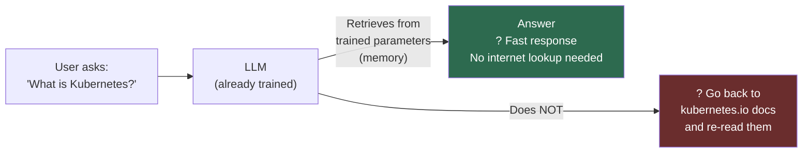

**The human brain analogy (from the instructor):**
> You learned Kubernetes by reading the documentation. When someone asks "What is Kubernetes?", your brain retrieves that knowledge from memory — you don't re-read the docs. LLMs work exactly the same way. All knowledge is stored in parameters; every response is retrieved from that internal memory.

This is why:
- LLMs respond almost instantly ?
- LLMs can have outdated knowledge (their training has a cutoff date) ??
- LLMs can "hallucinate" — generating plausible-sounding but incorrect text when their training data was insufficient on a topic ?

---

#### LLM Training Sources

| Model | Known Training Data Details |
|-------|-----------------------------|
| **OpenAI GPT (early models)** | Confirmed: 80% from Common Crawl (web crawl dataset) |
| **LLaMA 3.1** (Meta) | Various internet sources, books, code; Meta does not fully disclose |
| **DeepSeek** | Internet data + proprietary sources; training details not fully public |
| **Gemini** (Google) | Google-scale web data; not fully disclosed |

> [!NOTE]
> As LLMs advance, training source transparency has decreased. For the purposes of DevOps work, this matters less than understanding that models are trained on *internet-scale data* — meaning common technologies like Kubernetes, Docker, and Python are well-represented, while your organization's proprietary code is not.

---

### Prompt Engineering — Introduction

> **Definition:** Prompt engineering is the medium you use to communicate with a Large Language Model.

Just as humans communicate with each other using natural languages (English, Hindi, Telugu), **the medium for communicating with LLMs is the prompt.** The quality of your prompt directly determines the quality of the output.

**The prompt quality spectrum:**

```diff
! Example: You want a Kubernetes Deployment manifest

- Poor prompt:
-   "generate a kubernetes deployment manifest"
-   Result: Generic YAML, default values, probably not usable as-is

+ Good prompt:
+   "Generate a Kubernetes Deployment manifest for a Python app named 'order-service'
+    with 3 replicas, port 8080 exposed, resource limits CPU 500m/Memory 256Mi,
+    liveness probe on /health, annotations for Prometheus scraping,
+    output only the YAML with no explanation"
+   Result: Production-ready, immediately usable manifest
```

**Prompt engineering techniques** (covered in depth in Day 2):

| Technique | Description |
|-----------|-------------|
| **Zero-shot** | Ask directly with no examples provided |
| **Few-shot** | Provide 2–3 examples to guide the style/format of the response |
| **N-shot** | Provide N examples for precise output conditioning |
| **Chain-of-Thought (CoT)** | Ask the model to reason step-by-step before answering |

> ?? Even small changes like **capitalizing keywords** in a prompt help the LLM understand what the key intent of your request is.

> [!IMPORTANT]
> Prompt engineering is covered in depth in **Day 2** — the instructor describes it as the most critical single skill in this entire course. The better you communicate with an LLM or AI Agent, the better every downstream outcome.

---

### The AI Landscape for DevOps Engineers (4 Categories)

The instructor presents a framework for thinking about AI tools in DevOps — analogous to how the DevOps landscape categorizes tools by concept rather than specific product.

> ?? **The DevOps analogy:** In DevOps, you learn "CI/CD" — not Jenkins or GitHub Actions specifically. Learn the category, then pick a tool. Same principle applies to AI.

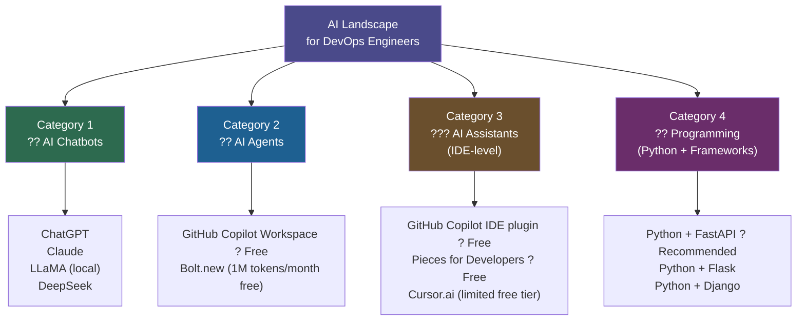

**Category Details:**

**Category 1 — AI Chatbots**
- For DevOps work: generating code, explaining concepts, drafting documentation
- Recommended starting points: ChatGPT, Claude, or run LLaMA locally
- DeepSeek: newer but very promising
- ? Most people already use this category

**Category 2 — AI Agents**
- Go beyond chatbots: they can *plan AND execute* tasks autonomously
- **GitHub Copilot Workspace**: creates repositories, writes code, executes tasks — currently **free**
- **Bolt.new**: 1 million tokens/month free; also promising
- Used in today's demo — see Section 7

**Category 3 — AI Assistants (IDE-level)**
- Provide code suggestions, autocomplete, inline documentation inside your editor
- **GitHub Copilot IDE plugin**: free — integrates into VS Code, JetBrains
- **Pieces for Developers**: free — personal code snippet AI assistant
- **Cursor.ai**: promising but mostly paid; free tokens are minimal

**Category 4 — Programming (Python + Frameworks)**
- Enables *programmatic* interaction with LLMs via API calls
- Use Python to call local LLMs (via Ollama) or cloud LLMs (via OpenAI/Google APIs)
- **FastAPI** is highly recommended for GenAI-related services
- This is what Days 3–8 build on extensively

> [!IMPORTANT]
> You should aim to be **good at one tool in each category** — not all tools in all categories. Pick the best free option in each, practice it daily, and you'll be ahead of most DevOps engineers.

**DevOps concept ? AI equivalent mapping:**

| DevOps Tool Category | DevOps Example | AI Equivalent |
|---------------------|----------------|---------------|
| Version control | Git (GitHub/GitLab/Bitbucket) | AI Chatbot (ChatGPT/Claude/DeepSeek) |
| CI/CD | Jenkins/GitHub Actions/GitLab CI | AI Agent (Copilot Workspace/Bolt.new) |
| IaC | Terraform/Pulumi | AI Assistant (Copilot IDE/Pieces) |
| Scripting/automation | Shell scripting/Ansible/Puppet | Python + FastAPI/Flask |

---

### Demo: VM Health-Check Shell Script with GitHub Copilot Workspace

#### Task Specification

**Objective:** Create a GitHub repository containing a shell script that monitors the health of an AWS EC2 Ubuntu instance.

**Script behavior:**

```diff
+ ./health.sh
+   ? Checks CPU utilization, Memory utilization, Disk space utilization
+   ? If ALL three are below 60% ? prints: "healthy"
+   ? If ANY one exceeds 60% ? prints: "not healthy"

+ ./health.sh explain
+   ? Same checks as above
+   ? ALSO prints: why the machine is healthy/not healthy
+   ? Shows: "CPU usage is X%, memory usage is Y%, disk usage is Z%"

! Target: Ubuntu (AWS EC2) virtual machines
! Threshold: 60% across CPU, memory, and disk
```

**Estimated time — traditional approach:**
- Average DevOps engineer: 2–3 hours
- Experienced DevOps engineer: ~30 minutes
- With GitHub Copilot Workspace (AI Agent): **~2 minutes**

---

#### The Zero-Shot Prompt

The exact prompt used in the demo (zero-shot — no examples provided):

```
Create a shell script where the script should analyze the health of the virtual 
machine based on CPU, memory, and disk space. If any of these three things are 
less than 60% utilized, the script declares the state of VM as healthy. Whereas 
if any of these parameters are more than [60%], the script declares the health as 
not healthy.

The script should also support a command line argument named "explain". When 
passed, the script should explain the reason for health status along with printing 
the health status.

Target virtual machines are always Ubuntu.
```

> [!NOTE]
> This is a **zero-shot prompt** — no examples of expected output are given. After learning prompt engineering in Day 2, you will see how a few-shot or chain-of-thought version of this prompt produces even more precise results on the first attempt.

---

#### GitHub Copilot Workspace Workflow

GitHub Copilot Workspace is an **AI Agent** — it can plan AND execute, not just generate text.

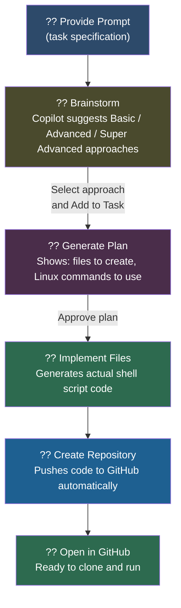

**Linux commands used in the generated script:**

| Command | Purpose | Diagnostic Relevance |
|---------|---------|---------------------|
| `top` / `vmstat` | Get CPU usage percentage | `vmstat 1 3` shows CPU idle %; subtract from 100 for utilization. Also reveals run queue (procs_r) — high values indicate CPU contention |
| `free` | Get memory usage | `free -h` shows total/used/available RAM in human-readable format; `free -m` gives MB values for scripting. Also reveals swap usage — heavy swap indicates RAM pressure |
| `df` | Get disk space usage | `df -h` shows all mounted filesystems with usage percentage. Key columns: `Use%` and `Mounted on`. Watch for `/var/log` filling on high-log systems |

**Brainstorm options presented by Copilot Workspace:**
1. **Basic**: Core health check — `top`/`vmstat` for CPU, `free` for memory, `df` for disk, threshold check, `explain` argument
2. **Advanced**: Core check + logging to file + additional metrics
3. **Super Advanced**: Core check + notifications/alerts when unhealthy

---

#### Script Execution

Steps performed on an AWS EC2 t2.micro Ubuntu instance:

```bash
# Connect to the EC2 instance
ssh -i devops-demo.pem ubuntu@<instance-public-ip>

# Clone the repository (or copy the script directly)
git clone https://github.com/<user>/vm-health-check

# Make script executable
chmod 777 vm_health_check.sh

# Run basic health check
./vm_health_check.sh
# Output: healthy

# Run with explain argument
./vm_health_check.sh explain
# Output:
# CPU usage is 0%
# Memory usage is 33%
# Disk usage is 26%
# VM is healthy
```

**Actual test result:**
- CPU: 0% utilization ? ? below 60%
- Memory: 33% utilization ? ? below 60%
- Disk: 26% utilization ? ? below 60%
- **Overall status: healthy** ?

> [!NOTE]
> The entire task — from prompt to working script on a live EC2 instance — was completed in approximately **2 minutes** using GitHub Copilot Workspace as the AI Agent.

---

#### Key Insight: Why You Still Need DevOps Fundamentals

Despite the impressive productivity gain, the instructor makes an important point:

```diff
+ AI Agents can: generate the code, create the repository, execute tasks
- AI Agents cannot:
-   ? Design the problem statement (you must define what needs to be built)
-   ? Verify that the output matches YOUR organization's requirements
-   ? Debug and troubleshoot if the generated script has issues
-   ? Take responsibility for production deployments

! Rule: Using AI with zero DevOps knowledge leads to adverse outcomes
! Rule: AI augments DevOps expertise — it does not replace it
```

**The three-tier capability hierarchy:**

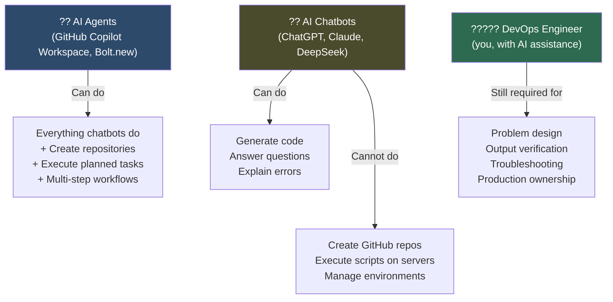

---

## Summary

### Key Takeaways

```diff
+ Traditional AI ? Prediction from historical data (AIOps, Predictive Autoscaling, incident management)
+ Generative AI ? Generation of new content (K8s manifests, shell scripts, code, docs)
+ LLMs ? Text-generation subset of GenAI; trained on supercomputers; respond from internal memory (parameters)
+ Prompt Engineering ? The medium for communicating with LLMs; better prompt = better output
+ AI Landscape ? 4 categories: Chatbots, Agents, Assistants, Programming (Python + FastAPI)
+ AI Agents > AI Chatbots ? Agents plan AND execute; chatbots only generate responses
! In 2025: you must use at least one tool from each of the 4 AI landscape categories
- Zero DevOps knowledge + AI tools = adverse outcomes; AI augments skill, it does not replace it
```

### Quick Reference — Key Concepts

| Concept | Definition | DevOps Example |
|---------|-----------|----------------|
| **Traditional AI** | Predicts from historical data | AWS Predictive Autoscaling, AIOps log analysis |
| **Generative AI** | Creates new content using GPT-based Transformers | K8s manifest generation, Dockerfile writing |
| **LLM** | Text-generation subset of GenAI | ChatGPT, Claude, LLaMA, DeepSeek |
| **LLM Parameters** | Numerical weights = stored knowledge | LLaMA 3.1 405B = 405 billion parameters |
| **Prompt** | Input you give to an LLM | "Generate a K8s deployment YAML for a Python app" |
| **Prompt Engineering** | Craft of optimizing prompts for better output | Zero-shot, few-shot, CoT techniques |
| **AI Chatbot** | Conversational LLM interface | ChatGPT, Claude, DeepSeek |
| **AI Agent** | LLM + execution capability (plans + acts) | GitHub Copilot Workspace, Bolt.new |
| **AI Assistant** | IDE-level code suggestion tool | GitHub Copilot plugin, Pieces for Developers |

### Quick Reference — Lab Commands

```bash
# Make script executable
chmod 777 vm_health_check.sh          # or: chmod +x vm_health_check.sh

# Run health check (basic)
./vm_health_check.sh

# Run health check with explanation
./vm_health_check.sh explain

# Check CPU usage manually
top -bn1 | grep "Cpu(s)" | awk '{print $2}' | cut -d'%' -f1

# Check memory usage
free -m | awk 'NR==2{printf "Memory: %.2f%%\n", $3*100/$2}'

# Check disk usage for root partition
df -h / | awk 'NR==2{print $5}'

# SSH to EC2 instance
ssh -i your-key.pem ubuntu@<public-ip>
```

**Diagnostic notes for the above commands:**
- `top -bn1`: `-b` = batch mode (non-interactive), `-n1` = one iteration. The "Cpu(s)" line shows `%us` (user), `%sy` (system), `%id` (idle). CPU utilization = 100 - idle%. If `%wa` (I/O wait) is high, CPU time is being spent waiting on disk — often misdiagnosed as CPU pressure when the root cause is disk I/O
- `free -m`: The `buff/cache` column is NOT in use by processes — the OS can reclaim it. True available memory = `available` column, not `free` alone. Using `free` alone to measure memory pressure is a common mistake
- `df -h /`: Shows only the root filesystem. If `/var` or `/tmp` are separate mount points (common in enterprise setups), they need to be checked independently. A full `/var/log` partition will kill logging and system services even when `/` is healthy

### Expert Insight

**?? Real-world Application:**
The VM health-check pattern from today's demo is the foundation for building production-grade health monitoring. In real environments, this script becomes: (1) a Kubernetes readiness/liveness probe, (2) a Nagios/Prometheus custom exporter, or (3) an input feed for AIOps anomaly detection. The AI Agent workflow (describe ? plan ? implement ? deploy) maps directly to how senior engineers use AI in 2025 production environments.

**?? Expert Path:**
1. Use an AI chatbot (Claude or ChatGPT) for at least one DevOps task today — don't wait until Day 8 to start
2. Request access to GitHub Copilot Workspace now (if not already enrolled) — it's free and needed for this day's demo
3. Try the `health.sh` lab task yourself before moving to Day 2 — understanding the script helps contextualize prompt engineering
4. Practice the "describe ? plan ? verify" discipline: describe the problem to the AI, review its plan before executing, then verify the output manually

**?? Common Pitfalls:**
- Confusing Traditional AI with Generative AI — they have fundamentally different purposes; using a GenAI model for pure prediction tasks (when a traditional ML model is more appropriate) is an efficiency waste
- Assuming LLM responses are always current — models have a knowledge cutoff; for recent Kubernetes versions, security advisories, or new cloud service features, always verify against official docs
- Skipping the verification step after AI-generated shell scripts — a script that runs without errors is not necessarily correct; always test against expected thresholds and edge cases
- Using public LLMs (ChatGPT) for scripts that contain your organization's infrastructure names, IP addresses, secrets, or architecture details — use local LLMs for sensitive work (covered in Day 3)
- Treating AI Chatbots as AI Agents — if you want the AI to also *execute* a task (create a repo, deploy code), you need an AI Agent, not just a chatbot

**?? Additional Diagnostic / Troubleshooting Notes:**
- **`vmstat 1 5`** — outputs 5 samples 1 second apart; columns `r` (run queue) and `b` (blocked processes) are key: `r > number of CPU cores` indicates CPU saturation; `b > 0` indicates I/O wait problems
- **`free -h` interpretation** — `total - available` = memory actually in use; the `free` column alone is misleading because Linux uses free RAM as buffer/cache aggressively
- **`df -i`** — shows inode usage, not block usage; a filesystem can be 0% full on blocks but 100% full on inodes, preventing new file creation — a common production mystery
- **`chmod 777` vs `chmod +x`** — `chmod 777` grants read/write/execute to ALL users (owner, group, others); in production, `chmod 755` (owner can write, others can only read+execute) or `chmod +x` (adds execute for current permissions) is safer and preferred
- **`ssh -i key.pem`** — if connection is refused, check: security group inbound rules (port 22 open?), key file permissions (`chmod 400 key.pem` required on Linux/Mac), and confirm the correct username (`ubuntu` for Ubuntu AMIs, `ec2-user` for Amazon Linux)
- **GitHub Copilot Workspace API** — if plan generation is slow or fails, it may indicate rate limiting on the free tier; wait a few minutes and retry rather than submitting the same prompt repeatedly

> [!IMPORTANT]
> **Transcript Corrections Applied (CS46H pass):**
> - "abishek" ? "Abhishek" (instructor's name)
> - "deop enges / devop sness / devop sner / inance / enger / devops inance" ? "DevOps engineers" (garbled audio throughout)
> - "gpta Transformers" ? "GPT-based Transformers"
> - "Lama 47p / 407b / four 47 billion" ? "LLaMA 3.1 405B" (correct Meta model; 405 billion parameters)
> - "genkins" ? "Jenkins"
> - "bid bucket" ? "Bitbucket"
> - "anible" ? "Ansible"
> - "Puli" ? "Pulumi"
> - "bold. new" ? "Bolt.new"
> - "gilot workspace" ? "GitHub Copilot Workspace"
> - "Jango" ? "Django"
> - "zero short / few short / n short" ? "zero-shot / few-shot / N-shot"
> - "instant management" ? "incident management"
> - "absorbability" ? "observability"
> - "in AA Ops" ? "AIOps"
> - "dispas" ? "disk space"
> - "VM CH mod" ? "chmod"
> - "Dosh" ? ".sh (shell script extension)"
> - "open aai" ? "OpenAI"

</details>
