# Day 2: Prompt Engineering Explained

<details open>
<summary><b>Day 2: Prompt Engineering Explained (G3CS46T)</b></summary>

## Table of Contents
1. [Episode Overview](#1-episode-overview)
2. [What is Prompt Engineering?](#2-what-is-prompt-engineering)
3. [The Dual Value of Prompt Engineering](#3-the-dual-value-of-prompt-engineering)
4. [Demo 1: Token Economics & Cost Benchmark in Google AI Studio](#4-demo-1-token-economics--cost-benchmark-in-google-ai-studio)
5. [Prompt Engineering Taxonomy & Techniques](#5-prompt-engineering-taxonomy--techniques)
   - [5.1 Zero-Shot Prompting (Direct Prompting)](#51-zero-shot-prompting-direct-prompting)
   - [5.2 Few-Shot Prompting](#52-few-shot-prompting)
   - [5.3 Multi-Shot Prompting](#53-multi-shot-prompting)
   - [5.4 Chain-of-Thought (CoT) Prompting](#54-chain-of-thought-cot-prompting)
   - [5.5 Technique Comparison Table](#55-technique-comparison-table)
6. [Demo 2: Enforcing Enterprise Standards with Few-Shot Prompting](#6-demo-2-enforcing-enterprise-standards-with-few-shot-prompting)
7. [The 4-Pillar Strategic Prompting Framework](#7-the-4-pillar-strategic-prompting-framework)
8. [Summary](#8-summary)

---

## 1. Episode Overview

**Day 2** of the *AI Assisted DevOps — Zero to Hero* course dives deep into **Prompt Engineering**, universally recognized as the single most critical practical skill when working with Generative AI and Large Language Models (LLMs). 

While Generative AI models possess vast encyclopedic knowledge, they lack the specific context of your enterprise, your team's coding conventions, and your architectural constraints. Prompt engineering is the bridge that guides raw model capability into reliable, production-grade DevOps assets.

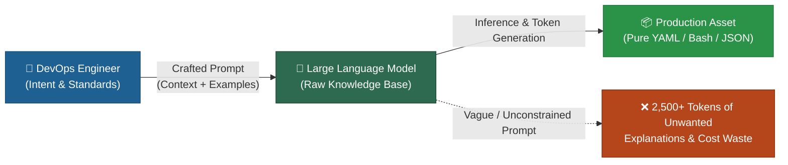

**Key Takeaways Covered in this Episode:**
- Definition and mechanics of prompt engineering in plain terminology.
- The two fundamental business justifications: **Output Precision** and **Token Cost Optimization**.
- Live Google AI Studio benchmark: reducing API token consumption from **2,473 tokens down to 179 tokens** (a **92.7% cost reduction**).
- Core prompting strategies: **Zero-Shot**, **Few-Shot**, **Multi-Shot**, and **Chain-of-Thought (CoT)**.
- Hands-on DevOps demonstration: using Few-Shot prompting to force an LLM to generate Bash scripts matching strict organizational header and documentation standards.
- Abhishek's **4-Pillar Strategic Prompting Framework** (Context, Instruction, Examples, Output Format).

> [!NOTE]
> Prompt engineering is not a theoretical science requiring machine learning math; it is a practical operational discipline. Mastering it allows you to extract 10x value from both public cloud models (OpenAI, Gemini, Anthropic) and private on-premises models (Llama, DeepSeek).

---

## 2. What is Prompt Engineering?

### Core Definition

In layman's terminology:
- **Prompt**: The input text, instructions, or queries provided by a user to an AI model (specifically an LLM).
- **Prompt Engineering**: The practice of designing, structuring, and enhancing user inputs so that the AI model produces the exact, expected, and desired output without hallucinations, extraneous conversational filler, or missing parameters.

```diff
! User Input → [Prompt Engineering Refinement] → LLM Processing → High-Precision Output
```

When an engineer interacts with an LLM, the model does not read minds. If you provide a generic, unconstrained prompt, the model reverts to its default conversational persona—generating introductory greetings, explanations of how Kubernetes works, step-by-step instructions on `kubectl apply`, verification commands, and parting advice. 

In a production automation pipeline, this conversational filler is completely unusable. Prompt engineering ensures that the model outputs **only** the exact code or structured data required.

---

## 3. The Dual Value of Prompt Engineering

Prompt engineering provides two distinct and equally vital benefits:

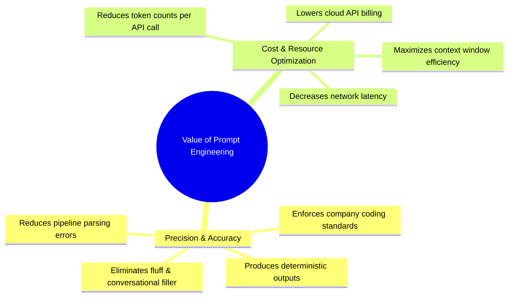

### 3.1 Value 1: Output Precision & Clean Artifacts

In an interactive chat interface, reading explanations might seem harmless. But DevOps engineers do not just use web chat interfaces; they build scripts, automation pipelines, and CLI integrations that invoke LLM APIs programmatically.

Consider the following two prompts requesting a Kubernetes deployment manifest:

#### ❌ The Unoptimized Prompt:
```text
generate a kubernetes manifest for deployment resource
```
**Model Output Behavior**:
- Generates 2 paragraphs explaining what a Kubernetes Deployment is.
- Generates the deployment YAML with generic `nginx` images.
- Generates 4 paragraphs explaining each section (`apiVersion`, `kind`, `spec.replicas`, `spec.selector`).
- Generates shell commands explaining how to run `kubectl apply -f deployment.yaml`.
- Generates commands explaining how to inspect pods with `kubectl get pods`.
- Adds friendly concluding advice.

> **Impact**: Unusable in an automated Python script without complex regex parsing to extract only the YAML content between markdown code blocks.

#### ✅ The Precision-Engineered Prompt:
```text
generate only kubernetes manifest for deployment resource
```
**Model Output Behavior**:
- Replaces the indefinite article `"a"` with the restrictive constraint `"only"`.
- Output: Returns strictly the Kubernetes YAML document.
- Zero introductory text, zero trailing explanations, zero step-by-step instructions.

---

### 3.2 Value 2: Cost Optimization & Token Economics

The second—and financially critical—reason to master prompt engineering is **API cost reduction**.

#### The Enterprise Automation Scenario
Imagine a DevOps engineer tasked with building an internal developer portal or a Python CLI utility for their company. 
1. The developer runs a CLI tool or submits an internal request: `"I need a Kubernetes Service for my microservice"`.
2. The Python script constructs a prompt and makes a programmatic API request to an LLM provider (OpenAI, Google Gemini, Anthropic, or DeepSeek API).
3. The LLM processes the request and returns the generated infrastructure code.

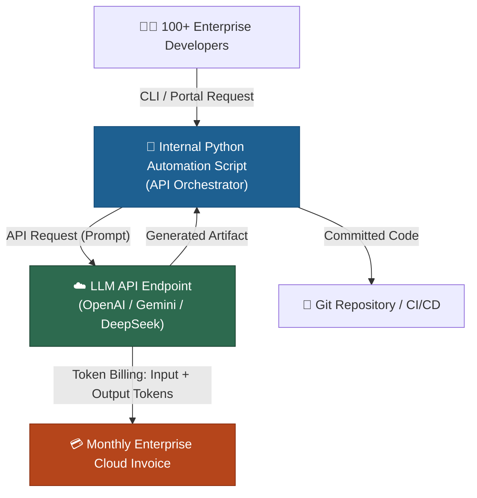

#### Why API Calls Are Not Free
LLM providers do not run free web services for enterprise APIs. They host massive hardware clusters equipped with specialized GPUs (NVIDIA H100, A100, TPU pods), power infrastructure, and cooling systems. 

Providers bill developers based on **Tokens**:
$$\text{Total Request Cost} = (\text{Input Tokens} \times \text{Rate}_{\text{input}}) + (\text{Output Tokens} \times \text{Rate}_{\text{output}})$$

#### What is a Token?
- A token is the fundamental building block of text processed by an LLM.
- Words and punctuation are broken into token chunks.
- As a rule of thumb (e.g., in Google Gemini models): **100 English words $\approx$ 60 to 80 tokens**.
- The more words an LLM generates in its response, the higher the token count, and the higher the financial cost.

#### Cost Scaling at Enterprise Scale
| Metric | Bad Prompt (Unconstrained) | Good Prompt (Engineered) |
|---|---|---|
| **Tokens per Request** | ~2,500 tokens | ~180 tokens |
| **Requests per Day** (100 developers) | 500 requests | 500 requests |
| **Daily Token Consumption** | $1,250,000$ tokens | $90,000$ tokens |
| **Annual Token Consumption** (250 workdays) | **312,500,000 tokens** | **22,500,000 tokens** |
| **Token Waste Ratio** | **13.8x More Expensive** | **Baseline Optimized** |

> [!IMPORTANT]
> Writing bad prompts does not just produce messy output—it burns corporate budgets. Prompt engineering is directly tied to **FinOps for AI**, enabling organizations to scale AI adoption without unexpected billing shocks.

---

## 4. Demo 1: Token Economics & Cost Benchmark in Google AI Studio

During the lecture, Abhishek demonstrates this token disparity live using **Google AI Studio** to inspect real-time token metrics.

```diff
! Live Experiment: Unconstrained vs. Constrained Prompt Token Generation
```

### Step 1: Testing the Unconstrained ("Bad") Prompt

**Input Prompt:**
```text
generate a kubernetes manifest for deployment resource
```

**Observation:**
- Google AI Studio processes the prompt and streams out a full tutorial: deployment description, full YAML, line-by-line breakdown, `kubectl` CLI commands, and deployment verification steps.
- **Observed Token Metric in AI Studio**: **2,473 tokens** generated!

```
┌────────────────────────────────────────────────────────┐
│ Google AI Studio Token Counter                         │
│ Prompt: "generate a kubernetes manifest..."            │
│ Status: Completed                                      │
│ Response Tokens: 2,473 tokens                          │
└────────────────────────────────────────────────────────┘
```

### Step 2: Testing the Constrained ("Good") Prompt

**Input Prompt:**
```text
generate only kubernetes manifest for deployment resource
```

**Observation:**
- Google AI Studio streams back strictly the valid YAML manifest.
- All conversational fluff, explanations, and tutorial text are omitted.
- **Observed Token Metric in AI Studio**: **179 tokens** (approx. 150–180 tokens depending on manifest version).

```
┌────────────────────────────────────────────────────────┐
│ Google AI Studio Token Counter                         │
│ Prompt: "generate only kubernetes manifest..."         │
│ Status: Completed                                      │
│ Response Tokens: 179 tokens                            │
└────────────────────────────────────────────────────────┘
```

### Benchmark Results & Analysis

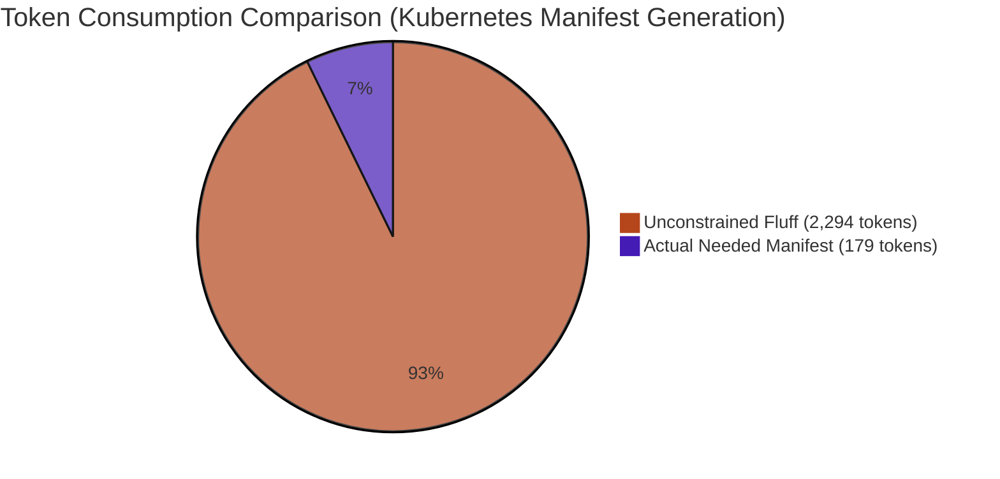

- **Token Reduction**: From 2,473 tokens down to 179 tokens.
- **Savings**: **92.7% reduction** in token consumption for the exact same desired technical asset!
- **Latency Improvement**: Generating 179 tokens completes in under 1 second, whereas generating 2,473 tokens takes 8–12 seconds, dramatically reducing pipeline execution time.

---

## 5. Prompt Engineering Taxonomy & Techniques

The lecture outlines four primary prompt engineering techniques. Understanding when to apply each technique is essential for every DevOps practitioner.

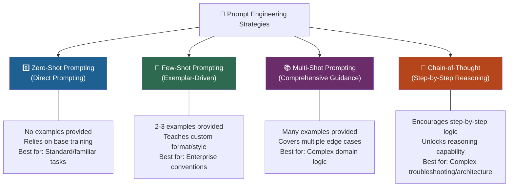

---

### 5.1 Zero-Shot Prompting (Direct Prompting)

> **Definition**: Providing a prompt directly to the LLM **without giving any reference examples** of the expected input-output format.

#### How It Works
You rely entirely on the patterns and knowledge the LLM acquired during its pre-training phase on public internet data.

#### When to Use Zero-Shot:
- When asking for standard, widely documented tools and configurations.
- Examples: Standard Dockerfile for Node.js, basic Kubernetes Pod manifest, common Linux command syntax, standard Git command combinations.
- The model has seen millions of instances of these during pre-training, so it can generate accurate syntax without explicit demonstration.

#### Example:
```text
Convert the following JSON string into valid YAML:
{"name": "payment-service", "port": 8080, "replicas": 3}
```

---

### 5.2 Few-Shot Prompting

> **Definition**: Providing a prompt that includes **a few concrete examples (typically 2 to 3)** demonstrating the exact input-output pattern before presenting the target task.

#### Why Few-Shot Prompting is Essential in DevOps
The instructor emphasizes that **Few-Shot Prompting is the most recommended and popular prompting style for DevOps engineers**.

**The Enterprise Context Void:**
- An LLM knows how to write an "ideal" shell script, Dockerfile, or Terraform module according to public open-source conventions.
- However, the LLM **does not know your organization**:
  - It does not know your company's proprietary script header standards.
  - It does not know your required author, version, or change-log annotations.
  - It does not know which shell linters (`shellcheck`) you enforce.
  - It does not know your corporate naming conventions for variables and functions.
  - It does not know that your security team bans specific utilities (e.g., using `curl` instead of `wget`, or enforcing POSIX-compliant syntax).

By supplying 2–3 examples of compliant corporate code, you "in-context tune" the model to match your organization's exact style without retraining the model.

#### Generic Demonstration: The Superhero Name Generator
To introduce the concept intuitively, Abhishek uses a naming demonstration in ChatGPT:

```text
[Prompt Input]
Example 1:
Task: Create a random name that starts with B.
Answer: Random name for alphabet B is Batman.

Example 2:
Task: Create a random name that starts with S.
Answer: Random name for alphabet S is Superman.

Task: Create a random name that starts with A.
Answer:
```

**Result:**
The model does not reply `"Sure! A good name starting with A could be Alice or Alex because..."`
Instead, it strictly mirrors the exact exemplar format:
```text
Random name for alphabet A is Aquaman.
```

---

### 5.3 Multi-Shot Prompting

> **Definition**: An extension of few-shot prompting where you provide **a larger set of examples (5, 10, or more)** covering various nuances, edge cases, and conditional branches.

#### When to Use Multi-Shot:
- When the task has multiple valid formatting rules depending on input conditions.
- Example: Generating Terraform modules where AWS, Azure, and GCP resources each require different tagging standards and credential management blocks.
- When generating complex regex parsers or log formatters where multiple distinct log patterns (Nginx access logs, PostgreSQL query logs, syslog) must be parsed differently.

---

### 5.4 Chain-of-Thought (CoT) Prompting

> **Definition**: A prompting technique that instructs the model to **break down its reasoning into explicit, sequential steps** before arriving at the final conclusion or code.

#### How It Works
By instructing the model to `"Think step by step"`, `"Analyze the root cause before proposing the fix"`, or providing examples with explicit thought processes, the model allocates computational tokens to logical reasoning.

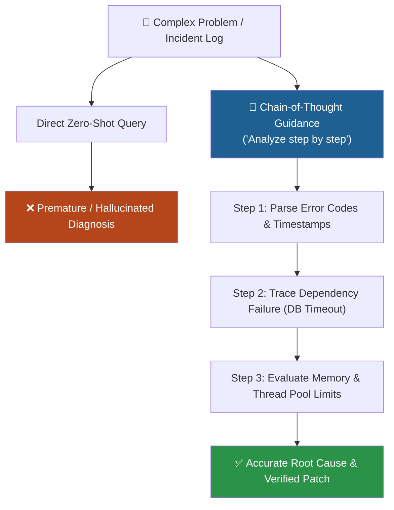

#### Why CoT is Powerful in DevOps
- High-level troubleshooting (e.g., diagnosing cascading microservice outages).
- Security policy analysis (e.g., evaluating Kubernetes RBAC permissions to verify if a service account can escalate privileges).
- Designing multi-tier cloud architectures where cost, reliability, and security must be balanced.

> [!NOTE]
> Chain-of-Thought prompting forms the cognitive foundation for **AI Agents** (covered in Days 7 and 8), where models autonomously plan, execute tools, reflect on results, and adjust actions.

---

### 5.5 Technique Comparison Table

| Attribute | Zero-Shot Prompting | Few-Shot Prompting | Multi-Shot Prompting | Chain-of-Thought (CoT) |
|---|---|---|---|---|
| **Number of Examples** | 0 | 2–3 | 4–10+ | 1–3 (with reasoning steps) |
| **Primary Mechanism** | Pre-trained parameter retrieval | In-context pattern matching | In-context edge-case coverage | Sequential logical deduction |
| **Prompt Token Cost** | Lowest (short prompt) | Moderate | Higher | Moderate to High |
| **Best Used For** | Standard syntax, boilerplate, generic CLI queries | Enforcing enterprise style, formatting, company conventions | Complex classification, heterogeneous data parsing | Deep troubleshooting, architecture design, root-cause analysis |
| **Risk** | Hallucinations, default filler text | Prompt size growth if examples are verbose | Exceeding token limits on smaller context models | May generate unnecessary reasoning steps when only code is needed |

---

## 6. Demo 2: Enforcing Enterprise Standards with Few-Shot Prompting

In the core practical demonstration of Day 2, Abhishek showcases how a DevOps engineer uses Few-Shot prompting to force an LLM to generate production Bash scripts compliant with strict enterprise guidelines.

### 6.1 The Enterprise Problem Statement

Your organization has established a mandatory Bash scripting standard:
1. Every script **must** begin with `#!/bin/bash`.
2. Every script **must** have a structured header comment containing:
   - `# Author: <Author Name>`
   - `# Version: <Version Number>`
   - `# Date: <Current Date>`
3. Comments must be cleanly terminated before actual commands begin.
4. Commands must follow specific company tool invocation conventions.

If you simply prompt ChatGPT: `"Write a script to check virtual machine services"`, it will output a generic script without your company header, using whatever author comment or layout it prefers.

---

### 6.2 The Few-Shot Prompt Construction

Abhishek crafts the following prompt providing two standard exemplars:

```text
You are an expert DevOps automation assistant. Follow our organization's exact shell scripting standards shown in the examples below.

Example 1:
Question: Write a shell script to fetch the docker version.
Answer:
#!/bin/bash
# Author: Abhishek Veeramalla
# Version: v1
# Date: 2026-10-12

docker --version

Example 2:
Question: Write a shell script to fetch the terraform version.
Answer:
#!/bin/bash
# Author: Abhishek Veeramalla
# Version: v1
# Date: 2026-10-12

terraform --version

Now generate the script for the following requirement:
Question: Write a shell script to fetch the versions of all services installed on a virtual machine.
Answer:
```

---

### 6.3 The Result Generated by the Model

Because the model was conditioned using Few-Shot exemplars, it strictly adopted the corporate template:

```bash
#!/bin/bash
# Author: Abhishek Veeramalla
# Version: v1
# Date: 2026-10-12

# Check versions of common installed DevOps and system services
echo "=== System & Service Versions ==="

echo -n "OS Version: "
cat /etc/os-release | grep "PRETTY_NAME" | cut -d= -f2 | tr -d '"'

if command -v docker &>/dev/null; then
    docker --version
else
    echo "Docker: Not installed"
fi

if command -v terraform &>/dev/null; then
    terraform --version
else
    echo "Terraform: Not installed"
fi

if command -v kubectl &>/dev/null; then
    kubectl version --client --short 2>/dev/null || kubectl version --client
else
    echo "Kubectl: Not installed"
fi

if command -v nginx &>/dev/null; then
    nginx -v
else
    echo "Nginx: Not installed"
fi

if command -v git &>/dev/null; then
    git --version
else
    echo "Git: Not installed"
fi
```

### Key Takeaway from the Demo
The LLM did not just write working Bash code—it adopted the **exact author header, versioning annotation, dating format, and structured presentation** without needing a fine-tuned model.

---

## 7. The 4-Pillar Strategic Prompting Framework

To conclude the lesson, Abhishek synthesizes a universal, repeatable prompting formula that every DevOps engineer should adopt across daily tasks and automation scripts.

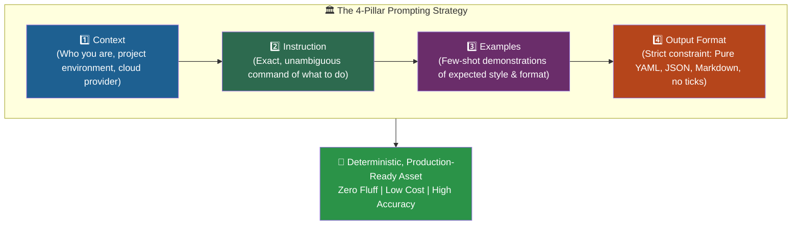

### Breakdown of the 4 Pillars

| Pillar | Purpose | DevOps Example |
|---|---|---|
| **1. Context** | Establishes the role, environment, and boundary constraints so the model doesn't make incorrect assumptions. | *"I am a Senior DevOps Engineer deploying microservices to an AWS EKS 1.30 cluster running on Bottlerocket OS."* |
| **2. Instruction** | Defines the exact operational task to perform, including operational criteria and banned practices. | *"Generate an automated AWS CLI script to rotate IAM access keys older than 90 days. Avoid using deprecated AWS CLI v1 commands."* |
| **3. Examples** | Provides 1–3 few-shot exemplars demonstrating expected coding standards, headers, and error handling. | *[Provide sample Bash script showing corporate header, `set -euo pipefail`, and structured JSON logging].* |
| **4. Output Format** | Enforces strict syntax boundary rules to make the response instantly usable by downstream parsers or humans. | *"Output ONLY raw Bash code inside a single code block. Do NOT include markdown explanations, prerequisites, or usage instructions."* |

---

### Complete Production Prompt Template for DevOps

Below is a reusable reference prompt template based on Abhishek's 4-Pillar framework:

```markdown
# CONTEXT
I am a DevOps engineer maintaining an enterprise Kubernetes platform on AWS (EKS v1.30). We strictly adhere to GitOps practices using ArgoCD and enforce CIS Kubernetes benchmark compliance.

# INSTRUCTION
Create a Kubernetes Deployment manifest for a high-availability Redis cache instance. 
Requirements:
- 3 replicas with PodAntiAffinity across availability zones (`topologyKey: topology.kubernetes.io/zone`).
- Explicit resource requests and limits (CPU: 250m/500m, Memory: 512Mi/1Gi).
- Readiness probe using `redis-cli ping`.
- Non-root security context (`runAsNonRoot: true`, `readOnlyRootFilesystem: true`).

# EXAMPLES
Our corporate manifest style is shown below:
apiVersion: apps/v1
kind: Deployment
metadata:
  name: example-app
  labels:
    app.kubernetes.io/name: example-app
    app.kubernetes.io/managed-by: argocd
spec:
  replicas: 2
  selector:
    matchLabels:
      app.kubernetes.io/name: example-app
  template:
    metadata:
      labels:
        app.kubernetes.io/name: example-app
    spec:
      containers:
      - name: app
        image: example:1.0.0

# OUTPUT FORMAT
Provide ONLY the raw Kubernetes YAML manifest. Do not include markdown explanations, tutorials, or kubectl commands before or after the code block.
```

---

## 8. Summary

### Key Takeaways

```diff
+ Prompt Engineering is the art and science of enhancing inputs to guide LLMs toward expected outputs.
+ Two primary benefits: (1) Output Precision (zero fluff) and (2) Token Cost Optimization.
+ In Google AI Studio, refining a prompt reduced tokens from 2,473 down to 179 (a 92.7% cost reduction).
+ API billing is strictly token-driven; bad prompts at enterprise scale burn thousands of dollars needlessly.
+ Zero-Shot Prompting: Direct input without examples; ideal for standard, well-documented tech tasks.
+ Few-Shot Prompting: Providing 2–3 examples; the most recommended technique for enforcing enterprise standards.
+ Multi-Shot Prompting: Providing multiple examples for complex, conditional, multi-cloud logic.
+ Chain-of-Thought (CoT): Guiding step-by-step reasoning; foundational for complex diagnosis and AI Agents.
- Never rely on default LLM output for enterprise shell scripts; models lack proprietary corporate context.
! The 4-Pillar Formula: Context → Instruction → Examples → Output Format ensures deterministic production results.
```

---

### Quick Reference

```bash
# Token Estimation Rule of Thumb (Google Gemini / OpenAI):
# 100 English Words ≈ 60 to 80 Tokens

# Core Directive Keywords for Precision:
# "generate only <resource>"       -> Suppresses conversational filler
# "output strictly as valid JSON"  -> Ensures downstream programmatic parsing
# "do not include explanations"    -> Drastically truncates output token billing

# Few-Shot Pattern Structure:
# Example 1: Input -> Expected Output
# Example 2: Input -> Expected Output
# Target:    Input -> [Model generates Expected Output]
```

---

### Detailed Command Diagnostics & Troubleshooting Relevance

When testing prompts and calling LLM APIs programmatically in DevOps pipelines (e.g., via `curl` or Python), engineers must monitor specific response headers and system diagnostics:

| Command / Metric / Header | Primary Use | Output Fields with High Diagnostic Relevance | Troubleshooting Significance |
|---|---|---|---|
| `curl -i -X POST <api_endpoint>` | Raw REST API testing for LLM endpoints | `HTTP/1.1 200 OK`, `401 Unauthorized`, `429 Too Many Requests`, `503 Service Unavailable` | **`429 Too Many Requests`**: Indicates your automated script exceeded provider rate limits (Tokens Per Minute - TPM or Requests Per Minute - RPM). Requires implementing exponential backoff.<br>**`401 Unauthorized`**: Expired or invalid API key in pipeline secret injection.<br>**`503 Service Unavailable`**: Upstream model cluster capacity overload. |
| `x-ratelimit-remaining-tokens` (HTTP Response Header) | Real-time token quota tracking | Integer (e.g., `54200`) | Diagnostic metric indicating how many tokens remain before the account is throttled. Monitoring this in Prometheus prevents automated pipeline outages. |
| `usage.prompt_tokens` & `usage.completion_tokens` (API JSON Body) | Token consumption accounting | `prompt_tokens`, `completion_tokens`, `total_tokens` | **Diagnostic Cost Audit**: Allows pipeline engineers to catch prompt regressions where poorly constructed prompts suddenly double or triple completion tokens in CI/CD runs. |
| `time curl ...` | Latency benchmarking | `real`, `user`, `sys` | High `real` time indicates large completion token counts (LLM generation is autoregressive: more output tokens = linearly higher latency). Refactoring to `"generate only"` immediately reduces `real` time. |
| `python -m json.tool` / `jq .` | Output format validation | Exit code `0` vs non-zero, parser errors | When instructing an LLM to generate JSON, piping output through `jq` in a CI/CD gate immediately validates whether the prompt successfully eliminated non-JSON markdown wrapper text. |

---

### Expert Insight

#### 🌍 Real-World Application
- **Enterprise System Prompt Templates**: Senior DevOps engineers build shared prompt templates in internal libraries (or via tools like LangChain / LlamaIndex / custom Python SDKs) so developers don't write ad-hoc prompts, guaranteeing security compliance and cost efficiency.
- **CI/CD Pull Request Reviewers**: When integrating LLMs into GitHub Actions or GitLab CI to review pull requests, unconstrained prompts cause pipeline timeouts and high monthly bills. Enforcing `"output strictly in JSON with keys: 'status', 'critical_findings', 'suggestions'"` allows automated PR gating without human intervention.
- **FinOps Governance**: Mature cloud organizations monitor LLM API costs alongside AWS/GCP bills, setting token budgets per engineering squad.

#### 🎓 Expert Path
1. **Always Use the 4 Pillars**: Never send a single-sentence prompt to an AI tool when working on production infrastructure.
2. **Experiment in Google AI Studio / OpenAI Playground**: Before writing code, test your prompts in developer playgrounds where token counts and system prompts are visibly displayed.
3. **Master Output Formats**: Learn how to prompt models to output strict schemas (JSON schemas, YAML without markdown backticks) for seamless integration with `jq`, `yq`, and shell variables.
4. **Prepare for Day 3 (Local LLMs)**: Understand that local LLMs have smaller context windows and compute power than cloud giants like GPT-4o or Gemini 1.5 Pro. Few-shot prompt engineering is **even more critical** on local models to keep them on track.

#### ⚠ Common Pitfalls

| Pitfall | Impact | Fix |
|---|---|---|
| **Vague Prompts** | Hallucinations, generic boilerplate, unusable configurations | Always provide **Context** and **Instruction** explicitly specifying tools, versions, and limits. |
| **Ignoring Token Costs** | Huge cloud API billing surprises at month-end | Add restrictive output keywords (`"generate only"`, `"concise"`, `"pure YAML"`) to eliminate conversational padding. |
| **Assuming LLM Knows Company Standards** | Generated scripts violate internal security or naming policies | Use **Few-Shot Prompting** with 2–3 compliant code snippets before the target query. |
| **Unconstrained Output Types** | Pipeline breaks because LLM included conversational text around JSON/YAML | Explicitly specify **Output Format** and mandate: `"Do not include markdown ticks or introductory text."` |
| **Overloading Context** | Passing entire 5,000-line log files when 20 lines would suffice | Filter and trim logs before passing them into the prompt to preserve context window and save tokens. |

---

### 📝 Transcript Corrections Applied

In accordance with the workflow rules, audio transcription errors from the raw VTT file have been corrected as follows:

| Garbled Audio / Transcript Error | Correct Technical Term | Context in Lecture |
|---|---|---|
| `prompt ins saring` | **Prompt Engineering** | Repeatedly garbled in automated captioning |
| `Equus deployment` | **Kubernetes deployment** | Audio misinterpreted "Kubernetes" as "Equus" |
| `deployment yl file` | **deployment YAML file** | Phonetic transcription of `.yaml` extension |
| `wordss` | **words** | Caption stuttering |
| `deeps` / `deep seek` | **DeepSeek** | Cloud LLM provider |
| `open aai` | **OpenAI** | Leading AI research lab & API provider |
| `AA model` | **AI model** | Garbled speech recognition |
| `zero short` | **zero-shot** | Standard prompt engineering terminology |
| `few short` | **few-shot** | Standard prompt engineering terminology |
| `multi-shot` | **multi-shot (N-shot)** | Prompting with multiple reference examples |
| `chain off thoughts` | **chain-of-thought (CoT)** | Sequential reasoning prompting strategy |
| `mirala` | **Veeramalla** | Instructor's last name in demo shell script author header |
| `close the comms` | **close the comments** | Referring to closing the `#` comment block in Bash |
| `concised` | **concise** | Grammatical correction for model response instruction |

</details>

<details open>
<summary><b>Day 2: Prompt Engineering Explained (CS46H)</b></summary>

## Table of Contents

- [DAY-2: Prompt Engineering Explained In 30 Minutes](#day-2-prompt-engineering-explained-in-30-minutes)
  - [Episode Overview](#episode-overview)
  - [What Is Prompt Engineering?](#what-is-prompt-engineering)
    - [The Lay Definition](#the-lay-definition)
    - [Zero-Shot Demo — The Instant Value of Better Prompts](#zero-shot-demo--the-instant-value-of-better-prompts)
  - [Why Prompt Engineering Matters — Two Business Cases](#why-prompt-engineering-matters--two-business-cases)
    - [Business Case 1: Output Precision](#business-case-1-output-precision)
    - [Business Case 2: Token Cost Optimization](#business-case-2-token-cost-optimization)
    - [Live Token Benchmark — Google AI Studio](#live-token-benchmark--google-ai-studio)
  - [Prompt Engineering Techniques](#prompt-engineering-techniques)
    - [Zero-Shot Prompting (Direct Prompting)](#zero-shot-prompting-direct-prompting)
    - [Few-Shot Prompting](#few-shot-prompting)
    - [Multi-Shot Prompting](#multi-shot-prompting)
    - [Chain-of-Thought (CoT) Prompting](#chain-of-thought-cot-prompting)
    - [Technique Comparison Table](#technique-comparison-table)
  - [Demo: Enforcing Org Standards with Few-Shot Prompting](#demo-enforcing-org-standards-with-few-shot-prompting)
    - [The Problem: LLMs Don't Know Your Org's Style](#the-problem-llms-dont-know-your-orgs-style)
    - [The Few-Shot Solution](#the-few-shot-solution)
    - [The Prompt Used in the Demo](#the-prompt-used-in-the-demo)
    - [Result](#result)
  - [The 4-Pillar Prompting Strategy](#the-4-pillar-prompting-strategy)
- [Summary](#summary)

---

## DAY-2: Prompt Engineering Explained In 30 Minutes

### Episode Overview

Day 2 establishes **Prompt Engineering** as the single most critical hands-on skill in the AI Assisted DevOps toolkit. The transcript covers the definition, two core business justifications (precision and cost), four prompting techniques, a live DevOps few-shot demo, and a practical 4-pillar strategy for structuring professional-grade prompts.

**Topics covered:**
- Definition of prompt vs. prompt engineering — in plain language
- Zero-shot demo: "generate a kubernetes manifest" vs. "generate ONLY a kubernetes manifest"
- Token economics — what tokens are, how cost scales with tokens, and why bad prompts drain budgets
- Live Google AI Studio benchmark: 2,473 tokens (bad) → 179 tokens (good) — a 92.7% reduction
- Four prompting techniques: Zero-Shot, Few-Shot, Multi-Shot, Chain-of-Thought
- DevOps few-shot demo: forcing LLM output to match an organization's shell script header standard
- Abhishek's 4-Pillar Strategy: Context + Instruction + Examples + Output Format

> [!NOTE]
> This episode is intentionally hands-on and visual. Every concept has an immediate, runnable example. The instructor's approach is: never explain without showing — theory here is inseparable from the demo.

---

### What Is Prompt Engineering?

#### The Lay Definition

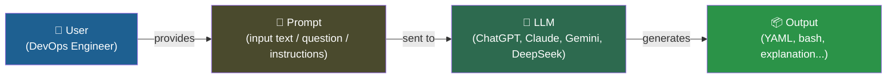

**Definitions (from the transcript):**
- **Prompt** — the input text provided by the user to an AI model
- **Prompt Engineering** — the discipline of enhancing and structuring that input so the AI model generates the exact, expected, desired output

```diff
+ Prompt:           What you type into ChatGPT
+ Prompt Engineering: How you improve what you type to get a better answer
! Key insight: the same LLM, trained on the same data, produces drastically different outputs
!              depending solely on how the input is structured
```

---

#### Zero-Shot Demo — The Instant Value of Better Prompts

The instructor demonstrates prompt engineering with a Kubernetes manifest example, starting in ChatGPT.

**Attempt 1 — vague prompt:**
```
generate a kubernetes manifest for deployment resource
```
**Result:** Provides the YAML manifest — BUT also includes:
- A description of what the manifest does (not requested)
- Explanation of each field (not requested)
- Steps to apply the manifest (not requested)
- Check deployment status instructions (not requested)
- Suggestions for further customization (not requested)

→ **Lots of text you don't need = wasted tokens = wasted cost**

**Attempt 2 — one-word improvement:**
```
generate ONLY kubernetes manifest for deployment resource
```
**Result:** Pure YAML only. No description, no explanation, no suggestions.

```diff
- Before: generate a kubernetes manifest for deployment resource
+ After:  generate ONLY kubernetes manifest for deployment resource
          ^^^^
          One word change. Entire output precision improved.
```

> 💡 **Key Insight:** The word "only" is a constraint directive. The LLM was always capable of producing clean YAML — the prompt was not giving it the right constraint. Prompt engineering is about closing the gap between what the LLM *can* do and what it *actually does* for your specific need.

---

### Why Prompt Engineering Matters — Two Business Cases

#### Business Case 1: Output Precision

The LLM produces exactly what you need — nothing more, nothing less.

| Output Quality | Without Prompt Engineering | With Prompt Engineering |
|----------------|--------------------------|------------------------|
| YAML manifest | ✅ Included | ✅ Included |
| Description/explanation | ❌ Unwanted, included | ✅ Excluded |
| Steps to apply | ❌ Unwanted, included | ✅ Excluded |
| Suggestions | ❌ Unwanted, included | ✅ Excluded |
| Immediate usability | ❌ Must edit output | ✅ Ready to use |
| Tokens consumed | ~2,473 | ~179 |

---

#### Business Case 2: Token Cost Optimization

> **Token economics:** API calls to hosted LLMs are not free. You pay per token consumed (both input and output).

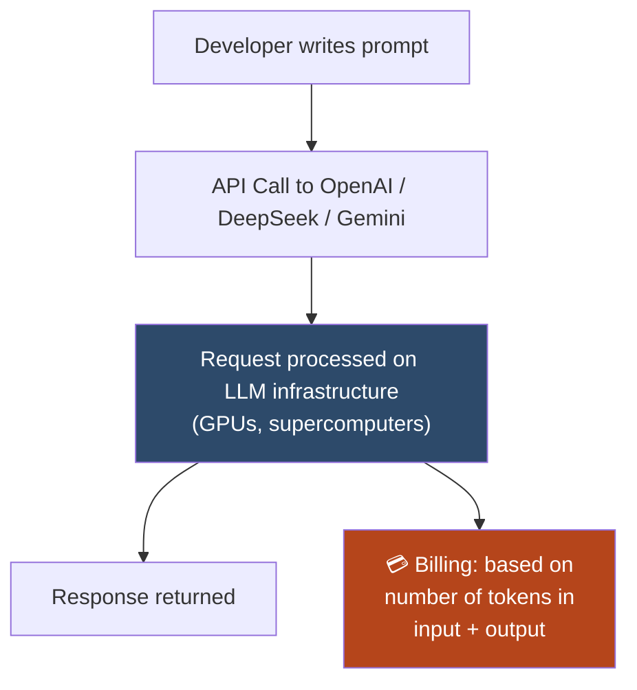

**What are tokens?**
- Tokens are the unit of measurement LLMs use internally for text processing
- Roughly: **100 words ≈ 60–80 tokens** (for models like Gemini)
- More words in the output → more tokens → higher cost per API call

**Why this matters at scale:**

| Scenario | Tokens per Request | Requests/Year | Annual Token Volume |
|----------|--------------------|---------------|---------------------|
| Bad prompt (2,473 tokens) | 2,473 | 1,000,000 | **2.47 trillion tokens** |
| Good prompt (179 tokens) | 179 | 1,000,000 | **179 billion tokens** |
| **Cost reduction** | — | — | **~93% less tokens → ~93% less cost** |

> [!IMPORTANT]
> The instructor's example: 100 developers in an organization each use a Python script that calls an LLM API daily. Over a year, that becomes millions of API requests. The difference between a bad prompt (2,473 tokens) and a good prompt (179 tokens) translates to a **93% reduction in API billing** — at scale, this becomes the difference between thousands and hundreds of thousands of dollars annually.

**The cost math:**
```diff
+ LLM API pricing model: charged per 1,000 tokens (or 1 million tokens for newer pricing tiers)
+ Bad prompt:  2,473 tokens × $X per 1K tokens = $2.473X per request
+ Good prompt:    179 tokens × $X per 1K tokens = $0.179X per request
! Savings per request: ~93%
! Savings over 1M requests: massive — the exact number depends on the model's per-token rate
```

---

#### Live Token Benchmark — Google AI Studio

The instructor opens Google AI Studio (free account) to visually compare token counts side by side.

**Test 1 — Bad Prompt:**
```
generate a kubernetes manifest for deployment resource
```
→ Token count: **2,473** (output includes descriptions, explanations, suggestions, steps)

**Test 2 — Good Prompt:**
```
generate ONLY kubernetes manifest for deployment resource
```
→ Token count: **179** (pure YAML only)

```diff
! Result: 2,473 tokens → 179 tokens
! Reduction: 2,294 tokens saved (92.7% reduction) from changing ONE WORD
```

> [!NOTE]
> Google AI Studio provides a free account and shows token counts in real time as the model generates output. It is the fastest way to benchmark your own prompt quality. Try it at `aistudio.google.com`.

---

### Prompt Engineering Techniques

#### Zero-Shot Prompting (Direct Prompting)

> **Definition:** Ask the LLM directly with no examples provided.

**When to use:**
- The topic is widely known and well-represented in the LLM's training data
- Standard formats (Kubernetes manifests, Dockerfiles, common scripts)
- Quick, one-off requests where format flexibility is acceptable

**Example from the demo:**
```
generate ONLY kubernetes manifest for deployment resource
```
No example YAML provided — the model knows the format from training data.

```diff
+ Strengths:  Fast, simple, requires no prior examples
- Limitations: Does not account for your org's specific conventions,
               naming standards, or custom formats
```

**Also called:** Direct Prompting

---

#### Few-Shot Prompting

> **Definition:** Provide 2–3 examples before stating your actual request. The model infers the desired format/style from the examples.

**When to use:**
- Output must match your organization's specific format or conventions
- The LLM doesn't have context about your company's coding style
- You need consistent, predictable output structure across many requests

**Generic example (from the demo):**
```
Example 1:
Q: Create a random name starting with B.
A: Random name for alphabet B is Batman.

Example 2:
Q: Create a random name starting with S.
A: Random name for alphabet S is Superman.

Now: Create a random name starting with A.
```
Result: LLM outputs "Random name for alphabet A is Aquaman" — matching the exact format, not just generating "Alice."

**Why this matters for DevOps:**
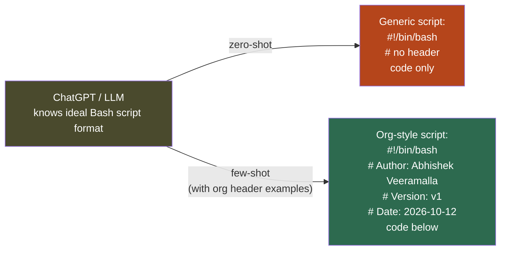

> 💡 **Key Insight (from the instructor):** "LLMs know the ideal answer but they don't know the context — they don't know what exactly your organization's requirement is. To make the model give the output that you need, always provide some examples. Always try to provide the context." This is the single most recommended technique from Abhishek throughout the entire series.

---

#### Multi-Shot Prompting

> **Definition:** Like few-shot, but with more examples (N > 2–3). Used for complex, multi-branch, or edge-case-heavy tasks.

**When to use:**
- Complex conditional logic with many possible inputs/outputs
- Multi-cloud scripts that behave differently per environment (AWS, GCP, Azure)
- Domain-specific output with many custom rules the LLM must learn

```diff
+ Few-Shot:   2–3 examples → sufficient for simple org format enforcement
+ Multi-Shot: Many examples → necessary when there are many conditional branches
             or complex rules the model must internalize before responding
```

---

#### Chain-of-Thought (CoT) Prompting

> **Definition:** Prompting the LLM to reason step-by-step before producing its final answer.

**How it works:**
```
Prompt: "Think through this step by step: ..."
or:     "Explain your reasoning, then provide the answer."
or:     "Step 1: ... Step 2: ... Step 3: ..."
```

**Why it helps:**
- Activates the LLM's internal reasoning capabilities
- Improves accuracy on complex analytical tasks (architecture analysis, root cause identification, debugging)
- Allows the model to "catch" its own errors during reasoning before producing the final answer

> [!NOTE]
> CoT is introduced briefly in Day 2 and covered in depth in later episodes when discussing AI Agents. For now: know that CoT is the go-to technique when zero-shot or few-shot answers feel shallow or imprecise on complex multi-step problems.

**Example contrast:**
```diff
- Zero-shot: "Why is my Kubernetes pod in CrashLoopBackOff?"
  → LLM gives generic list of possible causes

+ CoT: "A Kubernetes pod is in CrashLoopBackOff. Think step by step:
       First analyze what CrashLoopBackOff means in Kubernetes.
       Then list the most likely causes in order of probability.
       Then tell me what kubectl commands to run to diagnose each cause."
  → LLM provides structured, systematic root-cause analysis
```

---

#### Technique Comparison Table

| Technique | Examples Provided | Best For | DevOps Use Case |
|-----------|-------------------|----------|-----------------|
| **Zero-Shot** | None | Standard, well-known formats | Generate a Dockerfile, explain a kubectl error |
| **Few-Shot** | 2–3 | Org-specific format/style enforcement | Shell scripts with company header, YAML in org template |
| **Multi-Shot** | Many | Complex, multi-branch logic | Multi-cloud scripts, multi-language Dockerfiles |
| **Chain-of-Thought** | 0+ with reasoning steps | Deep analysis, debugging, architecture | Root cause analysis, incident post-mortems, security reviews |

---

### Demo: Enforcing Org Standards with Few-Shot Prompting

#### The Problem: LLMs Don't Know Your Org's Style

Every organization has coding conventions. For example:
- All shell scripts start with a standard header: author, version, date
- Variable names follow a specific casing convention
- Certain keywords or patterns are forbidden

**ChatGPT and other LLMs know ideal script formats — but they don't know YOUR organization's standards.**

Zero-shot prompting ("write a shell script to get VM service versions") will generate a perfectly functional but header-less, convention-free script.

---

#### The Few-Shot Solution

Provide 2 examples of your org's style BEFORE asking for the actual script. The LLM infers the pattern from the examples.

```diff
! You are not "training" the model — training is permanent and expensive.
+ You are providing context for THIS conversation / THIS request.
+ The model infers: "Oh, this organization always formats scripts THIS way."
```

---

#### The Prompt Used in the Demo

```
Example 1:
Q: Write a shell script to fetch the Docker version.
A:
#!/bin/bash
# Author: Abhishek Veeramalla
# Version: v1
# Date: 2026-10-12
docker --version

Example 2:
Q: Write a shell script to fetch the Terraform version.
A:
#!/bin/bash
# Author: Abhishek Veeramalla
# Version: v1
# Date: 2026-10-12
terraform --version

Now: Write a shell script to fetch the versions of all services and processes 
installed on a virtual machine.
```

---

#### Result

The LLM generated a comprehensive service/process version enumeration script — AND automatically applied the same header format from the examples:

```bash
#!/bin/bash
# Author: Abhishek Veeramalla
# Version: v1
# Date: 2026-10-12

# Get versions of common services
echo "=== Service Versions ==="
# ... (full script body generated by the LLM)
```

```diff
+ Header format: ✅ Exactly matched the examples (shebang, Author, Version, Date)
+ Script body:   ✅ Complex enumeration logic generated automatically
+ No description: ✅ No explanation or tutorial prose included
! Key: the LLM produced an org-standard script in one shot because of the examples
```

> 💡 **Production tip:** In real DevOps teams, few-shot templates are maintained in a shared prompt library (a simple markdown file or a prompt management tool). Every engineer pulls from the same template library, ensuring consistent LLM output style across the team.

---

### The 4-Pillar Prompting Strategy

The instructor's closing recommendation — a structured approach to writing any professional-grade prompt:

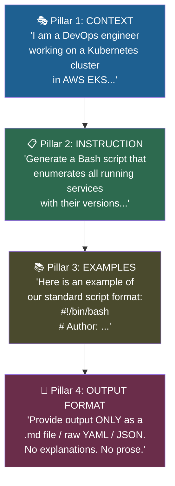

**The 4 Pillars:**

| Pillar | Purpose | Example |
|--------|---------|---------|
| **1. Context** | Establish your identity, environment, and project so the LLM understands the situation | "I am a DevOps engineer working on Ubuntu EC2 instances in AWS" |
| **2. Instruction** | State the specific task with clear, unambiguous criteria | "Write a Bash script that checks CPU, memory, and disk usage and reports if any exceeds 60%" |
| **3. Examples** | Provide 2–3 sample input/output pairs that encode your org's style | Show one example script with your standard header format |
| **4. Output Format** | Explicitly define the format of the response | "Output ONLY the raw bash script. No markdown fences. No explanation." |

**Output format directives that work well:**

```diff
+ "Output ONLY the YAML manifest. No explanation."
+ "Provide the result in JSON format."
+ "Return only raw bash script. No markdown code fences."
+ "Generate the output as a .md file."
+ "Format the response as a table with columns: Service | Version | Status"
```

> [!IMPORTANT]
> The instructor demonstrated the output format pillar live: asking ChatGPT for output in MD file format — and the model produced a downloadable `.md` file. Output format directives give you control over how results integrate into your downstream workflow (files, pipelines, documentation).

**Full 4-pillar prompt template:**

```
CONTEXT:
I am a DevOps engineer working on Ubuntu 22.04 LTS EC2 instances in AWS.
Our team uses Bash scripts with a standard header (author, version, date).

INSTRUCTION:
Write a shell script that checks all running services and prints their versions.
Include error handling for services that don't support --version.

EXAMPLES:
Q: Write a script to fetch the Docker version.
A:
#!/bin/bash
# Author: Abhishek Veeramalla
# Version: v1
# Date: 2026-10-12
docker --version

OUTPUT FORMAT:
Output ONLY the raw bash script. No explanations. No markdown code blocks.
```

---

## Summary

### Key Takeaways

```diff
+ Prompt = user input to an LLM
+ Prompt Engineering = enhancing that input to get exact, expected, desired output
+ Zero-shot: no examples; works for standard/familiar tasks (K8s manifests, Dockerfiles)
+ Few-shot: 2-3 examples; BEST for org-specific format and style enforcement
+ Multi-shot: many examples; for complex multi-branch / edge-case-heavy tasks
+ Chain-of-Thought: step-by-step reasoning; activates LLM's analytical depth
+ Token = unit of LLM processing; more words → more tokens → more cost
! Bad prompt: 2,473 tokens; Good prompt: 179 tokens → 92.7% cost reduction
! At scale (100 devs × 1,000 req/day × 365 days): token savings = thousands of dollars
+ 4-Pillar strategy: Context + Instruction + Examples + Output Format
- Prompt engineering is NOT about tricking the model; it's about communicating precisely
```

### Quick Reference — Prompt Engineering Cheat Sheet

| Goal | Technique | Key Directive |
|------|-----------|---------------|
| Get clean YAML only | Zero-Shot | Add "ONLY" or "Output ONLY the YAML" |
| Match org script format | Few-Shot | Provide 2 example scripts first |
| Complex multi-branch logic | Multi-Shot | Provide many examples covering all branches |
| Deep debugging / architecture analysis | Chain-of-Thought | "Think step by step:" or "Reason through this:" |
| Control output structure | Output Format pillar | "Output as JSON / .md / raw bash / table" |
| Establish context | Context pillar | "I am a DevOps engineer working on X..." |
| Reduce API costs | Good prompts | Add "ONLY", specify output format, eliminate filler directives |

### Quick Reference — Token Math

```bash
# Mental model for token cost estimation
100 words ≈ 60–80 tokens (Gemini baseline)

# Bad prompt token output example
"generate a kubernetes manifest for deployment resource"
→ Output: 2,473 tokens (descriptions + YAML + explanations + steps + suggestions)

# Good prompt token output example  
"generate ONLY kubernetes manifest for deployment resource"
→ Output: 179 tokens (YAML only)

# Savings calculation
echo "Token reduction: $((2473 - 179)) tokens"
echo "Percentage saved: $(echo "scale=1; (2473-179)/2473*100" | bc)%"
# Token reduction: 2294 tokens
# Percentage saved: 92.7%
```

### Expert Insight

**🌍 Real-World Application:**
In production DevOps organizations, few-shot prompt templates are maintained as shared assets — stored in a team's internal wiki or a dedicated prompt library repository. Engineers pull from approved templates for generating Dockerfiles, K8s manifests, Helm charts, Terraform modules, and CI/CD pipeline YAML. This creates consistency, enforces organizational standards, and dramatically reduces token waste.

**🚀 Expert Path:**
1. Build your own prompt library — one `.md` file with your best prompts organized by category (scripting, manifests, CI/CD, IaC, debugging)
2. Add the 4-pillar structure to every non-trivial prompt you write — even if you skip the examples pillar, always write the context and output format
3. Use Google AI Studio to benchmark your own prompts before integrating them into Python scripts that call paid APIs — the free token counter will save you money
4. For any prompt used in a production Python automation (API calls to OpenAI/Gemini/DeepSeek), benchmark the token count first and set a `max_tokens` parameter in the API call to guard against runaway outputs

**⚠️ Common Pitfalls:**
- Providing examples in a random or inconsistent format — the LLM infers format from consistency; if your two examples use different header styles, the output will be inconsistent too
- Confusing "providing context" with "training the model" — few-shot examples provide context for a single conversation only; they don't permanently change the model's behavior
- Forgetting the output format pillar — even a well-structured Context + Instruction + Examples prompt will produce verbose output if you don't tell the LLM explicitly what format you want
- Using ChatGPT (the web interface) for prompts you intend to later use in API calls — the web interface uses slightly different system prompts; always test your API prompts via the API or a tool like Google AI Studio that shows real token counts
- Assuming CoT is always better — for simple, factual tasks, zero-shot is faster and cheaper; CoT is a tool for complex analytical tasks, not a universal upgrade

**📝 Additional Diagnostic / Troubleshooting Notes:**
- **When few-shot produces inconsistent output:** Your examples may be too different from each other. Standardize the format across all examples before the main request. If output is still inconsistent, add an explicit Output Format pillar directive.
- **When zero-shot gives verbose output:** Add constraint directives: "ONLY", "No explanations", "No markdown prose", "Raw output only". These are the highest-precision constraint words.
- **When CoT reasoning is circular:** The model is stuck in a loop. Break the reasoning into explicit numbered steps: "Step 1: identify the problem. Step 2: list possible causes. Step 3: for each cause, describe the diagnostic command. Step 4: recommend a fix." Numbered steps force linear progression.
- **Token counting tools:** Google AI Studio (free), OpenAI Tokenizer (free, online), `tiktoken` Python library for programmatic token counting before API submission
- **Context window vs. token limit:** The "input token limit" of an LLM (e.g., 128K tokens for GPT-4 Turbo) defines how much context you can provide, including your examples. Few-shot prompts with very long examples can consume the context window — for multi-shot, keep individual examples concise.
- **Prompt injection risk:** In automated DevOps pipelines where user-supplied data is interpolated into a prompt (e.g., a developer's git commit message fed into an LLM for PR summarization), always sanitize or delimit user input to prevent injected instructions from hijacking the LLM's behavior.

> [!IMPORTANT]
> **Transcript Corrections Applied (CS46H pass):**
> - "abishek" → "Abhishek" (instructor's name throughout)
> - "prompt ins saring" → "Prompt Engineering"
> - "zero short / few short / n short" → "zero-shot / few-shot / N-shot"
> - "Equus deployment" → "Kubernetes deployment"
> - "deployment yl file" → "deployment YAML file"
> - "wordss" → "words"
> - "open aai" → "OpenAI"
> - "deeps / deep seek" → "DeepSeek"
> - "AA model" → "AI model"
> - "chain off thoughts" → "chain-of-thought (CoT)"
> - "mirala" → "Veeramalla"
> - "close the comms" → "close the comments"
> - "concised" → "concise"
> - "Jango" → "Django" (referenced in passing)

</details>
