# Day 3: GenAI Project For DevOps Engineers

<details open>
<summary><b>Day 3: GenAI Project For DevOps Engineers (G3CS46T)</b></summary>

## Table of Contents
1. [Episode Overview](#1-episode-overview)
2. [The DevOps Automation Challenge: Multi-Language Dockerfile Generation](#2-the-devops-automation-challenge-multi-language-dockerfile-generation)
3. [Architecture Decision Matrix: Local LLMs vs. Hosted LLMs](#3-architecture-decision-matrix-local-llms-vs-hosted-llms)
   - [3.1 Local LLM Architecture (Ollama + Llama 3.2 1B)](#31-local-llm-architecture-ollama--llama-32-1b)
   - [3.2 Hosted LLM Architecture (Google AI Studio / Gemini API)](#32-hosted-llm-architecture-google-ai-studio--gemini-api)
   - [3.3 Comprehensive Trade-Off Matrix](#33-comprehensive-trade-off-matrix)
   - [3.4 The "Docker for LLMs" Mental Model: Ollama Explained](#34-the-docker-for-llms-mental-model-ollama-explained)
4. [Environment Setup & Tooling](#4-environment-setup--tooling)
   - [4.1 Installing and Verifying Ollama](#41-installing-and-verifying-ollama)
   - [4.2 Downloading Lightweight Model Weights (`llama3.2:1b`)](#42-downloading-lightweight-model-weights-llama321b)
   - [4.3 Python Virtual Environment & Dependency Isolation](#43-python-virtual-environment--dependency-isolation)
5. [Project Implementation 1: Local LLM Dockerfile Generator](#5-project-implementation-1-local-llm-dockerfile-generator)
   - [5.1 Prompt Engineering with Structural Constraints](#51-prompt-engineering-with-structural-constraints)
   - [5.2 Complete Python Implementation (`generate_dockerfile.py`)](#52-complete-python-implementation-generate_dockerfilepy)
   - [5.3 Live Multi-Language Test Runs (Groovy, Python, Ruby on Rails)](#53-live-multi-language-test-runs-groovy-python-ruby-on-rails)
6. [Project Implementation 2: Hosted LLM Generator with Google Gemini](#6-project-implementation-2-hosted-llm-generator-with-google-gemini)
   - [6.1 Google AI Studio API Provisioning & Security Hygiene](#61-google-ai-studio-api-provisioning--security-hygiene)
   - [6.2 Complete Python Implementation (`generate_dockerfile_gemini.py`)](#62-complete-python-implementation-generate_dockerfile_geminipy)
   - [6.3 Live Multi-Stage Build Generation (Node.js)](#63-live-multi-stage-build-generation-nodejs)
7. [Production Hardening, Tokenomics & Security](#7-production-hardening-tokenomics--security)
   - [7.1 Foundation Model Divergence: Llama vs. Gemini vs. DeepSeek vs. Granite](#71-foundation-model-divergence-llama-vs-gemini-vs-deepseek-vs-granite)
   - [7.2 Token Cost Economics & Metering](#72-token-cost-economics--metering)
   - [7.3 DevOps Threat Modeling: DoS, Rate Limiting & Secret Sprawl](#73-devops-threat-modeling-dos-rate-limiting--secret-sprawl)
8. [Summary](#8-summary)

---

## 1. Episode Overview

**Day 3** of the *AI Assisted DevOps — Zero to Hero* course transitions from prompt engineering theory to building a **production-ready Generative AI automation utility**. DevOps engineers frequently support polyglot development organizations where engineering teams push services in diverse, unfamiliar languages—such as Java, Node.js, Python, Ruby on Rails, Groovy, Rust, or Go. Manually researching and writing secure, production-grade Dockerfiles for every unique runtime introduces friction, configuration drift, and security vulnerabilities.

In this project, Abhishek guides engineers through building a command-line DevOps tool that accepts any programming language and dynamically generates an optimized, multi-stage Dockerfile adhering to enterprise container standards.

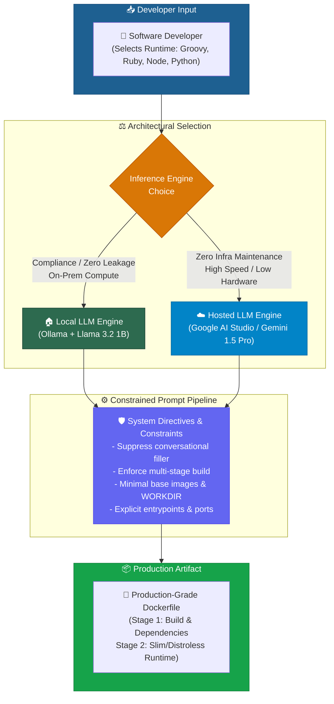

**Key Takeaways Covered in this Episode:**
- Building your very first functional Generative AI DevOps application in Python.
- Architectural deep dive: comparing **Local LLMs (Ollama)** vs. **Hosted Cloud LLMs (Gemini / OpenAI)** across security, privacy, infrastructure overhead, and cost.
- Demystifying Ollama using the "Docker for LLMs" mental model.
- Setting up a Python virtual environment (`venv`) and calling LLMs programmatically via native client libraries (`ollama` and `google-generativeai`).
- Applying Day 2's prompt engineering principles (context, negative constraints, structural requirements) to eliminate conversational filler.
- Comparing model outputs across Groovy, Python, Ruby on Rails, and Node.js.
- Cloud tokenomics, DoS protection, API key rotation, and rate-limiting best practices.

> [!NOTE]
> Even if you have never containerized a specific programming language (such as Ruby on Rails or Groovy), generative AI models trained on millions of open-source repositories provide immediate, high-accuracy scaffolding when given appropriate architectural constraints.

---

## 2. The DevOps Automation Challenge: Multi-Language Dockerfile Generation

### The Polyglot Dilemma in Modern Enterprises

In an enterprise platform engineering model, centralized DevOps and Site Reliability Engineering (SRE) teams serve dozens of distributed application teams. Each team chooses different languages and framework versions:

```
├── Squad A: Java 21 Spring Boot
├── Squad B: Node.js 20 Express / NestJS
├── Squad C: Python 3.11 FastAPI / Django
├── Squad D: Legacy Ruby on Rails 7
└── Squad E: Groovy batch processing pipeline
```

When developers ask DevOps to "dockerize" their application, DevOps engineers face common friction points:
1. **Unfamiliarity with Runtime Toolchains**: An engineer proficient in Python and Go may not know the nuances of Ruby bundler caching, Groovy classpath configuration, or Java multi-stage build targets.
2. **Security Vulnerabilities from Generic Boilerplate**: Copying unverified Dockerfiles from web forums often introduces root-running containers, huge base images (`ubuntu:latest`), unpinned packages, and missing dependency cache optimization.
3. **Conversational AI Inefficiency**: If developers manually query ChatGPT or Claude web interfaces, they receive conversational explanations, missing steps, or single-stage configurations that inflate container image sizes to 1.5 GB+.

### The Solution: An Automated, Constrained AI CLI

By encapsulating a hardened prompt inside a reusable Python script, platform engineers provide application developers with an internal self-service CLI. The script accepts only the target language and outputs an optimized, multi-stage Dockerfile ready for the CI/CD pipeline.

---

## 3. Architecture Decision Matrix: Local LLMs vs. Hosted LLMs

Before writing code, DevOps engineers must answer a critical architectural question: **Where should inference execute?**

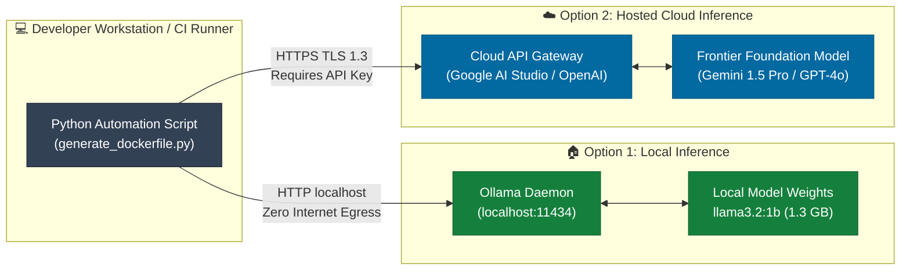

### 3.1 Local LLM Architecture (Ollama + Llama 3.2 1B)

In the local architecture, model weights execute directly on the developer's laptop or on private enterprise compute nodes.

- **Data Privacy & Security**: Prompts never leave the local machine. Proprietary source code snippets, internal repository names, and architecture details cannot leak to external AI providers or enter public training sets. This is mandatory for regulated sectors (defense, banking, healthcare, SOC2/HIPAA compliance).
- **Zero Variable Cost**: Once the model weights are downloaded, inference is 100% free. No per-token charges or monthly subscription tiers.
- **Hardware Bottlenecks**: Local execution consumes local RAM, CPU cycles, and GPU VRAM. Running a model on a CPU-bound machine can take 2 to 10 minutes per query, or trigger connection timeouts if background processes starve the daemon.

### 3.2 Hosted LLM Architecture (Google AI Studio / Gemini API)

In the hosted architecture, inference is offloaded to managed hyperscaler infrastructure.

- **Zero Infrastructure Overhead**: No local GPU or high-end laptop required. Works seamlessly on low-power developer machines and ephemeral CI/CD agents.
- **Frontier Intelligence & Sub-Second Latency**: Massive foundation models (e.g., Gemini 1.5 Pro, GPT-4o) process prompts and stream completions in seconds.
- **Data & Financial Exposure**: Every token processed incurs API costs (or draws down free quota). Sending proprietary code across third-party endpoints creates compliance risks if commercial terms do not guarantee zero-data-retention. Bad actors or runaway loops can trigger massive API bills.

---

### 3.3 Comprehensive Trade-Off Matrix

| Architectural Dimension | Local LLMs (`Ollama` + `Llama 3.2 1B`) | Hosted LLMs (`Google Gemini` / `OpenAI`) |
|---|---|---|
| **Data Privacy & Compliance** | **Absolute (Air-Gapped Compatible)**<br>Data never leaves localhost. Meets SOC2, HIPAA, PCI-DSS, FedRAMP. | **Shared Responsibility**<br>Prompts egress over HTTPS. Requires strict enterprise DPAs and zero-retention agreements. |
| **Operational & Hardware Cost** | **Zero Token Cost**<br>High upfront compute/hardware cost if scaling dedicated GPU clusters. | **Pay-As-You-Go ($ / 1M Tokens)**<br>Zero upfront infra cost; operational cost scales linearly with usage. |
| **Inference Latency** | **Hardware Dependent**<br>Sub-second on Apple Silicon / NVIDIA GPUs; 2–10 minutes on CPU-only laptops. | **Consistently Fast (1–3 Seconds)**<br>Powered by hyperscaler TPU/GPU clusters. |
| **Model Capability & Context** | **Lightweight (1B–8B Parameters)**<br>Good for standard tasks; may struggle with deeply nested reasoning. | **Frontier (Hundreds of Billions to Trillions)**<br>Exceptional polyglot knowledge, massive context windows (up to 2M tokens). |
| **Offline Availability** | **100% Offline Capable**<br>Functions on airplanes, secure enclaves, and disconnected air-gapped VPCs. | **Requires Internet Egress**<br>Fails if outbound internet access is restricted or provider experiences downtime. |
| **Enterprise Maintenance** | **High at Scale**<br>DevOps must manage local binaries, GPU driver updates, and model distribution. | **Zero Maintenance**<br>Managed SaaS endpoint maintained by cloud provider. |

---

### 3.4 The "Docker for LLMs" Mental Model: Ollama Explained

To help DevOps engineers instantly grasp how Ollama operates, Abhishek draws a direct 1-to-1 analogy with Docker:

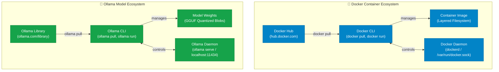

| Docker Component | Ollama Component | DevOps Responsibility |
|---|---|---|
| **Docker Hub Registry** (`hub.docker.com`) | **Ollama Model Library** (`ollama.com/library`) | Public repository of pre-packaged artifacts. |
| **Docker CLI** (`docker pull`, `docker run`) | **Ollama CLI** (`ollama pull`, `ollama run`) | Command-line tool used to download, run, and manage artifacts. |
| **Docker Image** (`ubuntu:22.04`, `node:20`) | **Model Weights** (`llama3.2:1b`, `deepseek-r1:8b`) | Quantized binary weights packaged for standardized execution. |
| **Docker Daemon** (`dockerd`, Unix socket) | **Ollama Server Daemon** (`ollama serve`, port `11434`) | Background service managing hardware acceleration, memory, and REST API. |
| **Docker Desktop / Engine** | **Ollama Application** | Native host application orchestrating runtime dependencies. |

---

## 4. Environment Setup & Tooling

### 4.1 Installing and Verifying Ollama

1. **Download & Install**: Visit [ollama.com](https://ollama.com) and install the native package for your operating system (macOS, Linux, or Windows).
2. **Verify Daemon Execution**: Ollama automatically starts a background daemon listening on `localhost:11434`.
   ```bash
   # Check Ollama version and CLI availability
   ollama --help
   ollama --version
   ```
3. **Verify Daemon Port**:
   ```bash
   # Query Ollama REST API directly via curl
   curl http://localhost:11434/
   # Expected Output: Ollama is running
   ```

> [!WARNING]
> If you run `ollama serve` in a terminal and see `Error: listen tcp 127.0.0.1:11434: bind: address already in use`, this does **not** mean an error occurred! It confirms that the Ollama background daemon is already running successfully as a background system service.

---

### 4.2 Downloading Lightweight Model Weights (`llama3.2:1b`)

Meta's **Llama 3.2** family includes ultra-lightweight models optimized for edge devices and standard developer laptops:
- `llama3.2:1b`: ~1.3 GB download (1 Billion parameters). Runs comfortably on standard 8 GB/16 GB RAM laptops without dedicated GPUs.
- `llama3.2:3b`: ~2.0 GB download (3 Billion parameters). Higher reasoning capacity with modest hardware requirements.

```bash
# Pull the 1-billion parameter model into local storage
ollama pull llama3.2:1b

# Verify downloaded models in local inventory
ollama list
```

```text
NAME               ID              SIZE      MODIFIED
llama3.2:1b        baf6a787fd9e    1.3 GB    2 minutes ago
```

---

### 4.3 Python Virtual Environment & Dependency Isolation

Always isolate Python dependencies within a dedicated virtual environment (`venv`) to prevent conflicting with system packages or other projects.

```bash
# Step 1: Create isolated virtual environment
python3 -m venv venv

# Step 2: Activate virtual environment
# On Linux / macOS:
source venv/bin/activate
# On Windows (PowerShell):
# .\venv\Scripts\Activate.ps1

# Step 3: Upgrade pip installer
pip install --upgrade pip

# Step 4: Install official Ollama Python SDK
pip install ollama

# Step 5: Verify installation in requirements
pip freeze > requirements.txt
```

> [!IMPORTANT]
> A common beginner mistake shown in the lecture is executing `pip3 install requirements.txt`. The `-r` flag is mandatory: `pip install -r requirements.txt`.

---

## 5. Project Implementation 1: Local LLM Dockerfile Generator

### 5.1 Prompt Engineering with Structural Constraints

Following Day 2's strategic framework, the prompt must enforce strict negative constraints and architectural requirements:
- **Direct Output Constraint**: Output *only* the Dockerfile. Suppress markdown greetings, explanations, and instructions on how to build the image.
- **Structural Best Practices**:
  1. Official minimal base image (`alpine`, `slim`).
  2. Defined working directory (`WORKDIR /app`).
  3. Optimized dependency caching (copy dependency manifests before source code).
  4. Explicit container port exposure (`EXPOSE`).
  5. Correct execution command format (`CMD` / `ENTRYPOINT`).
  6. **Multi-Stage Build**: Separate build-time dependencies from the lean production runtime image.

---

### 5.2 Complete Python Implementation (`generate_dockerfile.py`)

Below is the complete, documented Python automation script using the local `ollama` client library:

```python
"""
=============================================================================
DevOps Automation Tool: AI-Powered Multi-Language Dockerfile Generator
Runtime Engine: Local LLM via Ollama Daemon (Meta Llama 3.2 1B)
Author: Abhishek Veeramalla (AI Assisted DevOps Zero to Hero - Day 3)
=============================================================================
"""

import sys
import ollama

def generate_dockerfile(language: str) -> str:
    """
    Invokes the local Ollama daemon to generate an optimized, multi-stage Dockerfile
    for any specified programming language or application runtime.
    
    Args:
        language (str): Target runtime (e.g., 'Groovy', 'Python', 'Ruby on Rails', 'Java')
        
    Returns:
        str: Raw Dockerfile content extracted from the model's message payload.
    """
    # System prompt enforcing strict constraints and container best practices
    prompt = f"""Only generate an ideal multi-stage Dockerfile for {language} with production best practices.
Do not provide any description, explanation, or markdown commentary, because I just need the Dockerfile.
Ensure the Dockerfile includes:
- Multi-stage Docker build architecture (Stage 1: Build/Dependencies, Stage 2: Minimal Runtime)
- Official base images (use alpine or slim variants where possible)
- Setting up an explicit working directory
- Copying dependency files first to leverage Docker layer caching
- Installing runtime dependencies cleanly
- Adding application source code
- Exposing the appropriate application port
- Executable entrypoint / command
"""

    try:
        # Programmatic API call to Ollama local daemon (localhost:11434)
        response = ollama.chat(
            model='llama3.2:1b',
            messages=[
                {
                    'role': 'user',
                    'content': prompt
                }
            ]
        )
        
        # Navigate the JSON response payload: response['message']['content']
        return response['message']['content']

    except Exception as e:
        return f"Error communicating with local Ollama daemon: {str(e)}"

if __name__ == "__main__":
    print("=" * 65)
    print("🚀 AI-Assisted DevOps: Multi-Language Dockerfile Generator (Local)")
    print("=" * 65)
    
    # Accept dynamic user input for any programming language
    target_language = input("Enter programming language or framework: ").strip()
    
    if not target_language:
        print("❌ Error: Programming language cannot be empty.")
        sys.exit(1)
        
    print(f"\n⏳ Querying local Llama 3.2 1B model for '{target_language}' Dockerfile...\n")
    dockerfile_output = generate_dockerfile(target_language)
    
    print("-" * 65)
    print(dockerfile_output)
    print("-" * 65)
```

---

### 5.3 Live Multi-Language Test Runs (Groovy, Python, Ruby on Rails)

In the lecture, Abhishek executes the script across multiple runtime stacks to demonstrate how generative AI eliminates manual research.

#### Test 1: Apache Groovy
```bash
python3 generate_dockerfile.py
# Input: Groovy
```
**Model Output:**
```dockerfile
# Stage 1: Build stage
FROM groovy:4.0-jdk17 AS builder
WORKDIR /home/groovy/app
COPY build.gradle gradle.properties ./
COPY src ./src
RUN gradle build --no-daemon

# Stage 2: Runtime stage
FROM eclipse-temurin:17-jre-alpine
WORKDIR /app
COPY --from=builder /home/groovy/app/build/libs/*.jar app.jar
EXPOSE 8080
ENTRYPOINT ["java", "-jar", "app.jar"]
```

#### Test 2: Python with Slim Image & Layer Caching
```bash
python3 generate_dockerfile.py
# Input: Python
```
**Model Output:**
```dockerfile
# Stage 1: Dependency builder stage
FROM python:3.11-slim AS builder
WORKDIR /app
RUN apt-get update && apt-get install -y --no-install-recommends build-essential && rm -rf /var/lib/apt/lists/*
COPY requirements.txt .
RUN pip install --no-cache-dir --user -r requirements.txt

# Stage 2: Lean runtime stage
FROM python:3.11-slim
WORKDIR /app
COPY --from=builder /root/.local /root/.local
COPY . .
ENV PATH=/root/.local/bin:$PATH
EXPOSE 8000
CMD ["python", "app.py"]
```

#### Test 3: Ruby on Rails (The Litmus Test)
Many DevOps engineers have never containerized a Ruby on Rails application. Passing `Ruby on Rails` to the local model instantly generates the required Bundler caching and Asset precompilation structure:
```bash
python3 generate_dockerfile.py
# Input: Ruby on Rails
```
**Model Output:**
```dockerfile
# Stage 1: Build and asset compilation
FROM ruby:3.2-slim AS builder
WORKDIR /rails
RUN apt-get update -qq && apt-get install -y build-essential libpq-dev nodejs yarn
COPY Gemfile Gemfile.lock ./
RUN bundle install --jobs=4 --retry=3
COPY . .

# Stage 2: Final runtime
FROM ruby:3.2-slim
WORKDIR /rails
RUN apt-get update -qq && apt-get install -y libpq-dev && rm -rf /var/lib/apt/lists/*
COPY --from=builder /usr/local/bundle /usr/local/bundle
COPY --from=builder /rails /rails
EXPOSE 3000
CMD ["rails", "server", "-b", "0.0.0.0"]
```

---

## 6. Project Implementation 2: Hosted LLM Generator with Google Gemini

### 6.1 Google AI Studio API Provisioning & Security Hygiene

For engineers whose laptops lack sufficient RAM or CPU power to run local inference within reasonable timeouts, Google AI Studio provides a free API tier.

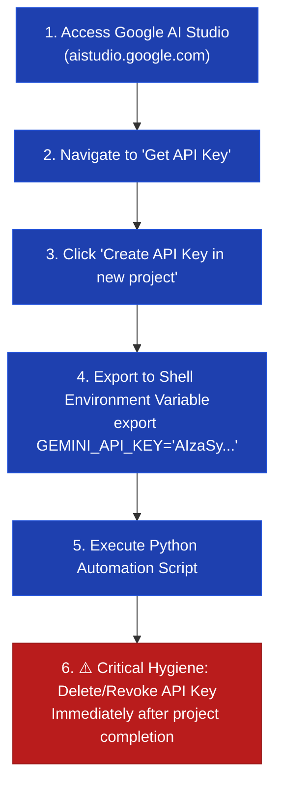

#### API Hygiene Rules:
1. **Never Hardcode Secrets**: Never commit API keys inside Python scripts, Git repositories, or Dockerfiles.
2. **Environment Variable Injection**: Always fetch keys via `os.environ.get("GEMINI_API_KEY")`.
3. **Revocation after Testing**: As emphasized by Abhishek in the lecture, once your testing is complete, return to Google AI Studio and **delete the API key** to prevent unauthorized access or token quota exhaustion.

---

### 6.2 Complete Python Implementation (`generate_dockerfile_gemini.py`)

Install the official Google Generative AI Python package:
```bash
pip install google-generativeai
```

The Python automation script using Gemini:

```python
"""
=============================================================================
DevOps Automation Tool: AI-Powered Multi-Language Dockerfile Generator
Runtime Engine: Hosted LLM via Google AI Studio (Gemini 1.5 Pro / Flash)
Author: Abhishek Veeramalla (AI Assisted DevOps Zero to Hero - Day 3)
=============================================================================
"""

import os
import sys
import google.generativeai as genai

# Fetch API key securely from the host environment
API_KEY = os.environ.get("GEMINI_API_KEY")

if not API_KEY:
    print("❌ Fatal: Environment variable 'GEMINI_API_KEY' is not set.")
    print("👉 Run: export GEMINI_API_KEY='your_api_key_here'")
    sys.exit(1)

# Configure the Gemini SDK client
genai.configure(api_key=API_KEY)

def generate_dockerfile_gemini(language: str) -> str:
    """
    Queries Google Gemini 1.5 Pro to generate a hardened multi-stage Dockerfile.
    
    Args:
        language (str): Target application programming language.
        
    Returns:
        str: Clean Dockerfile output generated by Gemini.
    """
    prompt = f"""Only generate an ideal multi-stage Dockerfile for {language} with production best practices.
Do not provide any description, explanation, or conversational markdown, because I just need the Dockerfile.
Ensure the Dockerfile includes:
- Multi-stage Docker build architecture
- Minimal official base image (e.g., alpine or slim)
- Explicit WORKDIR
- Package dependency caching before source copy
- Non-root user privileges where practical
- Clean port exposure and ENTRYPOINT
"""

    try:
        # Instantiate model (gemini-1.5-pro or gemini-1.5-flash)
        model = genai.GenerativeModel("gemini-1.5-pro")
        
        # Dispatch inference request
        response = model.generate_content(prompt)
        
        return response.text

    except Exception as e:
        return f"Error querying Google Gemini API: {str(e)}"

if __name__ == "__main__":
    print("=" * 65)
    print("☁️ AI-Assisted DevOps: Multi-Language Dockerfile Generator (Gemini)")
    print("=" * 65)
    
    target_language = input("Enter programming language or framework: ").strip()
    
    if not target_language:
        print("❌ Error: Programming language cannot be empty.")
        sys.exit(1)
        
    print(f"\n⏳ Sending request to Google Gemini API for '{target_language}'...\n")
    dockerfile_output = generate_dockerfile_gemini(target_language)
    
    print("-" * 65)
    print(dockerfile_output)
    print("-" * 65)
```

---

### 6.3 Live Multi-Stage Build Generation (Node.js)

Executing the Gemini script for Node.js:
```bash
export GEMINI_API_KEY="AIzaSy..."
python3 generate_dockerfile_gemini.py
# Input: Node.js
```

**Gemini Model Output:**
```dockerfile
# Stage 1: Build & Dependencies
FROM node:20-alpine AS builder
WORKDIR /app
COPY package*.json ./
RUN npm ci --only=production
COPY . .
RUN npm run build --if-present

# Stage 2: Production Runtime
FROM node:20-alpine
WORKDIR /app
ENV NODE_ENV=production
COPY --from=builder /app/package*.json ./
COPY --from=builder /app/node_modules ./node_modules
COPY --from=builder /app/dist ./dist
USER node
EXPOSE 3000
CMD ["node", "dist/index.js"]
```

**Why this output is superior to unconstrained generation:**
1. Leverages `node:20-alpine` (reducing base image from 1.1 GB to ~180 MB).
2. Uses `npm ci --only=production` for clean, deterministic builds without dev dependencies.
3. Incorporates `USER node` for non-root security.
4. Leaves zero explanatory text for downstream scripts to parse.

---

## 7. Production Hardening, Tokenomics & Security

### 7.1 Foundation Model Divergence: Llama vs. Gemini vs. DeepSeek vs. Granite

During the lecture, Abhishek notes that testing the exact same prompt across different foundation models yields slightly different Dockerfiles:

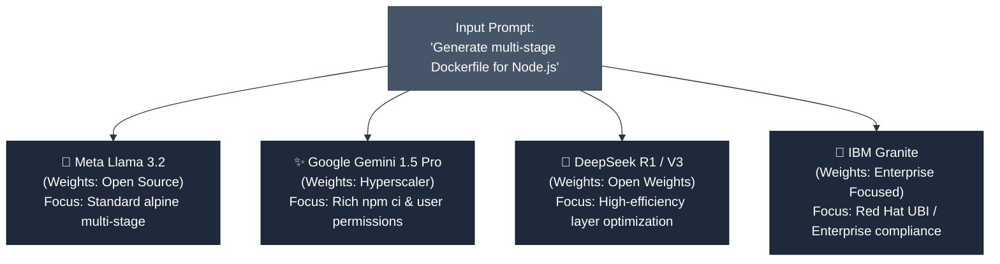

**Why Outputs Differ:**
- **Training Data Composition**: Different models ingest different corpora of GitHub repositories, Docker docs, and enterprise codebases.
- **RLHF Alignment & Safety Weights**: Some models lean heavily toward security headers and non-root users, while others prioritize minimal line counts.
- **Task Complexity Rule**: For common tasks like Dockerfiles, almost all major models produce correct output. For proprietary, complex architectural tasks, team testing and benchmarking are mandatory.

---

### 7.2 Token Cost Economics & Metering

When moving from local inference to cloud APIs, platform engineers must understand the underlying unit economics:

```
Total Request Cost = (Prompt Tokens × Input Rate) + (Completion Tokens × Output Rate)
```

#### Industry Pricing Snapshot (Per 1 Million Tokens):
- **OpenAI o1**: ~$15.00 / 1M input tokens (deep reasoning model).
- **OpenAI o3-mini / GPT-4o-mini**: ~$1.10 / 1M input tokens (high-efficiency coding model).
- **Google Gemini 1.5 Flash**: Free tier available; pennies per million tokens in paid tier.
- **Local Ollama**: **$0.00** per million tokens (amortized server hardware cost).

#### Enterprise Scaling Math:
In a 250-person engineering organization making 1,000 Dockerfile requests daily:
- Unconstrained prompts: ~2,500 tokens/request $\rightarrow$ 2,500,000 tokens/day $\rightarrow$ **$37.50/day** on premium reasoning models (**$13,687/year**).
- Constrained prompts: ~250 tokens/request $\rightarrow$ 250,000 tokens/day $\rightarrow$ **$3.75/day** (**$1,368/year**).
- Net FinOps Savings: **$12,319/year** simply by enforcing `"Only generate Dockerfile"` constraints.

---

### 7.3 DevOps Threat Modeling: DoS, Rate Limiting & Secret Sprawl

Automating cloud LLM calls in DevOps pipelines introduces novel security attack surfaces:

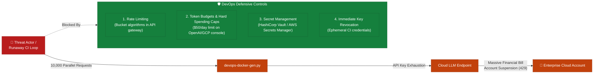

1. **Denial-of-Wallet (DoS / Financial Exhaustion)**: An automated CI/CD loop misconfigured to poll the script on every commit can burn thousands of dollars in token billing.
   - *Mitigation*: Configure hard billing spending limits in cloud provider consoles and implement local client rate limiters.
2. **API Key Sprawl in Repositories**: Developers inadvertently pushing `generate_dockerfile_gemini.py` with hardcoded strings to GitHub.
   - *Mitigation*: Run pre-commit hooks (`trufflehog`, `git-secrets`) and inject keys at runtime via environment variables or secret vaults.

---

## 8. Summary

### Key Takeaways

```diff
+ Built a production-grade Generative AI CLI for DevOps using Python.
+ Local LLMs (Ollama) offer 100% data privacy, zero token bills, and compliance readiness.
+ Hosted LLMs (Google Gemini, OpenAI) offload all GPU compute, delivering instant responses for low-spec laptops.
+ Ollama mirrors Docker: library = Docker Hub, CLI = docker CLI, weights = container images, daemon = dockerd.
+ Llama 3.2 1B parameter model runs locally in ~1.3 GB RAM, making local AI accessible on developer laptops.
+ Prompt constraints ('Only generate Dockerfile', 'Do not provide description') eliminate conversational fluff.
+ Generative AI effortlessly containerizes unfamiliar stacks (Ruby on Rails, Groovy) with production best practices.
- Never hardcode LLM API keys in source code; use environment variables and delete test keys immediately.
- Never run unmetered LLM calls in CI/CD without hard rate limits and token budgets to prevent DoS cost spikes.
! Docker layer caching (copying package manifests before source code) must be explicitly enforced in prompts.
```

---

### Quick Reference

```bash
# =============================================================================
# Ollama Quick Reference Commands
# =============================================================================
ollama --version                    # Check CLI version
ollama pull llama3.2:1b             # Download 1B parameter lightweight model
ollama list                         # List locally downloaded models
ollama run llama3.2:1b              # Start interactive chat session in terminal
curl http://localhost:11434/        # Verify background daemon is active

# =============================================================================
# Python Virtual Environment Setup
# =============================================================================
python3 -m venv venv                # Create isolated environment
source venv/bin/activate            # Activate on Linux/macOS
# .\venv\Scripts\Activate.ps1       # Activate on Windows PowerShell
pip install -r requirements.txt     # Install dependencies (ollama, google-generativeai)

# =============================================================================
# Script Invocations
# =============================================================================
python3 generate_dockerfile.py               # Local execution via Ollama
export GEMINI_API_KEY="AIzaSy..."            # Set hosted API secret
python3 generate_dockerfile_gemini.py        # Cloud execution via Gemini
```

---

### Detailed Command Diagnostics & Troubleshooting Relevance

| Command / Component | Primary Operational Role | Diagnostic Output / Status | Troubleshooting Significance |
|---|---|---|---|
| `ollama serve` | Starts Ollama daemon manually | `Error: listen tcp 127.0.0.1:11434: bind: address already in use` | **Harmless Warning**: Confirms daemon is already running in background. If daemon is hung, terminate with `kill -9 $(lsof -ti:11434)` and re-launch. |
| `curl -s http://localhost:11434/` | Local REST connectivity check | `Ollama is running` | Confirms daemon is healthy and accepting API requests on loopback interface before running Python scripts. |
| `ollama list` | Model weight inventory audit | Displays `NAME`, `ID`, `SIZE`, `MODIFIED` | If requested model (e.g., `llama3.2:1b`) is missing from output, Python API calls will fail with `model not found` errors. |
| `pip install -r requirements.txt` | Dependency package installer | Exit code `0`, `Successfully installed ...` | Common student error: running `pip install requirements.txt` (missing `-r`). Causes pip to attempt downloading a non-existent package named `requirements.txt`. |
| `top` / `htop` / Activity Monitor | Host compute load monitoring | High CPU / Memory utilization | On CPU-only laptops, local inference can saturate all cores, causing response times to stretch past 5–10 minutes or trigger connection drops. |
| `export GEMINI_API_KEY="..."` | Cloud API credential injection | Variable set in current subshell | If unset, script terminates immediately with `Fatal: GEMINI_API_KEY is not set`, preventing unauthenticated cloud calls. |

---

### Expert Insights

#### 🌍 Real-World Application
- **Platform Engineering Self-Service Portals**: Senior platform teams wrap this Python generator into an internal Slack bot (`/generate-dockerfile java`) or a Backstage plugin. Developers receive compliant, multi-stage Dockerfiles without needing platform engineers to intervene manually.
- **Air-Gapped Defense & Banking Environments**: In classified networks where internet access is blocked, teams deploy Ollama on internal GPU servers (e.g., NVIDIA A10G/H100 clusters) running Llama 3.2 or DeepSeek, providing generative AI capabilities behind firewalls with zero data exfiltration risk.
- **CI/CD Quality Gates**: Automated pipelines use LLMs to audit submitted Dockerfiles on pull requests, checking if layers are properly cached, if non-root users are enforced, and if vulnerabilities exist.

#### 🎓 Expert Path
1. **Explore Quantization Levels**: Study how 4-bit and 8-bit quantized models (`q4_K_M`, `q8_0`) allow running 8B and 14B models on laptops with limited VRAM.
2. **Transition from CLI to API**: Wrap `generate_dockerfile.py` in FastAPI to create an internal microservice running inside Kubernetes (`pod` running Ollama sidecar).
3. **Integrate Linter Verification**: Pipe the output of `generate_dockerfile.py` directly into `hadolint` (a Dockerfile linter) to validate code correctness before delivering it to developers.
4. **Prepare for Day 4 (AI Shell Scripting)**: Master using LLMs to generate robust, error-checked Bash automation scripts.

#### ⚠ Common Pitfalls

| Pitfall | Operational Impact | Prevention / Remediation |
|---|---|---|
| **Hardcoding API Keys in Scripts** | High risk of secret exfiltration to public GitHub | Store keys in environment variables (`os.environ.get()`) and delete test keys immediately in Google AI Studio. |
| **Executing on Under-Resourced Laptops** | Script hangs for 10+ minutes or throws connection timeout | Switch to hosted LLMs (Google AI Studio) or use ultra-lightweight models (`llama3.2:1b`). |
| **Omitting the `-r` Flag in Pip** | Package installation fails with error | Always run `pip install -r requirements.txt`, never `pip install requirements.txt`. |
| **Unconstrained Prompts** | Model generates paragraphs of tutorial text, breaking CLI pipelines | Add explicit constraints: `"Only generate the Dockerfile. Do not provide any description or commentary."` |
| **Ignoring Layer Cache Ordering** | Docker image builds take 10x longer in CI/CD | Instruct the prompt explicitly: `"Copy dependency manifests first (package.json, requirements.txt, pom.xml) before copying source code."` |
| **Forgetting to Delete Cloud API Keys** | Incurring unwanted charges or leaving access keys vulnerable | Delete API keys in the cloud console immediately after demonstration and testing. |

---

### 📝 Transcript Corrections Applied

In accordance with course workflow rules, audio transcription errors from the raw VTT file have been corrected:

| Garbled Audio / Transcript Error | Correct Technical Term | Context in Lecture |
|---|---|---|
| `VNV` / `virtual machine` | **virtual environment (`venv`)** | Python environment isolation |
| `Ollama h` | **`ollama --help`** | Viewing Ollama CLI arguments |
| `Ollama serve address already in use` | **Daemon already listening on port 11434** | Explaining Ollama background process |
| `open aai` | **OpenAI** | Hyperscaler LLM API provider |
| `Lama` / `Lama 3.2 1b` | **Meta Llama 3.2 1B** | Open-source foundation model |
| `pip3 install requirements.txt` | **`pip install -r requirements.txt`** | Correcting pip flag omission |
| `Google generative AI` | **`google-generativeai`** | Python SDK package name |
| `disto less` | **distroless** | Minimalist Google container base image |
| `gemini pro 1.5` | **Gemini 1.5 Pro** | Google foundation model |
| `Deep seek` | **DeepSeek** | Open-weights foundation model |
| `DOS attack` | **Denial of Service (DoS / Denial of Wallet)** | Cost exhaustion through runaway API loops |

</details>


<details open>
<summary><b>Day 3: GenAI Project For DevOps Engineers (CS46H)</b></summary>

## Table of Contents

- [DAY-3: Gen-AI Project For DevOps Engineers](#day-3-gen-ai-project-for-devops-engineers)
  - [Episode Overview](#episode-overview)
  - [The Project: Multi-Language Dockerfile Generator](#the-project-multi-language-dockerfile-generator)
    - [Why Not Just Use ChatGPT?](#why-not-just-use-chatgpt)
  - [LLM Architecture Decision: Local vs. Hosted](#llm-architecture-decision-local-vs-hosted)
    - [Local LLMs](#local-llms)
    - [Hosted LLMs](#hosted-llms)
    - [Architecture Trade-Off Matrix](#architecture-trade-off-matrix)
  - [Ollama — "Docker for LLMs"](#ollama--docker-for-llms)
    - [The Docker Analogy](#the-docker-analogy)
    - [Installing Ollama](#installing-ollama)
    - [Pulling and Running a Model](#pulling-and-running-a-model)
  - [Python Environment Setup](#python-environment-setup)
    - [Why Virtual Environments?](#why-virtual-environments)
    - [Setup Commands](#setup-commands)
    - [Communication Architecture](#communication-architecture)
  - [Implementation 1 — Local LLM (Ollama + Llama 3.2 1B)](#implementation-1--local-llm-ollama--llama-32-1b)
    - [The Prompt with Constraints](#the-prompt-with-constraints)
    - [The Python Script](#the-python-script)
    - [Demo Results](#demo-results)
  - [Implementation 2 — Hosted LLM (Google Gemini)](#implementation-2--hosted-llm-google-gemini)
    - [Google AI Studio Free API Key](#google-ai-studio-free-api-key)
    - [The Python Script (Gemini Version)](#the-python-script-gemini-version)
    - [Demo Results](#demo-results-1)
  - [Token Economics and Security](#token-economics-and-security)
    - [OpenAI Pricing Reference](#openai-pricing-reference)
    - [DoS and Denial-of-Wallet Risk](#dos-and-denial-of-wallet-risk)
    - [API Key Security Hygiene](#api-key-security-hygiene)
  - [Model Selection Guidance](#model-selection-guidance)
- [Summary](#summary)

---

## DAY-3: Gen-AI Project For DevOps Engineers

### Episode Overview

Day 3 moves from theory to production. The instructor builds a complete Python automation tool — from scratch — that accepts any programming language as input and generates an optimized Dockerfile using either a local LLM (Ollama + Llama 3.2 1B) or a hosted LLM (Google Gemini via API). Every concept from Days 1 and 2 is applied here: LLMs, prompt engineering with constraints, and the local vs. hosted trade-off.

**Topics covered:**
- Why ChatGPT alone is insufficient for DevOps automation (no programmability, enterprise access restrictions)
- Local LLMs (Llama, DeepSeek R, IBM Granite) vs. Hosted LLMs (OpenAI, Google Gemini, DeepSeek hosted)
- Ollama — installation, model pull, run, and the "Docker for LLMs" mental model
- Python virtual environment setup and dependency isolation
- `generate_dockerfile.py` — local implementation using `ollama.chat()`
- `generate_dockerfile_gemini.py` — hosted implementation using `google-generativeai`
- Token economics: OpenAI pricing ($15/1M tokens for o1, $1.10 for o3)
- Security risks: Denial-of-Wallet, API key exposure, code leakage to hosted LLMs

---

### The Project: Multi-Language Dockerfile Generator

**Project specification:**
```
Input:  Any programming language (Java, Python, Groovy, Ruby on Rails, Rust, Node.js...)
Output: A production-ready Dockerfile for that language
Method: Python script powered by an LLM
```

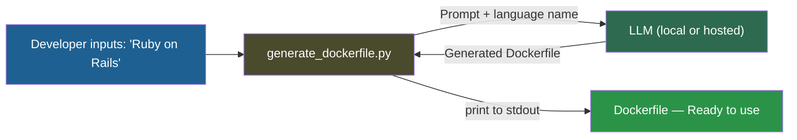

**Why this matters for DevOps:**
- A DevOps team supporting 20 squads using 8 different languages must maintain 8 Dockerfile templates manually
- New languages appear (Groovy, Rust, Go, Ruby on Rails) — engineer may not know the language's packaging system
- With this automation: one Python script covers ALL languages, forever

---

#### Why Not Just Use ChatGPT?

| Issue | ChatGPT / Chatbots | Python Script + LLM API |
|-------|--------------------|-------------------------|
| **Automation** | Manual, one-at-a-time | Programmable, batch-able |
| **Enterprise access** | Blocked in many MNCs | API calls from internal network |
| **Integration** | Cannot plug into CI/CD | Integrates into any pipeline |
| **Consistency** | Variable output per session | Same prompt = reproducible output |
| **Scale** | One developer at a time | Shared script for entire team |

> [!IMPORTANT]
> The instructor explicitly states: "In a lot of MNCs today, you cannot access ChatGPT or equivalent chatbots." The Python + LLM API approach bypasses this restriction by calling LLM APIs programmatically — either local (Ollama, no external network) or hosted (API endpoint, controllable by security team).

---

### LLM Architecture Decision: Local vs. Hosted

#### Local LLMs

> Local LLMs run on your own machine or your organization's servers. You download the model weights and run inference locally.

**Available local models:**

| Model | Provider | Key Fact |
|-------|----------|----------|
| **Llama 3.2 1B / 3.3** | Meta | Open-source; 1B model fits on laptops; 3.3 is latest |
| **DeepSeek R** | DeepSeek | Downloadable; competitive performance |
| **Granite** | IBM | Enterprise-focused; downloadable |

**Pros:**
- **Security/Privacy**: Meta has zero access to your prompts or data; model runs entirely inside your infrastructure
- **No per-call cost**: Free to run once downloaded (only hardware costs)
- **Compliance**: Meets regulations that prohibit sending data to third parties

**Cons:**
- **Infrastructure maintenance**: At organizational scale (1,000+ developers), you need multiple GPU servers, patching, uptime management
- **Hardware requirements**: Larger models need GPU/TPU acceleration; CPU-only machines are slow (up to 10 min per inference)
- **Model updates**: Must manually re-pull when new versions are released

---

#### Hosted LLMs

> Hosted LLMs run on the provider's infrastructure. You get an API key and make HTTPS calls to their endpoints.

**Available hosted providers:**

| Provider | Model | Key Fact |
|----------|-------|----------|
| **OpenAI** | GPT-4o, o1, o3 | Industry standard; paid; $15/1M tokens (o1), $1.10/1M (o3) |
| **Google** | Gemini 1.5 Pro | Free API key via Google AI Studio (as of recording) |
| **DeepSeek** | DeepSeek (hosted) | Also has hosted API option |
| **Anthropic** | Claude | Available via API |

**Pros:**
- No infrastructure: No GPUs to buy, no servers to maintain, no patching
- Latest models: Access to frontier models immediately
- Any hardware: Works on a laptop with no GPU

**Cons:**
- Security/Privacy risk: Developer code, prompts, and data sent to external provider; provider may use data for training
- Per-token cost: Every API call costs money; scales with prompt size and team size
- Network dependency: Requires internet; latency varies

**The code leak risk (from the instructor):**

```diff
! Scenario: Developer pastes 10 lines of proprietary code into ChatGPT
! "ChatGPT not only responds back, but also uses the information
!  provided by the developer for its training purpose — and that information
!  might be shared with someone else"
- Result: Proprietary algorithm now part of OpenAI's training data
- Impact: IP loss, compliance violation, potential breach of NDA
```

---

#### Architecture Trade-Off Matrix

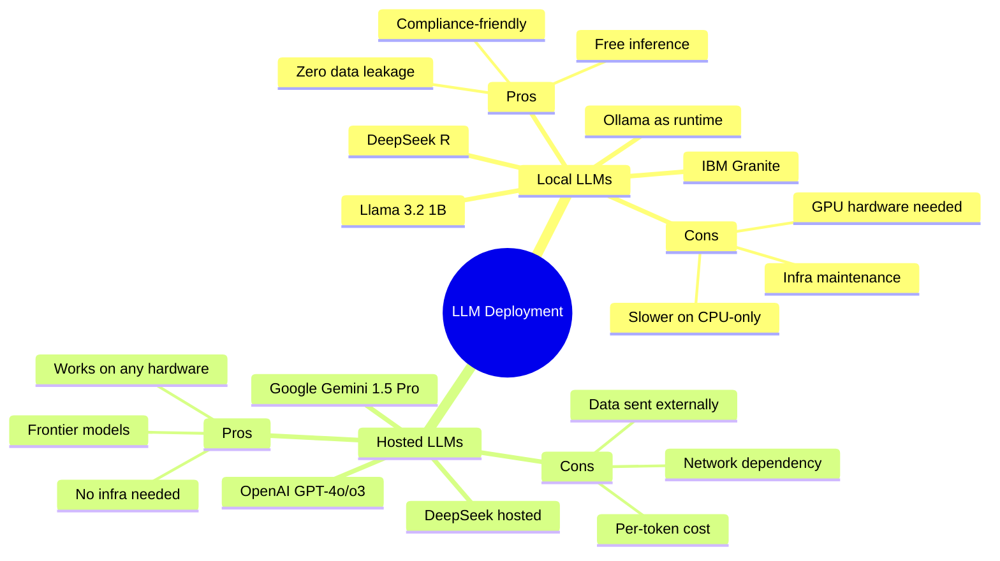

| Decision Factor | Choose Local | Choose Hosted |
|-----------------|-------------|---------------|
| Organization is security-sensitive | Yes | No |
| No GPU resources available | No | Yes |
| Need latest/best model | No | Yes |
| High-volume automation (cost concern) | Yes | No |
| Quick prototype / personal use | Yes (1B model) | Yes (free tier) |
| Regulated industry (healthcare, finance) | Yes | No |

---

### Ollama — "Docker for LLMs"

#### The Docker Analogy

Ollama is the tool that makes running local LLMs as simple as running Docker containers.

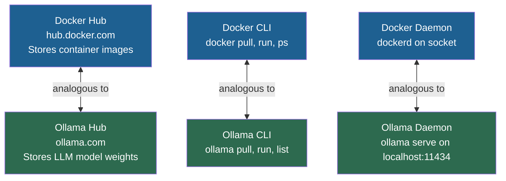

| Docker Concept | Ollama Equivalent |
|----------------|-------------------|
| `hub.docker.com` | `ollama.com` |
| `docker pull nginx` | `ollama pull llama3.2:1b` |
| `docker run nginx` | `ollama run llama3.2:1b` |
| `docker ps` | `ollama list` |
| `dockerd` (daemon) | `ollama serve` (daemon on port 11434) |
| Image layers | Model weights (GGUF format) |

---

#### Installing Ollama

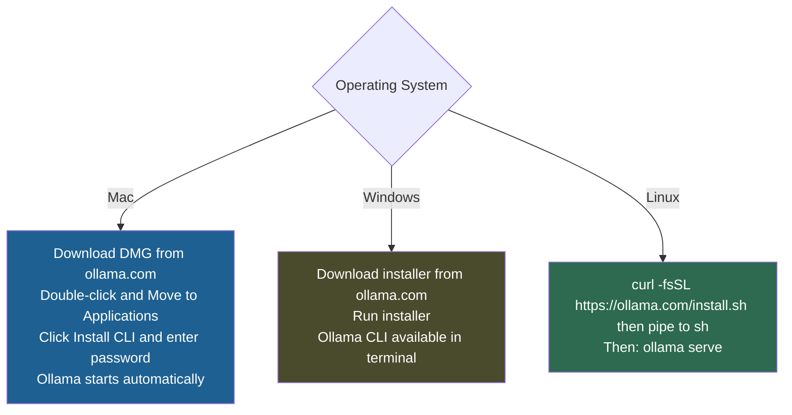

**Verify Ollama is running:**
```bash
ollama serve
# Output: "listen tcp 127.0.0.1:11434: bind: address already in use"
# Means: Ollama daemon is already running

# Check CLI works
ollama --help

# List downloaded models
ollama list
```

> [!NOTE]
> On Mac and Windows, Ollama starts automatically after installation (like Docker Desktop). On Linux, run `ollama serve` manually or configure it as a systemd service.

---

#### Pulling and Running a Model

```bash
# Pull model weights only (does NOT start interactive chat)
ollama pull llama3.2:1b

# Pull and start interactive chat (pulls if not already downloaded)
ollama run llama3.2:1b

# Once running interactively, test:
# >>> create a Dockerfile for Java-based app
# (model generates Dockerfile)

# List all downloaded models
ollama list
```

**Model size vs. parameter count:**

| Model | Disk Size | Parameters | Hardware Need |
|-------|-----------|-----------|---------------|
| `llama3.2:1b` | ~1.3 GB | 1 billion | CPU-only OK |
| `llama3.2:3b` | ~2.0 GB | 3 billion | CPU-only OK (slower) |
| `llama3.1:8b` | ~4.7 GB | 8 billion | GPU recommended |
| `llama3.1:405b` | ~230+ GB | 405 billion | Multiple high-end GPUs |

> [!NOTE]
> The instructor used a 28 GB RAM machine (Apple Silicon). On a standard 16 GB laptop, the `1b` or `3b` model is appropriate. Larger models on CPU-only machines will take 5–10 minutes per inference.

---

### Python Environment Setup

#### Why Virtual Environments?

```diff
! Problem: Two projects on the same machine need different package versions
! Project A: Ansible 2.9 (legacy infra)
! Project B: Ansible 2.14 (new automation)
+ Solution: Virtual environments — logical isolation of packages per project
+ Each venv has its own Python interpreter and installed packages
+ Activating one venv does not affect the other
```

A virtual environment is NOT a virtual machine — it is lightweight Python package isolation. No VM overhead.

---

#### Setup Commands

```bash
# Step 1: Create the virtual environment
python3 -m venv venv

# Step 2: Activate (Linux/Mac)
source venv/bin/activate
# Prompt changes to: (venv) $

# Step 2 (Windows):
# venv\Scripts\activate

# Step 3: Install dependencies (local LLM version)
pip install -r requirements.txt
# requirements.txt contains: ollama

# Step 4: Run the script
python3 generate_dockerfile.py

# Deactivate when done
deactivate
```

---

#### Communication Architecture

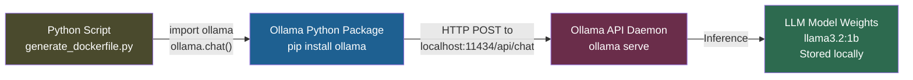

> **Key Insight:** Your Python script cannot talk directly to the LLM model file. It uses the `ollama` Python package, which calls the Ollama API daemon (running on `localhost:11434`), which loads the model weights and performs inference. This mirrors: your app -> Docker SDK -> Docker daemon -> container image.

---

### Implementation 1 — Local LLM (Ollama + Llama 3.2 1B)

#### The Prompt with Constraints

The prompt is a multi-line Python triple-quoted string. It combines instruction, constraints, and output format:

```python
prompt = f"""
Only generate an ideal Dockerfile for a {language}-based application with best practices.
Do not provide any description. I just need the Dockerfile.
Make sure you include:
- Base image
- Installing dependencies
- Setting up working directory
- Adding source code
- Running the application
Multi-stage Docker build using distroless or slim base image for the final stage.
"""
```

The `{language}` variable is injected at runtime. The user types "Groovy" and the prompt becomes "Only generate an ideal Dockerfile for a Groovy-based application..."

---

#### The Python Script

```python
import ollama

prompt = """
Only generate an ideal Dockerfile for the {language}-based application with best practices.
Do not provide any description. I just need the Dockerfile.
Make sure you include:
- Base image
- Installing dependencies
- Setting up working directory
- Adding source code
- Running the application
Multi-stage Docker build.
"""

def generate_dockerfile(language):
    response = ollama.chat(
        model="llama3.2:1b",
        messages=[
            {
                "role": "user",
                "content": prompt.format(language=language)
            }
        ]
    )
    return response["message"]["content"]

if __name__ == "__main__":
    language = input("Enter the programming language: ")
    print(generate_dockerfile(language))
```

**Code walkthrough:**

| Line | Purpose |
|------|---------|
| `import ollama` | Load Ollama Python package (talks to Ollama API daemon) |
| `prompt = """..."""` | Multi-line string: constraint-driven prompt |
| `ollama.chat(model=..., messages=[...])` | API call to local Ollama daemon |
| `model="llama3.2:1b"` | Specify which locally-pulled model to use |
| `messages=[{"role": "user", "content": ...}]` | OpenAI-compatible message format |
| `response["message"]["content"]` | Extract text from JSON response (skip metadata) |
| `if __name__ == "__main__":` | Python entry-point guard (best practice) |
| `input(...)` | Prompt user for programming language at runtime |

---

#### Demo Results

```bash
python3 generate_dockerfile.py
# Enter the programming language: Groovy
# Output: Dockerfile with FROM, WORKDIR, COPY, RUN, ENV, CMD

python3 generate_dockerfile.py
# Enter the programming language: Python
# Output: Multi-stage Dockerfile (builder stage + python:slim runtime stage)

python3 generate_dockerfile.py
# Enter the programming language: Ruby on Rails
# Output: Valid Dockerfile for Ruby on Rails
```

```diff
+ Key result: The script generates correct Dockerfiles for ANY language
+ Even unfamiliar languages (Ruby on Rails, Groovy) produce valid output
! "I have also never containerized a Ruby on Rails application,
!  but my GenAI project made it simple for me." — Abhishek
```

---

### Implementation 2 — Hosted LLM (Google Gemini)

#### Google AI Studio Free API Key

1. Go to `aistudio.google.com`
2. Click **API key** then **Get API key** then **Create API key in current project**
3. Copy the key immediately
4. Set it as an environment variable:

```bash
# Linux/Mac
export GOOGLE_API_KEY="your-api-key-here"

# Windows PowerShell
$env:GOOGLE_API_KEY = "your-api-key-here"
```

> [!IMPORTANT]
> **Delete the API key after completing the project.** In Google AI Studio: API keys, select your key, then Delete. An exposed API key can be used by others, billing your account.

---

#### The Python Script (Gemini Version)

```python
import google.generativeai as genai
import os

# Configure API key from environment variable
genai.configure(api_key=os.environ["GOOGLE_API_KEY"])

prompt = """
Only generate an ideal Dockerfile for the {language}-based application with best practices.
Do not provide any description. I just need the Dockerfile.
Make sure you include:
- Base image
- Installing dependencies
- Setting up working directory
- Adding source code
- Running the application
Multi-stage Docker build.
"""

def generate_dockerfile(language):
    model = genai.GenerativeModel("gemini-1.5-pro")
    response = model.generate_content(prompt.format(language=language))
    return response.text

if __name__ == "__main__":
    language = input("Enter the programming language: ")
    print(generate_dockerfile(language))
```

**Install the dependency:**
```bash
pip install google-generativeai
```

**Code differences from local version:**

| Aspect | Local (Ollama) | Hosted (Gemini) |
|--------|---------------|-----------------|
| **Import** | `import ollama` | `import google.generativeai as genai` |
| **Auth** | None (local) | API key via `genai.configure()` |
| **API call** | `ollama.chat(model=..., messages=[...])` | `model.generate_content(prompt)` |
| **Response** | `response["message"]["content"]` | `response.text` |
| **Model spec** | `"llama3.2:1b"` | `"gemini-1.5-pro"` |
| **Network** | `localhost:11434` | `generativelanguage.googleapis.com` |

---

#### Demo Results

```bash
python3 generate_dockerfile_gemini.py
# Enter the programming language: Node.js
# Output: Multi-stage Dockerfile (stage 1: node:18 builder, stage 2: node:18-alpine runtime)
```

> **Why does Gemini's output differ from Llama's?** Different training datasets and architectures lead to different stylistic choices. Both are valid for common languages. For org-specific consistency, use few-shot prompting to enforce the same format regardless of model.

---

### Token Economics and Security

#### OpenAI Pricing Reference

| Model | Price per 1M tokens |
|-------|---------------------|
| o1 | $15.00 |
| o3 | $1.10 |

**Per-request cost estimate:**
- Google AI Studio shows ~1,500–1,600 tokens per Dockerfile generation
- At o3 pricing: 1,600 tokens = $0.00176 per request
- At scale — 100 devs x 10 requests/day x 260 workdays: 260,000 requests/year
  - o3: ~$458/year
  - o1: ~$6,240/year

```diff
+ Use cheaper models (o3, Gemini Flash) for well-defined tasks like Dockerfile generation
+ Reserve premium models (o1, GPT-4o) for complex reasoning tasks where accuracy matters more
```

---

#### DoS and Denial-of-Wallet Risk

> "Somebody might perform a DoS attack — a developer who is a bad actor might consume a lot of tokens, which might incur a lot of costing for your organization." — Abhishek

**The threat:**

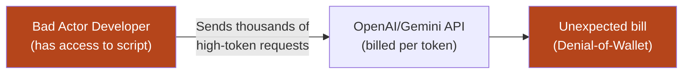

**Mitigations (covered in future videos):**
- Rate limiting per user on the Python script's API call
- Setting `max_tokens` in the API call to cap response length
- API key rotation and per-team keys with spending limits
- OpenAI dashboard: Set monthly hard spending limit

**Immediate mitigation you can apply now:**
```python
# Add max_tokens to cap response size and cost
response = ollama.chat(
    model="llama3.2:1b",
    messages=[{"role": "user", "content": prompt}],
    options={"num_predict": 500}  # max tokens in response
)

# For Google Gemini:
response = model.generate_content(
    prompt,
    generation_config=genai.types.GenerationConfig(max_output_tokens=500)
)
```

---

#### API Key Security Hygiene

```diff
+ DO: Store API keys as environment variables
+ DO: Delete API keys after completing demo projects
+ DO: Use per-project API keys — not one key for everything
+ DO: Set spending limits on API provider dashboards

- NEVER: Hardcode API keys in Python scripts
- NEVER: Commit API keys to Git (use .gitignore and pre-commit hooks)
- NEVER: Share API keys across teams without per-user tracking
- NEVER: Leave experimental keys active after the project ends
```

---

### Model Selection Guidance

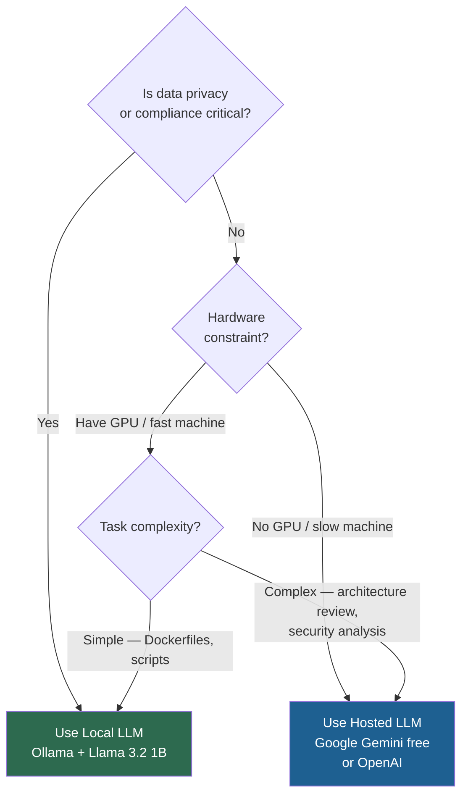

For common DevOps tasks (Dockerfiles, manifests, scripts), model quality matters less. A `llama3.2:1b` generates a correct Dockerfile just as well as GPT-4o for most cases. The difference shows on complex, nuanced tasks: multi-region disaster recovery design, deep security analysis, complex regex for log parsing.

---

## Summary

### Key Takeaways

```diff
+ The project: Python script → prompt → LLM → Dockerfile for any language
+ Local LLMs (Ollama + Llama): privacy, free inference, infra maintenance required
+ Hosted LLMs (Gemini, OpenAI): zero infra, per-token cost, data privacy risk
+ Ollama = "Docker for LLMs": ollama.com (hub), CLI (docker-like), port 11434 (daemon)
+ Python venv = package isolation per project (NOT a virtual machine)
+ ollama.chat(model, messages) returns response["message"]["content"]
+ google.generativeai: genai.configure(api_key) then model.generate_content(prompt)
+ Token cost: ~1,500 tokens per Dockerfile; OpenAI o3 = $1.10 per 1M tokens
! Denial-of-Wallet risk: rate-limit your LLM-powered scripts
- Never hardcode API keys; delete experimental keys immediately after use
```

### Quick Reference — Setup Commands

```bash
# Ollama setup (Linux)
# Install Ollama via the install script from ollama.com
ollama serve                        # start daemon
ollama pull llama3.2:1b             # download model
ollama run llama3.2:1b              # interactive test
ollama list                         # show downloaded models

# Python venv + deps (local)
python3 -m venv venv
source venv/bin/activate
pip install -r requirements.txt     # contains: ollama

# Python venv + deps (hosted Gemini)
pip install google-generativeai
export GOOGLE_API_KEY="your-key"    # set before running

# Run the scripts
python3 generate_dockerfile.py
python3 generate_dockerfile_gemini.py
```

### Quick Reference — Code Skeletons

**Local (Ollama):**
```python
import ollama

def generate_dockerfile(language):
    response = ollama.chat(
        model="llama3.2:1b",
        messages=[{"role": "user", "content": f"Generate ONLY a Dockerfile for {language}. No explanation."}]
    )
    return response["message"]["content"]

if __name__ == "__main__":
    lang = input("Enter language: ")
    print(generate_dockerfile(lang))
```

**Hosted (Gemini):**
```python
import google.generativeai as genai
import os

genai.configure(api_key=os.environ["GOOGLE_API_KEY"])

def generate_dockerfile(language):
    model = genai.GenerativeModel("gemini-1.5-pro")
    response = model.generate_content(f"Generate ONLY a Dockerfile for {language}. No explanation.")
    return response.text

if __name__ == "__main__":
    lang = input("Enter language: ")
    print(generate_dockerfile(lang))
```

### Expert Insight

**Real-World Application:**
This project is the foundation for a production-grade Internal Developer Platform (IDP) tool. In mature DevOps organizations, this pattern becomes: (1) a REST API (FastAPI wrapper around `generate_dockerfile()`) that CI/CD pipelines call automatically when a new service repo is created, (2) a GitHub Actions workflow step that generates and commits the Dockerfile on first push, or (3) an IDE plugin that calls the API on-demand during development. The same `ollama.chat()` and `genai.generate_content()` patterns from Day 3 power all of these.

**Expert Path:**
1. Run both implementations (local + Gemini) with 5 different languages — notice where outputs diverge; this builds intuition for model capability differences
2. Add a multi-stage build constraint and observe: does `llama3.2:1b` correctly implement the builder/slim-runtime separation? (Common languages usually work; obscure ones may need few-shot examples)
3. Wrap `generate_dockerfile()` in a FastAPI endpoint — this makes the tool available to the entire team over HTTP
4. Set up a pre-commit hook in a test repo that invokes the script if no Dockerfile is present — experience the full automation loop

**Common Pitfalls:**
- Forgetting to activate the virtual environment before running the script — you'll get `ModuleNotFoundError: No module named 'ollama'`
- Using `ollama run` (interactive) when you want `ollama pull` (download only) — `run` starts a blocking chat session
- Running `pip3 install requirements.txt` instead of `pip install -r requirements.txt` — the `-r` flag reads from file; without it, pip tries to install a package literally named "requirements.txt"
- Passing `response` directly to `print()` instead of `response["message"]["content"]` — you'll see a large JSON dict instead of the Dockerfile text
- Hardcoding the API key in the Python file and committing to GitHub — GitHub secret scanning will flag it, but damage may already be done
- Not checking if Ollama daemon is running before executing the script — you'll get `ConnectionRefusedError` on port 11434; run `ollama serve` first

**Additional Diagnostic Notes:**
- `ConnectionRefusedError` on port 11434: Ollama daemon is not running. Run `ollama serve` in a separate terminal. On Mac/Windows, check the system tray for the Ollama icon.
- `ollama run` shows model loading but times out: Insufficient RAM for the model. Switch to `llama3.2:1b`. Check memory with `free -h` (Linux) or Activity Monitor (Mac).
- Gemini returns `429 Resource Exhausted`: Free-tier rate limit hit. Wait 60 seconds and retry, or switch to the local Llama implementation.
- `ModuleNotFoundError: No module named 'google.generativeai'`: The package is named `google-generativeai` (hyphen) on PyPI. Run `pip install google-generativeai`.
- Output contains markdown code fences around the Dockerfile: Add to your prompt: "Do not wrap the output in markdown code fences. Output only the raw Dockerfile content."
- Local model produces caveats or apologies instead of a Dockerfile: The 1B model is small and may add filler text. Strengthen the constraint: "Respond with ONLY the Dockerfile content. Start with FROM. Do not add any text before or after." For persistent issues, try `llama3.2:3b`.
- Port 11434 in use by another process (not Ollama): On Linux/Mac use `lsof -i :11434` to identify the process. On Windows use `netstat -ano` and filter for 11434.

> [!IMPORTANT]
> **Transcript Corrections Applied (CS46H pass):**
> - "abishek" -> "Abhishek" (throughout)
> - "VNV / virtual machine" -> "venv (virtual environment)" (instructor self-corrects in transcript)
> - "Ollama h" -> "ollama --help"
> - "address already in use" (re: Ollama serve) -> "Ollama daemon already listening on port 11434"
> - "pip3 install requirements.txt" -> "pip install -r requirements.txt" (instructor self-corrects)
> - "Lama / Lama 3.2" -> "Llama / llama3.2:1b"
> - "Google generative AI" -> "google-generativeai" (PyPI package name)
> - "disto less" -> "distroless"
> - "gemini pro 1.5" -> "Gemini 1.5 Pro"
> - "DOS attack" -> "Denial of Service (DoS) / Denial-of-Wallet attack"
> - "docker file gemini.py" -> "generate_dockerfile_gemini.py"
> - "Deep seek R" -> "DeepSeek R"
> - "open aai" -> "OpenAI"
> - "set number" -> "cat -n" (command to show line numbers in a file)

</details>

