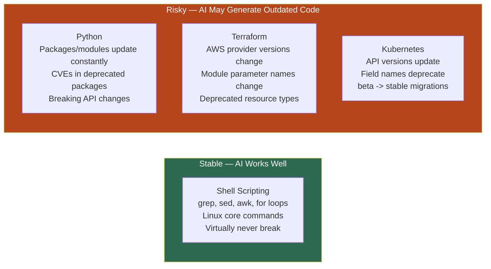
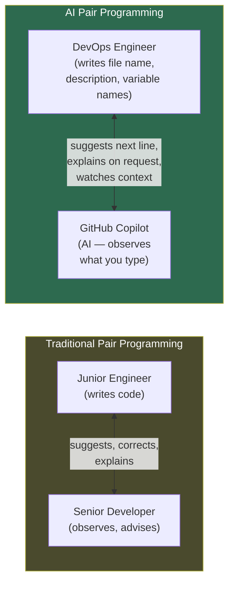
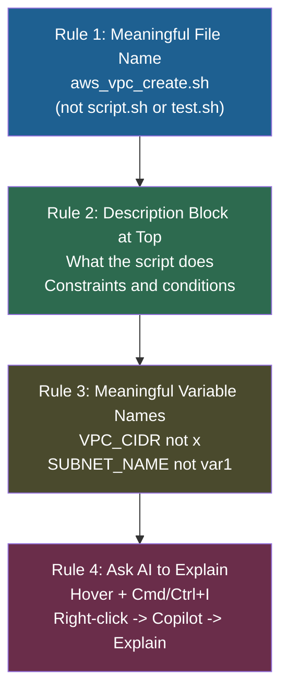
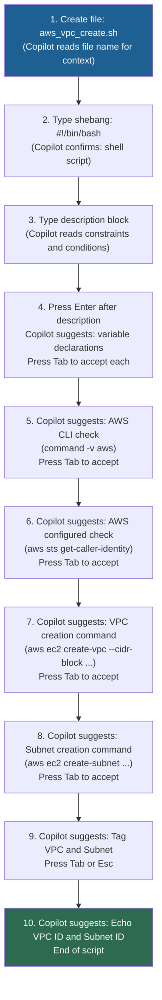

# Day 4: AI Assisted Shell Scripting

<details open>
<summary><b>Day 4: AI Assisted Shell Scripting — Write Shell Script like a Pro (CS46H)</b></summary>

## Table of Contents

- [DAY-4: AI Assisted Shell Scripting](#day-4-ai-assisted-shell-scripting)
  - [Episode Overview](#episode-overview)
  - [Why Shell Scripting Is the Best AI Use Case in DevOps](#why-shell-scripting-is-the-best-ai-use-case-in-devops)
    - [Shell Commands Are Stable — Unlike Python or Terraform](#shell-commands-are-stable--unlike-python-or-terraform)
    - [The Stability Comparison Across DevOps Languages](#the-stability-comparison-across-devops-languages)
  - [AI Pair Programming — What It Is and How It Works](#ai-pair-programming--what-it-is-and-how-it-works)
    - [The Senior Developer Analogy](#the-senior-developer-analogy)
    - [AI Pair Programming Tools for Shell Scripting](#ai-pair-programming-tools-for-shell-scripting)
  - [Best Practices for AI-Assisted Shell Scripting (4 Rules)](#best-practices-for-ai-assisted-shell-scripting-4-rules)
    - [Rule 1: Provide a Meaningful File Name](#rule-1-provide-a-meaningful-file-name)
    - [Rule 2: Provide a Description Block at the Top of the File](#rule-2-provide-a-description-block-at-the-top-of-the-file)
    - [Rule 3: Use Meaningful Variable Names](#rule-3-use-meaningful-variable-names)
    - [Rule 4: Ask AI to Explain Lines You Don't Understand](#rule-4-ask-ai-to-explain-lines-you-dont-understand)
  - [Demo: AWS VPC Creation Script with GitHub Copilot](#demo-aws-vpc-creation-script-with-github-copilot)
    - [Task Specification](#task-specification)
    - [The Description Block (Context for Copilot)](#the-description-block-context-for-copilot)
    - [GitHub Copilot Workflow — Zero Lines Typed](#github-copilot-workflow--zero-lines-typed)
    - [Generated Script Walkthrough](#generated-script-walkthrough)
    - [Running and Debugging the Script](#running-and-debugging-the-script)
  - [Assignment: Extend the Script with Command-Line Arguments](#assignment-extend-the-script-with-command-line-arguments)
- [Summary](#summary)

---

## DAY-4: AI Assisted Shell Scripting

### Episode Overview

Day 4 is described by the instructor as **the easiest episode of the entire series** — because it combines the DevOps skill where AI performs best (shell scripting) with a simple, immediately practical workflow (GitHub Copilot as an AI pair programmer in VS Code). No complex Python setup, no API keys, no LLM infrastructure — just a free VS Code extension and a keyboard.

**Topics covered:**
- Why shell scripting is the single DevOps field where AI generates the most reliable output
- What AI pair programming means (the senior developer analogy)
- GitHub Copilot vs. Cursor AI — when to use each
- 4 best practices for providing AI with the context it needs to generate correct shell scripts
- Full demo: creating `aws_vpc_create.sh` from scratch writing zero lines of code
- Assignment: extending the script to support `create` and `teardown` command-line arguments

> [!NOTE]
> Unlike Days 1–3, Day 4 requires no Python environment, no Ollama, no API keys. The only tool needed is VS Code + the free GitHub Copilot extension. If you've already installed Copilot, you can start the demo immediately.

---

### Why Shell Scripting Is the Best AI Use Case in DevOps

#### Shell Commands Are Stable — Unlike Python or Terraform

The core insight from the instructor:

> "If you ask me which one particular field of DevOps where AI has significant impact — if you use AI for a particular DevOps task which one that would be where AI can perform super good — I would say shell scripting."

**The reason: shell commands almost never change.**

```diff
+ grep — Abhishek has used the same grep commands for 11 years. Still works today.
+ sed — Same syntax for decades.
+ for loop — Syntax has not changed since Bash 1.0.
+ awk, ls, pwd, find — Core commands change so rarely they are effectively permanent.

! Shell scripting = a group of shell commands.
! If the individual commands are stable, the scripts remain valid indefinitely.
! A shell script written 3 years ago will almost certainly run unchanged today.
```

**Why this matters for AI-generated code:**
The most common failure mode of LLM-generated code is **using outdated packages or deprecated APIs**. LLMs have a training cutoff date, and package ecosystems evolve continuously. Shell commands live outside this problem space — they are part of the POSIX standard and Linux kernel interfaces that change extremely slowly.

---

#### The Stability Comparison Across DevOps Languages



| Technology | AI-Generated Code Quality | Main Risk |
|-----------|--------------------------|-----------|
| **Shell Scripting** | Excellent — high trust | Almost none (commands are stable) |
| **Python** | Good but verify | Outdated packages, CVEs, deprecated APIs |
| **Terraform** | Moderate — review carefully | Provider version changes, module param renames |
| **Kubernetes YAML** | Moderate — review carefully | API version deprecations (e.g., `apps/v1beta` removed) |
| **Dockerfile** | Good for common cases | Base image versions, package manager changes |

> [!IMPORTANT]
> This does NOT mean you can use AI-generated shell scripts without review. You still need to: (1) understand what each line does, (2) verify permissions are appropriate, and (3) test in a non-production environment first. The advantage is that the *commands themselves* are reliable — the risk of a deprecated function silently breaking is near-zero.

---

### AI Pair Programming — What It Is and How It Works

#### The Senior Developer Analogy

> "Assume you are a junior engineer, a fresher who just joined a company. When you are writing code in the initial days, you would write it under the assistance of a senior developer. You would shadow a senior engineer, see how they write code. Then the next step: you sit next to the senior developer as you write — the senior developer suggests best practices. This process is called pair programming. Because instead of doing it with a senior developer, you are doing it with AI — it is called AI pair programming."



**How GitHub Copilot works as a pair programmer:**
1. You open a file in VS Code — Copilot starts watching
2. You type a file name, shebang line, and description comment
3. Copilot reads the context and suggests the next line
4. You press **Tab** to accept, or **Esc** to reject, or just keep typing to override
5. You ask Copilot to **explain** any line you don't understand (right-click → Copilot → Explain, or **Cmd+I** / **Ctrl+I**)

---

#### AI Pair Programming Tools for Shell Scripting

| Tool | Cost | Best For | Notes |
|------|------|----------|-------|
| **GitHub Copilot** | Free (VS Code extension) | Shell scripting, general DevOps | Recommended by instructor for shell scripting |
| **Cursor AI** | Free for limited tokens; paid for full | Python, Terraform | Better than Copilot for complex languages but not fully free |
| **Pieces for Developers** | Free | Snippet management + AI | Good for storing and reusing your own prompt library |

**Installing GitHub Copilot:**
1. Open VS Code
2. Click the Extensions tab (Ctrl+Shift+X)
3. Search: `GitHub Copilot`
4. Click **Install**
5. Sign in with your GitHub account
6. Copilot now watches everything you type in VS Code

> [!NOTE]
> GitHub Copilot requires a GitHub account. As of the recording it is free for individual use via GitHub's free tier. If you want to disable it temporarily (e.g., for sensitive files), click the Copilot icon in the VS Code status bar and select **Disable**.

---

### Best Practices for AI-Assisted Shell Scripting (4 Rules)

These 4 rules maximize the quality of AI suggestions by ensuring GitHub Copilot has sufficient context before you start typing code.



---

#### Rule 1: Provide a Meaningful File Name

The file name is the first piece of context Copilot receives.

```diff
- Bad:  script.sh, test.sh, my_script.sh
+ Good: aws_vpc_create.sh, k8s_namespace_setup.sh, ec2_health_check.sh

! When Copilot sees "aws_vpc_create.sh" it immediately knows:
!   - Cloud provider: AWS
!   - Service: VPC
!   - Action: Create
! This shapes ALL subsequent suggestions before you type a single comment.
```

**Naming convention:**
```
<cloud_or_service>_<resource>_<action>.sh

Examples:
  aws_vpc_create.sh
  aws_s3_cleanup.sh
  k8s_pod_restart.sh
  ec2_healthcheck.sh
  docker_cleanup.sh
```

---

#### Rule 2: Provide a Description Block at the Top of the File

After the shebang line, write a multi-line comment block that explains:
- What the script does
- Any constraints or conditions it must handle
- Edge cases to be aware of

**Template:**
```bash
#!/bin/bash
# Description: <what this script does>
# Conditions:
#   - <condition 1>
#   - <condition 2>
# Constraints:
#   - <constraint 1>
```

> 💡 **Key Insight:** The description block is your prompt to Copilot — just written as a comment. Everything you would put in a ChatGPT prompt goes here. The richer the description, the more precisely Copilot generates the subsequent code.

**From the demo (exact description block used):**
```bash
#!/bin/bash
# Description: Create VPC in AWS
#   - Create a public subnet
#   - Verify if user has AWS CLI installed (Windows/Linux/Mac)
#   - Verify if AWS CLI is configured
```

---

#### Rule 3: Use Meaningful Variable Names

Variable names are additional context signals for Copilot. They also make your script self-documenting.

```diff
- Bad variable names:
-   x="10.0.0.0/16"
-   y="us-east-1"
-   z="my-vpc"

+ Good variable names:
+   VPC_CIDR="10.0.0.0/16"
+   AVAILABILITY_ZONE="us-east-1a"
+   VPC_NAME="demo-vpc"
+   SUBNET_NAME="demo-subnet"
+   SUBNET_CIDR="10.0.0.0/24"

! Copilot reads variable names when generating subsequent lines.
! VPC_CIDR in the AWS create-vpc command = correct placement.
! x in the AWS create-vpc command = Copilot may misplace it.
```

---

#### Rule 4: Ask AI to Explain Lines You Don't Understand

Never blindly accept AI-generated code you don't understand.

**How to invoke Copilot's explanation feature:**
- **Method 1:** Highlight the line → right-click → **Copilot** → **Explain This**
- **Method 2:** Highlight the line → press **Cmd+I** (Mac) or **Ctrl+I** (Windows/Linux) → type "explain this"
- **Method 3:** Open Copilot Chat (sidebar) → ask "what does line X do?"

**Multilingual:** Copilot can explain code in any language — including Telugu, Hindi, or whatever your preferred language is.

```diff
! The pair programming discipline applies here:
! A junior developer sitting next to a senior developer would NOT blindly type
! what the senior developer says without understanding it.
! The same rule applies with AI pair programmers.
+ Always: understand before accepting.
```

---

### Demo: AWS VPC Creation Script with GitHub Copilot

#### Task Specification

**Goal:** Create a shell script that:
1. Creates a VPC in AWS with a CIDR block
2. Creates one public subnet within that VPC
3. Verifies AWS CLI is installed (cross-platform: Windows/Linux/Mac)
4. Verifies AWS CLI is configured (has valid credentials)
5. Outputs the created VPC ID and Subnet ID

**Written by the engineer:** Zero lines of actual code — only the file name, shebang, and description block.

---

#### The Description Block (Context for Copilot)

```bash
#!/bin/bash
# Description: Create VPC in AWS
#   - Create a public subnet
#   - Verify if user has AWS CLI installed (Windows/Linux/Mac)
#   - Verify if AWS CLI is configured
```

This 5-line block is the entire manual input. Copilot generates everything else.

---

#### GitHub Copilot Workflow — Zero Lines Typed



**The developer's only keyboard actions:** Enter (to move to next line), Tab (to accept suggestion), Esc (to reject suggestion).

---

#### Generated Script Walkthrough

The script GitHub Copilot generates follows this structure:

```bash
#!/bin/bash
# Description: Create VPC in AWS
#   - Create a public subnet
#   - Verify if user has AWS CLI installed (Windows/Linux/Mac)
#   - Verify if AWS CLI is configured

# --- Variables (best practice: no hardcoded values) ---
VPC_CIDR="10.0.0.0/16"
SUBNET_CIDR="10.0.3.0/24"
VPC_NAME="demo-vpc"
SUBNET_NAME="demo-subnet"
AVAILABILITY_ZONE="ap-south-1a"   # corrected from us-east-1 after first run

# --- Check 1: Verify AWS CLI is installed ---
if ! command -v aws &> /dev/null; then
    echo "AWS CLI is not installed. Please install it first."
    exit 1
fi

# --- Check 2: Verify AWS CLI is configured ---
if ! aws sts get-caller-identity &> /dev/null; then
    echo "AWS CLI is not configured. Run 'aws configure' first."
    exit 1
fi

# --- Create VPC ---
VPC_ID=$(aws ec2 create-vpc --cidr-block "$VPC_CIDR" \
    --query 'Vpc.VpcId' --output text)
aws ec2 create-tags --resources "$VPC_ID" \
    --tags Key=Name,Value="$VPC_NAME"

# --- Create Subnet ---
SUBNET_ID=$(aws ec2 create-subnet \
    --vpc-id "$VPC_ID" \
    --cidr-block "$SUBNET_CIDR" \
    --availability-zone "$AVAILABILITY_ZONE" \
    --query 'Subnet.SubnetId' --output text)
aws ec2 create-tags --resources "$SUBNET_ID" \
    --tags Key=Name,Value="$SUBNET_NAME"

# --- Output ---
echo "VPC created: $VPC_ID"
echo "Subnet created: $SUBNET_ID"
```

**Script section explanations:**

| Section | Command | Purpose |
|---------|---------|---------|
| **Variables block** | `VPC_CIDR=`, `SUBNET_CIDR=`, etc. | Avoids hardcoded values; easy to modify without touching logic |
| **AWS CLI check** | `command -v aws` | Checks if `aws` exists anywhere in `$PATH`; portable across Linux/Mac/Windows |
| **AWS config check** | `aws sts get-caller-identity` | Makes an actual API call; fails if credentials are not configured or expired |
| **VPC creation** | `aws ec2 create-vpc --cidr-block` | Creates the VPC; captures VPC ID via `--query` and `--output text` |
| **Subnet creation** | `aws ec2 create-subnet --vpc-id` | Creates subnet inside the VPC; links it by VPC ID |
| **Tagging** | `aws ec2 create-tags` | Adds Name tag for human-readable identification in AWS Console |
| **Output** | `echo "VPC created: $VPC_ID"` | Confirms IDs created for the operator's records |

> 💡 **`command -v aws` explained:** This is a POSIX-portable way to check if a command exists in the system's PATH. It is preferred over `which aws` because `which` is not available on all systems. The `&> /dev/null` redirects both stdout and stderr to null (suppresses all output from the check itself).

> 💡 **`aws sts get-caller-identity` explained:** STS = AWS Security Token Service. This API call returns the IAM identity associated with the current credentials. If credentials are missing, expired, or invalid, it returns a non-zero exit code — which the `if !` check catches.

---

#### Running and Debugging the Script

```bash
# Step 1: Make executable (instructor used 777, but this is not recommended)
chmod 777 aws_vpc_create.sh
# Better practice: chmod 755 aws_vpc_create.sh (owner: rwx, others: r-x)

# Step 2: Run
./aws_vpc_create.sh
```

**First run — error encountered:**
```
An error occurred (InvalidAvailabilityZone) when calling the CreateSubnet operation:
Value 'us-east-1' for availabilityZone is invalid.
Subnets can currently only be created in: ap-south-1a, ap-south-1b, ap-south-1c
```

**Root cause:** The instructor's AWS CLI was configured with default region `ap-south-1`, but Copilot suggested `us-east-1a` as the availability zone. The variable needed to match the configured region.

**Fix:** Update the variable:
```diff
- AVAILABILITY_ZONE="us-east-1a"
+ AVAILABILITY_ZONE="ap-south-1a"
```

**Second run — success:**
```
VPC created: vpc-0abc12345def67890
Subnet created: subnet-0def67890abc12345
```

```diff
! Key lesson: AI-generated scripts require a test run in a real environment.
! Copilot uses sensible defaults (us-east-1 is AWS's most common region),
! but these defaults may not match YOUR configured environment.
+ Always: run the script, observe errors, fix configuration mismatches.
```

**`chmod` permission guide:**

| Permission | Numeric | Who Can Execute | Use Case |
|-----------|---------|-----------------|----------|
| `chmod 777` | rwxrwxrwx | Everyone | Never use in production; demo/testing only |
| `chmod 755` | rwxr-xr-x | Owner write; all can execute | Scripts shared across the system |
| `chmod 700` | rwx------ | Owner only | Sensitive scripts with credentials |
| `chmod +x` | Adds execute for owner | Safer minimal grant | Quick local use |

---

### Assignment: Extend the Script with Command-Line Arguments

**Extend `aws_vpc_create.sh` to accept two command-line arguments:**

```
Usage:
  ./aws_vpc_create.sh            → Print: "Please provide input as 'create' or 'teardown'"
  ./aws_vpc_create.sh create     → Create VPC and public subnet (current behavior)
  ./aws_vpc_create.sh teardown   → Check if VPC/subnet exist; delete them if they do
  ./aws_vpc_create.sh <other>    → Print: "Invalid input parameter"
```

**Hint — description block for the extended script:**
```bash
#!/bin/bash
# Description: Manage VPC in AWS
#   - Accepts one command-line argument: 'create' or 'teardown'
#   - 'create': Creates VPC (CIDR 10.0.0.0/16) and public subnet (CIDR 10.0.3.0/24)
#   - 'teardown': Checks if VPC and subnet exist; deletes them if found
#   - No argument: Print usage message
#   - Invalid argument: Print invalid input message
#   - Verify AWS CLI is installed before any operation
#   - Verify AWS CLI is configured before any operation
```

**Shell scripting pattern for argument handling:**
```bash
case "$1" in
  create)
    # create logic here
    ;;
  teardown)
    # teardown logic here
    ;;
  "")
    echo "Please provide input as 'create' or 'teardown'"
    exit 1
    ;;
  *)
    echo "Invalid input parameter: $1"
    exit 1
    ;;
esac
```

**Teardown commands to be aware of:**
```bash
# Delete subnet
aws ec2 delete-subnet --subnet-id "$SUBNET_ID"

# Delete VPC (must delete all subnets first)
aws ec2 delete-vpc --vpc-id "$VPC_ID"
```

> [!NOTE]
> To implement teardown, the script needs to either (a) store the created VPC ID and Subnet ID to a file during `create` and read them back during `teardown`, or (b) query AWS to find existing VPCs/subnets by tag name. Option (b) is more robust — use `aws ec2 describe-vpcs --filters "Name=tag:Name,Values=demo-vpc"` and parse with `--query` and `--output text`.

---

## Summary

### Key Takeaways

```diff
+ Shell scripting = the single best DevOps use case for AI-generated code
+ Reason: shell commands are backward-compatible; a grep from 11 years ago still works
+ Python/Terraform/K8s are risky: packages deprecate, API versions change, CVEs appear
+ AI pair programming = AI watches you type and suggests the next line in real time
+ GitHub Copilot = free VS Code extension; best tool for AI-assisted shell scripting
+ 4 rules: meaningful file name, description block, meaningful variable names, ask for explanations
+ In the demo: zero lines of code typed by the engineer — only Enter and Tab pressed
! AWS CLI check: command -v aws (portable, preferred over 'which')
! AWS config check: aws sts get-caller-identity (validates real credentials)
- Never use chmod 777 in production; use chmod 755 or chmod 700 depending on sensitivity
- Always test AI-generated scripts in a non-production environment first
```

### Quick Reference — GitHub Copilot Keyboard Shortcuts

| Action | Mac | Windows/Linux |
|--------|-----|---------------|
| Accept suggestion | Tab | Tab |
| Reject suggestion | Esc | Esc |
| See next suggestion | Option+] | Alt+] |
| See previous suggestion | Option+[ | Alt+[ |
| Open Copilot Chat | Cmd+I (inline) | Ctrl+I (inline) |
| Explain selected code | Right-click → Copilot → Explain | Right-click → Copilot → Explain |
| Disable Copilot | Status bar → Copilot icon → Disable | Status bar → Copilot icon → Disable |

### Quick Reference — AWS CLI Commands Used

```bash
# Check if AWS CLI is installed
command -v aws &> /dev/null

# Check if AWS CLI is configured
aws sts get-caller-identity

# Create VPC
aws ec2 create-vpc --cidr-block "10.0.0.0/16" \
    --query 'Vpc.VpcId' --output text

# Tag a resource
aws ec2 create-tags --resources "<resource-id>" \
    --tags Key=Name,Value="<name>"

# Create subnet in a VPC
aws ec2 create-subnet \
    --vpc-id "<vpc-id>" \
    --cidr-block "10.0.3.0/24" \
    --availability-zone "ap-south-1a" \
    --query 'Subnet.SubnetId' --output text

# List S3 buckets (verify AWS is configured)
aws s3 ls

# Delete subnet
aws ec2 delete-subnet --subnet-id "<subnet-id>"

# Delete VPC
aws ec2 delete-vpc --vpc-id "<vpc-id>"
```

### Expert Insight

**Real-World Application:**
This pattern — file name + description block + variable names as Copilot context — is the foundation for building an entire internal script library with AI pair programming. In production DevOps teams, engineers maintain a `scripts/` directory where every script follows this convention. New engineers onboarded to the team can use GitHub Copilot to understand and extend existing scripts without needing a senior engineer to explain every line. The `Explain This` feature effectively turns Copilot into a 24/7 code tutor.

**Expert Path:**
1. Install GitHub Copilot in VS Code today — even if you don't use it immediately, getting comfortable with accepting/rejecting suggestions takes practice
2. Create 3 scripts this week using the 4-rule framework: one AWS resource script, one system health check, one cleanup script — practice giving Copilot context via descriptions
3. For every line you accept but don't understand, use Explain before moving on — build understanding alongside the script
4. When the assignment (create/teardown with command-line arguments) is done, refactor to also support `--dry-run` — a common production pattern where the script prints what it WOULD do without executing any AWS API calls

**Common Pitfalls:**
- Starting to write code immediately without a description block — Copilot's suggestions become generic, not task-specific
- Using a vague file name like `script.sh` — Copilot has no context and produces boilerplate
- Accepting every suggestion blindly — the description block steers Copilot correctly most of the time, but always review the generated AWS commands before running against a real account
- Forgetting that `command -v aws` returns 0 (success) even if AWS CLI is installed but misconfigured — the `aws sts get-caller-identity` check is essential as a second gate
- Running with `chmod 777` in production — this grants world-write permissions to a script that executes AWS API calls; use `chmod 700` for sensitive automation scripts
- Not testing in a dev/sandbox AWS account first — a `create` script is easy to undo, but a `teardown` script run against the wrong VPC in production is not
- Hardcoding the availability zone as `us-east-1a` (Copilot's default) without checking your configured AWS region — always ensure `AVAILABILITY_ZONE` matches your `aws configure` default region

**Additional Diagnostic Notes:**
- `InvalidAvailabilityZone` error: Your configured AWS region (check with `aws configure get region`) doesn't match the hardcoded AZ variable. Update `AVAILABILITY_ZONE` to a valid AZ in your region (e.g., `ap-south-1a` for `ap-south-1`). List valid AZs with `aws ec2 describe-availability-zones --query 'AvailabilityZones[*].ZoneName' --output text`.
- `Unable to locate credentials` error: AWS CLI is installed but not configured. Run `aws configure` and enter your Access Key ID, Secret Access Key, region, and output format. Verify with `aws sts get-caller-identity`.
- `command: command not found` or `command -v` returns nothing: AWS CLI is not installed. Install it from the official AWS documentation. On Mac: `brew install awscli`. On Ubuntu: `sudo apt-get install awscli` or use the official installer script.
- Copilot not suggesting anything: Check the Copilot status bar icon — it may be disabled or rate-limited. Also ensure the file has a `.sh` extension and the shebang line is present; these are strong context signals.
- Copilot suggesting Python-style code in a `.sh` file: The file name or content may be confusing Copilot. Add `#!/bin/bash` as the very first line to signal Bash context unambiguously.
- `VpcId` is empty string after create-vpc: The `--query 'Vpc.VpcId'` JMESPath expression failed — check the AWS CLI output format. Run `aws ec2 create-vpc --cidr-block "10.0.0.0/16"` without `--query` and `--output text` first to see the raw JSON and verify the field name.

> [!IMPORTANT]
> **Transcript Corrections Applied (CS46H pass):**
> - "abishek" -> "Abhishek" (throughout)
> - "fur Loop / fur loop" -> "for loop"
> - "grip" -> "grep"
> - "SED" -> "sed"
> - "cadr" -> "CIDR"
> - "bpc / bpcreate" -> "VPC / aws_vpc_create.sh"
> - "aw VPC creation / awor vpcc create" -> "aws_vpc_create.sh"
> - "Tri 7 / trip 7" -> "chmod 777"
> - "do s" -> ".sh (shell script extension)"
> - "GH/GP/a that would" -> "grep/awk" (inferred from shell commands context)
> - "co-pilot" -> "Copilot"
> - "curser AI" -> "Cursor AI"
> - "taay down / pair down" -> "teardown"
> - "CA" -> "AWS CLI" (checking if it exists in PATH)
> - "S3 MB" -> "aws s3 mb" (make bucket)
> - "Dosh" -> ".sh"
> - "VPC create.sh" -> "aws_vpc_create.sh"
> - "CVS" -> "CVEs (Common Vulnerabilities and Exposures)"

</details>
