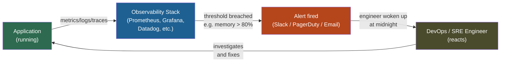
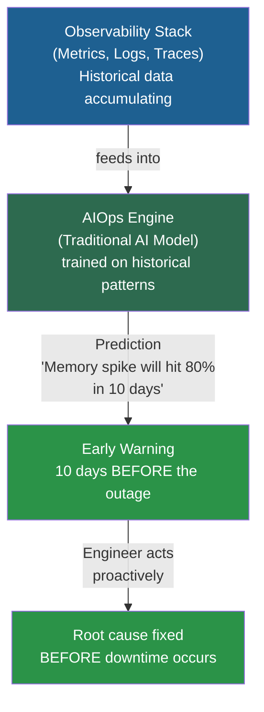
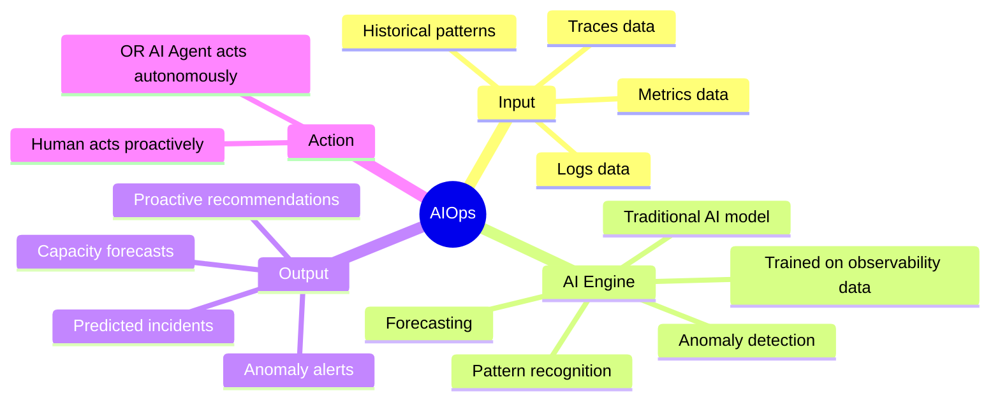
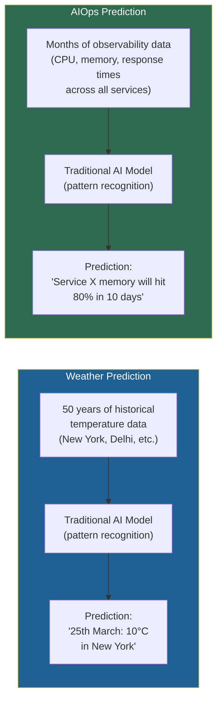
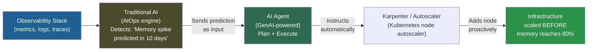
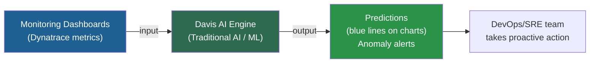
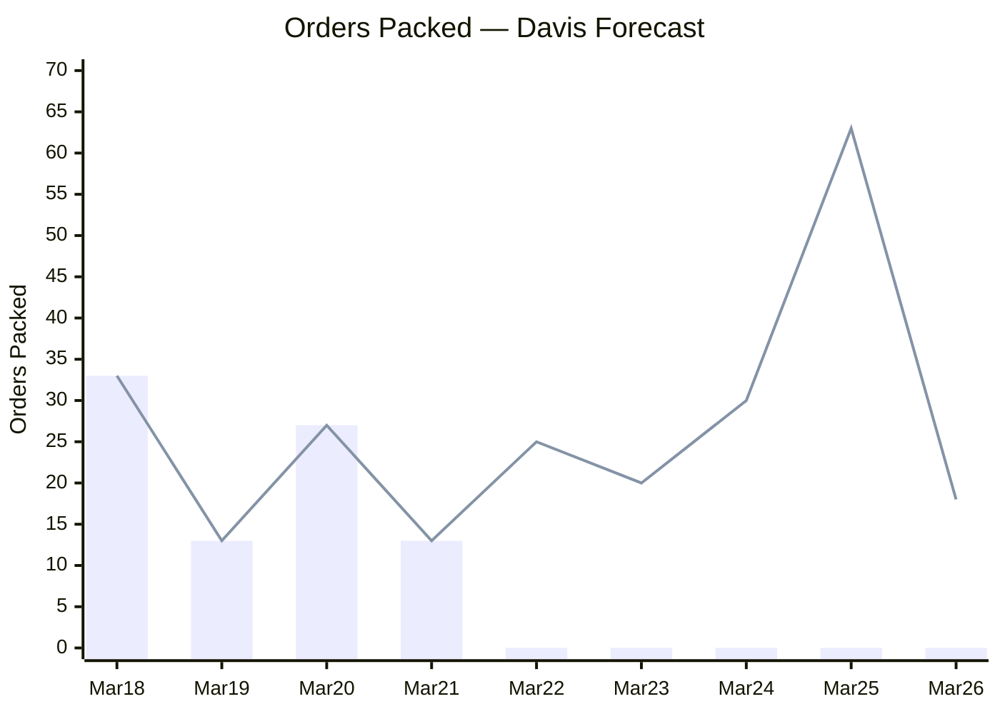
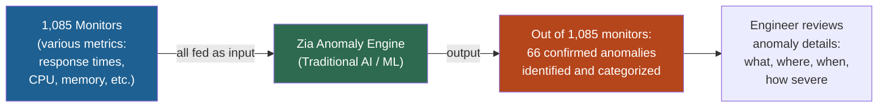
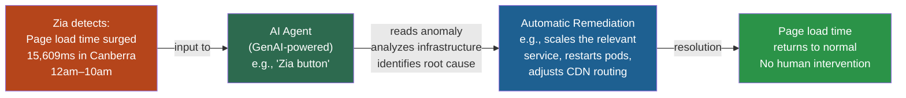
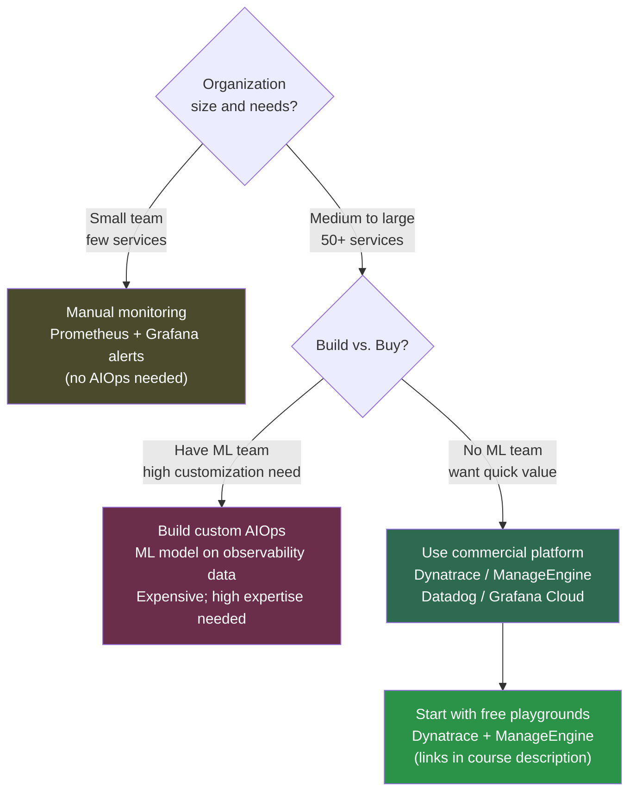

# Day 5: AIOps Explained with Free Playgrounds

<details open>
<summary><b>Day 5: AIOps Explained with Free Playgrounds (CS46H)</b></summary>

## Table of Contents

- [DAY-5: AIOps Explained with Free Playgrounds](#day-5-aiops-explained-with-free-playgrounds)
  - [Episode Overview](#episode-overview)
  - [What Is NOT AIOps — Clearing Up Misconceptions](#what-is-not-aiops--clearing-up-misconceptions)
  - [The Business Problem AIOps Solves](#the-business-problem-aiops-solves)
    - [The Reactive Observability Approach (and Its Limits)](#the-reactive-observability-approach-and-its-limits)
    - [The AIOps Predictive Approach](#the-aiops-predictive-approach)
  - [What Is AIOps — The Definition](#what-is-aiops--the-definition)
    - [Why AI, Not Humans?](#why-ai-not-humans)
    - [The Weather Prediction Analogy](#the-weather-prediction-analogy)
  - [GenAI's Emerging Role in AIOps](#genais-emerging-role-in-aiops)
  - [Enterprise AIOps Platforms](#enterprise-aiops-platforms)
  - [Demo 1 — Dynatrace Davis AIOps Playground](#demo-1--dynatrace-davis-aiops-playground)
    - [How Davis Works](#how-davis-works)
    - [Dashboard 1: E-Commerce Order Volume Forecasting](#dashboard-1-e-commerce-order-volume-forecasting)
    - [Dashboard 2: Predictive Disk Capacity](#dashboard-2-predictive-disk-capacity)
    - [Other Dashboards Available](#other-dashboards-available)
  - [Demo 2 — ManageEngine Zia Anomaly Dashboard](#demo-2--manageengine-zia-anomaly-dashboard)
    - [How Zia Works](#how-zia-works)
    - [The Demo Anomaly: Page Load Time Surge](#the-demo-anomaly-page-load-time-surge)
    - [The Next Step: GenAI Agent Integration](#the-next-step-genai-agent-integration)
  - [AIOps Implementation Options Summary](#aiops-implementation-options-summary)
- [Summary](#summary)

---

## DAY-5: AIOps Explained with Free Playgrounds

### Episode Overview

Day 5 focuses entirely on **AIOps** — what it is, what it is NOT, and how enterprise observability platforms are implementing it. This episode is conceptually rich: it builds directly on Day 1's Traditional AI vs. GenAI distinction, Day 2's understanding of prompts, and provides critical context for the AIOps project in Day 6.

The instructor walks through two live AIOps playground environments (Dynatrace Davis and ManageEngine Zia) to demonstrate real AIOps in action — without requiring any infrastructure setup.

**Topics covered:**
- Clearing misconceptions: what is NOT AIOps (GenAI + Kubernetes ≠ AIOps)
- The business problem: why reactive observability is not enough
- AIOps definition: Traditional AI applied to IT operations for a predictive approach
- Why human monitoring fails at scale (10,000+ metrics across 100 services)
- The weather prediction analogy for AIOps
- GenAI's emerging (not yet mature) role in AIOps — the Traditional AI + GenAI Agent hybrid
- Enterprise AIOps platforms: Dynatrace, ManageEngine, Datadog, Grafana Cloud
- Live demo: Dynatrace Davis playground — e-commerce order forecasting, disk capacity prediction
- Live demo: ManageEngine Zia — 1,085 monitors → 66 confirmed anomalies → page load time surge example

> [!NOTE]
> The instructor attempted to set up an open-source AIOps solution integrated with Prometheus for this episode, but found the available open-source options were not efficient enough for a meaningful demo. The commercial playground environments (both free to sign up) provide a better introduction to what production AIOps actually looks like.

---

### What Is NOT AIOps — Clearing Up Misconceptions

Before defining AIOps, the instructor explicitly states what does NOT qualify as AIOps:

```diff
- Using GenAI/LLMs to automate Kubernetes deployments or workflows → NOT AIOps
- Using GenAI to generate Dockerfiles (e.g., the Day 3 project) → NOT AIOps
- Using GenAI for CI/CD pipelines or shell scripts → NOT AIOps

+ All of the above are "AI-assisted DevOps" or "using GenAI to enhance DevOps practice"
+ They are valuable — but they are a different category
```

> 💡 **Key Insight:** Many engineers assume they are "doing AIOps" because they use AI tools in their DevOps workflow. The distinction matters because AIOps has a specific technical meaning: it involves **Traditional AI applied to observability data for prediction** — not GenAI used to generate code or automate tasks.

| Practice | Category | Description |
|----------|----------|-------------|
| GenAI generates Kubernetes manifests | AI-assisted DevOps | Code generation, automation |
| GenAI generates Dockerfiles via API | AI-assisted DevOps | Code generation |
| LLM writes CI/CD pipeline YAML | AI-assisted DevOps | Code generation |
| GitHub Copilot writes shell scripts | AI-assisted DevOps | Code generation (pair programming) |
| Traditional AI predicts memory leak from metrics | **AIOps** | Observability prediction |
| ML model detects anomaly in application response time | **AIOps** | Observability anomaly detection |
| AI forecasts order volume for capacity planning | **AIOps** | Operational forecasting |

---

### The Business Problem AIOps Solves

#### The Reactive Observability Approach (and Its Limits)

> **Core requirement for every organization:** Applications must be available and reliable 24x7.

Applications fail for many reasons:
- Resource exhaustion: CPU, memory, or disk space runs out
- Performance degradation: response time slows (e.g., ideal 10ms but actual 1s)
- HTTP errors: 502 Bad Gateway (upstream connection failure), 404, 500 — cascading service failures

**Traditional observability response pattern:**



This is a **reactive approach** — an internal feedback system that continuously reports the state of your system. It is valuable but has a critical limitation.

**The memory leak scenario (from the transcript):**

```
Timeline:
  T+0:  Memory at 60% — monitoring running normally
  T+1h: Memory reaches 80% — alert fires to Slack
  T+2h: Engineer receives alert, starts investigating
  T+3h: By the time engineer understands root cause, memory is at 100%
  T+4h: Application crashes — customer downtime

Even with fix applied:
  - Memory freed by restarting pods
  - 2 hours later: memory at 90% again (it's a leak — root cause not fixed)
  - Cycle repeats every 2–3 hours
```

```diff
! The reactive approach does NOT prevent downtime.
! It minimizes the time-to-response — but a response still requires a human to intervene.
! Complex issues (CPU throttling, memory leaks, cascading failures) take time to diagnose.
! By the time the engineer acts, the customer has already experienced the outage.
```

---

#### The AIOps Predictive Approach

> **AIOps adds a predictive layer on top of the observability stack.**



**The key difference:**

| Approach | Trigger | Human action time | Downtime risk |
|----------|---------|-------------------|---------------|
| **Reactive (observability)** | Threshold already breached | After the fact | High — customer may already be impacted |
| **Predictive (AIOps)** | Pattern identified BEFORE threshold | Days/weeks ahead | Low — fix applied proactively |

**AIOps anomaly detection example:**
> "AI sees an anomaly in your memory usage. What is an anomaly? A strange behavior or a strange pattern. If the model tells you that for a service, the memory spike is happening very rapidly — maybe after 10 days it might hit 80% of the memory allocated to the VM — you can fix this proactively. Over midnight, you don't have to receive a Slack notification. The AI predicts by looking at your observability stack that something might happen in future." — Abhishek

---

### What Is AIOps — The Definition

> **AIOps = Artificial Intelligence for IT Operations**

Specifically: applying **Traditional AI** (prediction, pattern recognition, anomaly detection) to the data streams generated by the observability stack (metrics, logs, traces) to produce a **predictive approach** to IT operations.



**AIOps is NOT:**
- A replacement for observability (it sits ON TOP of observability)
- A GenAI solution (it is primarily Traditional AI / ML)
- A substitute for good monitoring practices

**AIOps IS:**
- An AI layer that ingests observability data
- Trained to recognize patterns in metrics/logs/traces
- Capable of predicting future incidents before they cause downtime
- Most valuable at scale: where humans cannot manually monitor thousands of metrics

---

#### Why AI, Not Humans?

```diff
! Scale problem:
! 100 services × 100 metrics per service = 10,000 metrics to monitor simultaneously
!
! Human limitations:
- Cannot watch 10,000 dashboards continuously
- Cannot detect subtle month-over-month patterns in memory usage
- Cannot be on-call 24x7 without fatigue affecting judgment
- Cannot correlate patterns across 10,000 metrics simultaneously
!
+ AI advantages:
+ Monitors ALL 10,000 metrics simultaneously, continuously
+ Detects subtle patterns humans would miss (e.g., 0.5% memory increase per day)
+ No fatigue, no missed alerts, no context switching
+ Can correlate anomalies across multiple services simultaneously
```

> [!NOTE]
> For small organizations with a handful of services, manual monitoring is viable. AIOps becomes essential when the number of services and metrics exceeds what a human team can reasonably watch — typically at 50+ services. At MNC scale (thousands of services), AIOps is not optional.

---

#### The Weather Prediction Analogy

AIOps works exactly like weather prediction applications — the instructor draws this connection back to Day 1:



| Weather Prediction | AIOps |
|-------------------|-------|
| Input: historical climate data per location | Input: historical metrics/logs/traces per service |
| Model: trained on years of weather patterns | Model: trained on months of observability data |
| Output: predicted temperature on future date | Output: predicted resource exhaustion / anomaly |
| Accuracy: not 100%, but better than human guessing | Accuracy: not 100%, but catches patterns humans miss |
| Value: brings umbrella BEFORE it rains | Value: scales up BEFORE memory hits 100% |

---

### GenAI's Emerging Role in AIOps

AIOps was historically a **Traditional AI only** domain. Over the last 2–3 years, some observability platforms have started experimenting with combining Traditional AI + GenAI.

**The emerging hybrid architecture:**



```diff
+ Traditional AI: detects and predicts the situation
+ GenAI Agent: receives the prediction and ACTS on it (no human intervention)
+ Example: Karpenter is normally triggered when memory hits 80%
+ With AI Agent: Karpenter is instructed to add a node 10 DAYS BEFORE the threshold is reached
! Current state (as of recording): This combination exists but is NOT yet efficient
! Most observability platforms are still working on integrating GenAI Agents into their AIOps offerings
! "Maybe in future this solution might be efficient." — Abhishek
```

> [!NOTE]
> This is the convergence of everything learned in this series: Day 1 (Traditional AI vs. GenAI), Day 8 (AI Agents) — both come together in the next evolution of AIOps. The current generation of AIOps is primarily Traditional AI. The next generation will combine it with GenAI Agents for autonomous remediation.

---

### Enterprise AIOps Platforms

> [!IMPORTANT]
> AIOps solutions are **NOT free** in production. They require the platform to train and continuously retrain custom ML models on your observability data — which requires significant compute infrastructure. This is why most platforms offer it only in paid tiers.

| Platform | AIOps Feature | Free Tier / Playground |
|----------|--------------|------------------------|
| **Dynatrace** | Davis AI engine | Free playground environment |
| **ManageEngine** | Zia anomaly detector | Free playground environment |
| **Datadog** | Watchdog (AI anomaly detection) | Trial available |
| **Grafana Cloud** | ML plugin (anomaly detection) | Paid; not in free Grafana OSS |
| **New Relic** | Applied Intelligence | Paid tier |

**Why build your own AIOps?**
- Requires building a complete ML model tailored to your observability data schema
- Requires training infrastructure (GPUs, data pipelines)
- Requires continuous retraining as your infrastructure evolves
- Open-source options exist on GitHub but are not production-efficient (per the instructor's testing)
- **Recommendation:** Use a commercial platform's AIOps feature unless your organization has a dedicated ML engineering team

---

### Demo 1 — Dynatrace Davis AIOps Playground

#### How Davis Works

**Davis** is Dynatrace's AIOps AI engine. It is fed by Dynatrace's observability stack (metrics, dashboards, monitors) and applies Traditional AI to produce predictions and anomaly detection.



**Access:** Sign up for free at the Dynatrace playground — link in the course description. Search for "AIOps" in the Dynatrace interface to find the Davis dashboard.

---

#### Dashboard 1: E-Commerce Order Volume Forecasting

**Scenario:** An e-commerce company monitors "orders packed" as a business metric.

```
Historical data (observed, shown as solid line):
  18th March: 33 orders packed
  19th March: 13 orders packed
  20th March: 27 orders packed
  21st March: 13 orders packed
  ...

Davis AI prediction (shown as blue shaded line):
  25th March: ~63 orders (high confidence)
  26th March: ~18 orders (lower volume predicted)
```



**How Davis generates this prediction:**
1. Ingests 30 days of historical "orders packed" data
2. Applies ML pattern recognition (time-series forecasting)
3. Identifies patterns: day-of-week effects, trend lines, seasonal patterns
4. Projects forward with confidence intervals (the blue shaded region)

**DevOps / business use case:**
- Capacity planning: If 63 orders predicted on 25th, the fulfillment system needs to scale to handle the load
- Staffing: Warehouse operations can pre-schedule staff for a high-volume day
- Infrastructure: Auto-scaling policies can be pre-warmed before the surge

---

#### Dashboard 2: Predictive Disk Capacity

**Scenario:** Monitoring disk space utilization over time.

```
Historical data: Flat utilization from 19th → 21st → 23rd March (constant usage)
Davis prediction: Also flat (no anomalies detected)

Why? Because:
  - No spike in disk usage observed
  - No trend toward exhaustion
  - Flat historical curve → flat prediction curve
```

```diff
+ Key insight: AIOps doesn't always predict doom.
+ If the historical pattern is stable (flat disk usage),
+ Davis correctly predicts continued stability.
+ Only when an ANOMALY is detected does Davis raise a concern.
! Anomaly = "a sudden spike or any unexpected behavior"
```

**Disk exhaustion warning example (what WOULD trigger an anomaly):**
```
If disk were growing 2% per day:
  Day 0: 40% used
  Day 10: 60% used
  Day 20: 80% used → Davis predicts "disk will reach 85% in 22 days"
  → AIOps alert fires 22 days BEFORE the disk fills up
  → DevOps engineer adds storage or cleans up before any impact
```

---

#### Other Dashboards Available

The Dynatrace Davis playground includes additional pre-built demos:

| Dashboard | What It Monitors | AIOps Value |
|-----------|-----------------|-------------|
| **Predictive Incident Response** | Service availability + error rates | Predicts service degradation before customer impact |
| **Kubernetes CPU Usage** | Node and pod CPU metrics | Predicts node saturation, informs cluster autoscaler |
| **Kubernetes Memory Working Sets** | Pod memory consumption | Predicts OOM kills before they happen |
| **E-Commerce Orders** | Business metrics (order volume) | Forecasts demand spikes for capacity planning |

---

### Demo 2 — ManageEngine Zia Anomaly Dashboard

#### How Zia Works

**Zia** is ManageEngine's AIOps / anomaly detection engine. Like Davis, it feeds on monitoring data as input and applies ML to detect anomalies and predict issues.



**Scale demonstration:**
> "They have set up 1,085 monitors and all of these monitors are fed as input to Zia. It says: out of 1,085 monitors, **66 of them have confirmed anomalies**. It's plug-and-play — just connect that to your AIOps solution." — Abhishek

This is the core value proposition at scale: a human cannot meaningfully watch 1,085 monitors simultaneously. Zia watches all of them and surfaces the 66 that need attention.

---

#### The Demo Anomaly: Page Load Time Surge

**Anomaly detected:** Homepage page load time surge

```
Metric:        Homepage page load time
Location:      Canberra, Australia
Anomaly type:  Surge (sudden increase)
Magnitude:     Spiked by 15,609 milliseconds
Severity:      1.9x above the usual threshold
Time pattern:  Occurs between 12:00 AM and 10:00 AM
```

```diff
! 15,609ms page load time = 15.6 seconds to load a homepage
! Typical acceptable homepage load time: under 3 seconds
! 1.9x above threshold means the system's own baseline was ~8,200ms
! Pattern: 12am–10am = potentially a batch job or scheduled task consuming resources

+ AIOps value demonstrated:
+ Out of 1,085 monitors, this specific anomaly was surfaced automatically
+ Engineer did not need to look at all 1,085 dashboards
+ Zia identified the anomaly, quantified its severity, and pinpointed the time pattern
```

**What a human would have needed to do without AIOps:**
- Manually check 1,085 monitors
- Notice that the Canberra homepage load time was elevated (among thousands of data points)
- Calculate the deviation from baseline manually
- Identify the time-of-day pattern independently

**What Zia did automatically:**
- Monitored all 1,085 metrics continuously
- Detected the deviation from learned baseline behavior
- Quantified: 15,609ms surge, 1.9x above normal
- Identified: time pattern (12am–10am)
- Categorized: confirmed anomaly (not a false alarm)

---

#### The Next Step: GenAI Agent Integration

The instructor describes the future state that observability platforms are working toward:



> "Imagine they have a button here — a GenAI solution, maybe let's call it Zia. When you click on it, it takes the input from the anomaly where the page load time has surged, reads it, goes to the application or infrastructure, and tries to fix it. That is where GenAI comes into the picture. Most of these observability platforms haven't integrated GenAI yet — or they might be working on it. Once you have it, this becomes an end-to-end user experience. That will be the true power of AIOps with the combination of Traditional AI and GenAI." — Abhishek

```diff
! Current state: Traditional AI detects → Human is notified → Human fixes (still reactive)
+ Near-future state: Traditional AI detects → GenAI Agent auto-remediates (fully proactive)
+ This is the convergence of Days 1-8 of this series
```

---

### AIOps Implementation Options Summary



| Option | Cost | Effort | Best For |
|--------|------|--------|----------|
| **No AIOps (manual)** | Free | Low | Small orgs, few services |
| **Build custom ML model** | High (infrastructure + ML team) | Very high | Large orgs with specialized needs |
| **Dynatrace Davis** | Paid (free playground) | Low (plug-and-play) | Enterprise observability users |
| **ManageEngine Zia** | Paid (free playground) | Low (plug-and-play) | Organizations already using ManageEngine |
| **Datadog Watchdog** | Paid (trial available) | Low | Datadog ecosystem users |
| **Grafana Cloud ML** | Paid | Medium | Grafana OSS users wanting to scale |

---

## Summary

### Key Takeaways

```diff
+ AIOps = Artificial Intelligence for IT Operations (NOT GenAI for DevOps tasks)
+ What is NOT AIOps: GenAI for Dockerfiles, K8s manifests, shell scripts, CI/CD — that's AI-assisted DevOps
+ The business problem: reactive observability (alerts + humans) still allows downtime to occur
+ AIOps adds a predictive layer: Traditional AI detects patterns BEFORE thresholds are breached
+ 3 pillars of observability (input to AIOps): Metrics, Logs, Traces
+ Scale driver: 100 services × 100 metrics = 10,000 metrics; humans cannot watch all of them
+ Analogy: Weather prediction uses 50 years of climate data; AIOps uses months of observability data
+ GenAI in AIOps: Traditional AI detects → GenAI Agent auto-remediates (emerging, not yet mature)
+ Enterprise platforms: Dynatrace (Davis), ManageEngine (Zia), Datadog, Grafana Cloud
! Commercial platforms not free in prod; free playgrounds available for Dynatrace and ManageEngine
- Open-source AIOps options exist but are not yet production-efficient (per instructor's testing)
```

### Quick Reference — AIOps vs. AI-Assisted DevOps

| Activity | Category | Example |
|----------|----------|---------|
| GenAI generates Dockerfile | AI-Assisted DevOps | `generate_dockerfile.py` (Day 3) |
| GitHub Copilot writes shell script | AI-Assisted DevOps | `aws_vpc_create.sh` (Day 4) |
| LLM generates Kubernetes manifest | AI-Assisted DevOps | Any Day 1–4 demo |
| Traditional AI predicts memory exhaustion | **AIOps** | Dynatrace Davis predicts memory spike |
| ML detects anomaly in page load time | **AIOps** | ManageEngine Zia detects 15,609ms surge |
| AI forecasts e-commerce order volume | **AIOps** | Davis predicts 63 orders on March 25 |

### Quick Reference — Observability + AIOps Stack

```
┌─────────────────────────────────────────────────────┐
│                    AIOps Layer                       │
│  (Traditional AI: pattern recognition, forecasting, │
│   anomaly detection on observability data)          │
│  Tools: Dynatrace Davis, ManageEngine Zia, Datadog  │
├─────────────────────────────────────────────────────┤
│               Observability Stack                    │
│  Metrics  │  Logs  │  Traces                        │
│  Prometheus│ ELK   │ Jaeger/Zipkin                  │
│  Grafana  │ Loki   │ OpenTelemetry                  │
├─────────────────────────────────────────────────────┤
│              Application / Infrastructure            │
│  Kubernetes pods, VMs, databases, services           │
└─────────────────────────────────────────────────────┘
```

### Expert Insight

**Real-World Application:**
In a production SRE / Platform Engineering team, the AIOps adoption journey typically follows three phases: (1) **Reactive** — alerts fire after threshold breach, engineers wake up at midnight; (2) **Proactive observability** — well-tuned alerting with tighter thresholds and runbooks; (3) **AIOps** — ML models predict incidents before thresholds are reached, engineers fix root causes during business hours instead of at 3am. Most organizations are at phase 1 or 2. Phase 3 is where AIOps platforms (Dynatrace, Datadog, ManageEngine) provide the most value.

**Expert Path:**
1. Sign up for the Dynatrace playground today (free — link in course description) and explore all 5 AIOps demo dashboards, not just the two covered in the episode
2. When exploring ManageEngine Zia, click into each of the 66 confirmed anomalies and read the severity, time pattern, and threshold deviation — this builds intuition for what real anomaly reports look like
3. Map the AIOps concept back to your current organization's monitoring setup: identify 3 metrics that could benefit from anomaly detection (response time, memory usage, error rate) — this becomes your Day 6 project scope
4. Research the difference between "anomaly detection" (detecting deviation from learned baseline) and "forecasting" (predicting future metric values) — both are AIOps capabilities but address different problems

**Common Pitfalls:**
- Confusing AIOps with AI-assisted DevOps — the distinction matters when evaluating tools, designing solutions, and communicating with stakeholders
- Assuming AIOps replaces observability — it doesn't; AIOps sits on top of observability and requires a functioning metrics/logs/traces pipeline as its foundation
- Expecting AIOps to work with insufficient historical data — Traditional AI models need months of observability data to detect meaningful patterns; deploying AIOps on a new system with only 2 weeks of data produces unreliable predictions
- Believing open-source AIOps is production-ready — as the instructor notes, open-source options are not yet efficient; for production use, either build your own ML model (expensive) or use a commercial platform
- Over-alerting from AIOps — if every minor deviation triggers an anomaly, engineers get alert fatigue; tuning the sensitivity of AIOps models is as important as tuning traditional alert thresholds
- Implementing AIOps before fixing basic observability — if your metrics are inconsistent, incomplete, or noisy, AIOps models will produce poor predictions; "garbage in, garbage out" applies

**Additional Diagnostic / Troubleshooting Notes:**
- **Dynatrace Davis playground access:** If the playground link is unavailable, search "Dynatrace Playground" in the Dynatrace website's main navigation. The playground is typically accessible without a credit card.
- **Understanding the blue prediction band:** In Davis charts, the blue shaded region represents the confidence interval — the wider the band, the less certain the prediction. A narrow band means high confidence (stable historical pattern); a wide band means uncertainty (high variance in historical data).
- **ManageEngine Zia "confirmed anomaly" vs. "likely anomaly":** Confirmed anomalies have exceeded the statistical threshold for significance; likely anomalies are approaching it. In production, start by triaging confirmed anomalies before investigating likely ones.
- **Understanding 1.9x threshold:** ManageEngine Zia compares current behavior to a learned baseline. 1.9x above the baseline means the current value is 90% above what the system expects as normal. Thresholds for "anomaly" vary by platform but typically start at 1.5x–2x the baseline.
- **AIOps false positives:** When AIOps first deploys, it may flag anomalies during expected events (deployments, scheduled batch jobs, business peak hours). These are "false positives" because the model hasn't yet learned these patterns as "normal." Most platforms allow you to annotate events so the model learns to ignore them.
- **Karpenter vs. Cluster Autoscaler:** The instructor mentions "Carpenter" (correctly: Karpenter) as the Kubernetes node autoscaler. Karpenter (AWS) and Cluster Autoscaler are both Kubernetes node provisioners. Karpenter is typically faster (provisions nodes in ~30s vs. ~3min for Cluster Autoscaler) and is the more modern choice for AWS EKS clusters.

> [!IMPORTANT]
> **Transcript Corrections Applied (CS46H pass):**
> - "abishek" -> "Abhishek" (throughout)
> - "absorbability / absor..." -> "observability" (throughout)
> - "animaly / animales / animal" -> "anomaly / anomalies"
> - "aobs / a of / aop" -> "AIOps"
> - "din TR / dinr / dinat tray / deis / devis / Diner TR" -> "Dynatrace" / "Davis" (Dynatrace's AI engine)
> - "Carpenter / Karpenter" -> "Karpenter" (Kubernetes node autoscaler)
> - "AMA and Lama 3" -> "Ollama and Llama 3" (Day 3 reference)
> - "gen / gni / jni" -> "GenAI / Generative AI"
> - "wether / wether reporting" -> "weather / weather prediction"
> - "Zia anomo" -> "Zia anomaly" (ManageEngine's AI engine)
> - "page load time has searched" -> "page load time has surged"
> - "dispas" -> "disk space"
> - "devops in engers" -> "DevOps engineers"
> - "mem set" -> "memory working sets"
> - "Zia" -> "Zia" (correct as-is; ManageEngine's AI system)
> - "din tray / manages engine" -> "Dynatrace / ManageEngine"
> - "impla / impl" -> "implement" (re: enterprise platforms)
> - "CP utilization" -> "CPU utilization"
> - "srd / Sr team" -> "SRE (Site Reliability Engineering) team"

</details>
