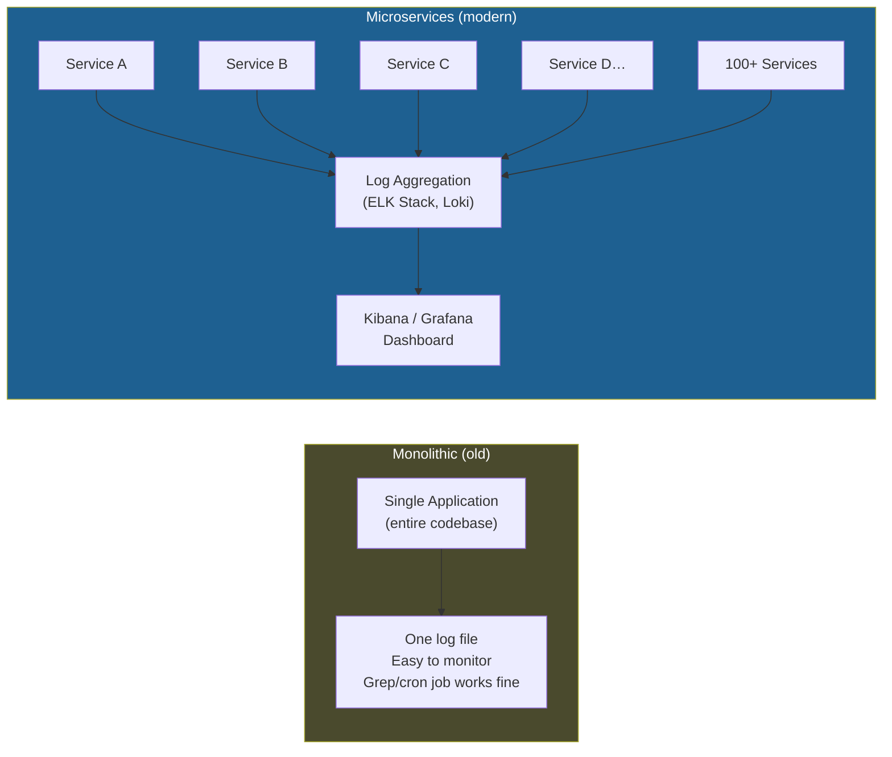
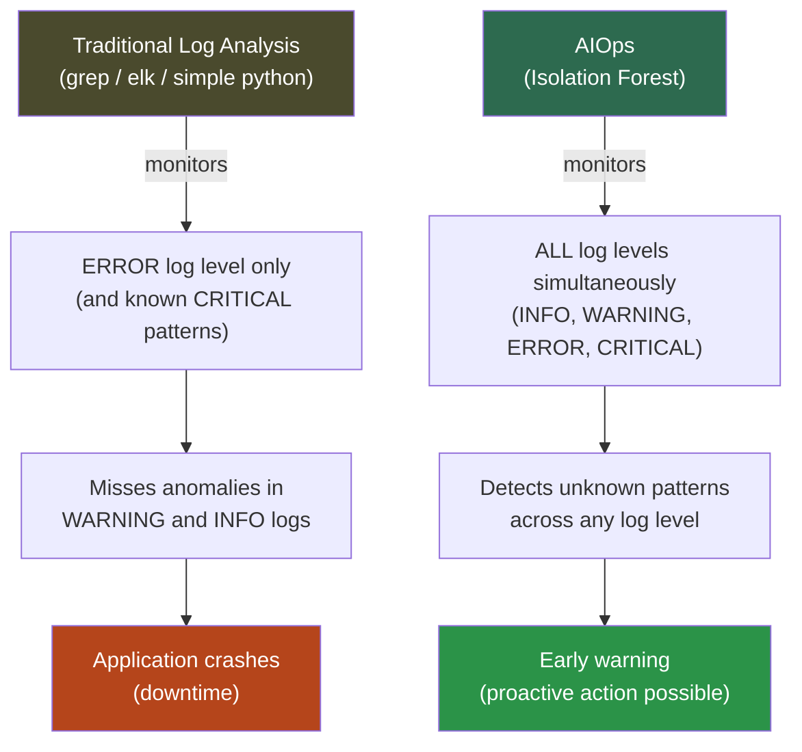
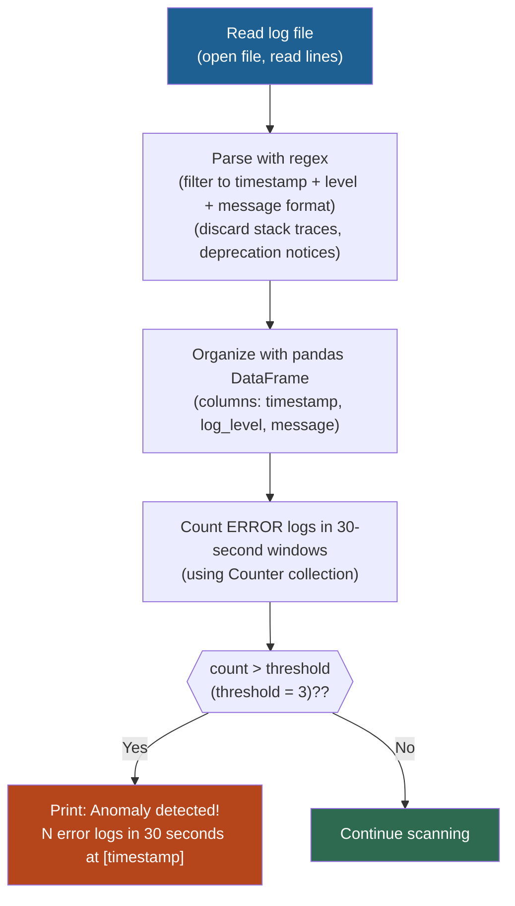
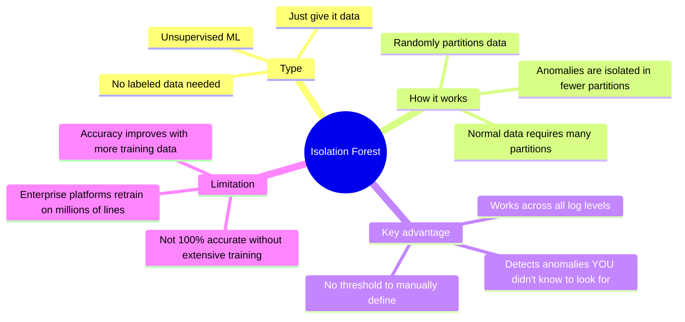
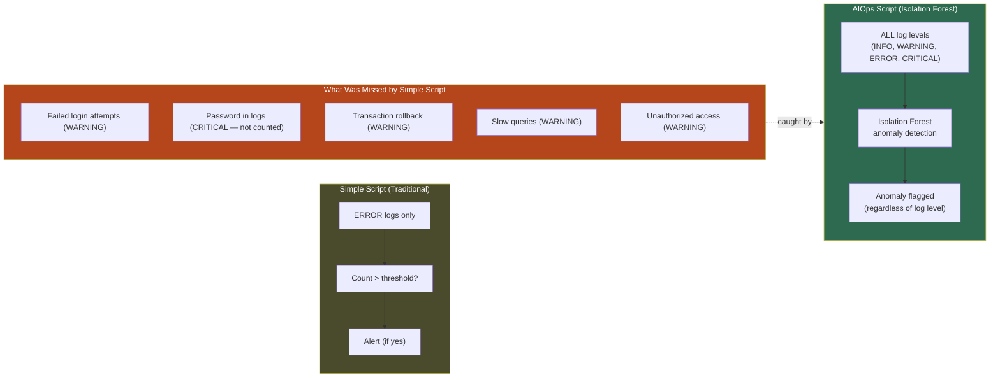

# Day 6: AIOps for Log Analysis — First AIOps Project using Python

<details open>
<summary><b>Day 6: AIOps for Log Analysis — First AIOps Project using Python (CS46H)</b></summary>

## Table of Contents

- [DAY-6: AIOps for Log Analysis](#day-6-aiops-for-log-analysis)
  - [Episode Overview](#episode-overview)
  - [Quick Recap: AIOps on Metrics](#quick-recap-aiops-on-metrics)
  - [Why Log Analysis Is an AIOps Problem](#why-log-analysis-is-an-aiops-problem)
    - [From Monolithic to Microservices — Scale Changes Everything](#from-monolithic-to-microservices--scale-changes-everything)
    - [The ELK Stack — Good, But Not Enough](#the-elk-stack--good-but-not-enough)
    - [The Critical Problem: Anomalies Hide in WARNING and INFO Logs](#the-critical-problem-anomalies-hide-in-warning-and-info-logs)
  - [Project Setup: Two Scripts, One Log File](#project-setup-two-scripts-one-log-file)
  - [Script 1: Traditional Log Analysis (`simple_log_analysis.py`)](#script-1-traditional-log-analysis-simple_log_analysispy)
    - [How It Works](#how-it-works)
    - [Code Walkthrough](#code-walkthrough)
    - [Running the Script](#running-the-script)
    - [Limitations of the Traditional Approach](#limitations-of-the-traditional-approach)
  - [Script 2: AIOps Log Analysis with Isolation Forest (`aiops_log_analysis.py`)](#script-2-aiops-log-analysis-with-isolation-forest-aiops_log_analysispy)
    - [What Is Isolation Forest?](#what-is-isolation-forest)
    - [Code Walkthrough](#code-walkthrough-1)
    - [Running the Script](#running-the-script-1)
    - [Anomalies Detected by Isolation Forest](#anomalies-detected-by-isolation-forest)
    - [The Key Insight: Log Level vs. Actual Severity](#the-key-insight-log-level-vs-actual-severity)
  - [DIY vs. Enterprise AIOps Accuracy](#diy-vs-enterprise-aiops-accuracy)
  - [Environment Setup Reference](#environment-setup-reference)
- [Summary](#summary)

---

## DAY-6: AIOps for Log Analysis

### Episode Overview

Day 6 continues the AIOps thread from Day 5, shifting from **metrics** to **logs** — the second pillar of observability. The episode builds a complete, working AIOps project from scratch: two Python scripts that analyze the same 1,000-line application log file using two different approaches.

**What you will build:**
- `system_logs.txt` — ~1,000 lines of application logs (INFO, WARNING, ERROR, CRITICAL)
- `simple_log_analysis.py` — traditional approach (pandas + regex + Counter, no ML)
- `aiops_log_analysis.py` — AIOps approach (pandas + Isolation Forest ML algorithm from scikit-learn)

All files are published to the `day6` folder in the course GitHub repository.

> [!NOTE]
> The instructor spent significant time testing multiple ML algorithms for anomaly detection before settling on Isolation Forest. It is considered the best open-source unsupervised ML algorithm for anomaly detection in log data. Enterprise platforms (Dynatrace, etc.) likely use the same or similar algorithms, trained on much larger datasets.

---

### Quick Recap: AIOps on Metrics

Day 5 covered AIOps applied to **metrics**. Quick recap visible in the Day 6 demo:

```
Dynatrace Davis demo (metrics recap):
  Orange lines = historical data (observed orders packed: ~26–28 per day)
  Green lines = AI-predicted data (future orders packed)

  Context as of recording: Today = March 27th
  Davis prediction:
    March 28th = orders packed (predicted)
    March 29th = orders packed (predicted)

  If Davis detects predicted orders of 200 (vs. usual 26–28):
    → Immediately sends notification OR triggers AI Agent action
```

Today's shift: from **metrics prediction** to **log anomaly detection**.

---

### Why Log Analysis Is an AIOps Problem

#### From Monolithic to Microservices — Scale Changes Everything



```diff
! Monolithic: one log file → grep/cron job/simple script is enough
+ Microservices: hundreds of services → hundreds of log streams
+ Aggregation solves the "where" problem, but not the "what to look for" problem
```

---

#### The ELK Stack — Good, But Not Enough

The standard modern approach to log management:


**What ELK does well:**
- Aggregates logs from all services into one searchable database
- Search for known errors: `kibana: search "404 not found"` → results from all applications
- Keyword-based alerting: "if this specific error occurs 10 times in one hour, alert SRE team"

**What ELK cannot do:**
- Detect UNKNOWN patterns (you can only alert on patterns you already know about)
- Identify anomalies that emerge from combinations of log events across time
- Detect degradation in WARNING/INFO logs that developers mislabeled

```diff
! ELK solves: "find all 404 errors across all services"
- ELK cannot solve: "detect unknown memory leak pattern appearing 60 times/minute in WARNING logs"
- ELK cannot solve: "detect response time degradation across INFO log messages"
+ AIOps (Isolation Forest) solves: finds patterns YOU didn't configure alerts for
```

---

#### The Critical Problem: Anomalies Hide in WARNING and INFO Logs

The most important concept in this episode:

> **A developer writes the log level. Developers frequently assign the wrong severity level. AIOps ignores what level the developer chose and detects the pattern anyway.**

**Scenario 1 — Memory Leak in WARNING logs:**
```
10:00:00 INFO  Service started
10:00:30 WARNING Memory usage: 45%
10:01:00 WARNING Memory usage: 47%
10:01:30 WARNING Memory usage: 49%
...                (repeated 60× per minute throughout the day)
23:55:00 CRITICAL Application running out of memory
00:00:00 ERROR  Application crashed — customer downtime

Problem: Memory leak warnings occurred 60×/minute all day.
         No traditional alert was configured for WARNING level.
         An engineer would not notice this pattern manually.
         AI detects it BEFORE the 23:55 CRITICAL fires.
```

**Scenario 2 — Response Time Degradation in INFO logs:**
```
09:00:00 INFO Response time: 10ms     ← normal
09:05:00 INFO Response time: 60ms     ← slightly elevated
09:10:00 INFO Response time: 1s       ← concerning
09:15:00 INFO Response time: 5s       ← customers starting to notice
09:20:00 INFO Response time: 25s      ← application effectively down

Traditional script (counts ERROR logs): misses this entirely
AIOps (Isolation Forest): detects the escalating pattern in INFO logs
```



---

### Project Setup: Two Scripts, One Log File

**Prerequisites:**
```bash
# Create a virtual environment (best practice — isolates dependencies)
python3 -m venv venv
source venv/bin/activate    # Linux/macOS
# venv\Scripts\activate     # Windows

# Install dependencies
pip install pandas           # for Script 1 (simple_log_analysis.py)
pip install scikit-learn     # for Script 2 (aiops_log_analysis.py)
```

**Project files (from course Day 6 GitHub folder):**

| File | Purpose |
|------|---------|
| `system_logs.txt` | ~1,000 lines of application logs (mix of INFO/WARNING/ERROR/CRITICAL) |
| `simple_log_analysis.py` | Traditional approach — no ML, counts errors above a threshold |
| `aiops_log_analysis.py` | AIOps approach — Isolation Forest ML for anomaly detection |

**Log file format (`system_logs.txt`):**
```
2024-03-27 09:00:00 INFO  Application started successfully
2024-03-27 09:00:15 WARNING Memory usage at 45%
2024-03-27 09:01:02 ERROR  Database connection timeout
2024-03-27 09:01:03 ERROR  Database connection timeout
2024-03-27 09:01:04 ERROR  Database connection timeout
2024-03-27 09:01:05 ERROR  Database connection timeout
2024-03-27 09:05:22 CRITICAL Password change: user=admin [password=<redacted>]
2024-03-27 09:10:11 WARNING Slow query detected: SELECT * FROM orders (8.2s)
...
```
Format: `{YYYY-MM-DD HH:MM:SS} {LEVEL} {message}`

---

### Script 1: Traditional Log Analysis (`simple_log_analysis.py`)

#### How It Works



#### Code Walkthrough

```python
import re
import pandas as pd
from collections import Counter

# Step 1: Read and parse the log file
log_entries = []
with open("system_logs.txt", "r") as f:
    for line in f:
        # Regex: filter only lines matching "YYYY-MM-DD HH:MM:SS LEVEL message"
        # Ignores: stack traces, deprecation notices, unstructured output
        match = re.match(
            r"(\d{4}-\d{2}-\d{2} \d{2}:\d{2}:\d{2})\s+(INFO|WARNING|ERROR|CRITICAL)\s+(.*)",
            line.strip()
        )
        if match:
            log_entries.append(match.groups())

# Step 2: Organize data with pandas DataFrame
df = pd.DataFrame(log_entries, columns=["timestamp", "log_level", "message"])

# Step 3: Count ERROR logs per 30-second window
threshold = 3
error_counts = Counter()

for _, row in df.iterrows():
    if row["log_level"] == "ERROR":
        # Group by 30-second window (truncate seconds to 30s boundaries)
        time_window = row["timestamp"][:-2] + "00"   # simplified
        error_counts[time_window] += 1

# Step 4: Check threshold and report
for time_window, count in error_counts.items():
    if count >= threshold:
        print(f"Anomaly detected: {count} error logs in 30 seconds at {time_window}")
```

> [!NOTE]
> **Why regex?** Application logs often contain stack traces (500+ lines each), deprecation notices, and unstructured output you don't want to analyze. The regex filter `r"(\d{4}-\d{2}-\d{2} \d{2}:\d{2}:\d{2})\s+(INFO|WARNING|ERROR|CRITICAL)\s+(.*)"` keeps only clean, structured log lines.

#### Running the Script

```bash
python3 simple_log_analysis.py
```

**Output:**
```
Anomaly detected: 4 error logs in 30 seconds at 2024-03-27 09:01:0
Anomaly detected: 4 error logs in 30 seconds at 2024-03-27 10:01:0
```

The script found two time windows where 4 consecutive ERROR logs occurred within 30 seconds — both times exceeding the threshold of 3.

#### Limitations of the Traditional Approach

```diff
- Only monitors ERROR log level (WARNING, INFO, CRITICAL are ignored)
- Threshold is human-defined: if threshold=3 is wrong, the entire script is wrong
!   Senior engineer: "3 errors is normal for our app" → must manually update threshold
- Cannot detect anomalies in INFO logs (e.g., escalating response time: 10ms → 25s)
- Cannot detect patterns across log levels (e.g., spike in WARNINGs before a crash)
- Every ERROR above threshold is flagged — no intelligence about whether it matters
- Does not learn from data; requires manual rule updates as the application evolves
```

| What the script finds | What the script misses |
|----------------------|------------------------|
| 4 ERROR logs in 30s | Memory leak in WARNING logs (repeated 60×/min) |
| 4 ERROR logs in 30s | Response time degradation in INFO logs |
| — | Failed login attempts logged as WARNING |
| — | Slow SQL query logged as WARNING |
| — | Unauthorized access attempts logged as WARNING |
| — | Transaction rollbacks (not in ERROR level) |

---

### Script 2: AIOps Log Analysis with Isolation Forest (`aiops_log_analysis.py`)

#### What Is Isolation Forest?

**Isolation Forest** is an **unsupervised machine learning algorithm** specifically designed for anomaly detection.



> [!NOTE]
> Isolation Forest is an unsupervised algorithm — you do NOT need to label your data as "normal" vs. "anomaly" beforehand. You simply provide the data, and the algorithm identifies what is statistically unusual. This is critical for log analysis because you often don't know in advance what patterns to look for.

**How Isolation Forest works (conceptual):**
```
Normal data points: require many partitions to isolate → "not anomalous"
Anomalous data points: isolated in very few partitions → "anomaly"

Intuition: An outlier is easier to separate from the rest of the data.
Isolation Forest exploits this property.
```

#### Code Walkthrough

```python
import re
import pandas as pd
from sklearn.ensemble import IsolationForest

# Steps 1-3: Same as simple_log_analysis.py
# (Read file → regex parse → pandas DataFrame with timestamp, log_level, message columns)

log_entries = []
with open("system_logs.txt", "r") as f:
    for line in f:
        match = re.match(
            r"(\d{4}-\d{2}-\d{2} \d{2}:\d{2}:\d{2})\s+(INFO|WARNING|ERROR|CRITICAL)\s+(.*)",
            line.strip()
        )
        if match:
            log_entries.append(match.groups())

df = pd.DataFrame(log_entries, columns=["timestamp", "log_level", "message"])

# ===== NEW: AIOps steps =====

# Step 4: Label encoding — tell Isolation Forest the priority of each log level
# (The algorithm doesn't understand "WARNING" vs "ERROR" as text)
level_map = {"INFO": 1, "WARNING": 2, "ERROR": 3, "CRITICAL": 4}
df["level_numeric"] = df["log_level"].map(level_map)

# Step 5: Initialize and train Isolation Forest
# contamination=0.1 → tell the algorithm to expect ~10% of logs are anomalies
# (Lower value = more thorough analysis; higher value = more false positives)
model = IsolationForest(contamination=0.1, random_state=42)

# Step 6: Fit (train) and predict
df["anomaly"] = model.fit_predict(df[["level_numeric"]])
# Returns: -1 for anomaly, 1 for normal

# Step 7: Display results
for _, row in df.iterrows():
    if row["anomaly"] == -1:
        print(f"❌ ANOMALY | {row['timestamp']} | {row['log_level']} | {row['message']}")
    else:
        print(f"✅ Normal  | {row['timestamp']} | {row['log_level']} | {row['message']}")
```

**Key parameters explained:**

| Parameter | Value Used | Meaning |
|-----------|-----------|---------|
| `contamination` | `0.1` | Expect ~10% of logs to be anomalies; lower = stricter anomaly detection |
| `random_state` | `42` | Ensures reproducible results |
| Level encoding | INFO=1, WARNING=2, ERROR=3, CRITICAL=4 | Teaches the algorithm relative severity |

> [!IMPORTANT]
> **Why label encoding?** Isolation Forest works on numeric data. The text values "INFO", "WARNING", "ERROR", "CRITICAL" must be converted to numbers so the algorithm can mathematically compare them. The encoding (1–4) teaches the algorithm that CRITICAL is more severe than INFO, preserving the ordinal relationship.

#### Running the Script

```bash
pip install scikit-learn   # one-time install
python3 aiops_log_analysis.py
```

#### Anomalies Detected by Isolation Forest

The AIOps script detected the following anomalies — most of which the simple script **completely missed**:

| # | Log Level | Message | Why It's an Anomaly | Detected by simple script? |
|---|-----------|---------|--------------------|-----------------------------|
| 1 | WARNING | Multiple failed login attempts — user authentication | Security concern: brute force pattern | ❌ No |
| 2 | CRITICAL | User password change (password visible in log) | Security risk: credential exposure in logs | ❌ No (CRITICAL level ignored) |
| 3 | WARNING | Transaction rolled back | Data integrity concern | ❌ No |
| 4 | WARNING | Slow query detected: `SELECT * FROM orders` (8.2s) | Performance degradation | ❌ No |
| 5 | WARNING | Slow query detected again | Repeated performance issue | ❌ No |
| 6 | WARNING | Unauthorized access attempt | Security alert logged as WARNING | ❌ No |

**The simple script only found:**
- 4 ERROR logs in 30 seconds (detected twice)

**Isolation Forest found:** All 6 anomalies above, including all the WARNING-level issues that a reactive script would completely ignore.

---

#### The Key Insight: Log Level vs. Actual Severity

```diff
! Developer-assigned log level ≠ actual business severity
!
! Example from the demo:
- "Multiple failed login attempts" → logged as WARNING
+ Multiple failed login attempts = potential brute force attack = CRITICAL business risk
!
! Why this happens:
- Developers write log levels while focused on functionality, not operations
- They may not know what "operationally significant" looks like for their component
- Log level standards vary across teams
- Some developers default everything to WARNING to avoid noise
!
! What AIOps does:
+ Ignores the developer's opinion about log level
+ Analyzes the DATA PATTERN independent of level
+ "I told you INFO=1 and WARNING=2, but I found something unusual in the WARNING cluster"
+ Detects anomalies that cross log level boundaries
```



---

### DIY vs. Enterprise AIOps Accuracy

```diff
+ This script was written in 1–2 days for educational purposes
+ It uses Isolation Forest with default parameters and minimal training
!
! Enterprise AIOps accuracy comparison:
!
- DIY script: ~1,000 lines of training data, basic label encoding, no retraining
+ Enterprise (e.g., Dynatrace): millions of log lines, continuous retraining, custom model parameters
!
! Same algorithm (likely Isolation Forest or similar), vastly different accuracy
! because of:
  - Volume: millions of lines vs. 1,000 lines
  - Training: continuous retraining as app behavior changes
  - Parameters: tuned contamination, feature engineering, multi-dimensional inputs
  - Integration: combines metrics + logs + traces (not just one data stream)
```

| Factor | DIY Script | Enterprise Platform |
|--------|-----------|---------------------|
| Training data | ~1,000 lines | Millions of lines |
| Retraining | Manual (never) | Continuous |
| Algorithm | Isolation Forest (default) | Isolation Forest (fine-tuned) |
| Feature inputs | Log level (numeric) | Level + timestamp + frequency + message content + metrics |
| Contamination tuning | Fixed at 0.1 | Auto-tuned per service |
| Accuracy | Educational | Production-grade |

---

### Environment Setup Reference

```bash
# Full setup for Day 6 project

# 1. Clone/download course repository, navigate to day6/
cd day6

# 2. Create virtual environment
python3 -m venv venv

# 3. Activate it
source venv/bin/activate          # Linux/macOS
# venv\Scripts\activate           # Windows (PowerShell)

# 4. Install dependencies
pip install pandas                 # for simple_log_analysis.py
pip install scikit-learn           # for aiops_log_analysis.py

# 5. Run traditional script
python3 simple_log_analysis.py

# 6. Run AIOps script
python3 aiops_log_analysis.py
```

---

## Summary

### Key Takeaways

```diff
+ Day 6 applies AIOps to the second pillar of observability: LOGS (Day 5 covered metrics)
+ Traditional log analysis (ELK + custom scripts) is a reactive approach for KNOWN patterns
+ AIOps log analysis uses Isolation Forest to detect UNKNOWN anomalies proactively
+ Critical insight: log levels assigned by developers are unreliable — anomalies hide in WARNING/INFO
+ Isolation Forest is unsupervised — no labeled data needed; just provide the data
+ contamination=0.1 tells the algorithm to expect ~10% anomalies; lower = stricter detection
+ Label encoding (INFO=1, WARNING=2, ERROR=3, CRITICAL=4) teaches the algorithm severity order
+ Simple script detected: 2 occurrences of 4 ERROR logs in 30 seconds
+ AIOps script detected: 6 anomalies including failed logins, slow queries, unauthorized access — all WARNING level
! The same algorithm used by enterprise platforms (Isolation Forest); DIY just lacks training volume
- Open-source AIOps accuracy is lower than enterprise because of less training data and no fine-tuning
```

### Quick Reference — Two Scripts Side by Side

| Aspect | `simple_log_analysis.py` | `aiops_log_analysis.py` |
|--------|--------------------------|-------------------------|
| Libraries | `pandas`, `re`, `collections` | `pandas`, `re`, `sklearn.IsolationForest` |
| Approach | Rule-based threshold counting | Unsupervised ML anomaly detection |
| Log levels monitored | ERROR only | ALL (INFO, WARNING, ERROR, CRITICAL) |
| Threshold | Human-defined (3 errors/30s) | Algorithm-defined (contamination=0.1) |
| Unknown patterns | Cannot detect | Detects automatically |
| Accuracy | Depends on correct threshold | Depends on training data volume |
| Complexity | Low | Medium (+ ML concepts) |
| Best for | Known error patterns at scale | Unknown anomalies; cross-level detection |

### Quick Reference — Isolation Forest Parameters

```python
from sklearn.ensemble import IsolationForest

model = IsolationForest(
    contamination=0.1,     # ~10% of data expected to be anomalies; LOWER = stricter
    random_state=42        # reproducible results
)

# Label encoding required before fitting
level_map = {"INFO": 1, "WARNING": 2, "ERROR": 3, "CRITICAL": 4}

model.fit_predict(X)   # returns: -1 = anomaly, +1 = normal
```

### Expert Insight

**Real-World Application:**
In a production SRE environment, this script would be deployed as a Kubernetes CronJob or a Lambda function triggered by a log stream (via CloudWatch, Kinesis, or Kafka). The log file would be replaced with a real-time log stream from ELK or Loki. The `print` statements would be replaced with PagerDuty/Slack API calls. The Isolation Forest model would be periodically retrained on the last 30 days of logs and stored as a serialized model file (using `joblib.dump`/`joblib.load`).

**Expert Path:**
1. Run both scripts against the course `system_logs.txt` file and compare every single output line — this builds intuition for why the simple script misses so much
2. Modify `contamination` from 0.1 to 0.05, 0.2, 0.3 and observe how the number of detected anomalies changes — this is the most important tuning parameter in Isolation Forest
3. Add a second numeric feature to the model: log message length (longer messages often indicate stack traces or complex errors) — re-run and see if anomaly detection improves
4. Replace the `print` statements in `aiops_log_analysis.py` with a Slack webhook notification (using the `requests` library) — this makes the script production-deployable
5. Research `joblib.dump(model, 'aiops_model.pkl')` — understand how to serialize the trained Isolation Forest model so you don't retrain on every run

**Common Pitfalls:**
- **Setting contamination too high:** If `contamination=0.5`, the algorithm considers 50% of your logs anomalous — nearly useless; start at 0.05 and increase if too few anomalies are detected
- **Not creating a virtual environment:** Installing pandas and scikit-learn globally can conflict with other Python projects; always use `venv` for isolation
- **Trusting log levels from developers:** The entire point of AIOps log analysis is that WARNING/INFO can contain the most critical operational signals — never filter by log level before feeding to the ML model
- **Assuming this script is production-accurate:** With 1,000 lines of training data, this is educational. For production, the model needs weeks or months of historical logs to train on meaningful patterns
- **Ignoring the virtual environment activation:** Running `python3` without activating the venv will use system Python and fail with "No module named pandas/sklearn"; always activate with `source venv/bin/activate`
- **Not handling log file encoding:** Real-world log files may contain UTF-8 BOM or non-ASCII characters; use `open(file, "r", encoding="utf-8", errors="ignore")` in production
- **Missing the regex requirement:** Without the regex filter, stack traces (potentially 500 lines each) pollute the DataFrame with unstructured data that confuses the ML model; the regex is not optional

**Additional Technical Notes:**
- **Why pandas DataFrame?** The structured format (columns: timestamp, log_level, message) enables vectorized operations, easy filtering, and clean data feeding into sklearn. Without it, you'd write much more imperative Python to achieve the same.
- **Why unsupervised learning?** You cannot pre-label 1,000 log lines as "anomaly" vs. "normal" — you don't know which is which. Unsupervised learning discovers the structure in unlabeled data. This is why supervised algorithms (like Random Forest with labeled data) don't work well here.
- **Why Isolation Forest over other unsupervised algorithms?** The instructor tested multiple open-source ML algorithms for this use case and found Isolation Forest performed best. Alternatives (LOF, DBSCAN, Autoencoder) were either less accurate or more computationally expensive for this type of sequential log data.
- **The `fit_predict` method:** In scikit-learn, `fit_predict` combines the training step (fitting the model to data) and the inference step (predicting anomaly labels) in a single call. This is standard for unsupervised anomaly detection where you train and score on the same dataset.
- **Output encoding:** `-1` = anomaly, `+1` = normal. This is a scikit-learn convention for anomaly detection algorithms. The display symbols (❌ for anomaly, ✅ for normal) are for human readability only.

> [!IMPORTANT]
> **Transcript Corrections Applied (CS46H pass):**
> - "abishek" → "Abhishek" (throughout)
> - "dinat TR / din TR / Diner TR / din tray" → "Dynatrace"
> - "aops / a Ops / aob / a ob" → "AIOps"
> - "absorbability / observ ility" → "observability"
> - "animaly / animales / anim / animo" → "anomaly / anomalies"
> - "Sr / Sr team / srd" → "SRE / SRE team"
> - "pyate" → "scikit-learn" (the second Python library used, alongside pandas)
> - "psychic learn" → "scikit-learn" (pip install command)
> - "loog stash / log stash" → "Logstash"
> - "isolation format" → "Isolation Forest" (ML algorithm name)
> - "elk stag / elk stag" → "ELK stack"
> - "regx" → "regex"
> - "select star" → "SELECT *" (SQL syntax)
> - "cross symbol forward by" → "❌ (anomaly marker) followed by"
> - "right symbol" → "✅ (normal marker)"
> - "T4 T2" → "regex groups for 4-digit year, 2-digit month/day"
> - "infr log" → "INFO log"
> - "fur Loop / wile loop" → "for loop / while loop"
> - "pager Duty" → "PagerDuty"
> - "devops in engers" → "DevOps engineers"
> - "grip command" → "grep command"

</details>
