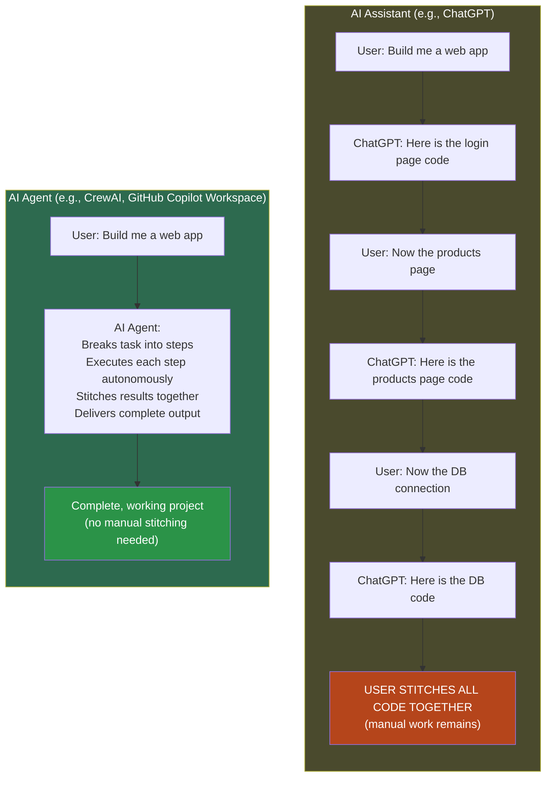
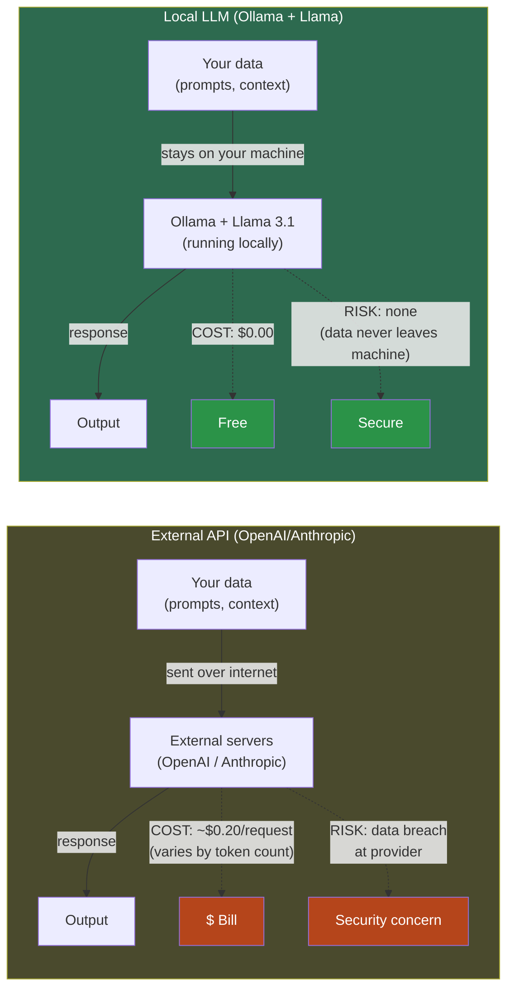
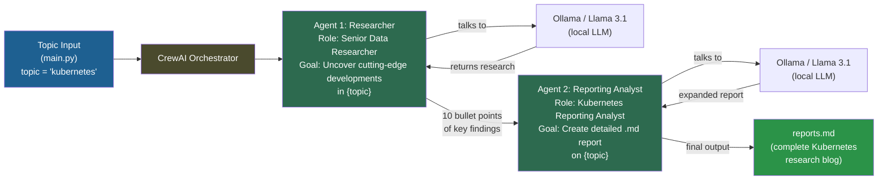
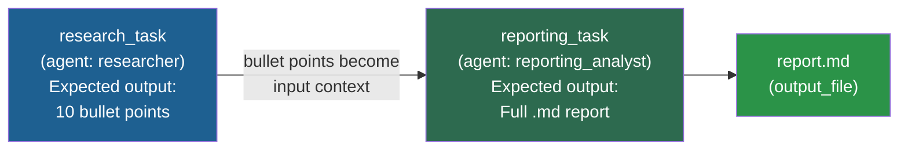
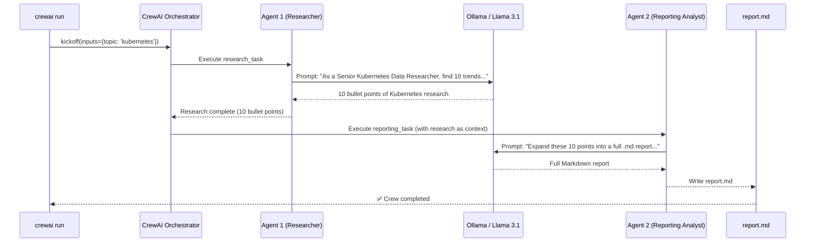
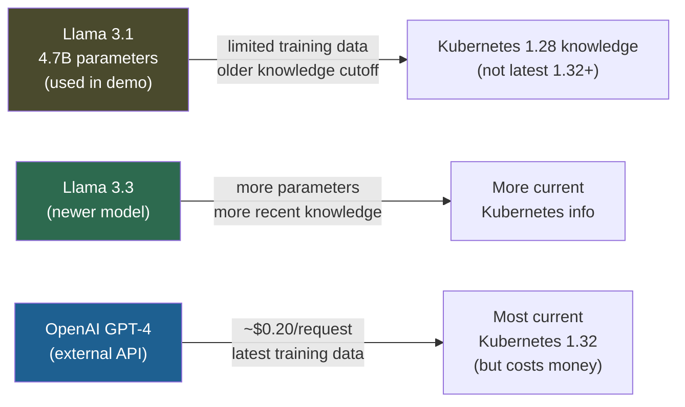

# Day 7: Create your First AI Agent with Zero Coding and Zero Cost

<details open>
<summary><b>Day 7: Create your First AI Agent with Zero Coding and Zero Cost (CS46H)</b></summary>

## Table of Contents

- [DAY-7: Create your First AI Agent](#day-7-create-your-first-ai-agent)
  - [Episode Overview](#episode-overview)
  - [AI Assistant vs. AI Agent — The Fundamental Distinction](#ai-assistant-vs-ai-agent--the-fundamental-distinction)
  - [Open-Source Agent Frameworks](#open-source-agent-frameworks)
    - [Why Use a Framework?](#why-use-a-framework)
    - [Why Local LLMs Instead of OpenAI APIs?](#why-local-llms-instead-of-openai-apis)
  - [Today's Project: Kubernetes Research Report](#todays-project-kubernetes-research-report)
    - [Two-Agent Architecture](#two-agent-architecture)
  - [Setup: Environment and Installation](#setup-environment-and-installation)
  - [Project Structure (Auto-Generated by CrewAI)](#project-structure-auto-generated-by-crewai)
  - [Configuring the Agents — `agents.yaml`](#configuring-the-agents--agentsyaml)
  - [Configuring the Tasks — `tasks.yaml`](#configuring-the-tasks--tasksyaml)
  - [The Only File You Edit — `main.py`](#the-only-file-you-edit--mainpy)
  - [The Orchestration File — `crew.py` (Do Not Modify)](#the-orchestration-file--crewpy-do-not-modify)
  - [Running the Project](#running-the-project)
  - [Demo Output and Accuracy Considerations](#demo-output-and-accuracy-considerations)
- [Summary](#summary)

---

## DAY-7: Create your First AI Agent

### Episode Overview

Day 7 introduces **AI agents** — what they are, how they differ from AI assistants (ChatGPT), and how to build a real multi-agent project using **CrewAI** and a local LLM (Llama 3.1 via Ollama) with zero cost and zero external API calls.

**What you will build:**
- A two-agent CrewAI project that researches the latest Kubernetes trends and generates a formatted Markdown report
- Agent 1 (Researcher): researches and returns 10 bullet points of relevant findings
- Agent 2 (Reporting Analyst): expands those points into a complete blog-style `.md` file

**Skills covered:**
- AI assistant vs. AI agent distinction
- Open-source agent frameworks: AutoGen, LangGraph, CrewAI
- Why local LLMs (no cost, no data leaves the machine)
- CrewAI project scaffolding (`crewai create crew`)
- `agents.yaml` and `tasks.yaml` configuration
- `main.py` topic customization
- `crew.py` orchestration (read-only)
- `crewai install` and `crewai run` workflow
- Output: `reports.md` — auto-generated research report

All project files are published to the `day7` folder in the course GitHub repository.

---

### AI Assistant vs. AI Agent — The Fundamental Distinction

This is the most important conceptual distinction in the episode:



```diff
! AI Assistants:
- Cannot implement a task on your behalf
- You must break the request into multiple conversational steps
- You must manually stitch the outputs together
- Result: significant human effort remains after every interaction

+ AI Agents:
+ Implement the task on your behalf autonomously
+ Break down complex tasks internally without user intervention
+ Can create sub-agents to unblock themselves if stuck
+ Examples: Bolt.new (web app generation), GitHub Copilot Workspace (EKS cluster + Terraform)
```

**Real examples of agent capability demonstrated in prior episodes:**
| Agent | Task Demonstrated | Human effort required |
|-------|-------------------|----------------------|
| Bolt.new | Complete web application (full stack) | Just describe the requirement |
| GitHub Copilot Workspace | EKS cluster creation in VPC with Terraform | Just describe the infrastructure |
| CrewAI (today) | Kubernetes research report with 10-point summary | Just specify the topic |

> [!NOTE]
> When an agent gets stuck mid-task, sophisticated agents can create a sub-agent whose sole job is to research how to unblock the primary agent. Once unblocked, the primary agent resumes. This self-healing capability is what makes agents "autonomous" rather than just "automated."

---

### Open-Source Agent Frameworks

#### Why Use a Framework?

Rather than building agent orchestration from scratch, use an open-source framework:

| Framework | Maintained By | Key Strength |
|-----------|--------------|-------------|
| **AutoGen** | Microsoft | Multi-agent conversation patterns; strong research tasks |
| **LangGraph** | LangChain | State-machine style agent graphs; complex branching |
| **CrewAI** | CrewAI (OSS) | Simple YAML-based config; research + reporting patterns; used today |

**Two key advantages all frameworks share:**
1. Provide the orchestration layer (agent creation, task routing, output chaining)
2. **Support local LLMs** — no dependency on paid external APIs

#### Why Local LLMs Instead of OpenAI APIs?



```diff
+ Local LLMs via Ollama:
+ Zero cost — no API billing, no token charges
+ Zero data exposure — your prompts and context never leave your machine
+ Works offline — no internet dependency during agent execution

- Trade-off:
- Older models (Llama 3.1 = 4.7B parameters) have less current knowledge
- Slower inference if running on CPU (no GPU acceleration)
- Less accuracy than OpenAI GPT-4 / Claude for complex reasoning

! For learning and demos: local models are the right choice (free + private)
! For production with latest information: use OpenAI or Anthropic APIs
```

---

### Today's Project: Kubernetes Research Report

**Business scenario:** Your organization needs to research the latest Kubernetes trends and publish a technical blog or internal report. Normally this is a task for a senior Kubernetes engineer or technical writer — it takes hours.

**With CrewAI agents:** Automated in minutes.

#### Two-Agent Architecture



**Why two agents instead of one?**
- Separation of concerns: one agent specializes in research, another in writing
- Each agent is given a specific role, goal, and backstory that shapes its LLM prompts
- The researcher produces structured bullet points; the analyst expands them into prose
- This mirrors a real team: researcher → technical writer

---

### Setup: Environment and Installation

**Prerequisites:**
- Python between **3.10 and 3.13** (CrewAI requirement — other versions cause incompatibility)
- Ollama installed and running (from Day 3)
- Llama 3.1 pulled via Ollama (from Day 3)

```bash
# Verify Python version (must be 3.10–3.13)
python3 --version

# Verify Ollama and Llama 3.1 are available
ollama list

# If Llama 3.1 is not available, pull it
ollama pull llama3.1

# Step 1: Create project directory
mkdir crew_example
cd crew_example

# Step 2: Create virtual environment
python3 -m venv crew

# Step 3: Activate virtual environment
source crew/bin/activate          # Linux/macOS
# crew\Scripts\activate           # Windows

# Step 4: Install CrewAI
pip install crewai

# Step 5: Scaffold the project (select Ollama + Llama 3.1 when prompted)
crewai create crew devops_ai_project

# Step 6: Navigate into the generated project
cd devops_ai_project

# Step 7: Install project dependencies (creates uv.lock)
crewai install

# Step 8: Run the agents
crewai run
```

**During `crewai create crew devops_ai_project`:**
- Select LLM provider: **Ollama** (option 6)
- Select model: **llama3.1** (already available from Day 3)

> [!NOTE]
> `crewai install` uses `uv` (a fast Python package manager) under the hood. It creates a `uv.lock` file that pins all dependency versions for reproducibility — similar to `package-lock.json` in Node.js.

---

### Project Structure (Auto-Generated by CrewAI)

Running `crewai create crew devops_ai_project` generates this complete project structure:

```
devops_ai_project/
├── .gitignore                          ← version control exclusions
├── README.md                           ← project documentation
├── pyproject.toml                      ← project metadata + dependencies
├── uv.lock                             ← created on crewai install (pinned deps)
└── src/
    └── devops_ai_project/
        ├── config/
        │   ├── agents.yaml             ← EDIT: agent roles, goals, backstories
        │   └── tasks.yaml              ← EDIT: task descriptions, expected output
        ├── crew.py                     ← DO NOT MODIFY (orchestration decorators)
        ├── main.py                     ← EDIT: only the topic input
        └── tools/                      ← custom tools (advanced — not used today)
```

**Files you modify for a new research topic:**

| File | What to change | Example |
|------|---------------|---------|
| `main.py` | The `topic` input value | `"kubernetes"` → `"docker"` |
| `agents.yaml` | Agent roles, goals, backstories (optional) | Change researcher persona |
| `tasks.yaml` | Task descriptions and expected output (optional) | Change output format |

**Files you never modify:**

| File | Why |
|------|-----|
| `crew.py` | Auto-generated orchestration; uses Python decorators `@agent`, `@task` |
| `pyproject.toml` | Managed by CrewAI tooling |
| `uv.lock` | Auto-generated on `crewai install` |

---

### Configuring the Agents — `agents.yaml`

CrewAI auto-generates two default agents for research tasks — a researcher and a reporting analyst. The `{topic}` placeholder is filled at runtime from `main.py`.

```yaml
# src/devops_ai_project/config/agents.yaml

researcher:
  role: >
    {topic} Senior Data Researcher
  goal: >
    Uncover cutting-edge developments in {topic}
  backstory: >
    You are a seasoned researcher with a knack for uncovering the latest
    developments in {topic}. Known for your ability to find the most
    relevant information and present it in a clear and concise manner.

reporting_analyst:
  role: >
    {topic} Reporting Analyst
  goal: >
    Create detailed reports based on {topic} research and findings
  backstory: >
    You are a meticulous analyst with a keen eye for detail. You are known
    for your ability to turn complex data into clear and concise reports,
    making it easy for others to understand and act on the information
    you provide.
```

**How these fields work:**

| Field | Purpose | Example value for Kubernetes topic |
|-------|---------|-------------------------------------|
| `role` | Shapes the LLM's "persona" for this agent | "Kubernetes Senior Data Researcher" |
| `goal` | Tells the agent what it is trying to achieve | "Uncover cutting-edge developments in Kubernetes" |
| `backstory` | Additional context framing the agent's expertise | "Seasoned researcher known for finding relevant info..." |

> [!NOTE]
> These fields are essentially system prompts for the LLM powering each agent. The richer and more specific the backstory, the more focused the agent's output tends to be. You can customize these for any domain: security research, compliance auditing, competitive analysis, etc.

---

### Configuring the Tasks — `tasks.yaml`

Each agent has a corresponding task definition. Tasks specify what the agent should do and what output is expected.

```yaml
# src/devops_ai_project/config/tasks.yaml

research_task:
  description: >
    Conduct a thorough research about {topic}.
    Make sure you find any interesting and relevant information given
    the current year is 2025.
  expected_output: >
    A list with 10 bullet points of the most relevant information about {topic}.
  agent: researcher

reporting_task:
  description: >
    Review the context you got and expand each topic into a full section for a report.
    Make sure the report is detailed and contains any and all relevant information.
  expected_output: >
    A fully fledged report with the main topics, each with a full section of information.
    Formatted as markdown without '```'.
  output_file: report.md
  agent: reporting_analyst
```

**How tasks chain together:**


**Customization examples:**

| Use case | Change in `tasks.yaml` |
|----------|------------------------|
| Produce Excel instead of Markdown | `expected_output: "A CSV formatted report..."` |
| More bullet points | Change "10 bullet points" to "20 bullet points" |
| Different research year | Change "2025" to the current year |
| Security audit instead of research | Change description to "Audit security practices for {topic}..." |

---

### The Only File You Edit — `main.py`

`main.py` is the entry point. The only change needed for a new research topic is the `topic` input value.

```python
# src/devops_ai_project/main.py (simplified)

def run():
    """Run the crew."""
    inputs = {
        'topic': 'kubernetes'    # ← ONLY CHANGE THIS LINE for a different topic
    }
    DevopsAiProjectCrew().crew().kickoff(inputs=inputs)
```

**Changing the topic is all that is required to research any subject:**
```python
# Research Docker instead of Kubernetes
'topic': 'docker'

# Research CI/CD pipelines
'topic': 'CI/CD pipelines'

# Research anything outside DevOps
'topic': 'machine learning operations (MLOps)'
```

The `{topic}` placeholder in `agents.yaml` and `tasks.yaml` is automatically replaced with this value at runtime.

---

### The Orchestration File — `crew.py` (Do Not Modify)

`crew.py` contains the Python decorators that wire agents and tasks together. CrewAI generates this automatically — do not modify it unless adding new agents or tasks.

```python
# src/devops_ai_project/crew.py (auto-generated, do not modify)

from crewai import Agent, Crew, Process, Task
from crewai.project import CrewBase, agent, crew, task

@CrewBase
class DevopsAiProjectCrew():
    """DevopsAiProject crew"""

    @agent
    def researcher(self) -> Agent:
        return Agent(
            config=self.agents_config['researcher'],
            verbose=True
        )

    @agent
    def reporting_analyst(self) -> Agent:
        return Agent(
            config=self.agents_config['reporting_analyst'],
            verbose=True
        )

    @task
    def research_task(self) -> Task:
        return Task(
            config=self.tasks_config['research_task'],
        )

    @task
    def reporting_task(self) -> Task:
        return Task(
            config=self.tasks_config['reporting_task'],
            output_file='report.md'
        )

    @crew
    def crew(self) -> Crew:
        return Crew(
            agents=self.agents,
            tasks=self.tasks,
            process=Process.sequential,
            verbose=True,
        )
```

**Key concepts in `crew.py`:**

| Decorator | Purpose |
|-----------|---------|
| `@CrewBase` | Marks the class as a CrewAI project; auto-loads `agents.yaml` and `tasks.yaml` |
| `@agent` | Marks a method as returning an Agent; config is loaded from `agents.yaml` by name |
| `@task` | Marks a method as returning a Task; config is loaded from `tasks.yaml` by name |
| `@crew` | Marks the method that assembles and returns the complete Crew |
| `Process.sequential` | Tasks run in order (research → reporting); other option: `Process.hierarchical` |

---

### Running the Project

```bash
# From inside devops_ai_project/ with virtual environment activated

# First-time setup (installs deps, creates uv.lock)
crewai install

# Run the agents
crewai run
```

**What happens during `crewai run`:**



**Execution time:** Running on CPU (no GPU) takes significantly longer than GPU-accelerated inference. Be patient — the agents are calling the local LLM multiple times.

**Terminal output during run:**
```
[2025-XX-XX] Starting Task: research_task
  Status: Executing... (in progress)
  Agent: Kubernetes Senior Data Researcher
[2025-XX-XX] Starting Task: reporting_task
  Status: Executing... (in progress)
  Agent: Kubernetes Reporting Analyst
[2025-XX-XX] Crew complete ✓
```

**Finding the output:**
```bash
cat report.md        # view raw Markdown
# OR paste content into an online Markdown editor for rendered view
```

---

### Demo Output and Accuracy Considerations

The demo generated a `reports.md` titled "2025 Kubernetes Report" — a formatted Markdown blog post with sections on Kubernetes trends.

**Why the information may be outdated:**



| LLM Choice | Cost | Data Freshness | Security | Best For |
|-----------|------|----------------|---------|----------|
| **Llama 3.1 (local)** | Free | Older (training cutoff) | ✅ Private | Learning, demos |
| **Llama 3.3 (local)** | Free | More recent | ✅ Private | Better demo accuracy |
| **OpenAI API** | ~$0.20/req | Latest | ⚠️ External | Production, latest info needed |

```diff
! For the purposes of learning how agents work:
+ Local models are the correct choice — zero cost, zero security risk
+ The accuracy of the content is secondary to understanding the agent mechanics

! Key insight: changing the model in CrewAI is one line in the config
! crewai create crew → select different provider → same YAML, same architecture
```

> [!NOTE]
> Llama 3.1 available via `ollama list` in the demo is the 4.7B parameter variant. More parameters generally means better reasoning and more current knowledge. If your machine has sufficient RAM (32GB+), try pulling `llama3.3` for better results: `ollama pull llama3.3`.

---

## Summary

### Key Takeaways

```diff
+ AI Agents vs. Assistants: Agents IMPLEMENT tasks autonomously; assistants respond conversationally
+ Assistants require the user to stitch outputs together; agents deliver the final result end-to-end
+ Open-source frameworks (AutoGen, LangGraph, CrewAI) enable agent development without enterprise licensing
+ CrewAI + Ollama = zero-cost, zero-data-exposure agent development using local LLMs
+ CrewAI scaffolds the entire project: crewai create crew → generates agents.yaml, tasks.yaml, crew.py, main.py
+ agents.yaml = agent definitions (role, goal, backstory) — shapes each agent's LLM persona
+ tasks.yaml = task definitions (description, expected_output) — tells each agent what to do
+ main.py = only file to modify for a new research topic (change the topic input value)
+ crew.py = orchestration via Python decorators (@agent, @task, @crew) — do not modify
+ Two-agent flow: Researcher → 10 bullet points → Reporting Analyst → full report.md
+ crewai install (sets up deps, creates uv.lock) → crewai run (executes the agents)
! Local LLM trade-off: older knowledge cutoff vs. OpenAI API (more current but costs ~$0.20/request)
- Llama 3.1 (4.7B parameters) shows older Kubernetes info; Llama 3.3 or OpenAI gives more current data
```

### Quick Reference — CrewAI Commands

```bash
# Install CrewAI
pip install crewai

# Scaffold a new project (interactive: select Ollama → llama3.1)
crewai create crew <project_name>

# Install project dependencies
cd <project_name>
crewai install

# Run the agents
crewai run

# Check available local models
ollama list

# Pull a newer Llama model for better accuracy
ollama pull llama3.3
```

### Quick Reference — File Roles

| File | Role | Edit? |
|------|------|-------|
| `config/agents.yaml` | Agent personas (role, goal, backstory) | Yes — customize for your domain |
| `config/tasks.yaml` | Task instructions and expected output | Yes — customize output format |
| `main.py` | Entry point — sets the topic input | Yes — change `topic` value only |
| `crew.py` | Orchestration decorators | No — auto-generated |
| `pyproject.toml` | Project metadata | No — managed by CrewAI |
| `uv.lock` | Pinned dependencies | No — auto-generated by `crewai install` |

### Expert Insight

**Real-World Application:**
The two-agent research → report pattern from this episode is directly applicable to real DevOps/SRE workflows: (1) competitive analysis of cloud providers, (2) CVE research and security advisory generation, (3) post-incident report drafting from log summaries, (4) documentation generation from code comments. In each case, you swap out the `topic` in `main.py` and adjust the agent backstories and task descriptions in the YAML files. The architecture stays identical.

**Expert Path:**
1. Run the demo as-is (Kubernetes topic) to understand the basic flow — observe the terminal output carefully to see when Agent 1 hands off to Agent 2
2. Change the topic to something you personally need researched (Docker, Helm, Argo CD, OpenTelemetry) — run it again and compare quality
3. Read the CrewAI documentation for `Process.hierarchical` — this enables a "manager" agent that routes subtasks to worker agents dynamically (vs. `Process.sequential` used today)
4. Experiment with adding a third agent to `agents.yaml` (e.g., a `fact_checker` agent that validates the researcher's findings before the reporting analyst writes the report)
5. Try configuring the same project to use OpenAI instead of Ollama — compare output quality and cost per run

**Common Pitfalls:**
- **Wrong Python version:** CrewAI requires Python 3.10–3.13. If you use 3.9 or 3.14, you will get dependency incompatibility errors. Check with `python3 --version` before starting.
- **Ollama not running:** `crewai run` will hang or fail if Ollama is not running in the background. On macOS, the Ollama app must be open. On Linux, run `ollama serve` in a separate terminal.
- **Not activating the virtual environment:** Running `crewai run` outside the activated venv will use the wrong Python/package environment and fail with import errors.
- **Modifying `crew.py`:** The `@agent`, `@task`, and `@crew` decorators work by convention — the method name must exactly match the key in `agents.yaml` / `tasks.yaml`. Renaming methods in `crew.py` without updating the YAML breaks the wiring.
- **Expecting real-time web search:** Llama 3.1 (local) does not have internet access. Its knowledge is frozen at its training cutoff. CrewAI agents using local LLMs cannot browse the web unless you add a search tool (e.g., the `SerperDevTool` for Google search, which requires an API key).
- **Slow execution on CPU:** If your machine has no GPU, Llama 3.1 inference can take 5–20 minutes per task. This is normal — the agent is running ML inference entirely on your CPU. `crewai run` is not stuck; it is just processing.
- **Confusing `crewai install` with `pip install`:** `crewai install` is a project-specific command that resolves and installs the project's dependencies (listed in `pyproject.toml`) using `uv`. It is not the same as `pip install crewai` which installs the CrewAI package itself.

**Additional Technical Notes:**
- **Why `uv` instead of `pip`?** CrewAI uses `uv` (a Rust-based Python package manager) for dependency resolution and installation. It is 10–100x faster than `pip` and produces a `uv.lock` file for reproducible installs — similar to `poetry.lock` or `package-lock.json`.
- **`Process.sequential` vs. `Process.hierarchical`:** Sequential means tasks execute in defined order (task 1 → task 2 → ...). Hierarchical introduces a "manager" LLM that decides which agent to assign each subtask to dynamically — more powerful but requires more LLM calls.
- **Agent backstory = system prompt:** When CrewAI invokes the LLM for an agent, the `role`, `goal`, and `backstory` fields are assembled into the system prompt. The more specific and expert-sounding the backstory, the more focused the LLM's response tends to be.
- **`{topic}` is a Jinja2-style template variable:** CrewAI uses Python string formatting to substitute `{topic}` in the YAML files. You can add multiple input variables to `main.py` and reference them as `{variable_name}` in both YAML files.
- **`report.md` location:** The output file (`output_file: report.md` in `tasks.yaml`) is written to the project root directory (where `crewai run` was executed), not inside `src/`.

> [!IMPORTANT]
> **Transcript Corrections Applied (CS46H pass):**
> - "abishek" → "Abhishek" (throughout)
> - "chad GPT / chat gbt" → "ChatGPT"
> - "po. new / bold. new" → "Bolt.new" (AI full-stack app builder)
> - "snitch" → "stitch" (combine/assemble pieces of code)
> - "crew aai / crei / crew" → "CrewAI"
> - "ek cluster / eks cluster" → "EKS cluster" (Amazon Elastic Kubernetes Service)
> - "autogen" → "AutoGen" (Microsoft's open-source agent framework)
> - "lang graph" → "LangGraph"
> - "AMA / Ama / o Lama" → "Ollama"
> - "Lama / Lama 3.1 / Lama 3.3" → "Llama / Llama 3.1 / Llama 3.3"
> - "agent. yaml / task. yaml / main. pi / crew. pi" → "agents.yaml / tasks.yaml / main.py / crew.py"
> - "mkd R / mk dir" → "mkdir"
> - "FX MD file / full FX MD file" → "full .md file" (Markdown)
> - "o Lama list" → "ollama list"
> - "uv. loock" → "uv.lock"
> - "SRC" → "src"
> - "SE seasoned" → "seasoned" (typo removed)
> - "Python annotation" → "Python decorator"
> - "get status" → "git status"
> - "G ignore file" → ".gitignore file"
> - "pip install crew aai" → "pip install crewai"
> - "source crew bin activate" → "source crew/bin/activate"
> - "kuet" → "Kubernetes" (reporting analyst context)
> - "open a I apis" → "OpenAI APIs"

</details>
