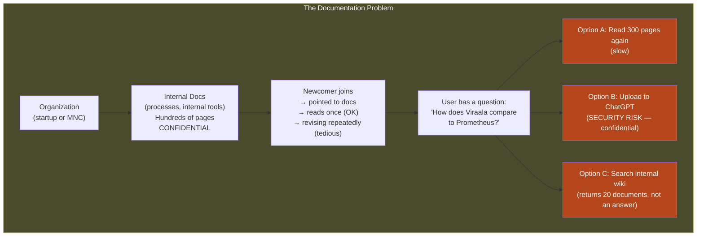
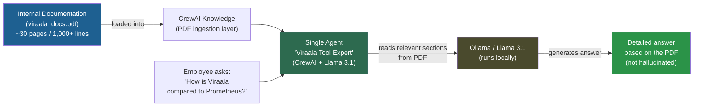
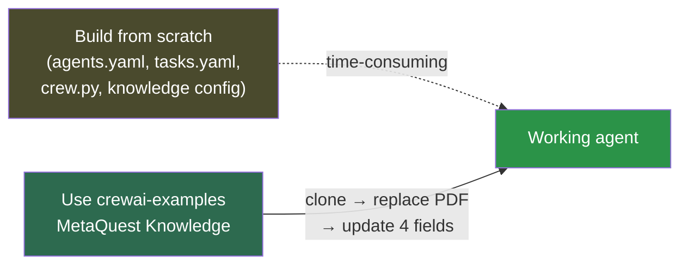
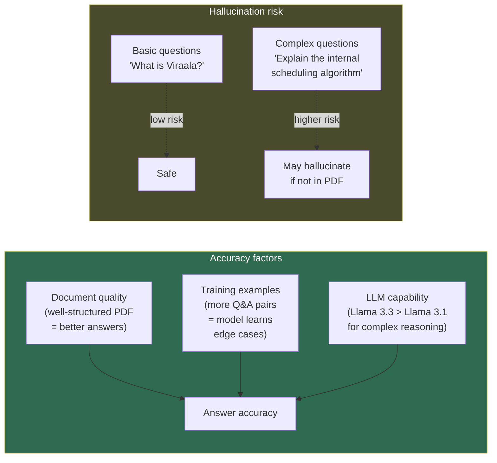

# Day 8: AI Agent for Internal Documentation in 30 Minutes

<details open>
<summary><b>Day 8: AI Agent for Internal Documentation in 30 Minutes (CS46H)</b></summary>

## Table of Contents

- [DAY-8: AI Agent for Internal Documentation](#day-8-ai-agent-for-internal-documentation)
  - [Episode Overview](#episode-overview)
  - [The Problem: Internal Documentation Is Confidential and Hard to Navigate](#the-problem-internal-documentation-is-confidential-and-hard-to-navigate)
  - [The Solution: Single-Agent CrewAI + Local LLM PDF Reader](#the-solution-single-agent-crewai--local-llm-pdf-reader)
  - [Step 1 — Generate the Fake Internal Documentation (PDF)](#step-1--generate-the-fake-internal-documentation-pdf)
    - [Few-Shot Prompt Used](#few-shot-prompt-used)
  - [Step 2 — Environment Setup](#step-2--environment-setup)
  - [Step 3 — Use an Existing CrewAI Example as a Starting Point](#step-3--use-an-existing-crewai-example-as-a-starting-point)
  - [Step 4 — Swap the PDF Document](#step-4--swap-the-pdf-document)
  - [Step 5 — Update `agents.yaml`](#step-5--update-agentsyaml)
  - [Step 6 — Update `tasks.yaml`](#step-6--update-tasksyaml)
  - [Step 7 — Update `main.py`](#step-7--update-mainpy)
  - [Step 8 — Update `crew.py`](#step-8--update-crewpy)
  - [Step 9 — Create the `.env` File (Override to Ollama)](#step-9--create-the-env-file-override-to-ollama)
  - [Step 10 — Install and Run](#step-10--install-and-run)
  - [Demo Results: Questions Answered from the PDF](#demo-results-questions-answered-from-the-pdf)
  - [Accuracy, Hallucination, and Training](#accuracy-hallucination-and-training)
- [Summary](#summary)

---

## DAY-8: AI Agent for Internal Documentation

### Episode Overview

Day 8 builds a real-world AI agent that reads an organization's internal documentation (PDF) and answers employee questions about it — running entirely on a local LLM (Llama 3.1 via Ollama) with zero data leaving the machine.

**The core use case:** Every organization has internal tools and processes documented in hundreds of pages. A new hire is pointed to those docs — but reading them repeatedly for reference is slow, and uploading them to ChatGPT is a security risk. This agent solves both problems.

**What you will build:**
- A single-agent CrewAI project that loads a PDF and answers questions from it
- Based on the `MetaQuest Knowledge` example from the `crewai-examples` GitHub repository
- Modified to use a fictional internal observability tool (Viraala) as the documentation source

**Key differences from Day 7:**
- Day 7: Two agents (researcher + analyst) — research output from LLM's built-in knowledge
- Day 8: One agent — reads a local PDF using CrewAI's knowledge feature; answers only from the document

All project files are in the `day8` folder of the course GitHub repository.

---

### The Problem: Internal Documentation Is Confidential and Hard to Navigate



```diff
! The specific challenge: LLMs know about PUBLIC tools (Kubernetes, Prometheus)
! but know NOTHING about your organization's internal tools (e.g., "Viraala")
!
- Uploading confidential documentation to ChatGPT/OpenAI = data breach risk
- Search returns documents, not answers
- Re-reading hundreds of pages manually is not scalable
!
+ Solution: A local AI agent that:
+   1. Reads the internal PDF documentation
+   2. Uses a local LLM (data never leaves the machine)
+   3. Answers specific questions — not page references, actual explanations
```

**Example scenario from the demo:**
- Internal tool: **Viraala** — a fictional observability platform documented in a 30-page PDF
- Questions the agent answers: "What is Viraala tool?", "How does Viraala compare to Prometheus?"
- ChatGPT knows nothing about Viraala because it was never made public
- The local CrewAI agent knows everything in the PDF and answers directly

---

### The Solution: Single-Agent CrewAI + Local LLM PDF Reader



**Why this architecture works:**
- CrewAI's `knowledge` feature loads the PDF and makes its content available to the agent as a searchable context
- The agent retrieves relevant sections from the PDF and uses the LLM to synthesize a coherent answer
- The LLM runs locally via Ollama — the PDF and all queries stay on-premise
- Single agent is sufficient because the task is focused: read document → answer question

---

### Step 1 — Generate the Fake Internal Documentation (PDF)

For the demo, real internal documentation cannot be used. A fake PDF was generated using ChatGPT with few-shot prompting.

**Why generate it instead of downloading a real PDF?**
- Real internal docs are confidential (the whole point of this episode)
- A publicly available PDF (e.g., Kubernetes docs) would already be in the LLM's knowledge — not a useful test of PDF-reading capability
- A completely fake, proprietary tool (Viraala) ensures the LLM's answers come exclusively from the PDF

#### Few-Shot Prompt Used

```
Context:
I'm working on testing an AI agent that can read the internal
documentation and respond to the queries of the users.

Request:
To help with this, can you generate a fake documentation of an
observability platform called Viraala? Assume this platform is better
than existing platforms like Prometheus because it uses VictoriaMetrics
instead of a time-series database. Add more fake information to the
documentation.

Output format:
PDF format, well-readable, at least 1,000 lines covering metrics,
traces, and logs. Add comparisons as much as possible.

Examples (few-shot):
Documentation should have topics like:
- What is Viraala platform?
- Why Viraala platform is best in the world of observability?
- Viraala vs. Prometheus comparison
```

> [!NOTE]
> **Prompt engineering technique demonstrated:** Few-shot prompting (providing examples) + output format specification + repetition of key requirements. The instructor repeats the important constraints (PDF format, 1,000 lines) to reinforce them — a valid prompt engineering technique.

**Output:** A 30-page PDF titled "Viraala Observability Platform Documentation" covering:
- What is Viraala platform
- Viraala vs. Prometheus comparison
- Deep dive into metrics monitoring
- Traces and log management sections

---

### Step 2 — Environment Setup

```bash
# Verify Python version (must be 3.10–3.13)
python3 --version   # e.g., 3.12

# Verify Ollama and Llama 3.1 are available
ollama list
# If not present:
ollama pull llama3.1

# Create project directory
mkdir docs_agent
cd docs_agent

# Create virtual environment (hidden folder — won't be pushed to Git)
python3 -m venv .ai_sandbox

# Activate virtual environment
source .ai_sandbox/bin/activate   # Linux/macOS

# Install CrewAI
pip3 install crewai
```

> [!NOTE]
> **Hidden virtual environment:** Using `.ai_sandbox` (dot prefix) hides the folder on Unix systems. This is a clean practice — the venv should not be committed to Git, and hiding it reduces visual clutter in the project directory.

---

### Step 3 — Use an Existing CrewAI Example as a Starting Point

**Key insight:** Do not build from scratch when an example already exists.

CrewAI maintains a public repository of example agents at `crewai-examples` on GitHub. The **MetaQuest Knowledge** example is exactly the architecture needed:
- One agent that reads a PDF
- Answers user questions based on the PDF content
- Already has the knowledge ingestion and Q&A flow implemented



```bash
# Go to home directory
cd ~

# Clone the crewai-examples repository
git clone https://github.com/crewAIInc/crewAI-examples.git

# Navigate to the MetaQuest Knowledge example
cd crewAI-examples/MetaQuest_knowledge
```

**Project structure of the MetaQuest Knowledge example:**
```
MetaQuest_knowledge/
├── .env                         ← create this (not in repo)
├── pyproject.toml               ← fix project name if needed
├── README.md
└── src/
    └── metaquest_knowledge/
        ├── config/
        │   ├── agents.yaml      ← update: role, goal, backstory
        │   └── tasks.yaml       ← update: task description
        ├── crew.py              ← update: PDF filename reference
        ├── main.py              ← update: hardcoded question → user input
        └── knowledge/
            └── meta_quest.pdf   ← DELETE and replace with your PDF
```

> [!NOTE]
> **Bug noted by instructor:** The `pyproject.toml` name field may be set to `metaquest_knowledge` while the folder is `MetaQuest_knowledge`. If `crewai install` fails with a name-related error, open `pyproject.toml` and ensure the `name` field matches the actual package directory name exactly (use underscores, lowercase).

---

### Step 4 — Swap the PDF Document

```bash
# Navigate into the knowledge directory
cd src/metaquest_knowledge/knowledge

# Remove the MetaQuest PDF
rm meta_quest.pdf

# Move your generated Viraala PDF into this folder
mv ~/Downloads/viraala_observability_platform_documentation.pdf .

# Verify
ls -ltr
# Should show: viraala_observability_platform_documentation.pdf
```

---

### Step 5 — Update `agents.yaml`

Change the agent identity from MetaQuest Expert to Viraala Tool Expert:

```yaml
# src/metaquest_knowledge/config/agents.yaml

# BEFORE (original MetaQuest agent):
metaquest_expert:
  role: MetaQuest Expert
  goal: Provide the best possible answers to questions about MetaQuest
  backstory: >
    You are a seasoned expert in the world of MetaQuest...

# AFTER (updated for Viraala):
viraala_tool_expert:
  role: Viraala Tool Expert
  goal: Provide the best possible answers to questions about Viraala tool
  backstory: >
    You are a seasoned expert in the world of Viraala observability
    platform. You are known for your ability to provide the best answers
    about the Viraala platform's architecture, features, and comparisons
    with other observability tools.
```

**Important:** The key name (`viraala_tool_expert`) must exactly match how the agent is referenced in `crew.py`. A mismatch causes a `KeyError` at runtime.

---

### Step 6 — Update `tasks.yaml`

The task definition stays largely the same — only update the agent reference:

```yaml
# src/metaquest_knowledge/config/tasks.yaml

answer_question_task:
  description: >
    Answer the user's question with the most relevant information
    from the knowledge source.
  expected_output: >
    A clear, detailed answer to the user's question based on the
    provided documentation.
  agent: viraala_tool_expert   # ← must match the key in agents.yaml
```

> [!IMPORTANT]
> **Common bug:** If you update the agent name in `agents.yaml` but forget to update the `agent:` field in `tasks.yaml`, CrewAI throws a `KeyError: 'viraala_tool_expert'` at runtime. Both files must reference the same agent key name.

---

### Step 7 — Update `main.py`

The MetaQuest example hardcodes the question. Update it to accept dynamic user input:

```python
# BEFORE (MetaQuest original — hardcoded question):
def run():
    inputs = {
        'question': 'How often should I take breaks when using MetaQuest?'
    }
    MetaquestKnowledgeCrew().crew().kickoff(inputs=inputs)

# AFTER (dynamic user input):
def run():
    question = input("Please enter your question: ")
    inputs = {
        'question': question
    }
    MetaquestKnowledgeCrew().crew().kickoff(inputs=inputs)
```

**Training section** — add example questions so the model learns to handle them accurately:

```python
# In main.py train() function — add your domain-specific training questions
def train():
    inputs = {
        'question': 'What is Viraala tool'   # ← add representative questions
    }
    # At enterprise scale: add many questions covering the full scope of the docs
    MetaquestKnowledgeCrew().crew().train(n_iterations=1, filename='training_data', inputs=inputs)
```

> [!NOTE]
> **Training philosophy:** You do not need to train on every possible question. Train on questions where the model gives inaccurate or incomplete answers. Basic questions (e.g., "What is Viraala?") need minimal training; advanced questions about edge cases benefit most from explicit examples.

---

### Step 8 — Update `crew.py`

Reference the Viraala PDF in the knowledge configuration:

```python
# src/metaquest_knowledge/crew.py

from crewai import Agent, Crew, Process, Task, LLM
from crewai.knowledge.source.pdf_knowledge_source import PDFKnowledgeSource

# Update the PDF source to point to the Viraala documentation
pdf_source = PDFKnowledgeSource(
    file_paths=["viraala_observability_platform_documentation.pdf"]
)

@CrewBase
class MetaquestKnowledgeCrew():

    @agent
    def viraala_tool_expert(self) -> Agent:    # ← rename from metaquest_expert
        return Agent(
            config=self.agents_config['viraala_tool_expert'],
            verbose=True
        )

    @task
    def answer_question_task(self) -> Task:
        return Task(
            config=self.tasks_config['answer_question_task'],
        )

    @crew
    def crew(self) -> Crew:
        return Crew(
            agents=self.agents,
            tasks=self.tasks,
            process=Process.sequential,
            knowledge_sources=[pdf_source],   # ← PDF knowledge loaded here
            verbose=True,
        )
```

---

### Step 9 — Create the `.env` File (Override to Ollama)

By default, CrewAI uses OpenAI as the LLM provider. Without a `.env` file, `crewai run` fails with an OpenAI API key error.

```bash
# Create the .env file in the project root (MetaQuest_knowledge/)
# (This file should be in .gitignore — never commit API keys or model config to Git)
```

```ini
# .env file content
MODEL=ollama/llama3.1
API_BASE=http://localhost:11434
```

```diff
! Without this .env file:
- crewai run → "Error: OpenAI API key not found"
- CrewAI defaults to OpenAI even when Ollama was selected at project creation

+ With this .env file:
+ CrewAI routes all LLM calls to your local Ollama instance
+ Port 11434 is Ollama's default HTTP API port
+ Zero cost, zero data exposure — all inference stays on your machine
```

> [!NOTE]
> If you do not have Llama 3.1 already downloaded from Day 3, pull it now: `ollama pull llama3.1`. Verify it is available with `ollama list`.

---

### Step 10 — Install and Run

```bash
# Install uv (if not already installed — required by crewai install)
pip install uv

# Install project dependencies (creates uv.lock)
crewai install

# Run the agent
crewai run
```

**Troubleshooting `crewai install` failure:**

If you see a project name mismatch error:
```bash
# Open pyproject.toml and check the name field
# It must match the actual package directory name (lowercase, underscores)
# Example fix:
# name = "metaquest_knowledge"   ← must match src/metaquest_knowledge/
```

**Expected terminal output during `crewai run`:**
```
Please enter your question: What is Viraala tool?

[Agent: Viraala Tool Expert]
Task: Answer the user's question with the most relevant information...
Status: Executing...

Final Answer:
Viraala tool, also known as Viraala Observability Platform, is a
comprehensive tool designed to provide deep visibility into software
systems. Key features include:
- Unified visibility across metrics, logs, and traces
- Real-time analytics with VictoriaMetrics backend
- Root cause analysis capabilities...
```

---

### Demo Results: Questions Answered from the PDF

**Question 1: "What is Viraala tool?"**
```
Viraala tool, also known as Viraala Observability Platform, is a
comprehensive tool designed to provide deep visibility into software systems.
Features highlighted from the document:
- Unified visibility (metrics, logs, traces in one platform)
- Real-time analytics
- Root cause analysis
[Summarized from the 30-page PDF — not hallucinated]
```

**Question 2: "How is Viraala platform compared to Prometheus?"**
```
Both Viraala and Prometheus are monitoring systems in the cloud-native
environment. However, there are key differences:

Prometheus architecture: [summarized from PDF]
Viraala platform benefits over Prometheus:
- Uses VictoriaMetrics instead of Prometheus's time-series database
- [additional comparisons from the document]
[Detailed comparison synthesized from the PDF content]
```

```diff
+ The agent answered both questions accurately using ONLY the PDF content
+ The LLM had no prior knowledge of "Viraala" — all information came from the document
! Some hallucination may occur — especially for complex or ambiguous questions
! Training on more examples (in main.py train section) improves accuracy
```

---

### Accuracy, Hallucination, and Training



| Question type | Hallucination risk | Training needed |
|--------------|-------------------|-----------------|
| Basic definition ("What is X?") | Low — clearly in PDF | Minimal |
| Feature comparison ("X vs Y?") | Low — covered in doc | Minimal |
| Architectural deep dive | Medium — may extrapolate | Helpful |
| Edge cases not in PDF | High — no source truth | Essential or out-of-scope |

**Enterprise-scale deployment recommendations:**
1. Provide the complete internal documentation (multiple PDFs if needed) — more context = better answers
2. Add at least 10–20 representative training questions covering the common queries from employees
3. Monitor for hallucinations using a test set of questions with known-correct answers
4. For sensitive organizations: verify all answers are grounded in document text before relying on them

---

## Summary

### Key Takeaways

```diff
+ Problem solved: Internal documentation is confidential — cannot use public LLMs
+ Solution: CrewAI + local LLM (Ollama/Llama 3.1) + PDF knowledge source
+ Architecture: Single agent reads PDF, answers questions locally (zero data exposure)
+ Shortcut: Use crewai-examples MetaQuest Knowledge template instead of building from scratch
+ Steps: Clone repo → swap PDF → update agents.yaml → tasks.yaml → main.py → crew.py → .env
+ .env file required: must set MODEL=ollama/llama3.1 and API_BASE=http://localhost:11434
+ main.py: change hardcoded question to input() for dynamic user queries
+ agents.yaml key MUST match tasks.yaml agent reference — mismatch = KeyError
+ pyproject.toml name must match package directory name — mismatch = crewai install failure
+ Training: add representative Q&A examples to main.py train() for better accuracy on edge cases
! Hallucination: local models may extrapolate beyond the PDF — train on problem areas
- Llama 3.1 (4.7B params): some accuracy limitations; use Llama 3.3 for more complex docs
```

### Quick Reference — Complete Setup Steps

```bash
# Prerequisites
python3 --version          # 3.10–3.13
ollama list                # llama3.1 present
# ollama pull llama3.1    # if not present

# Setup
mkdir docs_agent && cd docs_agent
python3 -m venv .ai_sandbox
source .ai_sandbox/bin/activate
pip3 install crewai

# Get the template
git clone https://github.com/crewAIInc/crewAI-examples.git
cd crewAI-examples/MetaQuest_knowledge

# Swap PDF
rm src/metaquest_knowledge/knowledge/meta_quest.pdf
cp ~/Downloads/your_internal_docs.pdf src/metaquest_knowledge/knowledge/

# Edit these 4 files:
#   agents.yaml   → rename agent key and update role/goal/backstory
#   tasks.yaml    → update agent: reference to match agents.yaml key
#   main.py       → change question to input() and update training questions
#   crew.py       → update PDF filename reference and agent method name

# Create .env in project root
echo "MODEL=ollama/llama3.1" > .env
echo "API_BASE=http://localhost:11434" >> .env

# Run
pip install uv
crewai install
crewai run
```

### Quick Reference — Files to Edit vs. Files to Leave Alone

| File | Edit? | What to change |
|------|-------|----------------|
| `knowledge/*.pdf` | Replace | Delete MetaQuest PDF, add your internal doc PDF |
| `config/agents.yaml` | Yes | Agent key name, role, goal, backstory |
| `config/tasks.yaml` | Yes | `agent:` field to match new agent key |
| `main.py` | Yes | Hardcoded question → `input()`; training questions |
| `crew.py` | Yes | PDF filename; agent method name |
| `.env` | Create | `MODEL` and `API_BASE` for Ollama |
| `pyproject.toml` | Fix if broken | `name` field must match package directory |
| `uv.lock` | Never | Auto-generated by `crewai install` |

### Expert Insight

**Real-World Application:**
This pattern is directly production-applicable for any organization. Common real-world deployments: (1) onboarding assistant that answers questions about company policies and processes; (2) internal tool documentation bot (similar to Viraala — an internal observability platform, CI/CD system, or custom API); (3) compliance assistant that answers "Does our process comply with SOC 2 / ISO 27001?" by reading the compliance documentation; (4) incident response playbook assistant — employee asks "What is the runbook for a Kubernetes node failure?" and the agent reads the runbook PDF. In every case, the architecture is identical — only the PDF and the agent backstory change.

**Expert Path:**
1. Run the demo as-is with the Viraala PDF, then ask 5 different questions — note which ones produce accurate answers and which hallucinate
2. Add 3 more training examples in `main.py` for the questions that hallucinated — re-run and compare quality
3. Add a second PDF to the `knowledge_sources` list in `crew.py` (CrewAI supports multiple files) — test whether the agent can cross-reference between two documents
4. Research CrewAI's `PDFKnowledgeSource` vs. `TextFileKnowledgeSource` vs. `JSONKnowledgeSource` — understand which source type best suits each documentation format your organization uses
5. Explore adding a second agent: one agent reads the PDF and extracts relevant sections, a second agent synthesizes and formats the final answer — this improves accuracy at the cost of latency

**Common Pitfalls:**
- **`KeyError` on agent name:** The key in `agents.yaml` (e.g., `viraala_tool_expert:`) must exactly match the method name in `crew.py` (`def viraala_tool_expert(self)`) and the `agent:` value in `tasks.yaml`. Any mismatch causes a `KeyError` at runtime.
- **Forgetting the `.env` file:** Without it, CrewAI attempts to call the OpenAI API and fails with an API key error. The `.env` file is not committed to Git and must be created manually on each machine.
- **Virtual environment not activated:** Running `crewai install` or `crewai run` outside the activated venv causes import errors. Always verify the prompt shows the venv name before running.
- **`pyproject.toml` name mismatch:** If `crewai install` reports a name error, open `pyproject.toml` and ensure `name = "metaquest_knowledge"` matches the actual directory name under `src/`.
- **PDF quality matters:** If the PDF has inconsistent formatting, scanned images (not text), or missing sections, the knowledge source cannot index it properly and answers will be incomplete or incorrect. Use text-based PDFs with clear headings.
- **Ollama not serving:** `crewai run` will hang indefinitely if Ollama is not running. Verify with `ollama list` or `curl http://localhost:11434/api/tags` before running.
- **Using too large a PDF without GPU:** A 300-page PDF with a CPU-only machine will make inference very slow (5–30 minutes per question). Start with a 30-page PDF for initial testing; scale up once the architecture is validated.
- **Not updating both `agents.yaml` AND `tasks.yaml`:** The most common mistake — updating the agent name in `agents.yaml` but leaving the old name in `tasks.yaml`'s `agent:` field. Always update both files together.

**Additional Technical Notes:**
- **CrewAI Knowledge feature vs. traditional RAG:** CrewAI's PDF knowledge source implements a form of Retrieval Augmented Generation (RAG) internally — it chunks the PDF, embeds the chunks, and retrieves relevant ones per query. The developer does not need to manage the embedding model, vector database, or retrieval logic explicitly.
- **Why single agent here (vs. two agents in Day 7)?** Day 7's research task requires generating new information from the LLM's training data — a researcher + analyst split adds value. Day 8's task is purely retrieval-based (find relevant PDF sections + synthesize an answer) — one expert agent is sufficient and reduces latency.
- **`input()` in main.py vs. web interface:** The demo uses a terminal prompt for simplicity. In production, you would replace the `input()` call with a Flask/FastAPI endpoint that accepts HTTP POST requests with the question — making this a deployable internal API service.
- **Training vs. prompting:** The `train()` function in `main.py` fine-tunes the agent's behavior on specific Q&A pairs. This is distinct from the agent's `backstory` (which is a system prompt), and from the PDF content (which is retrieved dynamically). Training is most valuable for teaching the agent HOW to respond (tone, format, depth) rather than WHAT to respond (the PDF handles that).
- **`.ai_sandbox` hidden venv:** Using a dot-prefixed directory name (`.ai_sandbox`) hides it from `ls` on Unix — a clean convention that signals "this is infrastructure, not project code." Add it to `.gitignore` to prevent accidental commits.

> [!IMPORTANT]
> **Transcript Corrections Applied (CS46H pass):**
> - "M andC" → "MNC" (multinational company)
> - "crew aai / crei / QAI" → "CrewAI"
> - "MetaQuest / meta quest / MetaQuest_knowledge" → "MetaQuest" (Meta's VR headset; the CrewAI example name)
> - "Viraala / Vmala / Bala / Vala / vala / VMALa / virala" → "Viraala" (fictional observability tool throughout)
> - "AMA / Ama / Olama / Ola" → "Ollama"
> - "Lama 3.1 / lama / lama pool" → "Llama 3.1 / ollama pull"
> - "chat GPD / chat GPT" → "ChatGPT"
> - "agents.yamel / task.ml / to mill" → "agents.yaml / tasks.yaml / pyproject.toml"
> - "fading document / fade document" → "fake document"
> - "few short prompting" → "few-shot prompting"
> - "prompt engine snaring" → "prompt engineering"
> - "anible" → "Ansible" (configuration management tool analogy)
> - "Venv / vnv" → ".env / venv"
> - "pip 3 install" → "pip3 install"
> - "metaquest_nowledge" → "metaquest_knowledge" (typo in pyproject.toml fix)
> - "open AAI" → "OpenAI"
> - "SRC" → "src"
> - "one open AAI is chargeable" → "OpenAI is chargeable"
> - "ai sandbox" → ".ai_sandbox" (hidden virtual environment folder name)
> - "crewi examples / crew ai examples" → "crewai-examples" (GitHub repository name)

</details>
